<div align="center">
  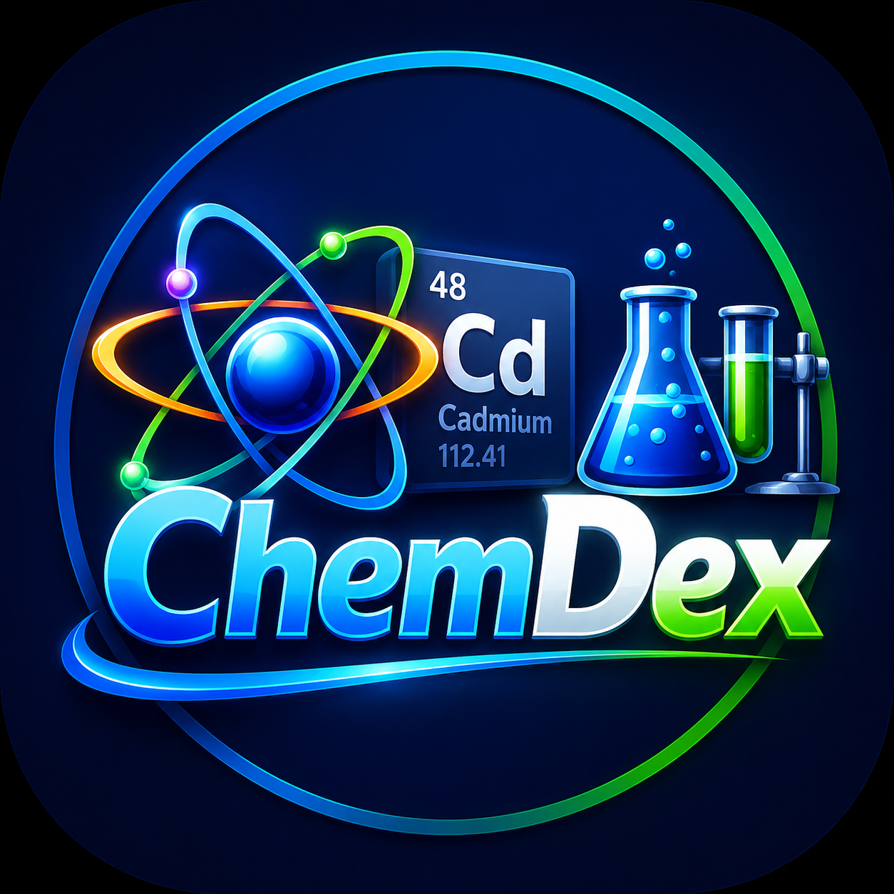
  <h1>ChemDex</h1>
  <p><strong>Tra cứu hóa học · Khám phá cấu trúc · Thực hành mô phỏng · Ôn tập</strong></p>
  <p>Bản tài liệu <strong>2026.11.08</strong> · Node.js <strong>22.x</strong> · <strong>7 ứng dụng con</strong></p>
</div>

ChemDex là nền tảng học hóa học bằng tiếng Việt, kết hợp bảng tuần hoàn 118 nguyên tố, hồ sơ chất, mô hình phân tử, công cụ tính toán, phòng thí nghiệm 2D/3D, huấn luyện an toàn và cộng đồng. Web chính dùng HTML/CSS/JavaScript; các phân hệ React được build riêng và ghép vào cùng website.

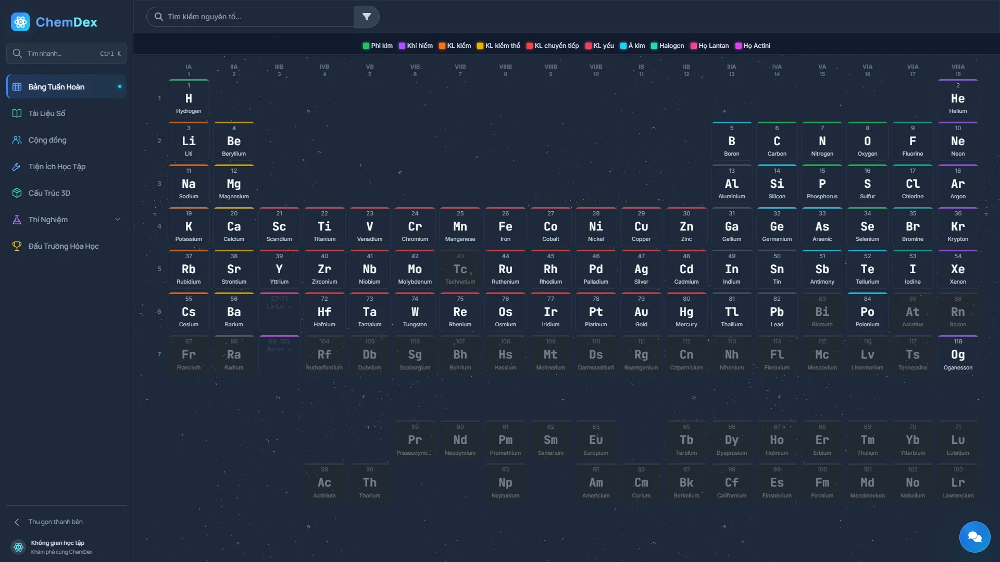

> **Phạm vi phiên bản:** `2026.11.08` là bản tài liệu ngày 08/11/2026. Package gốc chưa khai báo phiên bản ứng dụng chung. Xem [phiên bản từng phân hệ và toàn bộ dependency trực tiếp](docs/VERSIONS.md). Ảnh lấy từ bản build local; số liệu là snapshot dữ liệu trong source tại thời điểm cập nhật.

## Mục lục

- [Chạy nhanh](#chạy-nhanh)
- [Tính năng và giao diện](#tính-năng-và-giao-diện)
- [Danh sách 20 công cụ chuyên biệt](#danh-sách-20-công-cụ-chuyên-biệt)
- [Phiên bản và công nghệ](#phiên-bản-và-công-nghệ)
- [Kiến trúc và thư mục](#kiến-trúc-và-thư-mục)
- [Phát triển, build và cấu hình](#phát-triển-build-và-cấu-hình)
- [API và triển khai](#api-và-triển-khai)
- [Kiểm tra và bảo trì tài liệu](#kiểm-tra-và-bảo-trì-tài-liệu)
- [Dữ liệu, đóng góp và giấy phép](#dữ-liệu-đóng-góp-và-giấy-phép)

## Chạy nhanh

Chạy tại thư mục `ChemDex/`, nơi có `package.json` gốc. Dùng **Node.js 22.x** theo `.nvmrc`; npm dùng bản tương thích đi kèm Node 22.

```sh
npm ci
npm run build
npm run preview
```

Mở **http://127.0.0.1:4173**. Build đầu tiên cần mạng để cài dependency ứng dụng con. `build` sinh catalog/thư viện, build 7 app và tạo output tổng hợp trong `dist/`. `preview` phục vụ output này cùng API local.

Khi chỉ sửa HTML/JS/CSS nền tảng và đã có `dist/` của **tất cả** ứng dụng con:

```sh
npm run build:static
npm run preview
```

`build:static` vẫn tạo lại `dist/` gốc và sinh dữ liệu; nó dùng bản build con hiện có để đóng gói. Sau khi sửa React, build lại phân hệ hoặc build toàn bộ trước khi đóng gói. Không mở HTML qua `file://`: module, JSON và API cần HTTP.

## Tính năng và giao diện

### 1. Bảng tuần hoàn và hồ sơ nguyên tố

**URL:** `/`, `/nguyen-to.html?element=Cu`.

Tra 118 nguyên tố theo tên, ký hiệu và số hiệu; mở hồ sơ có cấu hình electron, tính chất, lịch sử, ứng dụng, mô hình nguyên tử/tinh thể và media tùy nội dung có sẵn. `data/manifest.json` có 118 mục; `data/elements/` hiện có **68 file hồ sơ**, với độ sâu nội dung khác nhau.

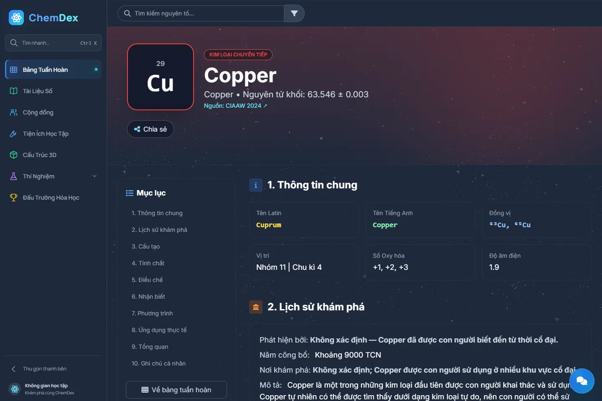

**Source:** `nguyen-to.html`, `js/`, `css/`, `data/`, `shared/elements.json`. Build lấy `nguyen-to.html` làm `dist/index.html`.

### 2. Điều hướng chung và tìm kiếm nhanh

Sidebar kết nối các phân hệ, hỗ trợ thu gọn và menu mobile. Nhấn **Ctrl+K / Cmd+K** hoặc chọn “Tìm nhanh” để tìm nội dung và công cụ từ một chỗ.

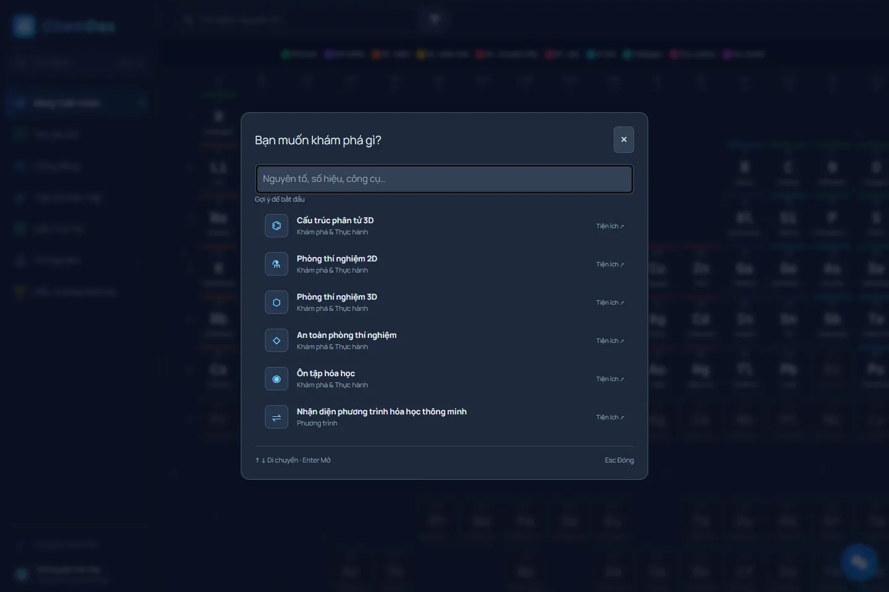

**Source:** `platform/sidebar.js`, `sidebar.css`, `search.js`, `search-index.js`.

### 3. Tiện ích học tập

**URL:** `/tien-ich/`.

Danh mục **25 mục** gồm 20 công cụ chuyên biệt và 5 mục khám phá/thực hành: cấu trúc 3D, Lab 2D, Lab 3D, Lab Safety, ôn tập. Có tìm kiếm, lọc nhóm, ghim yêu thích, cân bằng phương trình nhanh và mở công cụ chuỗi phản ứng.

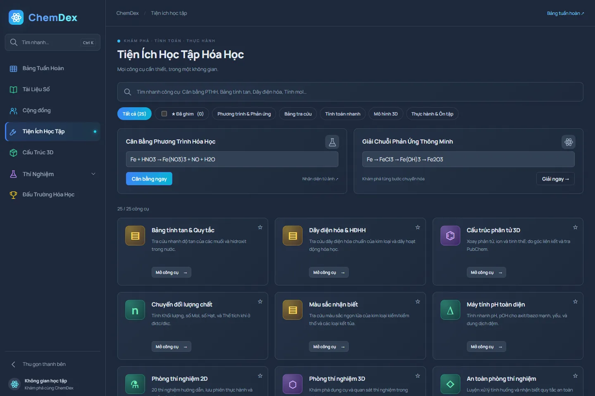

**Source:** `platform/tools.js`, `platform/catalog.js`, `data/features/main.json`, `tien-ich/`.

### 4. Nhận diện phương trình và giải chuỗi phản ứng

**URL:** `/tien-ich/phuong-trinh/nhan-dien-pthh-thong-minh/`, `/tien-ich/phuong-trinh/chuoi-phan-ung/`.

Nhận diện phương trình từ văn bản/ảnh, hỗ trợ OCR và phân tích phản ứng. Công cụ chuỗi nhận các chất nối bằng mũi tên, tra chuyển hóa và điều kiện theo catalog cục bộ. Thao tác có dùng AI cần backend được cấu hình.

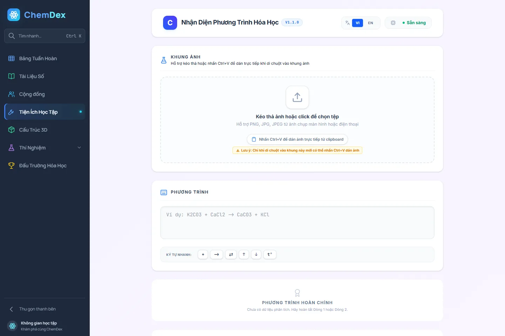

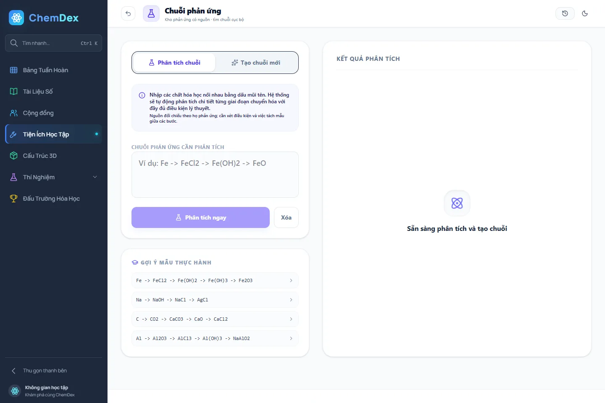

Catalog phiên bản **2** có **1.299 phản ứng**, **378 phương trình ion rút gọn**, **5.740 chuỗi** và **325 loài hóa học**, theo `shared/reaction-data-summary.json`. Số chuỗi là số bản ghi sinh trong catalog; cần xét điều kiện và việc tách mẫu giữa các bước khi diễn giải.

**Source:** hai app trong `tien-ich/phuong-trinh/`, `shared/chemistry/`, `shared/reaction-*.generated.json`, `server/routes/gemini/`.

### 5. Cấu trúc phân tử, ion và tinh thể 3D

**URL:** `/tien-ich/cau-truc-3d/`.

Tìm theo tên, công thức hoặc CID; lọc loại cấu trúc/nhóm chất/chất trong lab. Xoay, phóng to, đổi kiểu cầu–que/que liên kết/cầu đặc, chọn nguyên tử để đo khoảng cách/góc. Có yêu thích, so sánh, tải PNG/SDF/CIF, mở hồ sơ/lab, tra PubChem và tạo mô hình thành phần từ công thức.

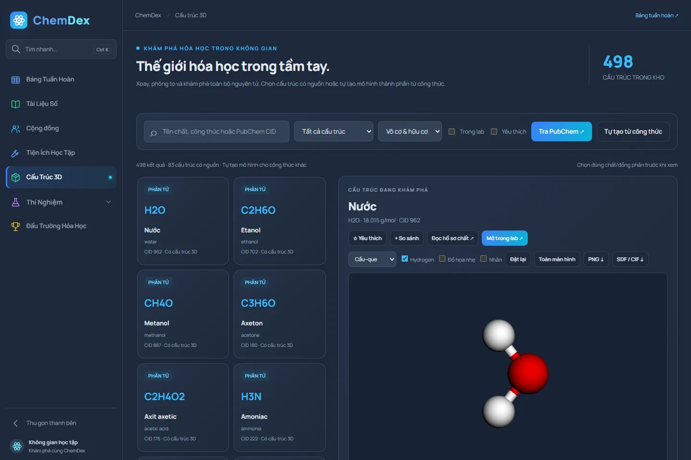

Kho có **498 định danh** trong snapshot, gồm cấu trúc tọa độ có nguồn và mô hình thành phần được sinh. Mô hình thành phần không xác lập hình học phân tử thực nghiệm; viewer ghi nguồn và giới hạn của bản ghi đang xem.

**Source:** `platform/structures.js`, `viewer.js`, `viewer-canvas.js`, `shared/structures/`, `shared/structure-*.json`.

### 6. Phòng thí nghiệm 2D

**URL:** `/lab-2d/`. `/thi-nghiem`, `/thi-nghiem/`, `/thi-nghiem.html` chuyển về đây.

- Bàn thực hành với dụng cụ SVG, hóa chất, định lượng và phép đo.
- **20 thí nghiệm hướng dẫn**, mô phỏng phản ứng, nhiệt và cân bằng theo engine.
- Undo/redo, lưu/khôi phục và xuất/nhập phiên thực hành.
- Báo cáo diễn biến, phương trình, số đo, ghi chú; xuất CSV/JSON và in/lưu PDF bằng trình duyệt.

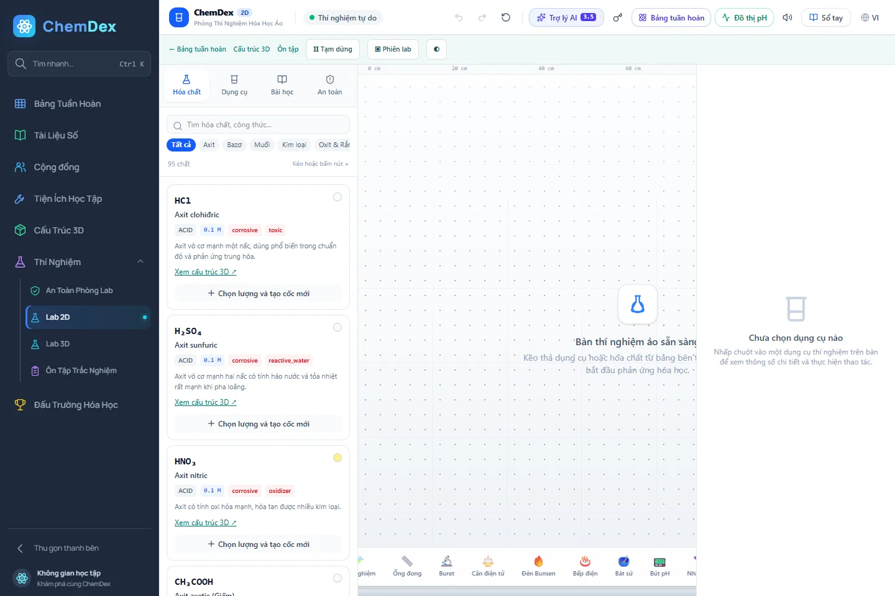

**Source:** `lab-2d/src/components/`, `chemistry/`, `engine/`, `store/`, `services/`. [README Lab 2D](lab-2d/README.md).

### 7. Phòng thí nghiệm 3D

**URL:** `/lab-3d/`. `/lab` và `/lab/*` là đường dẫn tương thích chuyển về Lab 3D.

Chọn/cầm/di chuyển dụng cụ, rót và quan sát chất trong bình; theo dõi nhiệt độ, pH, lượng chất và phản ứng. Có bài hướng dẫn, panel chuẩn độ, báo cáo, thông tin nguy cơ/PPE, camera và mức chất lượng đồ họa. Engine tách logic hóa học, hiện tượng vật lý và VFX.

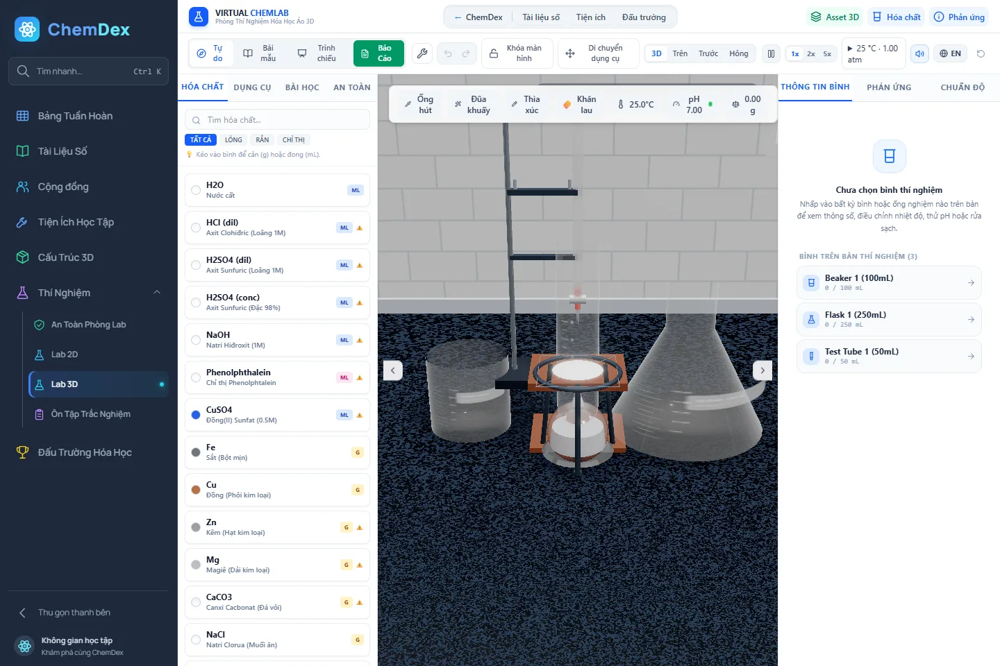

**Source:** `lab-3d/src/`, nổi bật là `components/three/`, `engine/`, `science/`, `sim/`, `simulation/`, `vfx/`, `pour/`, `handling/`. [README Lab 3D](lab-3d/README.md).

### 8. An toàn phòng thí nghiệm và học viện

**URL:** `/lab-safety/`.

Huấn luyện nhận biết nguy cơ và xử lý tình huống trong phòng 3D: bảo hộ cá nhân, tràn đổ, chất thải, cháy và thiết bị an toàn. Màn bắt đầu giới thiệu **5 chặng**, **35 nhiệm vụ thực hành**; học viện có **44 thử thách**. Có hồ sơ nhân vật, quiz, tiến độ, chứng nhận mô phỏng và điều khiển theo thiết bị.

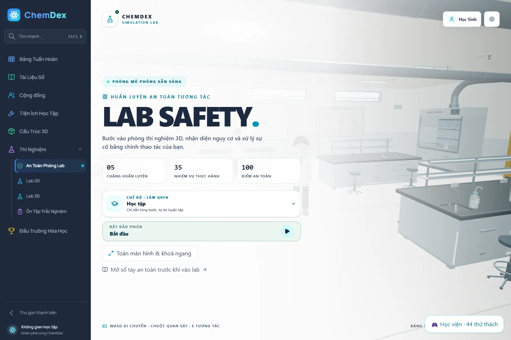

**Source:** `lab-safety/src/academy/`, `core/`, `components/`, `scenarios/`, `systems/`, `store/`. [README Lab Safety](lab-safety/README.md). Nội dung là mô phỏng học tập; thực hành thật cần theo nội quy cơ sở và SDS hóa chất.

### 9. Tài liệu số và hồ sơ chất

**URL:** `/trung-tam/tai-lieu-so/`.

Tìm, lọc và đọc tài liệu/hồ sơ chất, lưu dấu trang và lịch sử đọc. Nội dung có công thức, bảng, dữ liệu nguồn và liên kết sang mô hình/lab. Snapshot coverage ghi **489 tài liệu liên kết với 498 định danh**; nhiều định danh có thể cùng một chất. Có liên kết tài liệu không có nghĩa toàn bộ nội dung đã được đối chiếu khoa học độc lập.

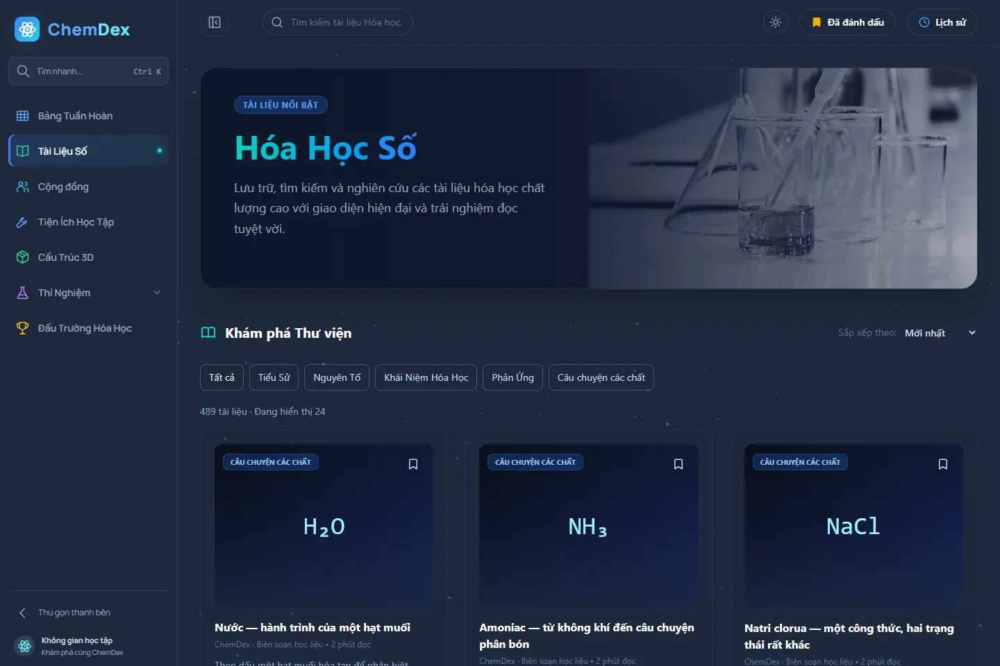

**Source:** `trung-tam/src/pages/TaiLieuSoPage.tsx`, `components/`, `data/`, `utils/`; generator/audit ở `scripts/build-library.mjs`, `shared/library-*.generated.json`.

### 10. Cộng đồng hóa học

**URL:** `/trung-tam/cong-dong/`.

Trao đổi bài tập, chia sẻ nội dung, bài đăng/bình luận và thao tác AI tích hợp. Ghi bài cần đăng nhập và cấu hình Firebase phù hợp; danh sách hiển thị phụ thuộc dữ liệu dịch vụ tại thời điểm truy cập.

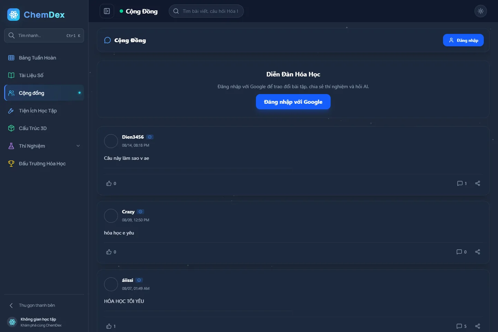

**Source:** `trung-tam/src/community/`, `pages/CongDongPage.tsx`, `server/routes/gemini/community.ts`.

### 11. Ôn tập trắc nghiệm

**URL:** `/on-tap/`.

**60 câu hỏi** về thực hành, nguyên tố và cấu trúc/liên kết. Mỗi câu có giải thích; có lọc câu chưa làm, ôn lại câu sai và lưu tiến độ trên trình duyệt.

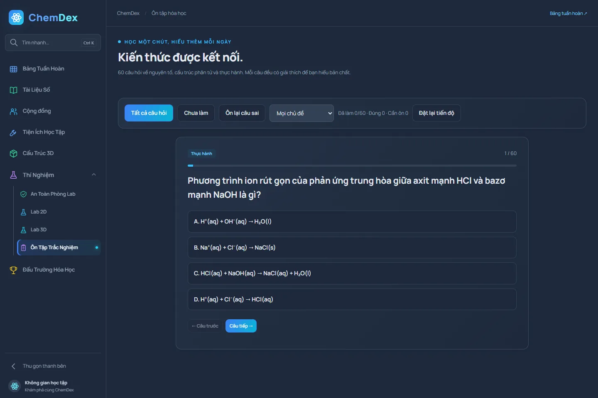

**Source:** `on-tap/index.html`, `platform/study.js`, `shared/study-questions.json`.

### 12. ChemDex Arena

**URL:** `/dau-truong/`.

Đăng nhập hoặc chọn khách để luyện tập. Source có dashboard, tạo/tham gia phòng, lobby/trận đấu realtime, bảng xếp hạng, hồ sơ, lịch sử, thử thách hằng ngày, ôn theo chương và sổ lỗi. Tài khoản/nhiều người chơi phụ thuộc Firebase Auth/Firestore; ảnh dưới là màn vào ứng dụng trước đăng nhập.

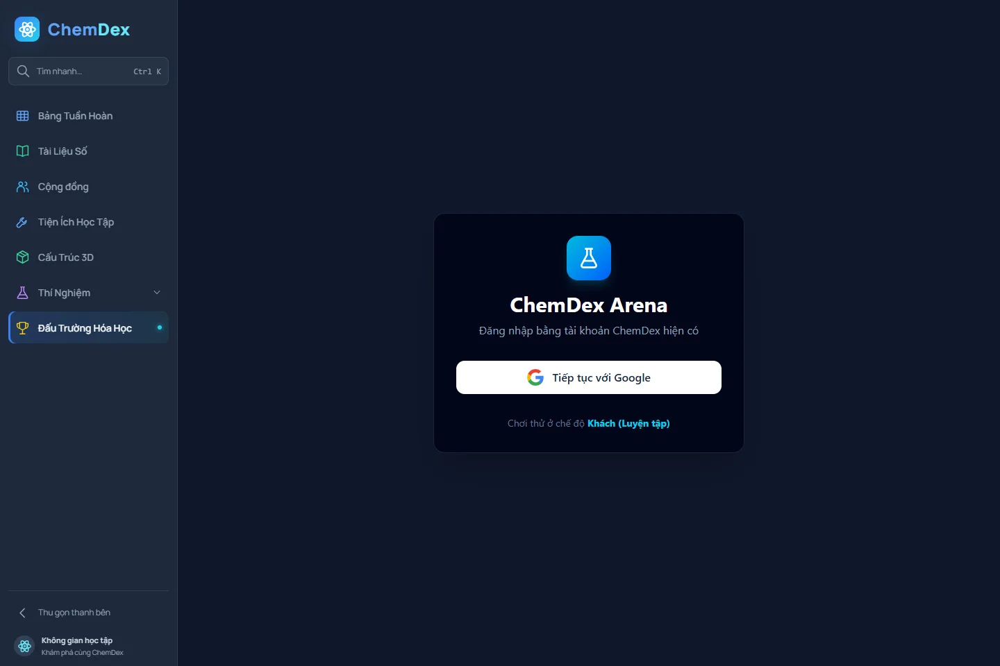

**Source:** `dau-truong/src/pages/`, `games/`, `features/`, `services/`, `store/`. [README Arena](dau-truong/README.md).

### 13. Chatbot theo ngữ cảnh

Chatbot trong trang nguyên tố nhận ngữ cảnh đang xem, gợi ý câu hỏi và gửi tới `/api/gemini/chat/`. Gọi AI cần khóa cấu hình ở server.

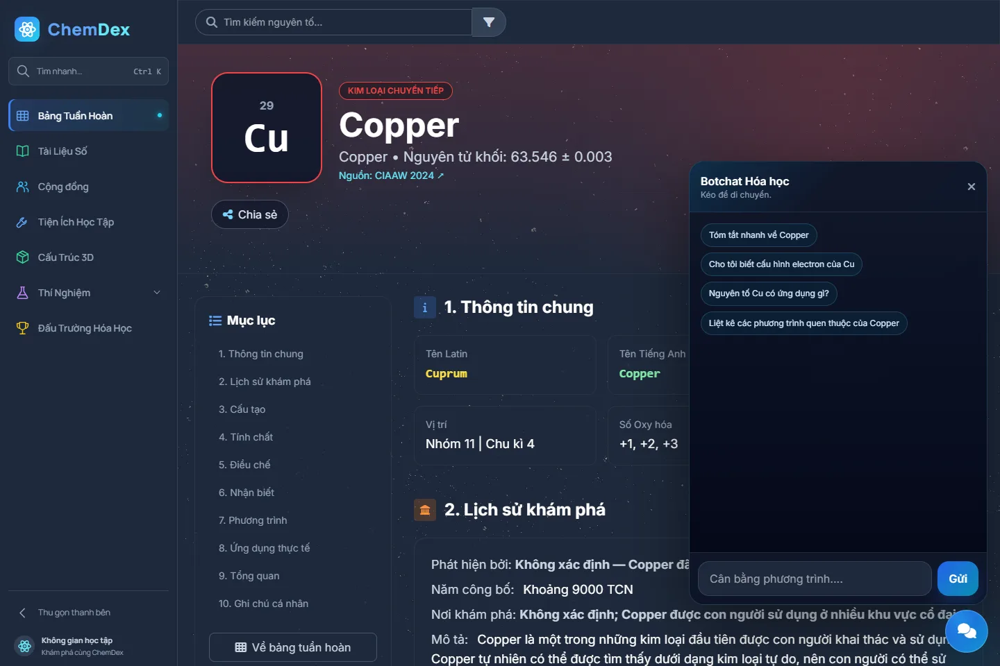

**Source:** `js/chatbot.js`, `data/chatbot-responses.json`, `server/routes/gemini/chat.ts`.

### 14. Biên tập dữ liệu

**URL:** `/data-editor.html`, `/edit.html`.

Visual CMS cho phép chọn nguyên tố, chỉnh trực quan hoặc JSON, xem trước, quản lý draft/diff và nhập/xuất dữ liệu. `edit.html` nhập object để dựng giao diện; `data-editor.html` là editor đầy đủ. Lưu cloud phụ thuộc tài khoản và quyền Firebase.

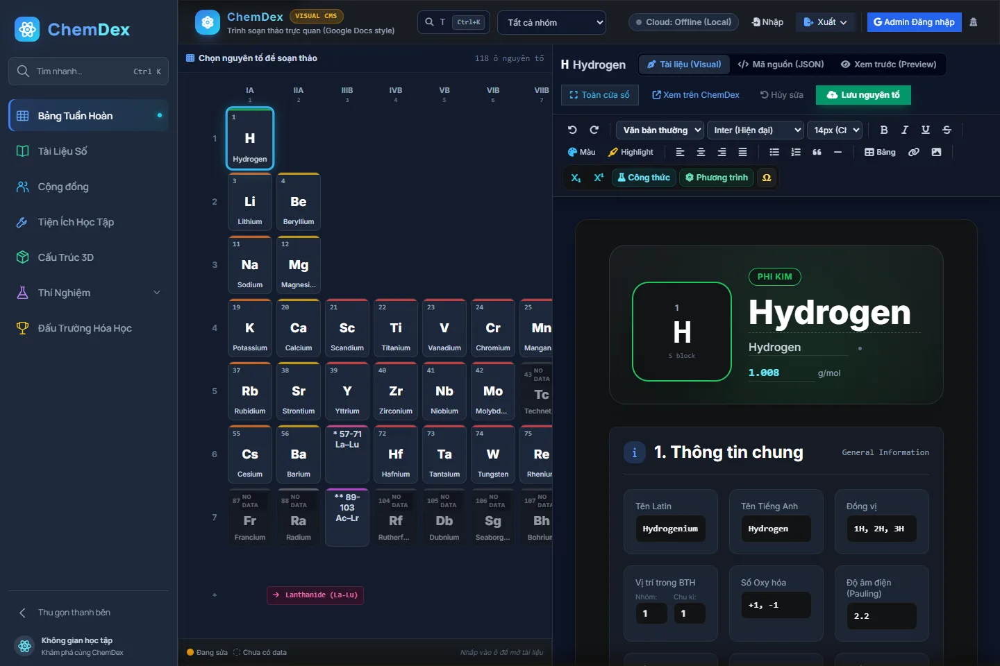

**Source:** `data-editor.html`, `edit.html`, `js/data-editor.js`, `js/data-editor/`.

## Danh sách 20 công cụ chuyên biệt

Các folder dưới đây nằm trong `tien-ich/`, có URL cùng cấu trúc. Mỗi công cụ có liên kết ảnh giao diện riêng.

| Nhóm | Công cụ / folder | Công dụng | Ảnh |
| --- | --- | --- | --- |
| Phương trình | `phuong-trinh/nhan-dien-pthh-thong-minh/` | Nhập text/ảnh, OCR và phân tích PTHH | [Xem](docs/images/nhan-dien-pthh-thong-minh.webp) |
| Phương trình | `phuong-trinh/chuoi-phan-ung/` | Tra chuỗi chuyển hóa và điều kiện | [Xem](docs/images/chuoi-phan-ung.webp) |
| Phương trình | `phuong-trinh/so-oxi-hoa/` | Xác định số oxi hóa | [Xem](docs/images/so-oxi-hoa.webp) |
| Phương trình | `phuong-trinh/phuong-trinh-ion-rut-gon/` | Lập phương trình ion rút gọn | [Xem](docs/images/phuong-trinh-ion-rut-gon.webp) |
| Phương trình | `phuong-trinh/tinh-theo-phuong-trinh/` | Tính theo hệ số PTHH | [Xem](docs/images/tinh-theo-phuong-trinh.webp) |
| Đại cương | `dai-cuong/chuyen-doi-luong-chat/` | Đổi mol, khối lượng, thể tích, số hạt | [Xem](docs/images/chuyen-doi-luong-chat.webp) |
| Đại cương | `dai-cuong/tinh-toan-dung-dich/` | Tính các đại lượng dung dịch | [Xem](docs/images/tinh-toan-dung-dich.webp) |
| Đại cương | `dai-cuong/hieu-suat-phan-ung/` | Hiệu suất và chất giới hạn | [Xem](docs/images/hieu-suat-phan-ung.webp) |
| Hóa lý | `hoa-ly/tinh-ph/` | Tính pH | [Xem](docs/images/tinh-ph.webp) |
| Hóa lý | `hoa-ly/can-bang-hoa-hoc/` | Kc, Kp và cân bằng | [Xem](docs/images/can-bang-hoa-hoc.webp) |
| Hóa lý | `hoa-ly/nhiet-dong-luc-hoc/` | Đại lượng nhiệt động | [Xem](docs/images/nhiet-dong-luc-hoc.webp) |
| Hóa lý | `hoa-ly/dong-hoa-hoc/` | Tốc độ và động học | [Xem](docs/images/dong-hoa-hoc.webp) |
| Hóa lý | `hoa-ly/dien-hoa-hoc/` | Phương trình Nernst | [Xem](docs/images/dien-hoa-hoc.webp) |
| Hóa lý | `hoa-ly/quang-pho/` | Định luật Beer–Lambert | [Xem](docs/images/quang-pho.webp) |
| Tra cứu | `tra-cuu/tinh-tan/` | Bảng tính tan | [Xem](docs/images/tinh-tan.webp) |
| Tra cứu | `tra-cuu/day-dien-hoa/` | Dãy điện hóa/hoạt động hóa học | [Xem](docs/images/day-dien-hoa.webp) |
| Tra cứu | `tra-cuu/mau-sac-nhan-biet/` | Màu sắc và dấu hiệu nhận biết | [Xem](docs/images/mau-sac-nhan-biet.webp) |
| Tra cứu | `tra-cuu/danh-phap-huu-co/` | Danh pháp hữu cơ | [Xem](docs/images/danh-phap-huu-co.webp) |
| Tra cứu | `tra-cuu/dieu-kien-phan-ung/` | Điều kiện phản ứng | [Xem](docs/images/dieu-kien-phan-ung.webp) |
| Tra cứu | `tra-cuu/doc-danh-phap/` | Đọc danh pháp, có hỗ trợ AI | [Xem](docs/images/doc-danh-phap.webp) |

## Phiên bản và công nghệ

Phiên bản lấy từ **lockfile từng phân hệ**, không suy ra từ khoảng `^`/`~` trong manifest.

| Phân hệ | Version package | React | Vite | TypeScript | Tailwind CSS | Three.js |
| --- | --- | --- | --- | --- | --- | --- |
| Web chính / API | Chưa khai báo | — | — | 5.9.3 | 3.4.19 | 0.165.0 |
| Lab 2D | 1.0.0 | 19.3.0 | 6.4.4 | 5.8.3 | 4.3.3 | — |
| Lab 3D | 0.0.0 | 19.2.7 | 6.4.3 | 5.8.3 | 4.3.2 | 0.185.1 |
| Lab Safety | 0.0.0 | 19.3.0 | 6.4.4 | 5.8.3 | 4.3.3 | 0.185.1 |
| Trung tâm | 0.0.0 | 19.2.8 | 6.4.3 | 5.8.3 | 4.3.3 | — |
| Đấu trường | 1.0.0 | 19.2.8 | 6.4.3 | 5.8.3 | 4.3.3 | — |
| Nhận diện PTHH | 0.0.0 | 19.2.8 | 6.4.3 | 5.8.3 | 4.3.3 | — |
| Chuỗi phản ứng | 0.0.0 | 19.2.8 | 6.4.3 | 5.8.3 | 4.3.3 | — |

Web gốc còn khóa **3Dmol.js 2.5.5**, **esbuild 0.28.2**, **Playwright 1.64.1**, **Google GenAI 1.52.0**. Các app con có dependency riêng: React Three Fiber/Drei, Zustand, Firebase, KaTeX, Motion, Recharts, Tesseract tùy chức năng. [VERSIONS.md](docs/VERSIONS.md) liệt kê **toàn bộ dependency trực tiếp**, nhóm runtime/dev, khoảng khai báo và phiên bản khóa. Nhãn UI cũ có thể khác `package.json`; các package `0.0.0`/`react-example` vẫn giữ tên/phiên bản mẫu trong source.

## Kiến trúc và thư mục

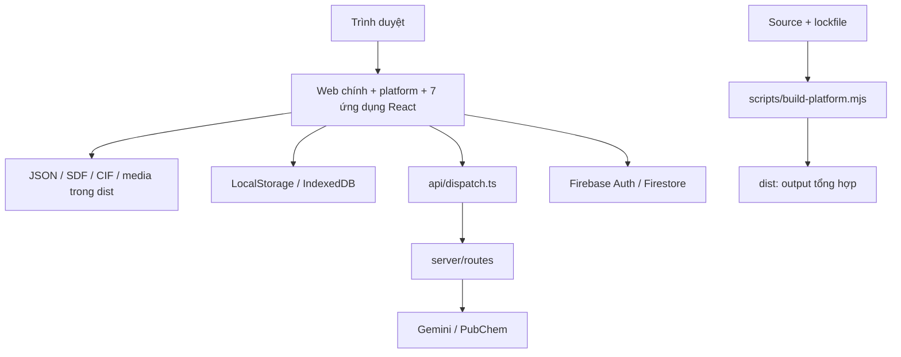

| Folder | Dùng làm gì? |
| --- | --- |
| `api/`, `server/` | Entry API và xử lý phía server |
| `platform/` | Sidebar, tìm nhanh, tiện ích, viewer cấu trúc, ôn tập |
| `js/`, `css/` | Bảng tuần hoàn, hồ sơ, chatbot và editor |
| `data/` | Manifest, nội dung nguyên tố và danh mục tính năng |
| `shared/` | Dữ liệu/thuật toán hóa học, cấu trúc, catalog dùng chung |
| `assets/` | Ảnh, mô hình, âm thanh, font, icon, texture |
| `tien-ich/`, `on-tap/` | Công cụ chuyên biệt, cấu trúc 3D và ôn tập |
| `lab-2d/` | Ứng dụng thí nghiệm SVG 2D |
| `lab-3d/` | Ứng dụng thí nghiệm 3D, engine khoa học và VFX |
| `lab-safety/` | Huấn luyện an toàn 3D và học viện |
| `trung-tam/` | Tài liệu số và cộng đồng |
| `dau-truong/` | Luyện tập, phòng đấu, hồ sơ và tiến độ |
| `scripts/` | Build, preview, sinh/audit dữ liệu, công cụ tài liệu |
| `tests/` | Node tests và Playwright tests nền tảng |
| `docs/` | Tài liệu và ảnh minh họa |
| `Các nguyên tố hóa học trong bảng tuần hoàn/` | Tư liệu nội dung theo nguyên tố còn lưu trong source |
| `dist/`, `node_modules/`, `.cache/`, `artifacts/` | Output, dependency, cache và kết quả kiểm tra |

**[SOURCE_MAP.md](docs/SOURCE_MAP.md)** giải thích chi tiết từng folder con, file entry/config, nơi sửa từng chức năng và các thư mục được sinh tự động. Người mới đọc source nên bắt đầu từ tài liệu này.

## Phát triển, build và cấu hình

### Làm việc với một phân hệ

Mỗi app có manifest/lockfile riêng, không dùng npm workspace chung. `npm ci` ở gốc chỉ cài dependency gốc. Build nền tảng cài app con khi thiếu `node_modules`; trong CI luôn chạy `npm ci` cho app con.

```sh
# Ví dụ phát triển Lab 2D
npm --prefix lab-2d ci
npm --prefix lab-2d run dev
```

Lab 2D dùng cổng `5174`, base `/lab-2d/`. Lab 3D có server development riêng cổng `6767`; Lab Safety mặc định cổng `3000`. Các app có thể trùng cổng, nên chạy riêng hoặc đổi cấu hình. Dùng preview tổng hợp `4173` để kiểm tra liên kết và API liên phân hệ.

| Lệnh tại gốc | Tác dụng |
| --- | --- |
| `npm run build` | Build và ghép toàn bộ nền tảng |
| `npm run build:static` / `npm run copy` | Đóng gói từ bản build con đã có |
| `npm run build-lab-2d` | Build Lab 2D; cài dependency trước |
| `npm run build-lab`, `npm run build-safety` | `npm ci` và build Lab 3D / Safety |
| `npm run build-trung-tam`, `npm run build-dau-truong` | `npm ci` và build trung tâm / Arena |
| `npm run build-pthh`, `npm run build-chuoi-phan-ung` | `npm ci` và build hai app phương trình |
| `npm run dev-lab`, `npm run dev-safety` | Development Lab 3D / Safety sau khi cài dependency |
| `npm run preview` | Phục vụ `dist/` và API local |

### Biến môi trường

| Biến | Ý nghĩa |
| --- | --- |
| `GEMINI_API_KEY` hoặc `GOOGLE_API_KEY` | Khóa AI phía server |
| `GEMINI_MODEL` | Chọn model trong handler có hỗ trợ; xem mặc định/fallback trong source |
| `CHEMDEX_RELEASE_SHA` / `VERCEL_GIT_COMMIT_SHA` | Nhãn commit trong `/api/health` |
| `PORT` | Cổng preview, mặc định `4173`; server riêng có mặc định riêng |
| `VITE_FIREBASE_*` | Cấu hình client Arena; xem `.env.example` của phân hệ |
| `CHEMDEX_TEST_URL` | URL để browser test dùng server đã có |

`scripts/preview.mjs` đọc biến process và **không tự nạp `.env`**. Với Node 22, dùng file local đã điền cấu hình:

```sh
node --env-file=.env.local scripts/preview.mjs
```

Tạo `.env.local` tại máy và chỉ điền biến cần dùng. Không đặt khóa Gemini vào `VITE_*`. Firebase của trung tâm/phân hệ có thể dùng file config/applet riêng: kiểm tra `services/`, `lib/`, `utils/` trước khi đổi môi trường. Tài khoản, Firestore rules và dữ liệu dịch vụ được cấu hình riêng với source.

## API và triển khai

Entry production: `api/dispatch.ts`; handler: `server/routes/`.

| Nhóm API | Công dụng |
| --- | --- |
| `/api/health` | Trạng thái, thời gian, release SHA |
| `/api/chemistry/search`, `/api/chemistry/structure` | Tìm kiếm/lấy cấu trúc PubChem |
| `/api/experiment/mix`, `/api/experiment/ai-query` | Phản ứng và hỗ trợ AI |
| `/api/gemini/{chat,chain,generate,verify,community}` | Các endpoint chat, chuỗi, sinh/kiểm tra nội dung, cộng đồng |
| `/api/generate-questions`, `/api/feedback` | Tạo câu hỏi, phản hồi |

Vercel: **Root Directory `ChemDex`**, **Node 22**, **Build Command `npm run build`**, **Output Directory `dist`**. `vercel.json` khai báo redirect lab, rewrite API và fallback hai route trung tâm. Host tĩnh chỉ phục vụ `dist` cần bổ sung API/rewrite tương ứng để dùng các tính năng dịch vụ.

Server riêng có thể có API development bổ sung; endpoint trong `server.ts` không mặc nhiên được đăng ký ở dispatcher production. Xem [hướng dẫn nền tảng](docs/PLATFORM_UPGRADE.md), [xác nhận release](docs/RELEASE_VALIDATION.md).

## Kiểm tra và bảo trì tài liệu

Chọn lệnh phù hợp phần thay đổi; không có `npm test` tổng hợp tại gốc.

```sh
npm run lint:api
npm run test:platform
npm run test:reactions
npm run library:audit
npm run catalog:audit
npm --prefix lab-2d test
npm --prefix lab-3d test
npm --prefix lab-safety test
npm --prefix lab-safety run test:practical
npm --prefix dau-truong run data:check
npm --prefix dau-truong test
```

Browser tests cần output đã build và browser Playwright. Cấu hình có Chromium, Firefox, WebKit và Edge trên Windows:

```sh
npx playwright install chromium firefox webkit
npm run test:browser -- --project=chromium
# Hoặc chạy toàn bộ project đã cài:
npm run test:browser
```

Playwright tự khởi động preview nếu chưa chỉ định URL khác. Quy trình và giới hạn kiểm thử: [PLATFORM_UPGRADE.md](docs/PLATFORM_UPGRADE.md), [RELEASE_VALIDATION.md](docs/RELEASE_VALIDATION.md).

Cập nhật phiên bản và ảnh:

```sh
node scripts/generate-readme-versions.mjs 2026-11-08
# Khi preview đang chạy, dùng terminal khác:
node scripts/capture-readme.mjs
```

Đổi ngày chốt khi tạo snapshot mới. Script chụp dùng Edge headless trên Windows, Chromium trên hệ khác; viewport **1440 × 960**, riêng bảng tuần hoàn **1920 × 1080** để hiển thị đủ các cột, xuất WebP ở `docs/images/`. Có thể chụp riêng bằng `node scripts/capture-readme.mjs periodic chatbot`. Đổi server bằng `CHEMDEX_SCREENSHOT_URL`. [Manifest ảnh](docs/images/manifest.json) ghi URL, kích thước và thời điểm chụp. Ảnh ở trạng thái chưa đăng nhập; nội dung cộng đồng có thể thay đổi. Khi đổi dependency, sinh lại [VERSIONS.md](docs/VERSIONS.md) và đồng bộ bảng tóm tắt README.

## Dữ liệu, đóng góp và giấy phép

- Nguồn/attribution nằm trong JSON và [ghi chú dữ liệu](docs/PLATFORM_UPGRADE.md). Cần phân biệt tọa độ tham chiếu, ô mạng lý tưởng và mô hình thành phần khi dùng kết quả.
- Sửa dataset tại nguồn rồi chạy generator/audit liên quan; không sửa riêng output build.
- Quy ước Git: làm việc trên `main`; ChemDex và DkTest dùng chung repo Git cha. Chỉ stage file thuộc tác vụ.
- Repo hiện chưa có file `LICENSE` cấp dự án để xác nhận giấy phép chung. Thư viện/dataset có giấy phép riêng; build đưa attribution được cấu hình vào `dist/licenses/`.

| Tài liệu | Nội dung |
| --- | --- |
| [SOURCE_MAP.md](docs/SOURCE_MAP.md) | Bản đồ folder/file và hướng dẫn đọc source |
| [VERSIONS.md](docs/VERSIONS.md) | Version ứng dụng và toàn bộ dependency trực tiếp |
| [PLATFORM_UPGRADE.md](docs/PLATFORM_UPGRADE.md) | Build, route, dữ liệu, phiên lab, kiểm thử |
| [MAIN_WEB_UPGRADE.md](docs/MAIN_WEB_UPGRADE.md) | Giao diện web chính và tiện ích |
| [library-dossiers.vi.md](docs/library-dossiers.vi.md) | Hồ sơ chất và liên kết thư viện |
| [restored-ui-and-structures.vi.md](docs/restored-ui-and-structures.vi.md) | Giao diện và cấu trúc |
| [RELEASE_VALIDATION.md](docs/RELEASE_VALIDATION.md) | Xác nhận bản triển khai |
| [CONTRIBUTING.md](docs/CONTRIBUTING.md) | Hướng dẫn đóng góp |

Các tài liệu kiến trúc/setup/deployment cũ trong `docs/` ghi lại giai đoạn trước, có thể còn mô tả server `5500` hoặc số app cũ. Với checkout hiện tại, ưu tiên README này, scripts trong `package.json` và cấu hình build/deploy thực tế.
