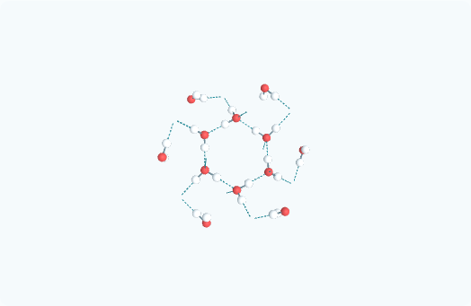

# Mạng hydrogen của Băng II

Mô hình nước trước đây chỉ có thanh O–H trong từng phân tử. Bản sửa thêm nét đứt H···O để nhìn được mạng giữa các phân tử, có nút ẩn/hiện riêng. Pha vẫn ghi rõ **Băng II, −75 °C, 0,3 GPa**, theo AMCSD 0018367, Kamb (1964); không dùng pha này để mô tả nước lỏng hoặc băng Ih ở áp suất thường.

Nét đứt là lớp hiển thị tính từ tọa độ nguồn, dùng quy ước hình học tham khảo của [MDAnalysis](https://docs.mdanalysis.org/stable/documentation_pages/analysis/hydrogenbonds.html): O–H ≤ 1,2 Å, O···O ≤ 3,0 Å, góc O–H···O ≥ 150°. Chỉ áp dụng cho tinh thể thuần H₂O có vị trí đầy: mỗi H phải xác định được duy nhất một O cho, mỗi O phải có đúng hai H. Không dùng quy tắc này để tự gán liên kết cho chất khác, hydrate, mô hình thiếu H hoặc H mất trật tự. Đây là tiêu chí đọc hình, không phải định nghĩa tổng quát hay phép chứng minh liên kết hydrogen.

Rà 306 cấu trúc: chỉ `chat-ice-ii` được thêm lớp này. Từ tọa độ trong ô cơ sở có 24 tiếp xúc định hướng; mỗi O cho hai và nhận hai. Khi sao chép và cắt tại biên, hình một ô có 42 đoạn nhìn thấy. Hai con số đếm các đối tượng khác nhau. Khoảng O···O tính được 2,766–2,830 Å, góc O–H···O 177,75–179,24°. CIF và JSON nguồn không thay đổi byte nào; xem `network-audit.json`.

Lớp nét đứt dùng một `InstancedMesh`, tự ẩn theo H/O và theo nút ẩn nguyên tử. Nút ẩn thanh liền và nút ẩn nét đứt độc lập; lựa chọn được giữ khi chuyển 1 ô / 2 × 2 × 2 ô. Nền sáng, khung ô mạng và cảnh trưng bày tiếp tục tắt mặc định. GLB tải về và PNG xem trước đã tạo lại cho pha bị ảnh hưởng.

Kiểm tra đã chạy:

- `npm run test:crystals`: 10/10, gồm kiểm tra CIF bằng Gemmi, số phối trí, ô xiên, biên tuần hoàn, góc cho–H–nhận và các trường hợp phải từ chối suy diễn.
- Playwright `crystal-display.spec.mjs --project=chromium`: 4/4; nút ẩn/hiện, ẩn nguyên tố, giữ trạng thái sau lặp ô, chọn nguyên tử, kéo qua nhiều cực, cảm ứng trên hơn 6.000 vị trí với dưới 60 lượt vẽ.
- Build thư viện và `npm run build:static`: thành công.
- PNG và GLB mới được render lại bằng Chromium WebGL, không có lỗi; đã xem ảnh kết quả. Các kiểm tra cảm ứng dùng giả lập Chromium, không phải phép đo FPS trên điện thoại thật.



Tạo lại đúng một pha mà không viết lại toàn bộ tài sản:

```powershell
node scripts/generate-crystal-assets.mjs --substances --id=chat-ice-ii --report-dir=docs/ice-hydrogen-network/2026-11-13
node scripts/render-mineral-previews.mjs --substances --crystals --id=chat-ice-ii --report-dir=docs/ice-hydrogen-network/2026-11-13
```
