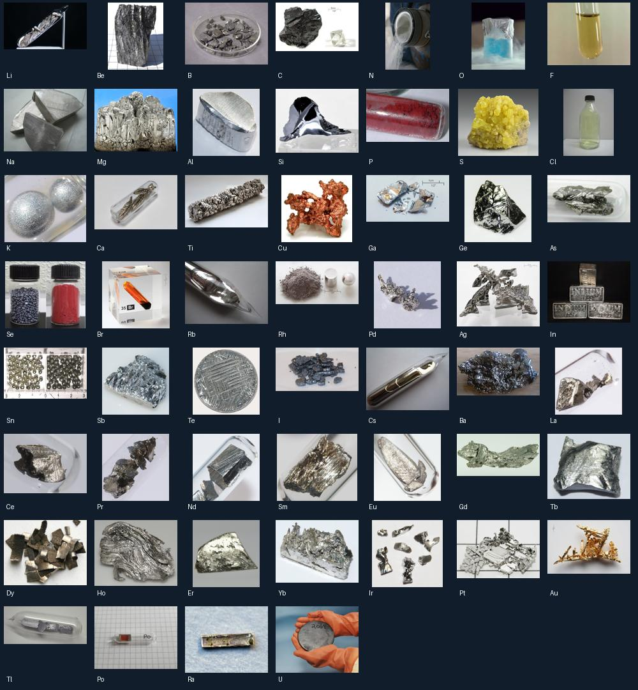
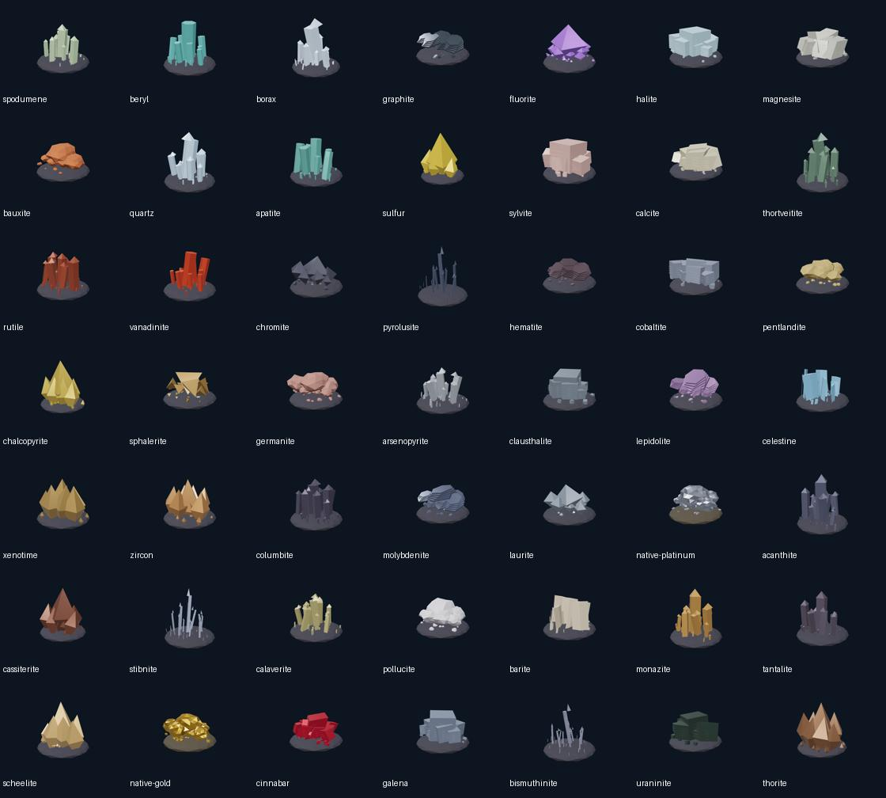

# Kiểm duyệt toàn bộ bảng tuần hoàn ChemDex

Ngày đối chiếu: **11/11/2026**, múi giờ người dùng Asia/Saigon. Cập nhật đè toàn bộ **118 hồ sơ** từ **118 file Word**, gồm **11.426 đoạn**. Trước thay đổi có 68 hồ sơ, sau thay đổi có 118; cả 68 hồ sơ cũ được nhập lại.

Điểm vào: [changelog chi tiết](CHANGELOG.md), [nhật ký thao tác](OPERATIONS.md), [kiểm tra dữ liệu](validation.json), [kiểm tra trình duyệt](browser-tests.json), [kiểm tra render 3D](model-render-verification.json), [manifest thay đổi file](change-manifest.json).

## Kết quả và cách đọc

- 122 quyết định biên tập theo đúng số đoạn trong bản nguồn; đây là số quyết định sửa/loại/diễn giải, không phải số lỗi khoa học độc lập.
- 1,110 vị trí phương trình được kiểm tra lại, gồm 866 chuỗi phương trình khác nhau sau chuẩn hóa. Các phần điều chế/nhận biết/tính chất có thể lặp lại cùng phản ứng.
- Phân loại: 871 hóa học, 172 hạt nhân, 16 quá trình vật lý, 51 sơ đồ ion/hệ số hình thức hoặc dự đoán.
- 523 bản ghi đồng vị chọn lọc. Bỏ việc công bố chu kỳ bán rã như số đo đã xác nhận khi không có bản ghi đối chiếu; nguồn và giới hạn được ghi ở từng nguyên tố.
- 53 ảnh tham chiếu có trang nguồn/tác giả/giấy phép; 118 sơ đồ định danh tự dựng. Khi ảnh chưa được xác minh hoặc giấy phép không phù hợp, website dùng sơ đồ có nhãn.
- 49 mô hình hình thái khoáng vật GLB và 49 ảnh render, liên kết với 79 nguyên tố. 39 nguyên tố còn lại có lý do không dựng quặng riêng. Một khoáng vật có thể liên quan tới nhiều nguyên tố; phần mô tả phân biệt nguyên tố chính với nguyên tố vết/thay thế/sản phẩm phân rã.
- JSON audit từng file lưu đầy đủ cặp giá trị trước/sau của 4139 trường hồ sơ. Markdown audit ghi các phát hiện, lý do xử lý, đối chiếu đồng vị, phương trình và nguồn.

## Phạm vi xác minh

Đã đọc toàn bộ văn bản OOXML theo thứ tự đoạn, kể cả các đoạn trong bảng. Bộ nguồn không có phương trình OMML hoặc phần chú thích/đầu trang/chân trang riêng cần trích bổ sung. Không thay đổi DOCX gốc. Văn bản nguồn được xử lý như dữ liệu, không như chỉ dẫn thực thi.

Đã đối chiếu dữ liệu nền với CIAAW, RSC, PubChem, NIST và IAEA; có các nguồn nghiên cứu riêng cho trường hợp cần sửa. Không coi bảo toàn nguyên tử/điện tích/số khối là bằng chứng phản ứng xảy ra. Điều kiện định tính là biên tập theo phản ứng và ngữ cảnh; không tự tạo thông số nhiệt độ/áp suất số để hợp thức hóa phản ứng thiếu cơ sở.

Mô hình 3D là hình học minh họa hình thái, màu gần đúng, không theo tỉ lệ; không phải ảnh quét mẫu thật hay tọa độ tinh thể thực nghiệm. Không dựng quặng giả cho nguyên tố nhân tạo. Bảng đồng vị là danh sách chọn lọc, không phải danh mục mọi đồng vị đã biết.

## Kiểm tra

- Kiểm tra dữ liệu: PASS — 118 hồ sơ, 1.110 vị trí phương trình, 523 bản ghi đồng vị, SHA-256 bản nguồn, tổng electron, hạt nhân tham chiếu, ảnh cục bộ và cấu trúc GLB.
- Render mô hình: 49/49 thành công, 0 lỗi WebGL.
- Kiểm thử bảo toàn hồi quy: 5/5 đạt (`python tests/periodic_review_test.py`).
- Kiểm thử nền tảng/thư viện: 26/26 đạt (`npm run test:platform`).
- Build: `npm run build:static` đạt, dùng bản build hiện có của các app con. Không rebuild/publish toàn bộ app con, không triển khai lên hosting.
- Kiểm thử trình duyệt Chromium: 4/4 đạt, 0 thất bại, 0 bỏ qua; có vòng chuyển đủ 118 nguyên tố và kiểm tra mobile 360 px.

## Bằng chứng hình ảnh

[Ảnh hồ sơ desktop](screenshots/iron-desktop.png) · [Bảng đồng vị](screenshots/iron-isotopes.png) · [Mô hình khoáng vật](screenshots/iron-mineral.png) · [Hồ sơ mobile](screenshots/oganesson-mobile.png) · [Phương trình mobile](screenshots/oganesson-reactions-mobile.png).

## Audit từng file

| Z | File nguồn và báo cáo | Đoạn đã đọc | Quyết định biên tập | Vị trí phương trình | Mô hình khoáng vật |
|---|---|---:|---:|---:|---|
| 1 | [001_H.docx](files/001_H.md) · [JSON](files/001_H.json) · [văn bản nguồn](sources/001_H.txt) | 113 | 4 | 15 | Không có quặng riêng |
| 2 | [002_He.docx](files/002_He.md) · [JSON](files/002_He.json) · [văn bản nguồn](sources/002_He.txt) | 95 | 7 | 7 | Không có quặng riêng |
| 3 | [003_Li.docx](files/003_Li.md) · [JSON](files/003_Li.json) · [văn bản nguồn](sources/003_Li.txt) | 104 | 4 | 13 | Spodumene |
| 4 | [004_Be.docx](files/004_Be.md) · [JSON](files/004_Be.json) · [văn bản nguồn](sources/004_Be.txt) | 94 | 0 | 10 | Beryl |
| 5 | [005_B.docx](files/005_B.md) · [JSON](files/005_B.json) · [văn bản nguồn](sources/005_B.txt) | 101 | 0 | 11 | Borax |
| 6 | [006_C.docx](files/006_C.md) · [JSON](files/006_C.json) · [văn bản nguồn](sources/006_C.txt) | 104 | 1 | 11 | Graphite |
| 7 | [007_N.docx](files/007_N.md) · [JSON](files/007_N.json) · [văn bản nguồn](sources/007_N.txt) | 100 | 1 | 9 | Không có quặng riêng |
| 8 | [008_O.docx](files/008_O.md) · [JSON](files/008_O.json) · [văn bản nguồn](sources/008_O.txt) | 105 | 3 | 12 | Không có quặng riêng |
| 9 | [009_F.docx](files/009_F.md) · [JSON](files/009_F.json) · [văn bản nguồn](sources/009_F.txt) | 105 | 2 | 11 | Fluorite |
| 10 | [010_Ne.docx](files/010_Ne.md) · [JSON](files/010_Ne.json) · [văn bản nguồn](sources/010_Ne.txt) | 84 | 0 | 2 | Không có quặng riêng |
| 11 | [011_Na.docx](files/011_Na.md) · [JSON](files/011_Na.json) · [văn bản nguồn](sources/011_Na.txt) | 100 | 1 | 13 | Halite |
| 12 | [012_Mg.docx](files/012_Mg.md) · [JSON](files/012_Mg.json) · [văn bản nguồn](sources/012_Mg.txt) | 115 | 1 | 15 | Magnesite |
| 13 | [013_Al.docx](files/013_Al.md) · [JSON](files/013_Al.json) · [văn bản nguồn](sources/013_Al.txt) | 109 | 2 | 14 | Bauxite |
| 14 | [014_Si.docx](files/014_Si.md) · [JSON](files/014_Si.json) · [văn bản nguồn](sources/014_Si.txt) | 104 | 1 | 11 | Quartz |
| 15 | [015_P.docx](files/015_P.md) · [JSON](files/015_P.json) · [văn bản nguồn](sources/015_P.txt) | 102 | 2 | 12 | Fluorapatite |
| 16 | [016_S.docx](files/016_S.md) · [JSON](files/016_S.json) · [văn bản nguồn](sources/016_S.txt) | 114 | 1 | 16 | Sulfur tự sinh |
| 17 | [017_Cl.docx](files/017_Cl.md) · [JSON](files/017_Cl.json) · [văn bản nguồn](sources/017_Cl.txt) | 111 | 0 | 17 | Halite |
| 18 | [018_Ar.docx](files/018_Ar.md) · [JSON](files/018_Ar.json) · [văn bản nguồn](sources/018_Ar.txt) | 82 | 1 | 2 | Không có quặng riêng |
| 19 | [019_K.docx](files/019_K.md) · [JSON](files/019_K.json) · [văn bản nguồn](sources/019_K.txt) | 97 | 1 | 10 | Sylvite |
| 20 | [020_Ca.docx](files/020_Ca.md) · [JSON](files/020_Ca.json) · [văn bản nguồn](sources/020_Ca.txt) | 110 | 0 | 15 | Calcite |
| 21 | [021_Sc.docx](files/021_Sc.md) · [JSON](files/021_Sc.json) · [văn bản nguồn](sources/021_Sc.txt) | 96 | 0 | 11 | Thortveitite |
| 22 | [022_Ti.docx](files/022_Ti.md) · [JSON](files/022_Ti.json) · [văn bản nguồn](sources/022_Ti.txt) | 106 | 1 | 12 | Rutile |
| 23 | [023_V.docx](files/023_V.md) · [JSON](files/023_V.json) · [văn bản nguồn](sources/023_V.txt) | 98 | 3 | 10 | Vanadinite |
| 24 | [024_Cr.docx](files/024_Cr.md) · [JSON](files/024_Cr.json) · [văn bản nguồn](sources/024_Cr.txt) | 110 | 0 | 14 | Chromite |
| 25 | [025_Mn.docx](files/025_Mn.md) · [JSON](files/025_Mn.json) · [văn bản nguồn](sources/025_Mn.txt) | 101 | 2 | 12 | Pyrolusite |
| 26 | [026_Fe.docx](files/026_Fe.md) · [JSON](files/026_Fe.json) · [văn bản nguồn](sources/026_Fe.txt) | 118 | 0 | 19 | Hematite |
| 27 | [027_Co.docx](files/027_Co.md) · [JSON](files/027_Co.json) · [văn bản nguồn](sources/027_Co.txt) | 98 | 0 | 12 | Cobaltite |
| 28 | [028_Ni.docx](files/028_Ni.md) · [JSON](files/028_Ni.json) · [văn bản nguồn](sources/028_Ni.txt) | 110 | 1 | 16 | Pentlandite |
| 29 | [029_Cu.docx](files/029_Cu.md) · [JSON](files/029_Cu.json) · [văn bản nguồn](sources/029_Cu.txt) | 113 | 0 | 17 | Chalcopyrite |
| 30 | [030_Zn.docx](files/030_Zn.md) · [JSON](files/030_Zn.json) · [văn bản nguồn](sources/030_Zn.txt) | 110 | 0 | 16 | Sphalerite |
| 31 | [031_Ga.docx](files/031_Ga.md) · [JSON](files/031_Ga.json) · [văn bản nguồn](sources/031_Ga.txt) | 97 | 0 | 11 | Bauxite |
| 32 | [032_Ge.docx](files/032_Ge.md) · [JSON](files/032_Ge.json) · [văn bản nguồn](sources/032_Ge.txt) | 99 | 1 | 11 | Germanite |
| 33 | [033_As.docx](files/033_As.md) · [JSON](files/033_As.json) · [văn bản nguồn](sources/033_As.txt) | 95 | 4 | 11 | Arsenopyrite |
| 34 | [034_Se.docx](files/034_Se.md) · [JSON](files/034_Se.json) · [văn bản nguồn](sources/034_Se.txt) | 106 | 2 | 9 | Clausthalite |
| 35 | [035_Br.docx](files/035_Br.md) · [JSON](files/035_Br.json) · [văn bản nguồn](sources/035_Br.txt) | 101 | 0 | 12 | Không có quặng riêng |
| 36 | [036_Kr.docx](files/036_Kr.md) · [JSON](files/036_Kr.json) · [văn bản nguồn](sources/036_Kr.txt) | 78 | 0 | 3 | Không có quặng riêng |
| 37 | [037_Rb.docx](files/037_Rb.md) · [JSON](files/037_Rb.json) · [văn bản nguồn](sources/037_Rb.txt) | 91 | 1 | 8 | Lepidolite (nhóm mica lithium) |
| 38 | [038_Sr.docx](files/038_Sr.md) · [JSON](files/038_Sr.json) · [văn bản nguồn](sources/038_Sr.txt) | 99 | 0 | 12 | Celestine |
| 39 | [039_Y.docx](files/039_Y.md) · [JSON](files/039_Y.json) · [văn bản nguồn](sources/039_Y.txt) | 94 | 1 | 11 | Xenotime-(Y) |
| 40 | [040_Zr.docx](files/040_Zr.md) · [JSON](files/040_Zr.json) · [văn bản nguồn](sources/040_Zr.txt) | 103 | 3 | 12 | Zircon |
| 41 | [041_Nb.docx](files/041_Nb.md) · [JSON](files/041_Nb.json) · [văn bản nguồn](sources/041_Nb.txt) | 96 | 6 | 9 | Columbite-(Fe) |
| 42 | [042_Mo.docx](files/042_Mo.md) · [JSON](files/042_Mo.json) · [văn bản nguồn](sources/042_Mo.txt) | 97 | 1 | 12 | Molybdenite |
| 43 | [043_Tc.docx](files/043_Tc.md) · [JSON](files/043_Tc.json) · [văn bản nguồn](sources/043_Tc.txt) | 96 | 1 | 9 | Không có quặng riêng |
| 44 | [044_Ru.docx](files/044_Ru.md) · [JSON](files/044_Ru.json) · [văn bản nguồn](sources/044_Ru.txt) | 93 | 1 | 8 | Laurite |
| 45 | [045_Rh.docx](files/045_Rh.md) · [JSON](files/045_Rh.json) · [văn bản nguồn](sources/045_Rh.txt) | 91 | 1 | 9 | Platinum tự sinh |
| 46 | [046_Pd.docx](files/046_Pd.md) · [JSON](files/046_Pd.json) · [văn bản nguồn](sources/046_Pd.txt) | 91 | 0 | 10 | Platinum tự sinh |
| 47 | [047_Ag.docx](files/047_Ag.md) · [JSON](files/047_Ag.json) · [văn bản nguồn](sources/047_Ag.txt) | 101 | 3 | 12 | Acanthite |
| 48 | [048_Cd.docx](files/048_Cd.md) · [JSON](files/048_Cd.json) · [văn bản nguồn](sources/048_Cd.txt) | 94 | 0 | 12 | Sphalerite |
| 49 | [049_In.docx](files/049_In.md) · [JSON](files/049_In.json) · [văn bản nguồn](sources/049_In.txt) | 94 | 0 | 11 | Sphalerite |
| 50 | [050_Sn.docx](files/050_Sn.md) · [JSON](files/050_Sn.json) · [văn bản nguồn](sources/050_Sn.txt) | 100 | 0 | 12 | Cassiterite |
| 51 | [051_Sb.docx](files/051_Sb.md) · [JSON](files/051_Sb.json) · [văn bản nguồn](sources/051_Sb.txt) | 102 | 2 | 13 | Stibnite |
| 52 | [052_Te.docx](files/052_Te.md) · [JSON](files/052_Te.json) · [văn bản nguồn](sources/052_Te.txt) | 94 | 3 | 9 | Calaverite |
| 53 | [053_I.docx](files/053_I.md) · [JSON](files/053_I.json) · [văn bản nguồn](sources/053_I.txt) | 102 | 1 | 11 | Không có quặng riêng |
| 54 | [054_Xe.docx](files/054_Xe.md) · [JSON](files/054_Xe.json) · [văn bản nguồn](sources/054_Xe.txt) | 83 | 0 | 5 | Không có quặng riêng |
| 55 | [055_Cs.docx](files/055_Cs.md) · [JSON](files/055_Cs.json) · [văn bản nguồn](sources/055_Cs.txt) | 91 | 0 | 8 | Pollucite |
| 56 | [056_Ba.docx](files/056_Ba.md) · [JSON](files/056_Ba.json) · [văn bản nguồn](sources/056_Ba.txt) | 97 | 0 | 11 | Barite |
| 57 | [057_La.docx](files/057_La.md) · [JSON](files/057_La.json) · [văn bản nguồn](sources/057_La.txt) | 96 | 3 | 10 | Monazite-(Ce) |
| 58 | [058_Ce.docx](files/058_Ce.md) · [JSON](files/058_Ce.json) · [văn bản nguồn](sources/058_Ce.txt) | 98 | 0 | 9 | Monazite-(Ce) |
| 59 | [059_Pr.docx](files/059_Pr.md) · [JSON](files/059_Pr.json) · [văn bản nguồn](sources/059_Pr.txt) | 92 | 5 | 8 | Monazite-(Ce) |
| 60 | [060_Nd.docx](files/060_Nd.md) · [JSON](files/060_Nd.json) · [văn bản nguồn](sources/060_Nd.txt) | 98 | 3 | 8 | Monazite-(Ce) |
| 61 | [061_Pm.docx](files/061_Pm.md) · [JSON](files/061_Pm.json) · [văn bản nguồn](sources/061_Pm.txt) | 101 | 4 | 8 | Không có quặng riêng |
| 62 | [062_Sm.docx](files/062_Sm.md) · [JSON](files/062_Sm.json) · [văn bản nguồn](sources/062_Sm.txt) | 99 | 0 | 8 | Monazite-(Ce) |
| 63 | [063_Eu.docx](files/063_Eu.md) · [JSON](files/063_Eu.json) · [văn bản nguồn](sources/063_Eu.txt) | 97 | 0 | 8 | Monazite-(Ce) |
| 64 | [064_Gd.docx](files/064_Gd.md) · [JSON](files/064_Gd.json) · [văn bản nguồn](sources/064_Gd.txt) | 101 | 0 | 8 | Monazite-(Ce) |
| 65 | [065_Tb.docx](files/065_Tb.md) · [JSON](files/065_Tb.json) · [văn bản nguồn](sources/065_Tb.txt) | 93 | 2 | 8 | Xenotime-(Y) |
| 66 | [066_Dy.docx](files/066_Dy.md) · [JSON](files/066_Dy.json) · [văn bản nguồn](sources/066_Dy.txt) | 98 | 0 | 8 | Xenotime-(Y) |
| 67 | [067_Ho.docx](files/067_Ho.md) · [JSON](files/067_Ho.json) · [văn bản nguồn](sources/067_Ho.txt) | 91 | 0 | 7 | Xenotime-(Y) |
| 68 | [068_Er.docx](files/068_Er.md) · [JSON](files/068_Er.json) · [văn bản nguồn](sources/068_Er.txt) | 95 | 0 | 7 | Xenotime-(Y) |
| 69 | [069_Tm.docx](files/069_Tm.md) · [JSON](files/069_Tm.json) · [văn bản nguồn](sources/069_Tm.txt) | 90 | 0 | 7 | Xenotime-(Y) |
| 70 | [070_Yb.docx](files/070_Yb.md) · [JSON](files/070_Yb.json) · [văn bản nguồn](sources/070_Yb.txt) | 96 | 0 | 7 | Xenotime-(Y) |
| 71 | [071_Lu.docx](files/071_Lu.md) · [JSON](files/071_Lu.json) · [văn bản nguồn](sources/071_Lu.txt) | 92 | 0 | 7 | Xenotime-(Y) |
| 72 | [072_Hf.docx](files/072_Hf.md) · [JSON](files/072_Hf.json) · [văn bản nguồn](sources/072_Hf.txt) | 90 | 1 | 9 | Zircon |
| 73 | [073_Ta.docx](files/073_Ta.md) · [JSON](files/073_Ta.json) · [văn bản nguồn](sources/073_Ta.txt) | 91 | 1 | 9 | Tantalite-(Fe) |
| 74 | [074_W.docx](files/074_W.md) · [JSON](files/074_W.json) · [văn bản nguồn](sources/074_W.txt) | 92 | 1 | 10 | Scheelite |
| 75 | [075_Re.docx](files/075_Re.md) · [JSON](files/075_Re.json) · [văn bản nguồn](sources/075_Re.txt) | 90 | 0 | 8 | Molybdenite |
| 76 | [076_Os.docx](files/076_Os.md) · [JSON](files/076_Os.json) · [văn bản nguồn](sources/076_Os.txt) | 88 | 0 | 8 | Platinum tự sinh |
| 77 | [077_Ir.docx](files/077_Ir.md) · [JSON](files/077_Ir.json) · [văn bản nguồn](sources/077_Ir.txt) | 91 | 0 | 8 | Platinum tự sinh |
| 78 | [078_Pt.docx](files/078_Pt.md) · [JSON](files/078_Pt.json) · [văn bản nguồn](sources/078_Pt.txt) | 91 | 2 | 8 | Platinum tự sinh |
| 79 | [079_Au.docx](files/079_Au.md) · [JSON](files/079_Au.json) · [văn bản nguồn](sources/079_Au.txt) | 93 | 3 | 8 | Gold tự sinh |
| 80 | [080_Hg.docx](files/080_Hg.md) · [JSON](files/080_Hg.json) · [văn bản nguồn](sources/080_Hg.txt) | 105 | 1 | 11 | Cinnabar |
| 81 | [081_Tl.docx](files/081_Tl.md) · [JSON](files/081_Tl.json) · [văn bản nguồn](sources/081_Tl.txt) | 96 | 0 | 10 | Galena |
| 82 | [082_Pb.docx](files/082_Pb.md) · [JSON](files/082_Pb.json) · [văn bản nguồn](sources/082_Pb.txt) | 105 | 0 | 13 | Galena |
| 83 | [083_Bi.docx](files/083_Bi.md) · [JSON](files/083_Bi.json) · [văn bản nguồn](sources/083_Bi.txt) | 95 | 1 | 11 | Bismuthinite |
| 84 | [084_Po.docx](files/084_Po.md) · [JSON](files/084_Po.json) · [văn bản nguồn](sources/084_Po.txt) | 88 | 0 | 8 | Uraninite |
| 85 | [085_At.docx](files/085_At.md) · [JSON](files/085_At.json) · [văn bản nguồn](sources/085_At.txt) | 85 | 0 | 6 | Uraninite |
| 86 | [086_Rn.docx](files/086_Rn.md) · [JSON](files/086_Rn.json) · [văn bản nguồn](sources/086_Rn.txt) | 85 | 0 | 6 | Không có quặng riêng |
| 87 | [087_Fr.docx](files/087_Fr.md) · [JSON](files/087_Fr.json) · [văn bản nguồn](sources/087_Fr.txt) | 87 | 1 | 6 | Uraninite |
| 88 | [088_Ra.docx](files/088_Ra.md) · [JSON](files/088_Ra.json) · [văn bản nguồn](sources/088_Ra.txt) | 94 | 0 | 8 | Uraninite |
| 89 | [089_Ac.docx](files/089_Ac.md) · [JSON](files/089_Ac.json) · [văn bản nguồn](sources/089_Ac.txt) | 94 | 3 | 8 | Uraninite |
| 90 | [090_Th.docx](files/090_Th.md) · [JSON](files/090_Th.json) · [văn bản nguồn](sources/090_Th.txt) | 102 | 0 | 11 | Thorite |
| 91 | [091_Pa.docx](files/091_Pa.md) · [JSON](files/091_Pa.json) · [văn bản nguồn](sources/091_Pa.txt) | 94 | 0 | 8 | Uraninite |
| 92 | [092_U.docx](files/092_U.md) · [JSON](files/092_U.json) · [văn bản nguồn](sources/092_U.txt) | 108 | 1 | 11 | Uraninite |
| 93 | [093_Np.docx](files/093_Np.md) · [JSON](files/093_Np.json) · [văn bản nguồn](sources/093_Np.txt) | 101 | 0 | 11 | Không có quặng riêng |
| 94 | [094_Pu.docx](files/094_Pu.md) · [JSON](files/094_Pu.json) · [văn bản nguồn](sources/094_Pu.txt) | 102 | 0 | 12 | Không có quặng riêng |
| 95 | [095_Am.docx](files/095_Am.md) · [JSON](files/095_Am.json) · [văn bản nguồn](sources/095_Am.txt) | 98 | 2 | 9 | Không có quặng riêng |
| 96 | [096_Cm.docx](files/096_Cm.md) · [JSON](files/096_Cm.json) · [văn bản nguồn](sources/096_Cm.txt) | 100 | 2 | 9 | Không có quặng riêng |
| 97 | [097_Bk.docx](files/097_Bk.md) · [JSON](files/097_Bk.json) · [văn bản nguồn](sources/097_Bk.txt) | 104 | 3 | 11 | Không có quặng riêng |
| 98 | [098_Cf.docx](files/098_Cf.md) · [JSON](files/098_Cf.json) · [văn bản nguồn](sources/098_Cf.txt) | 103 | 2 | 12 | Không có quặng riêng |
| 99 | [099_Es.docx](files/099_Es.md) · [JSON](files/099_Es.json) · [văn bản nguồn](sources/099_Es.txt) | 91 | 1 | 6 | Không có quặng riêng |
| 100 | [100_Fm.docx](files/100_Fm.md) · [JSON](files/100_Fm.json) · [văn bản nguồn](sources/100_Fm.txt) | 94 | 3 | 4 | Không có quặng riêng |
| 101 | [101_Md.docx](files/101_Md.md) · [JSON](files/101_Md.json) · [văn bản nguồn](sources/101_Md.txt) | 98 | 0 | 6 | Không có quặng riêng |
| 102 | [102_No.docx](files/102_No.md) · [JSON](files/102_No.json) · [văn bản nguồn](sources/102_No.txt) | 95 | 0 | 6 | Không có quặng riêng |
| 103 | [103_Lr.docx](files/103_Lr.md) · [JSON](files/103_Lr.json) · [văn bản nguồn](sources/103_Lr.txt) | 100 | 0 | 5 | Không có quặng riêng |
| 104 | [104_Rf.docx](files/104_Rf.md) · [JSON](files/104_Rf.json) · [văn bản nguồn](sources/104_Rf.txt) | 88 | 0 | 6 | Không có quặng riêng |
| 105 | [105_Db.docx](files/105_Db.md) · [JSON](files/105_Db.json) · [văn bản nguồn](sources/105_Db.txt) | 89 | 1 | 6 | Không có quặng riêng |
| 106 | [106_Sg.docx](files/106_Sg.md) · [JSON](files/106_Sg.json) · [văn bản nguồn](sources/106_Sg.txt) | 91 | 1 | 6 | Không có quặng riêng |
| 107 | [107_Bh.docx](files/107_Bh.md) · [JSON](files/107_Bh.json) · [văn bản nguồn](sources/107_Bh.txt) | 89 | 0 | 6 | Không có quặng riêng |
| 108 | [108_Hs.docx](files/108_Hs.md) · [JSON](files/108_Hs.json) · [văn bản nguồn](sources/108_Hs.txt) | 90 | 0 | 6 | Không có quặng riêng |
| 109 | [109_Mt.docx](files/109_Mt.md) · [JSON](files/109_Mt.json) · [văn bản nguồn](sources/109_Mt.txt) | 89 | 0 | 6 | Không có quặng riêng |
| 110 | [110_Ds.docx](files/110_Ds.md) · [JSON](files/110_Ds.json) · [văn bản nguồn](sources/110_Ds.txt) | 89 | 0 | 6 | Không có quặng riêng |
| 111 | [111_Rg.docx](files/111_Rg.md) · [JSON](files/111_Rg.json) · [văn bản nguồn](sources/111_Rg.txt) | 89 | 0 | 6 | Không có quặng riêng |
| 112 | [112_Cn.docx](files/112_Cn.md) · [JSON](files/112_Cn.json) · [văn bản nguồn](sources/112_Cn.txt) | 91 | 0 | 6 | Không có quặng riêng |
| 113 | [113_Nh.docx](files/113_Nh.md) · [JSON](files/113_Nh.json) · [văn bản nguồn](sources/113_Nh.txt) | 90 | 0 | 6 | Không có quặng riêng |
| 114 | [114_Fl.docx](files/114_Fl.md) · [JSON](files/114_Fl.json) · [văn bản nguồn](sources/114_Fl.txt) | 89 | 0 | 6 | Không có quặng riêng |
| 115 | [115_Mc.docx](files/115_Mc.md) · [JSON](files/115_Mc.json) · [văn bản nguồn](sources/115_Mc.txt) | 89 | 0 | 6 | Không có quặng riêng |
| 116 | [116_Lv.docx](files/116_Lv.md) · [JSON](files/116_Lv.json) · [văn bản nguồn](sources/116_Lv.txt) | 89 | 0 | 6 | Không có quặng riêng |
| 117 | [117_Ts.docx](files/117_Ts.md) · [JSON](files/117_Ts.json) · [văn bản nguồn](sources/117_Ts.txt) | 92 | 1 | 6 | Không có quặng riêng |
| 118 | [118_Og.docx](files/118_Og.md) · [JSON](files/118_Og.json) · [văn bản nguồn](sources/118_Og.txt) | 91 | 4 | 6 | Không có quặng riêng |

## Tái lập kết quả

`npm run periodic:import` đọc lại 118 DOCX hiện có. `npm run periodic:replay` dùng snapshot văn bản đã lưu trong audit, không cần DOCX. `npm run periodic:audit` kiểm tra toàn bộ dữ liệu và media. Nguồn RSC có snapshot các fact box trong `reference-facts.json`; PubChem và IAEA có snapshot trong `references/` cùng SHA-256. Các nguồn trực tuyến có thể thay đổi sau ngày đối chiếu.

`npm run periodic:models` dựng lại GLB/sơ đồ và render PNG bằng Chromium. `node scripts/capture-periodic-review.mjs` chụp giao diện qua preview local đang chạy. Sau khi thay đổi dữ liệu/giao diện, chạy build trước kiểm thử trình duyệt.
