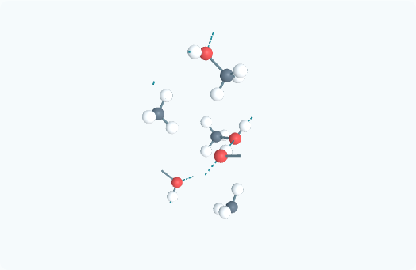

# Liên kết hydrogen từ bảng CIF công bố

Trình xem trước đây chỉ dựng thanh lân cận và dùng tiêu chí hình học riêng cho băng có đủ H. CIF methanol chứa bảng `geom_hbond` của tác giả nhưng bảng đó chưa đi vào hình 3D. Bản sửa đọc các bộ ba cho–H–nhận được ghi rõ trong nguồn và khai triển chúng theo đầy đủ đối xứng, tịnh tiến của ô mạng.

Đối chiếu [định nghĩa bảng GEOM_HBOND của IUCr](https://www.iucr.org/__data/iucr/cifdic_html/1/cif_core.dic/Cgeom_hbond.html) và [mã đối xứng của từng vị trí](https://www.iucr.org/__data/iucr/cifdic_html/1/cif_core.dic/Igeom_hbond_site_symmetry_.html). Bộ đọc xử lý mã của cả D, H, A; dùng định danh phép đối xứng khi CIF khai báo định danh; không coi định danh là chỉ số mảng. Khoảng cách và góc tính lại bằng metric đầy đủ của ô mạng phải khớp bảng nguồn trong độ làm tròn của số in. Không dùng độ bất định thực nghiệm để nới phép kiểm tra này.

Trong [COD 4503066](https://www.crystallography.net/cod/4503066.html), bản methanol tinh khiết ở 122 K có một dòng O1–H1···O1 với mã A `4_557`. Sau khai triển có bốn bộ ba trong ô cơ sở: mỗi O cho một và nhận một liên kết hydrogen. O···O tính được 2,6928859 Å, góc 174,0845°, khớp bảng 2,6929(11) Å / 174,1°. Đây là tọa độ H đặt theo hình học (`geom`) của nguồn, không phải phép đo riêng từng H. Không dùng mẫu co-crystal acetylene cũng được mô tả trong cùng công trình.

Nét đứt xanh được bật/tắt độc lập với thanh liền; tự ẩn khi tắt nguyên tố tham gia, kể cả nguyên tố cho nếu khác nguyên tố nhận. Gộp nét đứt theo nhóm nguyên tố để tránh tạo quá nhiều lượt vẽ. Phần quy ước thu gọn phân biệt dữ liệu từ bảng tác giả với phép dựng hình học chỉ áp dụng cho băng. Những chất không có bảng nguồn không tự được gán bảng; ngưỡng dành cho nước cũng không lọc bỏ những bộ ba mà tác giả của chất khác đã ghi nhận.

Rà đủ 306 cấu trúc hiện có: một CIF có bảng này (methanol); Băng II tiếp tục dùng lớp hình học đã ghi rõ trước đó. Mọi CIF gốc giữ nguyên byte; JSON methanol chỉ thêm `hydrogenBondGeometry`, toàn bộ trường cũ gồm tọa độ, occupancy, metric và nguồn giữ nguyên. GLB / PNG methanol đã dựng lại. Xem `source-audit.json` và các báo cáo render kèm theo.

Kiểm tra:

- Python 3.12 / Gemmi 0.7.5: 8 kiểm tra bảng gốc, mã đối xứng không liên tiếp, mã D/H, loại dòng trùng, từ chối mã/nhãn/geometry sai và không tự áp ngưỡng dành cho nước.
- Node: 22 kiểm tra liên quan gồm CIF, phối trí, metric, nguồn, nhập COD, hiển thị và kiểm tra lại từng bộ ba methanol từ tọa độ.
- Chromium: 10 kiểm tra giao diện; có nút ẩn/hiện, lặp ô, ẩn O/H, giao diện 390 px, xoay nhiều góc, kéo cảm ứng và chuyển mô hình trong thư viện.
- Build thư viện và bản static thành công. GLB / PNG render không lỗi; đã xem ảnh.

Giới hạn hiển thị còn lại: cắt đúng tại mặt ô mạng có thể cắt ngang một phân tử và để đầu thanh ở mặt ô. Tọa độ tuần hoàn đúng nhưng hình một ô chưa thuận mắt bằng một cụm phân tử nguyên vẹn; cần bổ sung cách xem khép phân tử ở biên. Đây không phải lý do để di chuyển nguyên tử nguồn hoặc vẽ thêm liên kết ngoài bảng.



```powershell
py -3.12 -X utf8 tests/test_cif_hydrogen.py
py -3.12 -X utf8 scripts/compile-cod-crystals.py
node scripts/generate-crystal-assets.mjs --cod --id=cod-4503066 --report-dir=docs/published-hydrogen-network/2026-11-13
node scripts/render-mineral-previews.mjs --cod --crystals --id=cod-4503066 --report-dir=docs/published-hydrogen-network/2026-11-13
```
