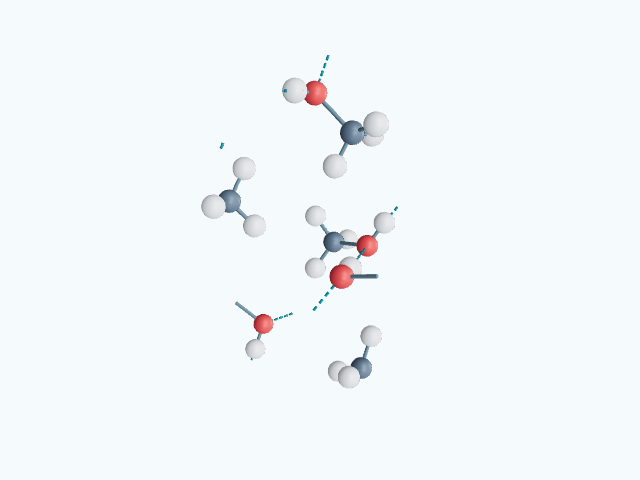
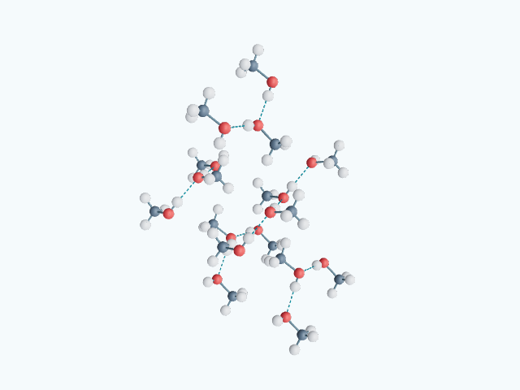

# Hiện trọn cụm nguyên tử qua biên ô mạng

Hình tinh thể cũ cắt mọi thanh nối tại mặt ô mạng. Trong tinh thể phân tử, một phần của phân tử có thể nằm ở ô kế bên, nên cách cắt đó để lại nửa phân tử và đầu thanh không có cầu. Bản sửa giữ các vị trí gốc đang hiện và thêm đúng các bản sao tuần hoàn cần thiết để khép các cụm hữu hạn của đồ thị lân cận.

Mỗi bản sao giữ chỉ số nguyên tử nguồn, độ chiếm chỗ và tọa độ phân số gốc; tọa độ hiển thị bằng tọa độ gốc cộng một vector nguyên theo ba trục ô mạng. Khoảng cách được tính với basis đầy đủ, kể cả ô xiên. Không dịch chuyển vị trí nguồn, gán bậc liên kết mới hay tăng thành phần của ô cơ sở. Những thanh hiện thêm là bản sao của các quan hệ lân cận đã dùng trước đó.

Bộ duyệt đồ thị phát hiện chu trình có tịnh tiến khác không để loại mạng kéo dài vô hạn khỏi phép khép cụm. Các thành phần có tiếp xúc ion/kim loại, nguyên tử đứng riêng, vị trí bán phần hoặc mất trật tự không được tự coi là phân tử hữu hạn. Với dữ liệu hydrogen đã có, thêm đúng một lớp cụm cho/nhận quanh các cụm giao ô mạng rồi dừng; chỉ vẽ tiếp xúc đầy đủ khi các vị trí tham gia đang hiện.

Chế độ trọn cụm bật mặc định ở những cấu trúc cần bổ sung bản sao. Nút **Cắt tại biên ô** trở về hình cắt ở ô mạng; **Hiện trọn cụm** bật lại. Lựa chọn được giữ khi chuyển 1 ô / 2 × 2 × 2 ô. Các nút ẩn nguyên tử, ẩn nguyên tố, thanh liền, nét đứt và khung ô mạng tiếp tục độc lập. Phần giải thích mới nằm trong mục quy ước thu gọn.

Rà 306 cấu trúc: 33 cần khép cụm, 273 giữ cách dựng cũ. Có cả methanol, Băng II, vòng S₈, I₂, N₂, O₂, CO₂ rắn, glucose, fructose và một số cụm hữu hạn trong hydrate. Điều này không có nghĩa 273 cấu trúc kia đều là mạng vô hạn; một số đã nằm trọn trong ô hoặc không đủ điều kiện để khép. GLB và PNG đã tạo lại cho đúng 33 cấu trúc bị ảnh hưởng. CIF và JSON nguồn của toàn bộ tinh thể không thay đổi so với commit `eeea8b5a`.

## Kiểm tra

- `npm run test:crystals`: 24 kiểm tra; có thành phần từng cụm CH₄O / H₂O / S₈ / C₆H₁₂O₆, phối trí, ô xiên, biên tuần hoàn, dữ liệu bán phần và các mạng phải giữ nguyên.
- `scripts/audit-crystal-clusters.mjs`: rà đủ 306 cấu trúc ở hai chế độ lặp. Với 33 cấu trúc bị ảnh hưởng, kiểm tra từng ma trận instance, bản sao nguyên ô, vị trí gốc không bị mất, không trùng điểm đầy, mọi lân cận của cụm bổ sung đều có cầu và thanh đầy đủ, đầu tiếp xúc hydrogen có cầu, nút tắt có thể trả về hình cũ và metadata GLB khớp. Không có lỗi; kết quả từng cấu trúc trong `cluster-audit.json`.
- Chromium: 10 kiểm tra giao diện qua; có chuyển trọn cụm / cắt biên, giữ chế độ và trạng thái nét đứt sau lặp ô, nút không xuất hiện ở NaCl, ẩn nguyên tố, 390 px, kéo qua nhiều cực và cảm ứng trên mô hình dày. Các luồng NaCl, Băng II và methanol được xác nhận lại trên bản dựng cuối.
- Build thư viện và static thành công. Cả 33 GLB tải và render PNG không lỗi. Đã xem ảnh methanol, Băng II, S₈ và glucose. Kiểm tra cảm ứng dùng Chromium giả lập, không phải đo FPS trên thiết bị thật.

Ảnh methanol cùng pha 122 K trước và sau; nguyên tử nguồn không đổi:





## Chạy lại

```powershell
npm run test:crystals
node scripts/audit-crystal-clusters.mjs --report-dir=docs/whole-crystal-clusters/2026-11-13
```

Danh sách 33 ID nằm trong `cluster-audit.json` và `crystal-generation.json`. Hai công cụ xuất / render hỗ trợ `--all-crystals --ids=<danh-sách-ID-cách-bằng-dấu-phẩy> --report-dir=...` để tạo lại đúng tập tài sản đó.
