# CHEMDEX 2D SYSTEM ARCHITECTURE

## 1. Architectural Philosophy

ChemDex 2D is a scientifically validated, high-performance virtual chemistry laboratory designed to provide realistic chemical behavior while eliminating the heavyweight rendering dependencies and complex camera navigation of 3D virtual environments.

The simulator strictly enforces the following core principle:
> **Simulation state determines visual appearance.**
> Visual phenomena are truthful projections of the underlying physical ledger and stoichiometric reaction engine, never detached animations or pre-scripted state transitions.

```mermaid
graph TD
    subgraph LayerA["Layer A — Chemical Data"]
        Catalog["Chemical Catalog (IUPAC Constants, Hazards)"]
        Reactions["Reaction Database (deltaH, Ksp, Stoichiometry)"]
    end

    subgraph LayerB["Layer B — Chemistry Engine"]
        Parser["Formula Parser, Molar Mass & RREF Balancer"]
        Ledger["Conservation Ledger (Atoms & Mass Invariants)"]
        Stoich["Reaction Stoichiometry & Limiting Reagents"]
        Eq["Aqueous Charge-Balance pH & Titration Solver"]
        Telemetry["Kohlrausch Conductivity & Beer-Lambert UV-Vis"]
        Thermo["Adiabatic Calorimetry & Heat Balance"]
        Optics["Beer-Lambert Optical Transmittance"]
    end

    subgraph LayerC["Layer C — State & Step Engine"]
        Store["Zustand Store (8 Slices + Shallow Selectors)"]
        WorldStep["Pure stepLabWorld Tick Engine"]
        Guided["Guided Experiment Step Validator"]
    end

    subgraph LayerD["Layer D — SVG Vector Rendering"]
        Beaker["Beaker SVG (Meniscus, Precipitate, Bubbles)"]
        Flask["Erlenmeyer Flask SVG"]
        Burette["Burette & Stand SVG (Dropwise Valve)"]
        Balance["Digital Analytical Balance SVG"]
        Burner["Bunsen Burner SVG (Lively Flame)"]
        OtherSVG["Cylinder, Funnel, Pipette, Condenser, Wash Bottle"]
    end

    subgraph LayerE["Layer E — User Interface & Resilience"]
        Header["Top Navigation & Toolbar (Catalog Status, Theme, Lang)"]
        Sidebar["Inventory (115 Chemicals, Apparatus, 20 Labs, Safety)"]
        Workbench["Interactive Workbench Canvas (Pointer & Keyboard/ARIA)"]
        Inspector["Vessel Inspector (Conductivity, UV-Vis, Reaction Lookup)"]
        Modals["Lazy Modals, Titration Curves, Equation Balancer & ErrorBoundary"]
    end

    Catalog --> Stoich
    Reactions --> Stoich
    Parser --> Ledger
    Ledger --> Stoich
    Stoich --> Eq
    Eq --> Telemetry
    Stoich --> Thermo
    Eq --> Optics
    Stoich --> Store
    Store --> WorldStep
    WorldStep --> Store
    Store --> Guided
    Store --> Beaker
    Store --> Flask
    Store --> Burette
    Store --> Balance
    Store --> Burner
    Store --> OtherSVG
    Store --> Workbench
    Store --> Inspector
    Store --> Header
    Store --> Sidebar
    Store --> Modals
```

---

## 2. Layered Breakdown

### Layer A — Chemical Data
- `src/data/chemicals.ts`: Canonical catalog of **115 chemical compounds** with IUPAC standard molar masses, densities, categories, GHS hazards, PPE items, and bilingual descriptions.
- `src/chemistry/reactions/curriculumProjection.ts` & `src/data/curriculum/curriculumCore.json`: Slim projection of **131 curriculum reactions** loaded eagerly at startup while keeping full pedagogical reaction metadata (`reactions.vi.json`) lazy-loaded via dynamic `import()`.
- `src/chemistry/reactions/reactionDatabase.ts`: Curated handcrafted reactions plus non-conflicting compiled curriculum reactions, enthalpy values ($\Delta_r H^\circ$), visual outcomes, and unified normalized lookup helpers (`findMatchingVesselReactions`, `resolveReactionEquationById`).
- `src/chemistry/reactions/curriculumAndCatalogCompiler.ts`: Compiles the **131 curriculum reactions** eagerly from `curriculumCore.json` and lazy-loads `@shared/reaction-catalog.generated.json` (**1,300 shared catalog reactions** across 18 families) asynchronously via `ensureCatalogCompiled()`.
- `src/data/experiments.ts` & `src/data/advancedExperiments.ts`: **20 guided experiments** (14 core + 6 advanced) with state-based validation criteria.

### Layer B — Pure Scientific Computation
- **No dependencies on React, DOM, or animation frames.**
- `src/chemistry/core/elements.ts` & `formula.ts`: Parses nested chemical formulas (`Ca(OH)2`, `[Cu(NH3)4]SO4`, `CuSO4·5H2O`) and computes exact IUPAC molecular weights.
- `src/chemistry/core/equationBalancer.ts`: Exact-rational `BigInt` Gauss-Jordan RREF nullspace equation balancer and limiting-reagent stoichiometry calculator (molecular, hydrate, complex, ionic charge balance, STP/$25^\circ\text{C}$ gas volumes).
- `src/chemistry/core/ledger.ts`: Verifies element atom conservation and total mass balance before and after reactions.
- `src/chemistry/reactions/engine.ts`: Executes stoichiometric conversions across PASS 1 (curated/curriculum), Tier 1 multi-stage equilibria (`instantRuleSolver.ts`), PASS 3 (1,300+ compiled catalog reactions), and Tier 2 fallback heuristics, maintaining strict element and mass conservation.
- `src/chemistry/equilibrium/aqueous/`: Iterative charge-balance pH solver with Davies/Debye-Hückel ionic strength activity corrections, temperature-dependent $K_w(T)$, carbonate/phosphate speciation, and salt hydrolysis; wrapped by `src/chemistry/equilibrium/acidBase.ts`.
- `src/chemistry/equilibrium/titrationEngine.ts`: Dynamic equilibrium and conductometric titration simulator (`simulateEquilibriumTitration`), first-derivative equivalence detector, 5 interactive bench presets, and live burette trace appending.
- `src/chemistry/equilibrium/analyticalTelemetry.ts`: Kohlrausch-Falkenhagen ionic conductivity ($\kappa$, $I$) and virtual 380–720 nm Beer-Lambert UV-Vis spectrum generator.
- `src/chemistry/thermodynamics/calorimetry.ts`: Lumped capacitance calorimeter model calculating $\Delta T$ and latent-heat ice melting.

### Layer C — Laboratory State, Slices & Pure Tick Engine
- `src/store/useLabStore.ts`: Composes 8 focused slices under `src/store/slices/` (`aiSlice`, `equipmentSlice`, `experimentSlice`, `historySlice`, `safetySlice`, `simulationSlice`, `transferSlice`, `uiSlice`) with helpers in `labStoreHelpers.ts`, tracking `titrationTrace`, `cumulativeTitrated_ml`, `setupTitrationPreset`, and `catalogReady`.
- `src/engine/labWorldStep.ts`: Pure world simulation step (`stepLabWorld`) driving apparatus heating/cooling, burette/condenser flow, kinetics progression, and environment exchange without tying UI components to 60 Hz store re-renders.
- `src/store/usePointerDragStore.ts`: Externalized ephemeral drag state isolating pointer moves from React tree rerenders.

### Layer D — 2D SVG Glassware Rendering
- Scalable, lightweight vector graphics featuring:
  - Non-linear liquid volume heights matching real vessel geometry.
  - Liquid meniscus curves and transparent glass reflections.
  - Settled precipitate layers with individual solid sediment particles.
  - Animated gas effervescence bubbles when reactions release gas.
  - Dynamic Bunsen burner flame with inner blue cone and outer yellow flame.
  - Digital analytical balance with LCD readout, tare calculation, and stainless steel pan.

### Layer E — Modern User Interface, Accessibility & Resilience
- Predominantly white, clean scientific workspace layout with daylight/night lighting themes.
- Direct pointer manipulation plus full keyboard accessibility (`Tab`, `Arrow`/`Shift+Arrow` positioning, `Enter`/`Space` quick radial menu, `Delete`/`Backspace` removal, `Escape` deselect, `shouldIgnoreWorkbenchGlobalKey` isolation for inputs/selects/modals, informative `aria-label`, and `aria-live="polite"` event announcements).
- Enhanced `VesselInspector` (ionic conductivity card, expandable 380–720 nm UV-Vis spectrum SVG, reactive reaction matches across curated/catalog DB) and lazy-loaded analytical modals (`TitrationCurveModal` with live burette trace and `dpH/dV` toggles, `ReactionLibraryModal` with `EquationBalancerTab`, `LabNotebookModal` with unified ID resolution).
- Scoped `ErrorBoundary` wrapping the workbench canvas and modal dialogs with IndexedDB autosave recovery, workbench reset, and page reload.
- Non-blocking `CatalogLoadingBadge` while the shared 1,300-reaction catalog compiles in the background, plus lazy-loaded secondary modals (`Suspense`).
- Bilingual Vietnamese (default) and English support across UI, IndexedDB sessions, and CSV/JSON/print laboratory reports.
