# CHEMDEX 2D SYSTEM ARCHITECTURE

## 1. Architectural Philosophy

ChemDex 2D is a scientifically validated, high-performance virtual chemistry laboratory designed to provide realistic chemical behavior while eliminating the heavyweight rendering dependencies and complex camera navigation of 3D virtual environments.

The simulator strictly enforces the following core principle:
> **Simulation state determines visual appearance.**
> Visual phenomena are truthful projections of the underlying physical ledger and stoichiometric reaction engine, never detached animations or pre-scripted state transitions.

```mermaid
graph TD
    subgraph LayerA["Layer A — Chemical Data"]
        Catalog["Chemical Catalog (IUPAC Constants, Hazards)"]
        Reactions["Reaction Database (deltaH, Ksp, Stoichiometry)"]
    end

    subgraph LayerB["Layer B — Chemistry Engine"]
        Parser["Formula Parser & Molar Mass"]
        Ledger["Conservation Ledger (Atoms & Mass Invariants)"]
        Stoich["Reaction Stoichiometry & Limiting Reagents"]
        Eq["Acid-Base & Henderson-Hasselbalch Equilibrium"]
        Thermo["Adiabatic Calorimetry & Heat Balance"]
        Optics["Beer-Lambert Optical Transmittance"]
    end

    subgraph LayerC["Layer C — State Management"]
        Store["Zustand Lab Store (Vessels, Apparatus, Snapshots)"]
        UndoRedo["Immutable Undo / Redo History"]
        Guided["Guided Experiment Step Validator"]
    end

    subgraph LayerD["Layer D — SVG Vector Rendering"]
        Beaker["Beaker SVG (Meniscus, Precipitate, Bubbles)"]
        Flask["Erlenmeyer Flask SVG"]
        Burette["Burette & Stand SVG (Dropwise Valve)"]
        Balance["Digital Analytical Balance SVG"]
        Burner["Bunsen Burner SVG (Lively Flame)"]
        OtherSVG["Cylinder, Funnel, Pipette, Wash Bottle"]
    end

    subgraph LayerE["Layer E — User Interface"]
        Header["Top Navigation (Mode, Undo, Lang, Export)"]
        Sidebar["Inventory (Chemicals, Apparatus, 10 Labs, Safety)"]
        Workbench["Interactive Workbench Canvas (Pointer Drag)"]
        Inspector["Vessel Inspector (Telemetry, Contents, Controls)"]
        Modals["Precision Transfer Modal & Lab Notebook"]
    end

    Catalog --> Stoich
    Reactions --> Stoich
    Parser --> Ledger
    Ledger --> Stoich
    Stoich --> Eq
    Stoich --> Thermo
    Eq --> Optics
    Stoich --> Store
    Store --> Guided
    Store --> UndoRedo
    Store --> Beaker
    Store --> Flask
    Store --> Burette
    Store --> Balance
    Store --> Burner
    Store --> OtherSVG
    Store --> Workbench
    Store --> Inspector
    Store --> Header
    Store --> Sidebar
    Store --> Modals
```

---

## 2. Layered Breakdown

### Layer A — Chemical Data
- `src/data/chemicals.ts`: Canonical definitions of chemical compounds with IUPAC standard molar masses, densities, categories, GHS hazards, PPE items, and bilingual descriptions.
- `src/chemistry/reactions/reactionDatabase.ts`: Balanced stoichiometric equations, enthalpy values ($\Delta_r H^\circ$), equilibrium constants ($K_{sp}$), and visual outcome definitions.
- `src/data/experiments.ts`: 10 core curriculum experiments with state-based validation criteria.

### Layer B — Pure Scientific Computation
- **No dependencies on React, DOM, or animation frames.**
- `src/chemistry/core/elements.ts` & `formula.ts`: Parses nested chemical formulas (`Ca(OH)2`, `[Cu(NH3)4]SO4`, `CuSO4·5H2O`) and computes exact IUPAC molecular weights.
- `src/chemistry/core/ledger.ts`: Verifies element atom conservation and total mass balance before and after reactions.
- `src/chemistry/reactions/engine.ts`: Calculates reaction extent ($\xi$), limiting and excess reagents, precipitation mass, gas generation, and thermal changes.
- `src/chemistry/equilibrium/acidBase.ts`: Evaluates solution pH for strong acid/base mixtures, weak acids, and buffer solutions. Maps indicator colors (Phenolphthalein, Litmus, Universal indicator).
- `src/chemistry/thermodynamics/calorimetry.ts`: Lumped capacitance calorimeter model calculating $\Delta T$.

### Layer C — Laboratory State & History
- `src/store/useLabStore.ts`: Central Zustand store maintaining equipment positions, contents, tare weights, active selections, and immutable undo/redo snapshots.
- Step-by-step progress tracking for guided experiments against actual simulated apparatus state.

### Layer D — 2D SVG Glassware Rendering
- Scalable, lightweight vector graphics featuring:
  - Non-linear liquid volume heights matching real vessel geometry.
  - Liquid meniscus curves and transparent glass reflections.
  - Settled precipitate layers with individual solid sediment particles.
  - Animated gas effervescence bubbles when reactions release gas.
  - Dynamic Bunsen burner flame with inner blue cone and outer yellow flame.
  - Digital analytical balance with LCD readout, tare calculation, and stainless steel pan.

### Layer E — Modern User Interface
- Predominantly white, clean scientific workspace layout.
- Direct pointer manipulation (drag apparatus on workbench; hover over compatible vessel to pour).
- Precision Transfer Modal for numeric volume/mass inputs.
- Vessel Inspector displaying real-time chemical composition, concentrations, and physical properties.
- Bilingual Vietnamese (default) and English support.
- Printable laboratory notebook and report with CSV / JSON export.
