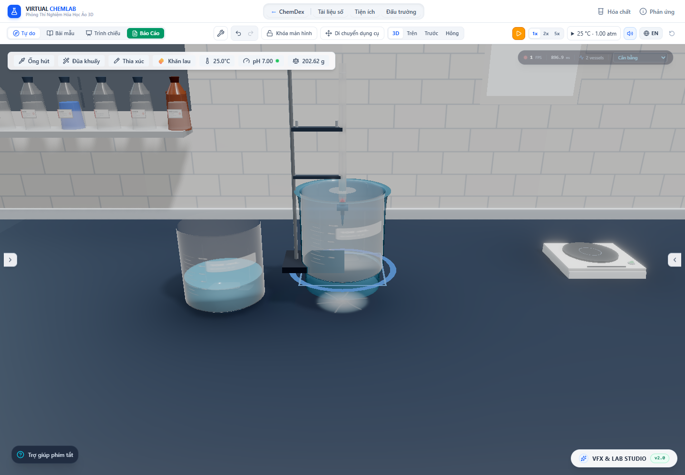

# Màng tràn quanh miệng tròn — 29/10/2026

Đã thay dải tràn dày tại một phía bằng màng quanh vành cho bình đứng có miệng tròn, mặt thoáng ngang trong mô hình. Thay đổi bao phủ kho trên thành, phần đang bay, vị trí chạm bàn, sự kiện ripple và nhập vũng. Mục tiêu mô phỏng mọi thứ đúng thực tế vẫn còn các phần chưa được chứng minh ở cuối báo cáo.

## Nguyên nhân và điều kiện áp dụng

Renderer bình dùng lathe từ `vesselContours`: vành là vòng tròn đồng mức, chưa có phần hạ thấp của một vòi rót thật. Mô hình bulk cũng dùng mặt thoáng ngang. Tuy vậy pipeline cũ đưa toàn bộ lượng tràn qua `profile.spoutWidth`, rồi khởi đầu ngoài thành với vận tốc bằng không. Với xung 20 mL/0,12 s, nước bị ép vào dải hẹp và tích thể tích ở đầu vào, tạo cạnh dày như một tấm vật liệu.

Với hình học tròn đồng mức và giả định bulk đã trộn đều, đợt này dùng bề rộng `w(y) = 2πr(y)` theo contour ngoài. Đây là **điều kiện đối xứng của mô hình**, chưa phải dự đoán vùng bám ướt của cốc thủy tinh có vết bẩn, góc nghiêng nhỏ, vành không đều hay vòi rót thật. Khi bình nghiêng tại lúc tạo receipt, pipeline vẫn dùng nhánh bay từ mép thấp; không ép nhánh đó thành màng tròn.

Điều kiện vào dùng tham chiếu dòng tới hạn dạng tấm: `q = Q/w`, `h_c = cbrt(q²/g)`, `u_c = cbrt(gq)`. [USACE HEC-RAS, Critical Depth](https://www.hec.usace.army.mil/confluence/rasdocs/ras1dtechref/6.0/modeling-culverts/culvert-hydraulics/critical-depth-of-flow-in-the-culvert) trình bày quan hệ tới hạn tổng quát và công thức tiết diện chữ nhật. [USBR, §2.12–13](https://www.usbr.gov/tsc/techreferences/mands/wmm/chap02_13.html) giải thích vai trò của hiệu chỉnh tổn thất và phân bố vận tốc. Việc dùng `u_c` làm vận tốc vào tiếp tuyến ngoài thành là **giả định triển khai chưa hiệu chuẩn cho mép cốc**, không phải chứng minh cốc là một đập tràn tiêu chuẩn.

Ở kịch bản kiểm tra, vận tốc tham chiếu vào khoảng 0,193 m/s; thời gian đi thành khoảng 0,109 s. Quan hệ màng Nusselt và giới hạn năng lượng hiện tại vẫn chỉ là closure tham chiếu. `reynolds4` khoảng 3.623 cho thấy không thể tự khẳng định màng steady laminar đã được xác minh. Nghiên cứu [Du và cộng sự, 2022](https://www.frontiersin.org/journals/energy-research/articles/10.3389/fenrg.2022.899023/full) nêu các giả thiết của màng tầng không dao động; nó không hiệu chuẩn xung tràn này. Không thêm sóng sin ngẫu nhiên để thay cho mô hình sóng màng thực.

## Cùng một lượng chất xuyên suốt

`PourParcel.sample` tiếp tục là chủ sở hữu duy nhất của lượng chưa tới bàn. `circularSheet` lưu tâm và bán kính thoát trong tọa độ thế giới. Khi kéo bình, phần đã bay giữ tâm cũ; phần còn bám đi theo bình. Khi mất hỗ trợ, nhánh detach giữ tọa độ cuối và vận tốc hướng kính tham chiếu của contour. Việc detach một khoảng dài vẫn dùng điểm đại diện như trước, chưa mô phỏng từng phần tử chất lỏng khi bình vỡ.

Mesh trên thành và mesh bay đều là mặt kín dạng vành khăn. Các đoạn dùng chung đỉnh theo chiều cao và chu vi, không có các mặt hướng kính trong suốt chồng lên nhau. Mỗi khoảng chất lỏng được hiệu chỉnh bề dày bằng nghiệm dương của phương trình thể tích bậc hai, để tổng thể tích tam giác bằng đúng lượng đang có trong khoảng đó. Chord polygon được đặt ngoài kính; không đưa cạnh đáy của polygon xuyên vào thành bình.

Các nút tích phân dư trên đoạn thành thẳng được giản lược với sai số hướng kính của mặt trong/ngoài tối đa 20 µm **trước hiệu chỉnh tổng thể tích**. Đây là dung sai hình học hiển thị; không đổi thời gian vận chuyển hay lượng chất. Hiệu chỉnh thể tích hữu hạn và chia lưới không bảo đảm bề dày tại mọi điểm bằng nghiệm thủy động lực học liên tục.

Phần bay được dựng bằng vị trí ballistic và cùng khoảng sinh hữu hạn. Không còn gom một màng vòng thành một ống tròn ở một phía. Vị trí chạm bàn được lấy bằng quadrature 24 góc đều nhau; mỗi vị trí chỉ nhận 1/24 thành phần thực tế của receipt. Các sự kiện va chạm phát sau khi toàn transaction đã cập nhật.

Nhập vũng đồng thời được bổ sung để tránh thiên lệch theo góc đầu tiên. Bộ giải tìm các thành phần tiếp xúc của cùng pha rồi thư giãn theo mô hình vũng hiện có; nếu footprint sau nhập chạm vũng khác thì tiếp tục nhập. Khối lượng, số mol từng chất và moment khối lượng theo x/z được giữ. Các vũng xa và lớp hữu cơ không tiếp xúc/tương thích không bị nhập vào nước. Đây vẫn là mô hình nhập vũng quasistatic; chưa giải tốc độ lan, động lực học cầu chất lỏng hoặc ảnh hưởng đáy bình tới dòng trên bàn.

## Bằng chứng kiểm tra

Audit dùng app thật với 150 g tổng kho, receipt 20 mL có thành phần CuSO₄/H₂O. Khoảng cấp 0,12 s là giả định API đã có từ đợt trước, không phải dữ liệu đo thao tác rót.

| Mốc | Trên thành (mL) | Đang bay (mL) | Chờ phát (mL) | Trên bàn (mL) | Tổng kho (g) |
|---|---:|---:|---:|---:|---:|
| 0,02 s | 3,333333 | 0 | 16,666667 | 0 | 150 |
| Trước chạm bàn | 17,621358 | 2,378642 | 0 | 0 | 150 |
| Nhận một nửa | 5,242716 | 4,757284 | 0 | 10 | 150 |
| Nhận hết | 0 | 0 | 0 | 20 | 150 |

Mỗi mốc đối chiếu thể tích thực của tam giác với lượng chất trên thành/trong không khí. Audit cũng kiểm tra từng thành phần, mọi store-version khi dose, tọa độ trước/sau kéo bình và reload không mất/nhân đôi kho.



- [Runtime và số đo](circular-overflow-2026-10-29/browser-audit.json)
- [Phản ứng nhanh cùng pipeline tràn](circular-overflow-2026-10-29/contact-and-overflow/browser-audit.json)
- [Kiểm thử](circular-overflow-2026-10-29/test-results.json), [build](circular-overflow-2026-10-29/build.log)
- [Benchmark CPU](circular-overflow-2026-10-29/cpu-benchmark.json)

Benchmark CPU trên máy hiện tại, Node 26.7: cập nhật cả mesh thành/bay cho một packet có median khoảng 0,243 ms; 24 packet khoảng 0,830 ms, p95 khoảng 2,409 ms. Kịch bản 24 packet có 13.056 tam giác và khoảng 612 KiB buffer được batch để render, chưa tính buffer CPU của các hình học thành phần. Transaction nhận hết 20 mL có median khoảng 0,200 ms. Đây là phép đo CPU của các hàm đã ghi trong script, **không phải FPS GPU, so sánh tương đương trước/sau hay cam kết cho mọi máy**.

Kiểm thử bổ sung xác nhận mặt vành khăn kín và có hướng đúng, thể tích 0,01/1/20/500 mL, normal không nhiễm tam giác cũ khi tái dùng buffer, sai số giản lược và giữ góc contour, bảo toàn khi đổi thứ tự các điểm chạm. Các test từng giả định chỉ một vũng được đổi sang cộng toàn bộ kho vũng và kiểm tra moment/vị trí; các kiểm tra lượng chất không bị bỏ.

Kiểm tra cuối: **176 file / 2.154 test đều qua**, TypeScript qua, build production qua trong **33,65 s**. Audit độc lập và audit gộp với phản ứng nhanh đều qua, không có lỗi JavaScript/console WebGL. Suite bỏ `performance.smoke.test.ts` để tránh ghi đè artifact benchmark lịch sử; phép đo CPU riêng ở trên không đưa ra kết luận FPS. Cảnh báo chunk lớn của build và cảnh báo localStorage thử nghiệm trên Node vẫn còn.

## Giới hạn còn lại của mục tiêu

1. Bề rộng vùng ướt trong trường hợp không đối xứng; contact angle động, điều kiện mép, tách thành, sóng và vỡ giọt chưa được hiệu chuẩn. Dạng màng tròn chỉ áp dụng cho hình học và giả định đã nêu.
2. Nusselt còn là tham chiếu ở Reynolds cao; cần closure chuyển tiếp hoặc dữ liệu thực nghiệm thay vì coi một ngưỡng Reynolds chung là đủ xác định mọi màng.
3. **Cập nhật sau báo cáo này:** [đợt thống nhất thước SI](world-scale.vi.md) đã sửa sai lệch dung tích–chiều dài cho 14 thân bình, có phép đo mesh thật của bốn bình chính. Chưa xác nhận kích thước dụng cụ theo nhà sản xuất, phụ kiện độc lập hoặc mọi hiệu ứng phụ. Artifact trong thư mục circular-overflow vẫn là ảnh/số đo lịch sử trước thay đổi kích thước.
4. Khoảng cấp dose/stock còn giả định 0,12 s; chất đã debit nhưng chưa phát được giữ trong cùng packet. Cần thời gian cấp thực và mô hình tích nước qua vành để thay giả định này.
5. **Cập nhật sau báo cáo này:** [hóa học trong mẫu vận chuyển](aliquot-contact-chemistry.vi.md) đã thêm phản ứng dung dịch được hỗ trợ trên dòng bay/thành/pipet. Sinh khí, chuyển pha và hiệu chuẩn tốc độ từng phản ứng vẫn chưa hoàn tất; xem thêm [đợt sửa phản ứng khi lấy bớt mẫu](reaction-continuation.vi.md).

## Tái chạy

```powershell
node --import tsx scripts/benchmarkOverflowSheet.ts
npx vitest run --maxWorkers=2 --exclude tests/performance.smoke.test.ts
npm run lint
npm run build
# Khi Vite đang chạy ở 127.0.0.1:6773:
$env:OVERFLOW_AUDIT_OUTPUT='docs/research/circular-overflow-2026-10-29'
node scripts/auditOverflowTransport.mjs
$env:CONTACT_AUDIT_OUTPUT='docs/research/circular-overflow-2026-10-29/contact-and-overflow'
node scripts/auditContactAndDischarge.mjs
```
