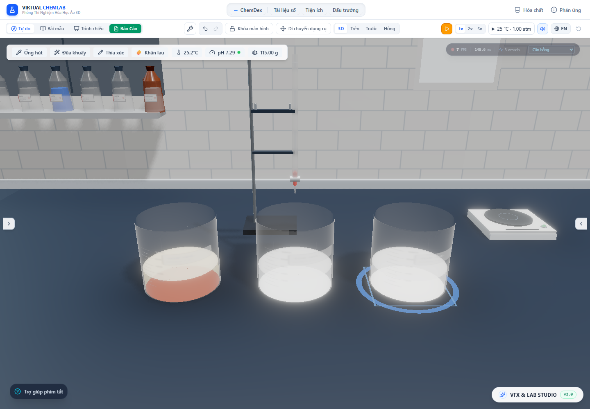
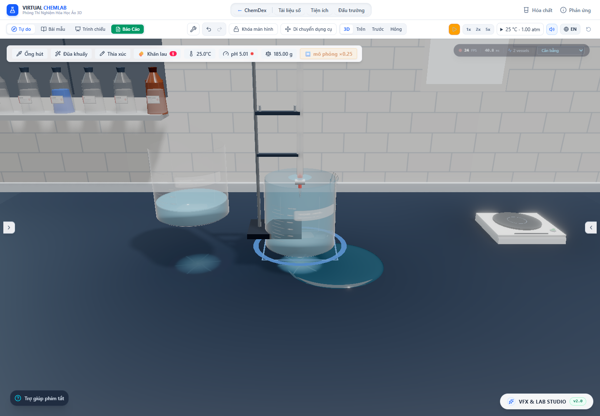

# Phản ứng dung dịch nhanh hơn, lưu lượng rót và giọt tràn — 29/10/2026

Mục tiêu đang tiếp tục: **“Cải tiến nâng cấp các phản ứng cho chi tiết. tràn nước dung dịch đồ chuẩn vật lí. Chuẩn mọi thứ thực tế....Phản ứng nhanh lên”.** Đợt này sửa được các sai lệch cụ thể về thời gian phản ứng, đầu áp/lưu lượng và giọt tràn. Chưa hoàn tất mục tiêu toàn hệ thống.

Cập nhật tiếp: lỗi vũng xuất hiện trước va chạm trong báo cáo này đã được xử lý bằng [kho tràn ngoài thành hữu hạn](finite-exterior-overflow.vi.md). Các ảnh/JSON dưới đây giữ bằng chứng thời điểm trước sửa; script kiểm tra hiện hành dùng pipeline mới và ghi kết quả vào thư mục overflow-transit.

## Phản ứng và trạng thái chất

Store trước đây dùng `visual.duration_s` để tiến triển cả các chương trình đã khai báo `chemistry.kinetics.model = instant`. Ví dụ FeCl₃ + NaOH có half-time minh họa 0,1 s nhưng quá trình hóa học bị kéo theo thời lượng trình chiếu nhiều giây.

`advanceAqueousContactProgress` nay dùng nghiệm tích phân chính xác:

`1 − p(t + dt) = (1 − p(t)) × exp(−ln(2) × dt / halfTime)`.

Chỉ áp dụng cho mô hình `instant` có tất cả chất phản ứng ở pha aq/l. Có **54 chương trình** thỏa điều kiện, liệt kê cùng thời gian đến 95% tại [contact-programs.json](contact-and-discharge-2026-10-29/contact-programs.json). Fe(OH)₃/AgCl có half-time 0,1 s nên đạt 95% sau khoảng 0,432 s mô phỏng; BaSO₄ dùng 0,15 s, đạt 95% sau khoảng 0,648 s. Đây là **tham số minh họa sẵn có**, chưa phải số đo tốc độ phản ứng của mẫu thực.

Mô hình nhiệt, kim loại–axit, chất rắn, tiếp xúc khí và phản ứng đồng hồ vẫn có cơ chế riêng. Tốc độ riêng của chúng không bị nhân lên theo yêu cầu làm nhanh phản ứng dung dịch. Khi phần còn lại dưới 0,01%, ledger hoàn tất lượng chuyển hóa còn lại; không bỏ chất hoặc thêm nguồn nhiệt thứ hai.

Màu của chương trình đang chạy lấy từ ledger/Beer–Lambert/chỉ thị khi có dữ liệu, thay cho nội suy màu đầu/cuối. Cờ kết tủa theo lượng rắn dương của ledger, bỏ ngưỡng ẩn cứng 1 mg/10 mg. Lắng/kết bông tiếp tục do hệ vận chuyển vật lý sở hữu, không bị ép hoàn thành khi phản ứng hóa học nhanh kết thúc.

HUD dùng hệ số đồng hồ thật trong store. Ghi chú `timeWarp` của chương trình không còn tạo nhãn “tua nhanh ×225” khi đồng hồ đang ở 1×. Thư viện ghi rõ các thời gian chưa hiệu chuẩn là giả định minh họa.

Nguồn hóa học [OpenStax — Classifying Chemical Reactions](https://openstax.org/books/chemistry-2e/pages/4-2-classifying-chemical-reactions) hỗ trợ phân loại kết tủa/trung hòa và điều kiện tạo chất rắn. Nguồn này **không xác nhận các half-time số** trong catalog. Giới hạn bão hòa, tỷ lượng và nhiệt vẫn do các helper/ledger hiện hành tính.

## Dòng rót

- Đầu áp lấy từ mặt thoáng ngang đã giải `solveLevel` trừ cao độ mép rót đã xoay, quy đổi qua tỉ lệ dung tích của dụng cụ. Bỏ xấp xỉ lượng dư/chỉ một tiết diện cục bộ và trần đầu áp 2,5 cm.
- Nhánh weir dùng `Q = Cd × (2/3) × sqrt(2g) × b × h^(3/2)` trong SI. Nhánh úp hoàn toàn dùng diện tích miệng và `Q = Cd × A × sqrt(2gh)`.
- Bỏ ép tốc độ tối thiểu 0,15 mL/s, trần 22/75 mL/s, nhánh xả `V × 2,8 + 8` và hệ số thời gian nhân vào Q. Đồng hồ sở hữu tăng/giảm tốc mô phỏng.
- Bỏ sóng sin 3,5 Hz sửa lượng chảy của mọi cổ hẹp. Cờ nguy cơ hạn chế thông khí còn là gợi ý hình học; chưa giải áp suất/không khí để dự đoán glug thật.
- Giới hạn lượng rời bình trong một bước theo lượng dư qua mép, lượng nguồn còn lại và ngân sách outflow được phép. Dòng rất nhỏ không bị reducer loại bởi ngưỡng 0,001 mL/s.

[USBR — Thin Plate Weir Relationships](https://www.usbr.gov/tsc/techreferences/mands/wmm/chap02_09.html) giải thích cơ sở tích phân dòng qua mép và yêu cầu hiệu chuẩn Cd. Cd = 0,62, phép hiệu chỉnh độ nhớt cũ và nội suy giữa hai nhánh ở góc úp vẫn là closure giả định của phần mềm. Đã chặn Cd không vượt 1; chưa phải mô hình dòng nhớt/mao dẫn hay hiệu chuẩn cổ bình thật. Hình học rót gần ngưỡng còn sai số tích phân/nội suy rất nhỏ.

## Giọt bên ngoài bình

Giọt đã tách khỏi đáy dùng `y = y₀ − g_scene × t²/2`, `vᵧ = −g_scene × t`, với `g_scene = 9,8 / 0,035`. Thời gian tới bàn phụ thuộc đúng chênh cao. Bỏ việc lấy một chu kỳ tùy ý rồi bình phương tọa độ. Gợn do hệ giọt này tạo chỉ được bật sau thời gian dòng tới đáy cộng thời gian bay.

Khi giọt bị kéo dài, hai bán kính ngang thu nhỏ để tích ba trục giữ nguyên. Tổng thể tích các glyph giọt tường/rơi được chặn theo lượng receipt tràn, kể cả micro-spill. **Đây chưa phải chứng minh tổng thể tích cả ribbon/crest/puddle và mọi giọt tức thời đã được phân vùng đúng.**

Mỗi vòng gợn có vật liệu riêng để opacity vòng cuối không ghi đè tất cả vòng khác. Buffer/vật liệu được giải phóng khi unmount. Đồng hồ cục bộ bắt đầu tại 0 để tránh tích lũy sai số khi cộng dt nhỏ vào epoch mili giây lớn.

## Bằng chứng hiện tại

- [Toàn lab](contact-and-discharge-2026-10-29/test-results.json): 172 file, **2.114 test qua**, không lỗi; không chạy bài `performance.smoke` ghi đè artifact kiểm toán riêng. Ca nhiệt vẫn kiểm tra nhiệt đèn thật và nhiệt phản ứng chỉ ghi một lần; ca CaCO₃ vẫn kiểm tra tỷ lượng, lượng rắn, không sinh khí và bảo toàn khối lượng ở giữa/cuối.
- Đối chiếu nghiệm half-time ở 10/30/60/120 FPS; 4 phản ứng dùng actual store/ledger, kiểm tra tạo kết tủa sớm và lượng chất cuối. Đối chiếu Q theo h, b, diện tích miệng, đầu áp hình học và rơi 1 m theo SI.
- Hook test actual renderer kiểm tra vị trí giọt, thể tích khi kéo dài, tạm dừng và không có gợn trước va chạm. Ma trận 120 lần rót hữu hạn tiếp tục qua.
- [Browser audit](contact-and-discharge-2026-10-29/browser-audit.json): actual app tạo Fe(OH)₃, AgCl, BaSO₄ sớm qua nhiều mốc chuyển hóa. Dose 20 mL vào bình đầy: nguồn mất 20 mL, receipt nhận 0/tràn 20 mL; tổng vật chất 140 g gồm hơi đã bay giữ đúng. Đã xem ảnh, không lỗi JavaScript/WebGL console. Cảnh được tạm dừng ở lúc giọt đầu đang rơi trước gợn va chạm. Đây không phải benchmark FPS.
- TypeScript qua; [production build](contact-and-discharge-2026-10-29/build.log) qua trong 31,26 s, còn cảnh báo chunk lớn. Sau chỉnh cuối, 29 test dòng rót/tràn chạy lại đều qua. Browser audit cuối xác nhận nhãn hệ số đồng hồ đúng và cập nhật lại ảnh sau sửa HUD.





## Kiểm tra hoàn thành toàn mục tiêu: chưa đạt

| Yêu cầu của mục tiêu | Trạng thái và phần còn thiếu |
| --- | --- |
| Phản ứng nhanh hơn | Có bằng chứng cho 54 chương trình dung dịch khai báo instant; chưa hiệu chuẩn định lượng tốc độ từng phản ứng theo nồng độ/khuấy/nhiệt độ. Các cơ chế chậm cần mô hình riêng. |
| Phản ứng chi tiết | Đã sửa màu theo lượng chất và hiển thị lượng rắn nhỏ; chưa chứng minh mọi phản ứng catalog/runtime tương đương thí nghiệm thực. |
| Tràn dung dịch chuẩn vật lý | Bảo toàn receipt, sửa Q/đầu áp và bay giọt. **Pool/spill ledger hiện ghi ngay lúc tràn qua mép, trước khi màng ngoài/giọt tới bàn.** Browser audit đã ghi nhận. Cần kho vật chất ngoài thành/đang bay với nhận dần ở bàn, phủ mọi đường dose/stock/pour và persistence/undo/reset. |
| Mọi thứ thực tế | Tỉ lệ dụng cụ theo dung tích chưa thống nhất với kích thước SI chứng nhận; Cd, bám ướt, contact angle, màng ngoài, glug, cuốn khí và vỡ giọt còn closure giả định. Chưa có hiệu chuẩn bằng bộ dữ liệu dụng cụ/mẫu thật. |

Bước kế tiếp ưu tiên **kho tràn ngoài thành → giọt → bàn hữu hạn**, dùng cùng kho chất, bảo toàn từng species, không tạo vũng trước va chạm và không làm mất vật chất khi di chuyển/xóa/vỡ bình hoặc reload/undo.

## Tái chạy

Từ `lab-3d`:

```powershell
npx vitest run --maxWorkers=2 --exclude tests/performance.smoke.test.ts
npm run lint
npm run build
# Vite dev tại cổng 6773, khởi động lại sau sửa nguồn nếu DISABLE_HMR=true:
node scripts/auditContactAndDischarge.mjs
```
