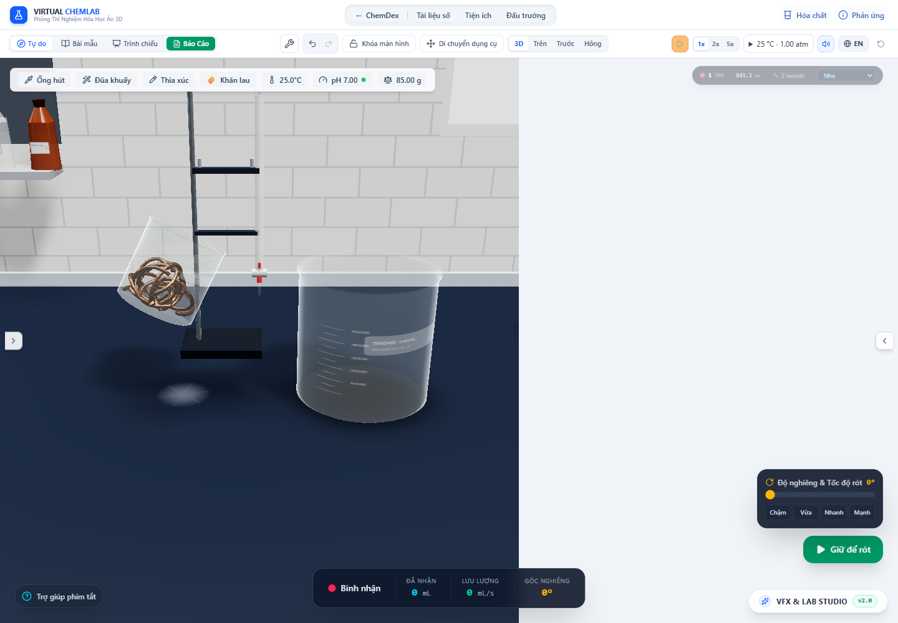

# Đầu áp rót khi nguồn có vật rắn chiếm chỗ

Cập nhật tiếp: [phép tính phần rắn ngập theo lưới](stock-immersion.vi.md) đã thay mô hình cầu tương đương cho các bố trí được hỗ trợ, trong đó ca bình tam giác ở 0,5 rad chuyển từ báo chảy sang chưa đủ head. Số đo ở báo cáo này vẫn là kết quả lịch sử của mô hình tham chiếu.

Ghi chú cập nhật cùng ngày: [đợt sửa thể tích và bố trí vật rắn](solid-volume-layout.vi.md) đã thay phần thu nhỏ mảnh trong renderer. Các số đo dưới đây là bằng chứng lịch sử của mô hình chiếm chỗ tham chiếu; phần rắn ngập nước theo hình học mới vẫn cần nối vào bộ giải mặt thoáng/đầu áp. Không dùng kết quả đầu áp khớp clipping plane dưới đây để chứng nhận lượng chiếm chỗ thực của bố trí mới.

Ngày kiểm tra: 30/10/2026. Sửa lỗi đường rót dùng riêng `volume_ml` trong khi mặt nước hiển thị đã dùng thể tích có vật rắn đẩy chỗ. Trước sửa, một bình có mặt nước qua mép vẫn có thể báo không chảy. Đợt này nối đầu áp với cùng mô hình chiếm chỗ, giữ riêng thể tích hình học và kho dung dịch được phép rời nguồn.

## Mô hình và phạm vi

[Nguyên lý Archimedes](https://openstax.org/books/university-physics-volume-1/pages/14-4-archimedes-principle-and-buoyancy) liên hệ lực nổi với lượng chất lỏng bị chiếm chỗ. Vật chìm hoàn toàn đẩy chỗ theo thể tích vật liệu; vật nổi cân bằng theo khối lượng chất lỏng bị chiếm chỗ. Trong mã hiện tại, mật độ chất lỏng lấy từ khối lượng pha lỏng / thể tích pha lỏng, không lấy cả kim loại vào mật độ dung dịch.

`calculateVesselWeirFlow` là biên giữa kho chất và quan hệ xả. Nó dùng `occupiedLiquidVolume` để giải mặt thoáng/đầu áp, và tính riêng lượng **chất lỏng** còn giữ được tại mép. `calculateWeirFlow` vẫn hỗ trợ trường hợp không có vật rắn; trạng thái chiếm chỗ chỉ được truyền dưới dạng hai đại lượng có tên riêng, không cộng thể tích đồng vào liều rót. Trợ giúp chọn góc và đường ngắm của controller cũng dùng cùng biên này.

Giới hạn được ghi ngay trong `displacementBasis`: đây là **upright-compact-reference** đang dùng cho renderer, gồm cầu đặc tương đương và tấm đá. Chưa phải phép cắt thể tích từng vật rắn thật theo mặt nước nghiêng, chưa giải vật rắn lăn/trượt hoặc chặn cổ bình. Mật độ chưa biết không được tự gán. Vì vậy, sửa lỗi đầu áp không chứng nhận mọi hình học chất rắn đã đúng thực tế.

## Chất rắn giữ lại và huyền phù đi cùng mẫu

Gọi R là dung tích hình học giữ được tới mép, L lượng dung dịch còn lại và D phần chiếm chỗ tại R. Với vật rắn được giữ lại, lượng lỏng giữ được thỏa `L + D = R`. Với chất rắn lơ lửng được phép lấy cùng mẫu, D thay đổi theo L; dùng D cố định sẽ cho giới hạn rót sai.

Controller lấy cùng snapshot `mobileSolidInventory` mà giao dịch rót canonical dùng. Snapshot thiếu hoặc cũ không cho phép lấy cặn. Nếu các vật rắn đạt cận chiếm chỗ, chia D thành phần cố định và phần đi cùng pha lỏng, rồi dùng nghiệm tuyến tính chính xác trong mô hình. Khi chỉ ngập một phần, dự báo các lần lấy mẫu thuần túy bằng `withdrawAliquot` và giải lượng lỏng còn lại ở mặt mép cố định. Dự báo không sửa store, kho hạt, phản ứng hoặc lượng đã thoát.

Nhánh phi tuyến có khoảng chặn từ `max(0,R-D_initial)` tới `min(R,L_initial)`, xen kẽ secant và chia đôi. Các bước chia đôi giữ sự giảm khoảng chặn; secant tránh 40 lần tạo dự báo trong phương trình gần tuyến tính. Kiểm tra riêng đối chiếu với nghiệm bậc ba độc lập của chỏm cầu có khối lượng giảm theo mẫu rót.

Trong `stepPourSimulation`, nguồn có kho pha được lấy **một mẫu duy nhất**, sau đó phân chia vào bình nhận và tràn. Cách này giữ thành phần của phần bắn/tràn và tránh dùng lại snapshot huyền phù sau một lần rút trước đó. Giới hạn thể tích bình nhận tiếp tục tính cả vật rắn trong mẫu tới nơi. Dòng bay/trên thành vẫn giữ cùng kho hữu hạn, không tạo thêm dung dịch để vẽ hiệu ứng.

## Kết quả trong app

Chạy `node scripts/auditDisplacementFlow.mjs`. [JSON](displaced-source-flow-2026-10-30/browser-audit.json) dùng bốn nguồn có nước và đồng, giữ tạm dừng ở 0,5 rad trước khi xả. Đầu áp được đo độc lập bằng khoảng cách từ mép bình thật tới clipping plane thế giới của nước, với thước SI chung. Tất cả ca cũ đều cho Q = 0 do chỉ xét lượng nước; các ca mới khớp đầu áp hiển thị trong sai số dưới 10⁻⁸ cm.

| Nguồn | Dung dịch ban đầu | Mặt thoáng quy theo mL hình học | Đầu áp qua mép | Q mô hình |
|---|---:|---:|---:|---:|
| Cốc 100 mL | 71,4337 mL | 75,4337 mL | 0,08941 cm | 0,3565 mL/s |
| Tam giác 250 mL | 239,7695 mL | 249,7695 mL | 1,04691 cm | 13,8254 mL/s |
| Ống nghiệm 50 mL | 45,9694 mL | 47,9694 mL | 0,20454 cm | 1,0065 mL/s |
| Ống đong 100 mL | 90,7160 mL | 94,7160 mL | 0,22512 cm | 1,5587 mL/s |

Q là kết quả quan hệ weir/orifice và hệ số đang có, không phải lưu lượng đo thực nghiệm. Tư thế được giữ để cô lập phép đo hình học; không dùng làm kiểm chứng va chạm với bàn hay thao tác cầm bình.

Bốn phiên rót trợ giúp tiếp theo nhận lần lượt 0,2 / 0,5 / 0,1 / 0,2 mL, giữ nguyên đồng trong nguồn. Tổng thể tích, khối lượng và mol theo công thức/pha qua mọi kho khớp trước–sau. Mẫu CuS kiểm soát ban đầu có 1 g lơ lửng trong 80 mL nước; rót 0,5 mL mang theo **0,00625 g CuS**, tương ứng snapshot cho phép. Đây là mẫu chuẩn bị sẵn để kiểm tra vận chuyển, không phải phản ứng được tạo thêm.

Ảnh tạm dừng chỉ minh họa cảnh. Góc và đầu áp lấy từ ma trận/plane trong JSON; HUD góc/FPS không dùng làm bằng chứng thời gian hay tốc độ.

## Sai lệch hình học được đo riêng

Audit cũng đo tổng và phần ngập của các tam giác đồng thật, gồm biến đổi từng instance. Trong các ca này toàn bộ mesh đồng nằm dưới mặt nước, nhưng một số mesh bị `placeSolidChunk` thu nhỏ để lọt bình:

| Nguồn | Thể tích vật liệu m/ρ | Tổng mesh đồng và phần mesh ngập |
|---|---:|---:|
| Cốc | 4 mL | 4,0000001 mL |
| Tam giác | 10 mL | 10,0000004 mL |
| Ống nghiệm | 2 mL | 0,8864052 mL |
| Ống đong | 4 mL | 3,2662567 mL |

Như vậy, phép đo đầu áp đã nhất quán với kho vật liệu và tham chiếu chiếm chỗ, nhưng **mesh đồng trong ống nghiệm/ống đong còn sai thể tích vật liệu**. Đây là bằng chứng cần sửa việc đặt vật rắn mà không co khối lượng hình học, không phải lý do giảm lượng đồng canonical để khớp ảnh. Tổng các mesh cũng chưa trừ thể tích chồng lấn giữa mảnh; chưa có packing/rigid-body/contact solver. Với vật chỉ ngập một phần, phải dùng cùng hình học/pose và vùng ngập thật cho cả mặt nước lẫn đầu áp; đợt này chưa hoàn tất phần đó.

## CPU và kiểm tra

`node --import tsx scripts/benchmarkDisplacementFlow.ts` đo cả phép tính dòng có kho chất, 50 lượt làm nóng và 200 mẫu mỗi ca, không gồm renderer/transport/FPS. [Sau tối ưu nghiệm phi tuyến](displaced-source-flow-2026-10-30/cpu.json), median / p95 khoảng: nước 0,011 / 0,050 ms; đồng ngập 0,016 / 0,049 ms; huyền phù ngập có nghiệm affine 0,043 / 0,106 ms; huyền phù chỉ ngập một phần 0,196 / 0,476 ms. [Lượt trước tối ưu](displaced-source-flow-2026-10-30/cpu-before-secant.json) của cùng lệnh có median nhánh phi tuyến 1,142 ms. Đây là hai lượt đo CPU riêng, không chứng minh tăng FPS hay mọi ca đều nhanh hơn theo cùng tỉ lệ.

`vessel_displacement_flow.test.ts` kiểm tra đầu áp đồng ngập, giới hạn nước rời nguồn, đá nổi, mật độ không rõ, nguồn khô/không hợp lệ, hồi quy không có vật rắn, nghiệm huyền phù affine, nghiệm chỏm cầu độc lập, snapshot cũ và thành phần mẫu khi bình nhận gần đầy. Helper đo mesh được kiểm tra thêm với khối lập phương không index có thể tích chỏm biết trước.

[Hồi quy phản ứng khi lấy mẫu](displaced-source-flow-2026-10-30/reaction-regression/browser-audit.json) qua ba đường trực tiếp/dòng bay/pipet: phản ứng nguồn tiếp tục từ 50% tới 75%, kho nguyên tố/khối lượng không đổi và nhiệt mới chỉ tính phần còn phản ứng. [Hồi quy hạt/khí khi nghiêng](displaced-source-flow-2026-10-30/tilted-regression/browser-audit.json) qua bốn bình, không có lỗi JavaScript/console WebGL.

Log: [test](displaced-source-flow-2026-10-30/test-results.json), [TypeScript](displaced-source-flow-2026-10-30/lint.log), [build](displaced-source-flow-2026-10-30/build.log). Suite tổng bỏ `performance.smoke.test.ts` để không ghi đè artifact hiệu năng cũ; đợt này đo CPU riêng như trên.

Kiểm tra cuối: **185 file / 2.302 test qua**, TypeScript qua và production build qua trong **16,57 s**. Audit bốn nguồn có đồng + mẫu huyền phù, ba đường hồi quy phản ứng và bốn bình hồi quy hạt/khí đều qua, không có lỗi JavaScript/console WebGL. Cảnh báo chunk lớn và localStorage thử nghiệm của Node vẫn còn.

Các giới hạn còn lại gồm hình học vật rắn bị thu nhỏ/chồng lấn, vùng ngập khi đổi pose, lớp cặn có độ rỗng, bám ướt/mao dẫn, cổ bình bị chắn và hiệu chuẩn quan hệ xả/động học từng phản ứng. Không đồng nhất việc cùng dùng một mô hình tham chiếu với việc đã mô phỏng đầy đủ thực tế. Mục tiêu nâng cấp toàn lab tiếp tục còn mở.
