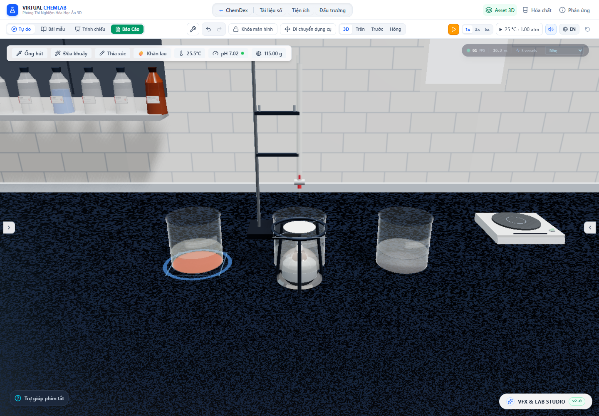

# Ổn định hiệu ứng và tài nguyên GPU — 04/11/2026

Đã sửa rò rỉ tài nguyên khi thay đổi chất lượng, giảm tải vẽ hạt và bổ sung khôi phục WebGL mà không khởi tạo lại thí nghiệm.

## Thay đổi

- Thay `ContactShadows` của phiên bản Drei đang cài bằng lớp sở hữu và giải phóng hai render target, hình học và toàn bộ material. Tài nguyên được cấp trong effect đã commit, có cleanup khi đổi độ phân giải/unmount, kể cả StrictMode. Các lượt dựng bóng khôi phục trạng thái renderer trong `finally`.
- Môi trường ánh sáng tĩnh được chụp một lần ở 128 px, dùng lại qua các mức chất lượng. Chụp lại sau khi khôi phục WebGL; không tái tạo bản đồ phản xạ theo mỗi lần render giao diện.
- Điều chỉnh chất lượng bằng thống kê toàn khung hình, gồm hậu xử lý. Hạ mức khi chậm kéo dài hoặc quá tải; cần 12 giây dư hiệu năng mới nâng và chờ 30 giây sau khi hạ. Không ngừng theo dõi sau một số lần đổi mức. Auto có thể nâng trên màn hình 60 Hz, tối đa high; ultra vẫn chọn thủ công được.
- Hạt kết tủa mức low/potato dùng hình học ít mặt hơn, giữ hình thái, kích thước và lượng chất. Bỏ bóng tiếp xúc ở hai mức này; low vẫn có bóng đèn chính. Chỉ upload/vẽ các hạt trang trí còn sống; không xóa đợt hạt phát trước khung đầu tiên. Thay đổi vị trí nguồn không phát lại burst tia lửa.
- Lấy mẫu khí trực tiếp qua các nguồn, giữ trọng số độ đục, không tạo mảng flatten theo từng loại khí mỗi khung. Tái sử dụng ma trận và thu hẹp subscription của toolbar, burette, modal AI đóng.
- Giới hạn framebuffer theo số pixel: potato 0,6 MP, low 1 MP, medium 1,8 MP, high 2,8 MP, ultra 4 MP. Sửa flex viewport để canvas thu nhỏ theo cửa sổ, không giữ chiều cao màn hình 4K sau resize.
- Khi mất WebGL, dừng vòng render; Auto chuyển về potato. Khi context trở lại, khôi phục kích thước viewport, bộ đếm và môi trường ánh sáng, tiếp tục dùng manager và dữ liệu thí nghiệm cũ.

## Kiểm chứng

- **195 file / 2.360 test** qua; thêm **1 test performance smoke** qua riêng để giữ nguyên artifact kiểm toán có sẵn. TypeScript và production build qua; build còn cảnh báo chunk lớn đã có.
- Chrome headless, Intel UHD/ANGLE D3D11, viewport 1440 × 1000, DPR thiết bị 1. Chạy FeCl₃ + NaOH, CaCO₃ + HCl, Zn + CuSO₄ cùng lúc; sau đó pause để kiểm tra đổi chất lượng không làm trôi hóa học/đồng hồ.
- [Trước khi sửa vòng đời GPU](../../artifacts/effect-performance/verified.json), ba lần trở về low tăng **30 → 36 → 42 texture**, **143 → 145 → 147 geometry**. [Lần cuối sau sửa](../../artifacts/effect-performance/final.json): **22 texture / 141 geometry**, giữ nguyên qua ba vòng medium → high → low, đã đi qua ultra và potato.
- Khối lượng đại diện cho phép sai số cộng số thực dưới 10⁻¹⁰ g khi đổi hạn mức hạt; dữ liệu hóa học và đồng hồ được so sánh chính xác, manager giữ cùng danh tính.
- Khung hình đang chạy sau warmup ở low trong lần cuối: 47, 61, 62, 57, 57 FPS. Kết quả này là phép đo một máy/cảnh ở bản dev, không phải cam kết FPS cho mọi thiết bị hay so sánh tốc độ trước/sau có kiểm soát.
- Viewport 3840 × 2160 ở high có drawing buffer **2280 × 1227**, dưới 2,8 MP. Khi thu cửa sổ, canvas trở về **1440 × 907**. Mất/khôi phục WebGL được giả lập thành công; lịch sử vẫn giữ nguyên, không lỗi JavaScript/console hoặc crash trang trong bài thử.

## Chạy lại

Khởi động Vite với `DISABLE_HMR=true` ở cổng 6773 rồi chạy `node scripts/auditEffectPerformance.mjs`. Nếu sửa nguồn hoặc bộ tối ưu dependency thay đổi trong lúc chạy, khởi động lại server và browser trước khi đo để tránh trộn các module store khác phiên bản. Script ghi JSON, CPU profile và ảnh trong `artifacts/effect-performance`, tự kiểm tra giới hạn pixel, tài nguyên GPU, hóa học và phục hồi context.
