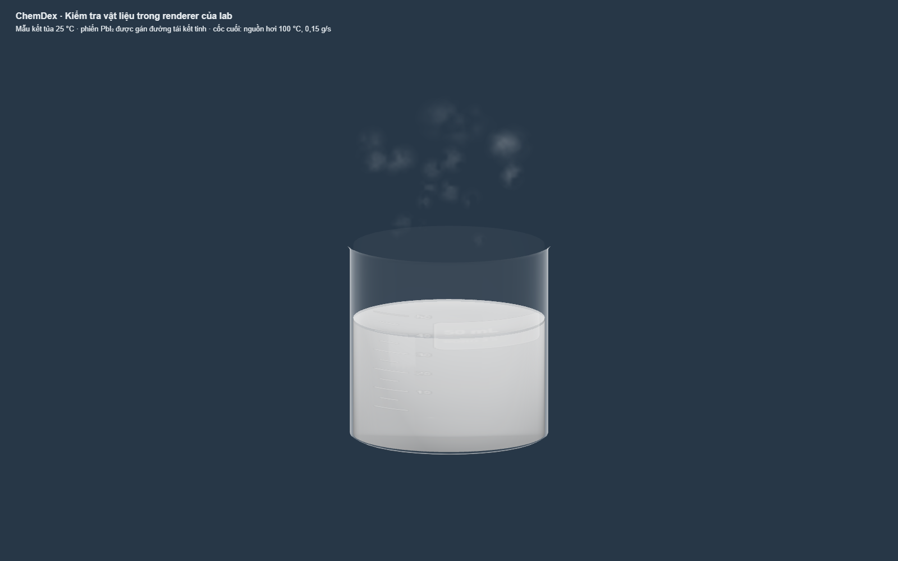

# Rà soát độ trung thực mô phỏng — 14/11/2026

Đợt này rà dữ liệu hiện hành, sửa vòng đời sương ngoài bình và đồng bộ PbI₂ mới kết tủa. Mục tiêu mô phỏng chi tiết toàn bộ phản ứng vẫn đang tiếp tục; kết quả dưới đây không chứng nhận tương đương thực nghiệm.

## Kiểm kê từ mã đang chạy

| Phạm vi | Kết quả | Ý nghĩa và giới hạn |
|---|---:|---|
| Chương trình hiệu ứng | 149 | Bao gồm 34 bài học và 6 quan sát không biểu diễn phản ứng theo mol; không cộng các nhóm này thành thí nghiệm mới |
| Quy tắc bộ giải | 48 | 4 quy tắc cân bằng pha hữu hạn |
| Phương trình ion được kiểm tra | 109 | Không lỗi cân bằng; không chứng minh hoạt độ/động học đúng |
| Quy tắc cacbonat suy diễn | 18 | Không lỗi cân bằng |
| Khai báo kết tủa | 43 | 43 có hồ sơ riêng, 0 sai danh tính hoặc sản phẩm rắn không khớp |
| Thuốc thử / hồ sơ sản phẩm rắn | 94 / 38 | Kiểm kê trạng thái, hình học, màu, mật độ và thông số hạt; chưa xác nhận độc lập từng trị số |
| Hồ sơ vật lí | 184 | 15 bình, 24 dụng cụ, 7 mẫu, 94 hóa chất, 38 sản phẩm, 6 môi trường; độ phủ không phải hiệu chuẩn |

Snapshot JSON của các audit nằm trong [thư mục bằng chứng](../../artifacts/mist-precipitate-fidelity/). Các báo cáo được tạo từ working tree tại thời điểm kiểm tra, kể cả các thay đổi có sẵn trước đợt này.

## Sương: sửa lịch sử nguồn và hệ tọa độ

Trước sửa, mỗi bước cập nhật lại lực nâng minh họa của **mọi** cụm sương bằng nhiệt độ nguồn mới. Bình đã ngừng phát hơi nhưng nóng tới 500 °C vẫn có thể tăng tốc sương cũ. Nhiễu ngang phụ thuộc độ cao tuyệt đối, nên dịch cùng cảnh lên cao cũng làm biến dạng quỹ đạo. Kích thước và vận tốc riêng của plume dùng đơn vị scene mặc dù đầu vào có thể dùng đơn vị cục bộ của bình.

Mỗi cụm sương nay giữ độ cao lúc sinh, tốc độ nâng ban đầu và thước chiều dài. Lực nâng minh họa giảm theo tuổi cụm trên thang trộn 2,5/s sẵn có, gió môi trường vẫn tác động theo m/s. Nhiễu dùng độ cao tương đối; kích thước, vận tốc và khoảng nhô khỏi miệng cùng được đổi đơn vị. Nguồn mới không thay nhiệt độ hoặc vị trí lịch sử của cụm cũ. Không thêm kho nước hay trừ khối lượng lần thứ hai.

Đây là sửa tính nhất quán của mô hình hiển thị. Hệ số trộn, thời gian sống, độ trong và đường kính cụm vẫn là giả định đồ họa. Chưa giải nhiệt độ riêng của cụm, kích thước từng giọt, CFD, va chạm với đồ vật hoặc trao đổi ẩm của cả phòng.

Cơ sở phân biệt hơi nước và sương: vùng fog chứa khí ẩm bão hòa và nước lỏng theo [ASHRAE, Psychrometrics](https://handbook.ashrae.org/Handbooks/F25/SI/F25_Ch01/F25_Ch01_si.aspx). Nguồn này hỗ trợ cách phân loại pha và cân bằng trộn; **không** xác nhận hệ số chuyển động/opacity của renderer.

## PbI₂: nhất quán giữa dữ liệu, diễn giải và hiệu ứng

Profile runtime trước đó đã phân biệt bột khi trộn lạnh và phiến khi có nhãn `CRYSTAL_PLATE`, nhưng bảng `PRECIPITATES_DATABASE`, lời mô tả chương trình và recipe cũ còn mặc định vảy lớn lấp lánh. Recipe còn có lớp ánh sáng phát ra.

Đã đồng bộ mặc định thành kết tủa vàng mịn, bỏ phát sáng và lựa chọn phiến tự động khỏi recipe cũ. Nhãn tái kết tinh riêng vẫn chọn hình học phiến lục giác. Khoảng bán kính 0,5–2 µm chỉ là đầu vào minh họa tương thích với hạt ban đầu cỡ 1 µm của runtime; không phải phân bố kích thước đo được.

[RSC: Golden rain](https://edu.rsc.org/exhibition-chemistry/golden-rain/2000048.article) mô tả chu kỳ hòa tan trong nước nóng rồi làm nguội để có tinh thể vàng lục giác lớn. [RSC: Silver and lead halides](https://edu.rsc.org/experiments/silver-and-lead-halides/1770.article) đối chiếu màu và hiện tượng tan khi đun. Những nguồn này không chứng nhận thời gian trình chiếu hoặc màu RGB cụ thể.

## Kiểm chứng

- Ba test mới đều thất bại trước sửa: độc lập với nhiệt độ nguồn về sau, bất biến khi dịch cao độ, và bất biến theo thước đơn vị cục bộ. Sau sửa đều đạt.
- Bộ đầy đủ: **238 file, 3.201/3.201 test đạt**, chạy `npx vitest run --maxWorkers=2 --reporter=dot`. Lượt baseline mặc định trước sửa có 1 lỗi ngưỡng thời gian trong performance smoke khi chạy đồng thời nhiều worker; kiểm tra riêng đạt, lượt đầy đủ giới hạn worker cũng đạt. Không sửa ngưỡng để che lỗi.
- `npm run lint` và `npm run build` đạt. Build còn cảnh báo chunk lớn.
- Kiểm tra Chrome WebGL bằng SwiftShader dùng **renderer thật**, với kho mẫu và nguồn hơi cấp sẵn: 26 cụm sương, alpha hợp lệ, ma trận hữu hạn, ma trận world khử đúng frame của bình; tạm dừng giữ trạng thái; ngắt nguồn rồi tiến 2,5 s hết cụm; tổng hơi được chấp nhận giữ 0,15 g. Không lỗi shader/WebGL được ghi nhận.
- Cảnh so sánh phân biệt profile PbI₂ bột và phiến; phiến được cấp nhãn thủ công, không phải bằng chứng đã mô phỏng chu trình tái kết tinh.
- Logic benchmark ba bình: trung bình khoảng 2,15 ms/bước, p95 khoảng 4,00 ms. Không bao gồm WebGL và không phải cam kết FPS thiết bị người dùng.

Ảnh cận dùng nền tối để thấy sương; đây là kiểm tra quang học của hạt, không chứng nhận độ trong của dung dịch hoặc toàn bộ ánh sáng trong phòng lab. Audit chờ instance thực sự upload, tránh chụp trước khi frame của bình được đồng bộ; bài kiểm tra vị trí dùng không khí tĩnh để tách chuyển động do gió.

Chạy lại: mở Vite ở `127.0.0.1:6777`, rồi chạy `node scripts/auditMistAndPrecipitateFidelity.mjs`. Các audit dữ liệu: `npm run science:audit`, `npm run physics:audit`, `npx tsx scripts/auditPrecipitateCoverage.ts`, `npx tsx scripts/auditStockMaterials.ts`.

## Các hạng mục chưa đủ để nghiệm thu mục tiêu tổng thể

| Hạng mục | Phần cần hoàn thiện | Bằng chứng cần có |
|---|---|---|
| Tạo kim loại trên vật rắn | `zn_agno3`, `mg_cuso4` còn bị audit đánh dấu chưa xác minh bám bề mặt | Theo dõi khối lượng nguồn → lớp bám → mảnh rời và ảnh qua các góc nhìn |
| Ferrocyanide | Ba chương trình còn dùng proxy vận chuyển, gồm hệ Prussian/Turnbull blue và đồng ferrocyanide | Nguồn về thành phần/hydrat hóa và dữ liệu mật độ, kích thước phù hợp |
| Kết tủa từng chất | Tạo mầm, tăng trưởng, kết bông, lắng và hòa tan chưa hiệu chuẩn riêng toàn bộ | So sánh theo nồng độ, nhiệt độ, cách rót và khuấy; kiểm tra bảo toàn |
| Tái kết tinh PbI₂ | Có lựa chọn hình học nhưng chưa chứng minh chu kỳ nhiệt sinh đúng phân bố tinh thể | Thử nghiệm nóng → tan → nguội → kết tinh với kho pha hữu hạn |
| Bay hơi / sương / khói | Phân biệt pha đã có, vận chuyển và quang học còn mô hình rút gọn | Khối lượng–enthalpy, độ ẩm, khí mang, va chạm biên, nhiều nguồn và tan dần |
| Asset và hình ảnh toàn danh mục | Audit này xem một nhóm chất, chưa nghiệm thu mọi bình/chất ở mọi góc nhìn | Lưới ảnh mọi profile, nhiều mức chất lượng, kiểm tra xuyên thành, lớp lắng, vật liệu trong suốt và tương phản |
| Hiệu năng | Chưa đo FPS GPU thiết bị thật hoặc tải lớn toàn phòng | Benchmark trình duyệt trên các thiết bị đích, ghi rõ độ phân giải và số bình |

Không đánh dấu mục tiêu tổng thể hoàn thành khi các hạng mục này còn mở.
