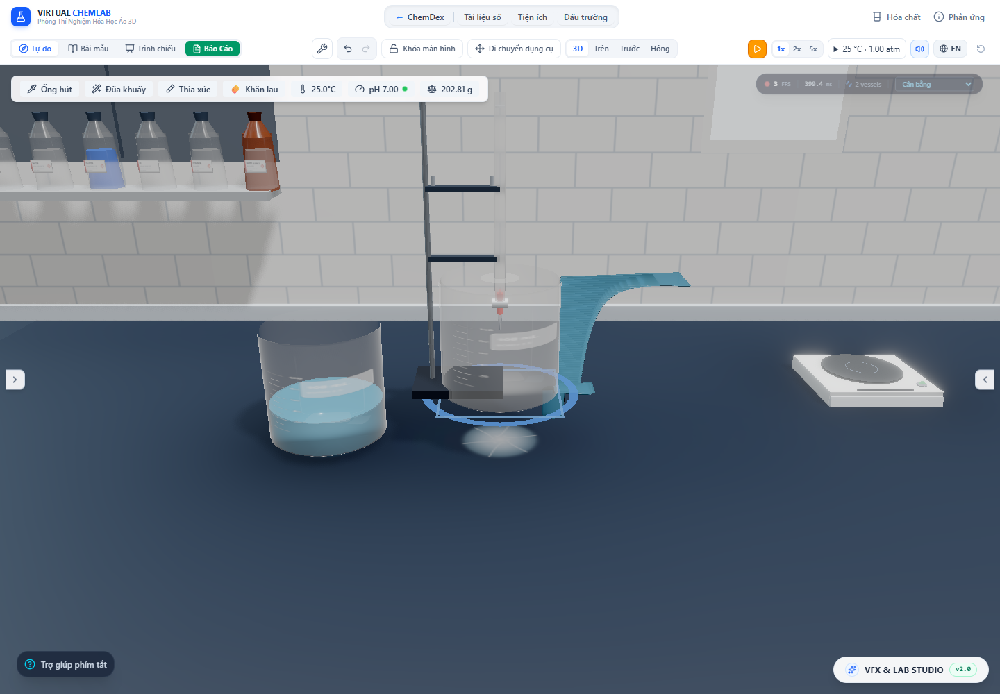

# Kho tràn ngoài thành hữu hạn — 29/10/2026

**Đợt tiếp theo:** [Màng tràn quanh miệng tròn](circular-overflow.vi.md) đã thay bề rộng spout/dải tràn trong trường hợp bình đứng đồng mức. Các số đo và ảnh bên dưới giữ lại để đối chiếu trạng thái trước thay đổi hình dạng.

Tiếp tục mục tiêu nâng chi tiết phản ứng, tràn dung dịch và độ đúng vật lý. Đợt trước đã chỉ ra vũng xuất hiện ngay khi có receipt qua mép. Lỗi **ghi vũng trước va chạm** đã được thay bằng vận chuyển hữu hạn; toàn mục tiêu “mọi thứ thực tế” vẫn chưa hoàn tất.

## Một chủ sở hữu vật chất

Các receipt tràn có bình nhận xác định nay tạo `PourParcel` với `stage: overflow` trong `inFlightPours`. `sample` chứa **toàn bộ lượng chưa đến bàn**, bao gồm thành phần, số mol, khối lượng, nhiệt độ và màu của phần bị từ chối. Không debit nguồn lần hai, không tạo thêm nước để vẽ.

Các phần `queued`, `wall`, `air` chỉ là phân vùng tính từ cùng một packet, không phải ba kho cộng thêm. `queued` là phần của khoảng cấp chưa được phát ra trong mô hình interval. Khi biết khoảng cấp thật từ dòng đang bay, packet giữ lưu lượng đó (`metered`); API dose/stock không có dữ liệu thời gian dùng khoảng cấp giả định **0,12 s**, ghi `assumed-dose-interval`. Kho nguồn đã debit theo giao dịch API; lượng đang chờ thuộc packet đó, chưa được vẽ thành dòng trước đầu chất lỏng.

Mặt bàn chỉ nhận phần đã qua cả thời gian chảy ngoài thành và thời gian bay. Với interval cấp `D`, thời gian đi thành `Tw`, thời gian bay `Tf`, phần đã tới bàn tại thời điểm `t` là:

`clamp((t − Tw − Tf) / D, 0, 1)`.

Mỗi lần cập nhật chỉ chuyển phần tăng mới sang `spills`; lượng chưa tới vẫn ở packet. Sự kiện `spill:impact` phát **sau** transaction cập nhật kho. Ripple chỉ có sau sự kiện đó. Sự kiện `vessel:overflow` mang `transported: true`, nên renderer trang trí cũ không vẽ thêm cascade/giọt thứ hai. Thống kê phiên đếm lượng vượt sức chứa một lần, không đếm lại khi packet chạm bàn.

Renderer tràn trang trí đã được bỏ khỏi cây cảnh chính; scene dùng mesh của kho vật chất. Test listener theo dõi **mọi store-version** còn bắt được khoảng cập nhật thiếu 20 mL giữa lúc debit nguồn và ghi packet. Dose/continuous transfer nay commit nguồn, bình nhận và phần tràn bằng một update. Stock rắn đẩy nước cũng commit phần giữ lại và nước bị đẩy cùng nhau, kể cả khi bình nghiêng. Không chỉ trạng thái cuối lệnh mới cân bằng.

Đường finite pour, dose API, stock bị từ chối, vật rắn chiếm chỗ đẩy nước và nước rửa vượt sức chứa dùng cơ chế này. Ground-deposition API không chỉ định bình vẫn giữ nghĩa deposition sẵn có; chưa biến mọi thao tác wash/shatter/đổ trực tiếp thành một bài toán bay mới.

## Thành, trọng lực và cân

Kế hoạch thành dùng contour ngoài thật của mesh, với cùng cơ sở local Nusselt + giới hạn thời gian theo năng lượng như màng trong. Các điểm trùng cao độ lấy bán kính ngoài lớn nhất, nên nước không đi về tâm tại nắp đáy phẳng. Thời gian rơi dùng gia tốc/đơn vị cảnh chung và vận tốc rời đáy của kế hoạch thành.

`outerWallCoatingMass_g` và `outerWallCoating_ml` là **bản sao dẫn xuất để cân/hiển thị**, không nằm trong contents hoặc được cộng thêm vào tổng kho chất. Cân cộng phần còn được thành/miệng bình đỡ, bỏ phần đã bay. HUD và balance dùng cùng lượng này. Phần chưa phát hết trong khoảng cấp vẫn thuộc phần được đỡ trong quy ước interval.

Khi bình dịch chuyển/đổi yaw, hệ tách phần đã bay theo khoảng sinh của nó, giữ quỹ đạo thế giới cũ. Phần còn trên thành theo pose mới. Khi xóa, vỡ, nghiêng hoặc thay thân bình, phần đang bay vẫn giữ quỹ đạo; phần còn bám tách ra tại **điểm đại diện** trên thành ở pose hợp lệ cuối. Giữ đủ khối lượng/thành phần, nhưng chưa giải phân bố vận tốc chi tiết sau đứt màng hoặc gia tốc của bình. Xóa bình vẫn mang nghĩa xóa chính dụng cụ/mẫu trong nó theo API hiện hành; test không coi phần mẫu người dùng đã xóa là vật chất phải còn trên bàn. Riêng packet tràn ngoài không bị xóa theo thân bình.

Save, reload, undo và redo serialize cả packet, kế hoạch thành và phần còn lại. Không phục hồi nguồn cũ đồng thời giữ packet đã debit.

## Hình học cũng theo lượng chất

`ExteriorFilmGeometry` là các strip khép kín. Mỗi đoạn nhận đúng `Q × Δt`. Bề dày không bị clamp rồi làm mất thể tích hiển thị; nghiệm bậc hai điều chỉnh mặt cắt để thể tích đa diện khớp lượng chất. Các đoạn kết thúc tại knot của contour, có end-cap, giữ thể tích qua phần vai/cổ và khi quay/di chuyển.

`TransitStreamGeometry` cũng có end-cap và chuẩn hóa thể tích để bù thiếu diện tích của polygon 12 cạnh và sai số chia đoạn thời gian. Các kiểm tra thể tích tích phân lại tam giác của mesh độc lập với phép tính khối lượng kho.

Phần `queued` chưa phát không vẽ một tia trước đầu dòng. Đây là quy ước cấp theo interval, không chứng minh vị trí vi mô của một liều API tức thời. Vũng được tạo từ lượng đã thực sự đến bàn, tiếp tục dùng hình học sessile-drop hiện có.

## Bằng chứng

[Test](overflow-transit-2026-10-29/test-results.json), [browser audit](overflow-transit-2026-10-29/browser-audit.json), [script](../../scripts/auditOverflowTransport.mjs).

Kết quả cuối đợt: **173 file / 2.130 test qua**, 0 thất bại, TypeScript qua. [Production build](overflow-transit-2026-10-29/build.log) qua trong 27,33 s, còn cảnh báo chunk lớn. [Audit gộp phản ứng + tràn hiện hành](overflow-transit-2026-10-29/contact-and-overflow/browser-audit.json) cũng qua; browser ghi mọi dose-version đều 150 g, không có khoảng hụt khối lượng giữa lệnh. Hai harness không ghi lỗi JS/WebGL console.

- Test mới kiểm tra trước va chạm, nhận dần, bảo toàn khối lượng và từng nguyên tố, 10/30/60/120 FPS, tạm dừng, cân, dịch chuyển, xóa/vỡ/nghiêng, dose/stock/đẩy nước, mesh, sự kiện sau commit, save/undo/redo.
- Mesh được kiểm tra bằng thể tích từ tam giác ở beaker, flask và test tube, gồm quay và tịnh tiến. Màng trong và ma trận rót cũ tiếp tục được kiểm tra.
- Test cũ giả định vũng tức thì được đổi thành kiểm tra lượng nằm trong packet trước va chạm **và** lượng/khối lượng cuối trong vũng; giữ các kiểm tra tỷ lượng, không sinh phản ứng với stock bị từ chối, solid ở lại nguồn và transaction nguyên tử.
- Trình duyệt actual app, Chrome/Intel UHD, hai bình có tổng 150 g, dose 20 mL vào bình đầy. Không lỗi JS/WebGL console trong lần kiểm tra. Thời gian được điều khiển bằng actual production reducer để chụp chính xác các mốc, không dùng ảnh để suy tốc độ thực nghiệm/FPS.

| Mốc browser | Trên thành, mL | Đang bay, mL | Chờ cấp, mL | Đã tới bàn, mL | Tổng kho, g |
| --- | ---: | ---: | ---: | ---: | ---: |
| Thành, t = 0,02 s | 3,333333 | 0 | 16,666667 | 0 | 150 |
| Đang bay, trước va chạm | 17,806786 | 2,193214 | 0 | 0 | 150 |
| Nhận một nửa | 5,613572 | 4,386428 | 0 | 10 | 150 |
| Nhận hết | 0 | 0 | 0 | 20 | 150 |

Tại mốc trước va chạm, thể tích mesh thành 17,806784 mL và mesh bay 2,193214 mL khớp lượng tương ứng trong sai số Float32. Sau kéo bình, hai vũng nằm tại vị trí cũ/mới; tổng vẫn 20 mL. Reload giữ tổng 150 g và tổng ngoài bình 20 mL. Kịch bản này là **xung 20 mL/0,12 s theo giả định API**, không phải phép đo đổ chậm.



## Cơ sở và giới hạn còn phải xử lý

[Du và cộng sự (2022)](https://www.frontiersin.org/journals/energy-research/articles/10.3389/fenrg.2022.899023/full) trình bày màng rơi Nusselt trong điều kiện steady, laminar, bề mặt không dao động và tương tác không khí nhỏ. Nó không xác nhận độ bám/bề rộng ướt của dụng cụ 3D hoặc xung lưu lượng cao hiện tại. [OpenStax — Projectile Motion](https://openstax.org/books/university-physics-volume-1/pages/4-3-projectile-motion) hỗ trợ chuyển động bay dưới trọng lực khi bỏ cản khí.

**Không coi bảo toàn thể tích là bằng chứng rằng hình dạng đã giống nước thật.** Bề rộng đang lấy theo spout, giả định bám toàn thành và quy tắc tách ở đáy chưa hiệu chuẩn. Xung lớn có thể làm ribbon loe dày/cạnh rõ; ảnh kiểm tra cho thấy hạn chế này. Nusselt laminar không được xác minh ở Reynolds cao; `reynolds4` được giữ trong plan để kiểm toán, không dùng tên model để tự khẳng định tính hợp lệ.

Phần còn lại của mục tiêu vẫn gồm:

1. Bề rộng ướt, dòng bám/tách mép và vỡ giọt theo điều kiện vật liệu/lưu lượng; xử lý xung lớn và hình dạng không còn như ribbon phẳng.
2. Khoảng cấp thực cho dose/stock, giảm phụ thuộc giả định 0,12 s; tiếp tục đồng bộ các thao tác có vòi/giọt riêng.
3. Những đường shatter/wash xuống bàn trực tiếp, co giãn nhiệt, phản ứng làm đổi thể tích, lớp lỏng không trộn và động lực học bọt/áp suất chưa được chứng minh chung với kho tràn ngoài.
4. Hiệu chuẩn tốc độ phản ứng, hệ số dòng và tỉ lệ kích thước dụng cụ bằng dữ liệu thực. 54 chương trình dung dịch đã nhanh hơn nhưng half-time vẫn là metadata minh họa.

## Tái chạy

Từ `lab-3d`:

```powershell
npx vitest run --maxWorkers=2 --exclude tests/performance.smoke.test.ts
npm run lint
npm run build
# Vite dev ở cổng 6773:
node scripts/auditOverflowTransport.mjs
# Phản ứng nhanh + vận chuyển tràn hiện hành:
node scripts/auditContactAndDischarge.mjs
```

Audit gộp ghi vào `overflow-transit-2026-10-29/contact-and-overflow/`; giữ lại bằng chứng cũ tại `contact-and-discharge-2026-10-29/` để đối chiếu lỗi đã sửa.
