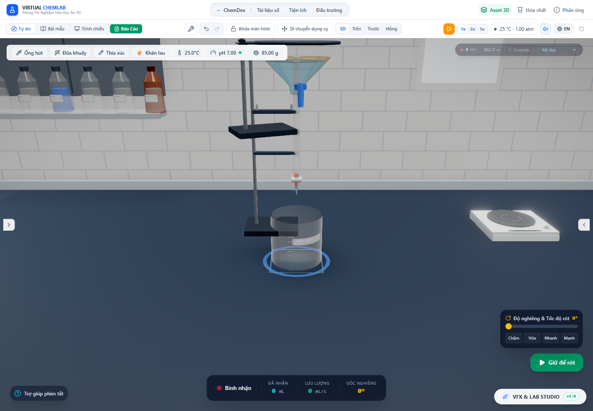

# Cột áp hai pha và dòng xả phễu hữu hạn

Ngày kiểm tra: 30/10/2026. Thay tốc độ phễu phân lớp cố định 2,5 mL/s bằng quan hệ xả theo phần cửa van tiếp xúc từng pha và cột áp của chúng. Chất rời phễu đi vào kho dòng bay, chưa được cộng ngay vào bình nhận. Hai mesh minh họa không có kho chất — ống nước phễu phân lớp và giọt phễu lọc — đã được bỏ.

Đây là mô hình tham chiếu quán tính có thông khí và giả định ống đã mồi (`vented-inertial-port-reference`). Nó cải thiện tính phụ thuộc hình học, pha và bảo toàn; chưa phải lưu lượng phễu thực đã hiệu chuẩn.

## Áp suất và cửa van

[Áp suất thủy tĩnh](https://openstax.org/books/university-physics-volume-1/pages/14-2-measuring-pressure) cộng theo trọng lượng các lớp nằm trên điểm xét. [Bernoulli](https://openstax.org/books/university-physics-volume-1/pages/14-6-bernoullis-equation) liên hệ chênh áp, độ cao và vận tốc trong giới hạn lý tưởng. Mã áp dụng các quan hệ này vào một closure có Cd giả định, không xem nguồn lý thuyết là kiểm chứng Cd hoặc tổn thất của phễu cụ thể.

Gọi c₁ là mặt phân cách, c₂ là mặt thoáng; z là cao độ theo hướng trọng lực. Với điểm cửa van nằm trong pha dưới, áp suất dư là `g[ρ₁(c₁−z) + ρ₂(c₂−c₁)]`. Với điểm nằm trong pha trên, áp suất dư là `gρ₂(c₂−z)`. Đổi chênh áp thành cột áp của **pha đang chảy**, cộng chênh cao từ cửa van tới đầu ống, rồi tính vận tốc tham chiếu `sqrt(2gH)` nếu H dương.

`funnelDischarge.ts` tích phân `Cd * sqrt(2gH) * dA` trên các dải của cửa tròn tiếp xúc từng pha. Hướng trọng lực lấy đủ ba thành phần trong hệ thân. Các biên tích phân gồm mặt phân cách, mặt thoáng và chỗ cột áp về 0. Vì vậy, khi nghiêng có thể chỉ một pha chạm van, cả hai pha cùng chạm van hoặc van khô; không luôn chọn toàn bộ pha dưới.

Gauss–Legendre 24 kết hợp ánh xạ sin hai lần làm trơn đầu mút đường tròn và đầu mút căn bậc hai của vận tốc. Cột áp đồng đều có nhánh diện tích chỏm tròn trực tiếp. Không có sàn Q tối thiểu hoặc hệ số tăng tốc thời gian.

Cửa tham chiếu dùng bán kính nhỏ nhất của lòng ống dưới khoang, 0,06 đơn vị model; cửa van tại y = −0,45, đầu ống tại y = −1,25. Đổi sang SI theo thước dung tích chung của thân. Cd = 0,62 là giả định, không phải đo cấu tạo bên trong van. Với stock có bố trí được hỗ trợ, hai mặt cắt dùng [phần ngập lưới](layered-stock.vi.md); nhánh còn lại được ghi `liquid-only-reference`, chưa chứng nhận chiếm chỗ của mọi loại cặn.

Nguồn bị đậy kín không xả trong closure có thông khí này. Đây là quy tắc giới hạn mô hình, chưa giải quá trình xả ngắn trước khi chân không hình thành trong bình kín. Mesh nút mài giờ chỉ hiện khi `isSealed`, để ngoại hình khớp trạng thái đó.

## Tích phân thời gian và giao dịch chất

`stepFunnelFlow` là bước bảo toàn với lưu lượng cố định trong bước. `advanceFunnelFlow`, đường store thực sử dụng, dự báo nửa bước rồi tính lại lưu lượng ở điểm giữa cho các khoảng dòng liên tục. Dự báo là phép tính thuần, không rút chất khỏi store. Khi một pha có thể hết trong bước, dùng bước sự kiện hữu hạn có chặn theo kho, không tạo lượng âm.

Hai pha cùng chạm cửa được rút theo hai lưu lượng riêng rồi gộp thành một aliquot; dung tích bình nhận không ưu tiên pha chỉ vì thứ tự vòng lặp. Khối lượng/mol và `organicVolume_ml` giữ trong mẫu. Thời gian phát cuối được rút ngắn theo lượng còn lại và lưu lượng, thay vì kéo một mẫu rất nhỏ suốt dt. Ngưỡng cạn cứng 10⁻¹² mL đã được bỏ; test riêng giữ đúng kho dương 10⁻¹³ mL, không chứng nhận GPU thể hiện được kích thước ấy.

Khi một pha hết giữa bước, khoảng thời gian còn lại chưa được tái dùng chính xác cho pha kế tiếp; pha đó tiến ở lần cập nhật sau. Vì vậy bằng chứng hội tụ trong khoảng dòng liên tục bên dưới không chứng nhận thời điểm chuyển pha đã chính xác đến mọi dt.

## Nguồn → dòng bay → bình nhận/tràn

`funnelTransport.ts` tạo `PourParcel` cho đúng aliquot đã rời nguồn, xuất phát tại đầu ống thật. Hướng và vị trí sinh được chụp từ ma trận thân đang vẽ; khi không có renderer, dùng tư thế canonical. Vận tốc là vận tốc tương đương thông lượng của closure, hướng theo trục đầu ống. Đây chưa phải nghiệm hai pha bên trong ống.

Store công bố nguồn đã giảm và parcel mới trong cùng một lần cập nhật. Nếu không dựng được quỹ đạo hợp lệ, không thực hiện lần rút chất. Khối lượng không biến mất giữa hai giao dịch, và bình nhận chưa tăng ngay lúc nguồn xả.

Parcel dùng pipeline có sẵn để bay, kiểm tra vị trí bình nhận tại thời điểm tới, nhập màng thành hoặc bulk và chuyển phần vượt sức chứa sang kho tràn hữu hạn. Đóng van sau khi đã phát không xóa đuôi đang bay. Di chuyển bình nhận không kéo dòng đã rời nguồn đi theo. Với chương trình aliquot được hỗ trợ, clock/chương trình phản ứng được chuyển qua chuẩn bị mẫu và nguồn tiếp tục phản ứng sau khi mất bớt mẫu.

Phễu lọc cũng dùng vận chuyển hữu hạn này và giữ cặn trên giấy. Tốc độ lọc vẫn là tham chiếu minh họa 2 mL/s; chưa thay bằng trở lực giấy/bánh lọc. Bộ chọn bình nhận còn dùng điều kiện vị trí; quỹ đạo xác nhận va chạm với bình được chọn, chưa phải bộ giải va chạm mọi vật trong cảnh.

## Số đo trong app

[Audit Chrome](funnel-discharge-2026-10-30/browser-audit.json) dùng phễu 150 mL có 20 mL nước và 10 mL pha hữu cơ, mật độ đầu vào 0,879 g/mL. Mỗi xung dài 5 ms, app tạm dừng giữa các bước kiểm tra. Audit chủ động invalidate canvas sau bước vận chuyển rồi chờ draw, tránh đọc buffer trước khung hình mới.

| Ca | Q đầu bước | Lượng rời nguồn trong xung | Thời gian bay ban đầu | Hành vi đã kiểm tra |
|---|---:|---:|---:|---|
| Đứng, bình nhận trống | 11,870712 mL/s | 0,059348476 mL | 0,087977 s | Bình nhận tăng khi dòng tới; đóng van vẫn giữ đuôi |
| Nghiêng 1,08 rad | 6,748291 mL/s | 0,033736528 mL | 0,153334 s | Cả nước và hữu cơ cùng vào mẫu; quỹ đạo này không vào bình đặt thẳng dưới |
| Cửa khô khi úp | 0 | 0 | — | Không rút hoặc vẽ dòng giả |
| Bình nhận 99,999 mL | 11,870712 mL/s | 0,059348476 mL | 0,060386 s | Bình nhận tới 100 mL; phần dư có chủ sở hữu trong kho tràn |
| Dời bình nhận khi đang bay | 11,870712 mL/s | 0,059348476 mL | 0,087977 s | Bình đã dời không nhận mẫu; vật chất tới bàn |
| Nguồn đậy kín | 0 | 0 | — | Không phát; mesh nút mài hiện đúng trạng thái |

Q trong bảng là giá trị đầu bước. Lượng phát dùng lưu lượng điểm giữa, không phải Q đầu bước nhân dt. Tại 1,08 rad, Q ban đầu gồm 6,728818 mL/s nước và 0,019472 mL/s hữu cơ. Các số này là kết quả closure, không phải số đo lưu lượng ngoài thực nghiệm.

Ở giữa chuyến bay, khi cả packet đã phát và chưa chạm bình, thể tích lưới được đo trên đúng draw range của buffer thật. Ví dụ ca đứng: khoảng 0,059348477 mL so với kho 0,059348476 mL. Audit yêu cầu sai số tương đối dưới 10⁻⁵ và kiểm tra lại qua low/medium/high/ultra. Kho chất cũng không đổi khi đổi chất lượng; không suy ra FPS từ phép đo này.

Ca bình nhận gần đầy có nước bay hơi trong tick nhiệt thật: khoảng 4,446×10⁻⁷ g. Audit giữ riêng ngân sách nước không còn trong bulk theo receipt bay hơi/trả màng, cộng mol H₂O tương ứng khi kiểm tra bảo toàn. Phần thể tích cộng lại là **thể tích nước lỏng tương đương**, không phải thể tích khí. Không tăng ngưỡng sai số để bỏ qua sink nhiệt này.



Một packet 5 ms rất ngắn; ảnh không dùng dải nước dày kéo kín khoảng trống để dễ thấy. HUD đang chọn bình nhận và app tạm dừng; góc/FPS trên đó không là số đo nguồn. Giá đỡ vẫn đi cùng nhóm thân khi giữ tư thế kiểm tra, chưa có tiếp xúc cơ học độc lập với bàn.

## Đối chiếu số học và kiểm tra

[Benchmark và oracle](funnel-discharge-2026-10-30/cpu.json) có ba phần tách biệt:

- Cửa tròn có cột áp đồng đều khớp công thức `Cd πr² sqrt(2gH)` và luật r². Cửa ngập một phần có chênh lệch khoảng 2,62×10⁻⁹ mL/s với tích phân midpoint độc lập 200.000 dải ở fixture đã lưu.
- Oracle RK4 độc lập cho một giây xả đứng, còn pha dưới, cho nước còn 8,356913559 mL. Sai số bước Euler ở 20 / 60 / 120 Hz lần lượt khoảng −0,01187557 / −0,00396382 / −0,00198257 mL. Đường midpoint mới tương ứng khoảng −1,318×10⁻⁵ / −1,460×10⁻⁶ / −3,648×10⁻⁷ mL. Đây là đối chiếu tích phân của cùng giả định vật lý, không hiệu chuẩn closure với thí nghiệm.
- CPU: 30 lượt làm nóng và 120 hướng thay đổi, đo riêng hàm lưu lượng và bước midpoint. Không gồm React, upload, draw, hóa học, vận chuyển hoặc va chạm. Median/p95 thô lưu trong JSON; không dùng làm bằng chứng FPS.

Ở lượt đo đã lưu, hàm lưu lượng có median/p95 khoảng 0,0933 / 0,3795 ms; bước midpoint khoảng 0,1846 / 1,0354 ms trên Node v26.7.0. Đây là số đo CPU cục bộ, không phải bảo đảm ngân sách khung hình trên mọi máy.

11 test mới bao phủ công thức chuẩn, cột áp hai mật độ, cửa ngập một phần/hai pha/khô, lưu lượng theo lượng hữu hạn, phát cuối, bước giữa so với oracle, kho rất nhỏ, ma trận sinh, thời gian bay và công bố source/parcel nguyên tử. Các test lọc cũ đã đổi fixture để đầu ống ở trên bình nhận, rồi chờ chuyến bay thay vì đòi nhận ngay lúc xả.

[Correctness suite](funnel-discharge-2026-10-30/test-results.json): **189 file, 2.345/2.345 test qua**, lượt cuối dùng một worker. [TypeScript](funnel-discharge-2026-10-30/lint.log), [build](funnel-discharge-2026-10-30/build.log) và [hồi quy hai pha có Zn](funnel-discharge-2026-10-30/layers-regression/browser-audit.json) đều qua. Suite loại `tests/performance.smoke.test.ts` để giữ artifact benchmark lịch sử. Test bảo toàn ngưng tụ mô phỏng 600 giây được tăng timeout 15 → 60 giây sau khi đo khoảng 24 giây khi chạy riêng trên máy này; không sửa vòng tích phân hoặc assertion bảo toàn. Trong lượt toàn bộ cuối, riêng ca này chạy khoảng 21,1 giây. Build còn cảnh báo chunk lớn hơn 500 kB.

```powershell
node --import tsx scripts/benchmarkFunnelDischarge.ts
# Vite chạy cổng 6773:
node scripts/auditFunnelDischarge.mjs
```

## Phần chưa hoàn thành của mục tiêu lab

Chưa hiệu chuẩn Cd, độ mở van, trở lực nhớt/turbulence, mao dẫn/đứt giọt, quá trình mồi ống và lượng giữ trong ống. Tách áp suất theo dải chưa giải tương tác hai pha trong ống hoặc dạng tia/nhũ tương; hình ảnh dùng dòng tương đương, kho vẫn giữ thành phần pha. Chưa giải vật rắn bít cửa, lăn/trượt, vật nổi ở biên pha hoặc hình học chiếm chỗ của mọi loại bột/cặn. Slosh và áp suất bình kín chưa được ghép vào luật xả này. Thời gian sự kiện chuyển pha còn cần tích phân chính xác hơn. Các giới hạn này vẫn thuộc mục tiêu đang tiếp tục, không được coi là đã hoàn thành nhờ kiểm tra bảo toàn và oracle qua.
