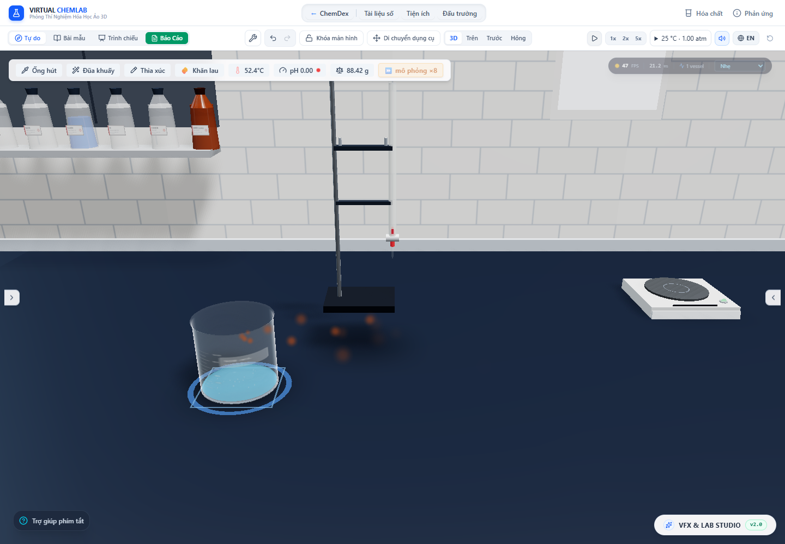

# Vòng đời đám khí và receipt khí thoát

Ngày kiểm tra: 29/10/2026. Tiếp nối [đợt sửa tư thế hạt/khí](tilted-particles.vi.md), đợt này tách mô phỏng đám khí màu khỏi vòng đời renderer của bình. Khí/hơi nước vẫn dùng nhánh pha nước riêng; báo cáo này nói về khí màu được catalog cho phép hiển thị.

## Sai lệch tìm thấy

GasPlume trước đây tạo GasPlumeSystem bằng `useMemo` có phụ thuộc số glyph theo chất lượng. Đổi chất lượng tạo hệ mới và xóa lịch sử đám khí. Renderer nằm trong nhánh hiệu ứng của bình; tháo nhánh đó, xóa bình hoặc thay mẫu có thể làm mất khí đã thoát.

Nguồn trước đây lấy flux hiện tại nhân thời gian của từng khung hình. Store hóa học có thể giữ một flux cũ giữa các lần commit được throttle khoảng 50 ms. Lượng phát hình khi đó phụ thuộc thời điểm renderer đọc flux, và không thể coi việc giữ một giá trị flux là một receipt khí mới.

## Quyền sở hữu và thời gian

`GasCloudRepository` là kho tạm trong bộ nhớ ngoài React. Nó phân biệt **ID bình + revision mẫu + loài khí**. Một renderer toàn cảnh GasClouds điều phối thời gian, còn mesh chỉ đọc và vẽ dữ liệu. Renderer của bình không sở hữu hoặc xóa quần thể khí ngoài bình.

- Phản ứng ngừng phát: lượng đã nhận vẫn được phát hết và đuôi khí tiếp tục chuyển động/tan theo mô hình hiện hành.
- Thay mẫu cùng ID: quần thể mới có revision riêng; quần thể cũ giữ tuổi, nhiệt độ nguồn, loài và lịch sử riêng.
- Xóa/vỡ bình: chấm dứt nguồn mới, không xóa các receipt đã nhận hoặc hạt đã thoát. Vỡ bình chưa tự tạo một nguồn khí mới nếu ledger không ghi nhận nó.
- Đổi chất lượng hoặc tháo/mount renderer: không tạo lại hệ mô phỏng. Khi tạm dừng, tuổi, hàng đợi và lượng đã nhận đứng yên.
- Reset, đổi thí nghiệm, Undo/Redo làm thay đổi material timeline (`pourEpoch`): xóa biểu diễn khí tạm của timeline trước. Chưa khôi phục lịch sử không gian đám khí từ snapshot cũ.

Mỗi GasFlux của store là một receipt runtime bất biến. Với khoảng nhận `Δt` và flux thoát `ṅ`, kho nhận **ṅ × Δt mol đúng một lần theo danh tính receipt**, không nhận lại chỉ vì có thêm khung hình. Receipt của từng loài có thời lượng riêng; hình ảnh phát lượng đó trong một khoảng bằng Δt kể từ khi được chuyển cho kho khí. Nếu nguồn biến mất trong lúc còn hàng đợi, phần đã nhận vẫn được giữ.

Đây là **cách ghép có độ trễ**, không phải tái dựng vị trí/thời điểm thoát liên tục bên trong bước hóa học. Throttle của store, thời lượng receipt và phần dư 1/120 giây có thể làm hình ảnh chậm hơn ledger. Khí đã thoát trong ledger là nguồn sự thật; số mol receipt trong mô phỏng khí là bộ đếm đối chiếu, không phải kho vật chất thứ hai để cộng thêm vào tổng khối lượng.

Flux được lưu từ phiên trước bị bỏ khi khởi tạo store: đó là phép đo của bước cũ, không phải nguồn phát mới sau reload. Lượng khí đã thoát cộng dồn vẫn nằm trong ledger; đám khí quang học không được lưu qua reload.

Một lỗi dọn quần thể được tìm thấy bằng app thật: số dư thời gian dưới 1/120 giây của một khoảng **không còn nguồn** có thể tồn tại mãi. Kho nay chỉ giữ quần thể rỗng nếu còn receipt hoặc còn lượng khí chờ tích phân; dư thời gian môi trường đơn thuần không ngăn dọn kho. Kho nguồn nhỏ vẫn giữ credit lấy mẫu đủ lâu để các receipt ngắn liên tiếp không mất phần lẻ.

## Chất lượng chỉ đổi cách vẽ

Mỗi quần thể dùng cùng giới hạn 192 glyph mô hình ở mọi mức chất lượng. Với nguồn catalog hiện tại giới hạn tối đa 40 glyph/s và tuổi glyph dưới 3 s, giới hạn này cao hơn quần thể ổn định dự kiến của một nguồn. Renderer batch theo loài khí, lấy mẫu dàn đều từ toàn bộ các revision/nguồn của loài đó, rồi áp dụng ngân sách vẽ theo chất lượng.

Trọng số quang học dùng `α_mới = 1 − (1 − α)^w` với w là số hạt được đại diện. Công thức bảo toàn transmittance cho các phần tử giống nhau; lấy mẫu các hạt khác tuổi/kích thước/vị trí vẫn là xấp xỉ hình ảnh. **Không coi nó là phép đo nồng độ hay hiệu chuẩn Beer–Lambert cho NO₂.** Hạ chất lượng không đổi tọa độ, tuổi, seed, bộ đếm nguồn hoặc thành phần quần thể mô hình.

Các callback vẫn theo thứ tự: hóa học trước, tư thế thân, mô phỏng khí, rồi upload glyph. Tham chiếu API chính thức: [React Three Fiber useFrame](https://r3f.docs.pmnd.rs/api/hooks). Mã mới không cần phát state React mỗi khung hình để thêm/bớt một đám khí.

## Bằng chứng

[Audit Chrome](gas-cloud-lifecycle-2026-10-29/browser-audit.json) chạy chương trình ảo `cu_hno3_conc` trong app, dùng ledger/flux thực của chương trình để cấp renderer. Đây là kiểm tra đường đi dữ liệu và vòng đời, không xác nhận nồng độ thuốc thử Studio, động học thực nghiệm hay mọi sản phẩm phản ứng của HNO₃ ngoài đời.

Audit kiểm tra:

1. Tổng mol receipt đã nhận bằng mol NO₂ thoát cộng dồn của nguồn tại thời điểm chụp trong 10⁻¹⁰ mol. Phản ứng hoàn tất có 0,02 mol NO₂ trong receipt của chương trình này; phần chưa tích phân được giữ trong hàng đợi.
2. Đổi ultra → potato → medium → low khi tạm dừng giữ **nguyên toàn bộ snapshot mô hình**, chỉ đổi số glyph được vẽ. Lần chụp cuối có 26 hạt mô hình, các mức tương ứng vẽ 26/16/26/16 hạt.
3. Khi active kinetics kết thúc, vẫn còn đuôi khí. Thay mẫu cùng ID tạo hai revision cùng tồn tại; không reset tuổi của revision cũ. Xóa bình lúc tạm dừng không đổi snapshot khí ngoài bình.
4. Sau khi ngừng mọi nguồn, bước thời gian môi trường có kiểm soát cho thấy đuôi khí tan và kho được dọn; không có ghi ngược vào kho chất của app. Lần chạy cuối có 114 hạt lúc xóa nguồn và không còn quần thể sau 3,2 s thời gian mô phỏng bổ sung.
5. Reload không phát lại flux dương đã lưu. Một fixture quang học riêng tháo cả Canvas rồi mount lại trong lúc tạm dừng và giữ nguyên snapshot. Fixture này dùng nguồn quang học có kiểm soát, không thay thế phần kiểm tra hóa học/ledger trong app.



Ảnh/HUD không phải benchmark FPS. Thời gian 8× dùng trong một phần audit là điều khiển đồng hồ chung của app, không sửa động học hoặc tạo hiệu ứng tăng tốc ngầm.

[Hồi quy tư thế hạt/khí](gas-cloud-lifecycle-2026-10-29/tilted-regression/browser-audit.json) tiếp tục kiểm tra bốn thân bình, mặt chất lỏng nghiêng, ma trận hạt, hơi không theo nguồn và khí NO₂ trong app. Tên mesh khí nay dùng batch theo loài; script hồi quy được cập nhật, các artifact của đợt trước được giữ nguyên.

Test mới kiểm tra receipt không phát lặp qua nhiều khung hình, phần lẻ của nguồn ngắn, giữ nguồn đã nhận khi xóa bình, tách revision/loài, chống phát lại sau dọn kho, tạm dừng, thay timeline, quỹ đạo có seed ở 30/60/120 Hz, đầu vào không hữu hạn và trọng số transmittance. Các log đầy đủ nằm trong [test-results.json](gas-cloud-lifecycle-2026-10-29/test-results.json), [lint.log](gas-cloud-lifecycle-2026-10-29/lint.log), [build.log](gas-cloud-lifecycle-2026-10-29/build.log).

Kiểm tra cuối: **181 file / 2.209 test đều qua**, TypeScript qua, build production qua trong **19,91 s**. Audit vòng đời và hồi quy tư thế đều không có lỗi JavaScript/console WebGL. Cảnh báo chunk lớn và localStorage thử nghiệm của Node vẫn còn; không có kết luận tăng FPS từ các phép kiểm tra này.

## Giới hạn còn lại

- Đây vẫn là mô hình glyph với vận tốc, trộn khí/nguội dần, lifetime và opacity minh họa. Chưa giải trường nồng độ, khuếch tán/đối lưu liên tục, thông gió/tủ hút, hút ẩm hay các phản ứng thứ cấp ngoài bình như NO → NO₂. Màu đúng loài không chứng minh nồng độ đúng.
- Khí đã xóa nguồn tiếp tục dùng điều kiện biên cuối cùng của nguồn cho chuyển động; chưa có trường gió/không khí không gian để thay thế. Việc chặn glyph tại mặt bàn chưa là mô hình tích tụ khí trên mặt bàn.
- Reset/Undo/Redo/reload xử lý biểu diễn tạm theo các quy tắc trên, chưa mô phỏng một kho khí không gian được lưu/khôi phục cùng vật chất. Không cộng các glyph này như khối lượng chất mới.
- Giới hạn về trượt cặn, sóng, vỡ giọt, bám ướt, hình dạng dụng cụ và hiệu chuẩn từng phản ứng vẫn còn trong các báo cáo trước. Mục tiêu “mọi thứ thực tế” chưa hoàn tất.

## Tái chạy

```powershell
npx vitest run --maxWorkers=2 --exclude tests/performance.smoke.test.ts
npm run lint
npm run build
# Vite riêng ở cổng 6773, khởi động lại sau khi sửa nguồn nếu tắt watcher:
$env:DISABLE_HMR='true'
node node_modules/vite/bin/vite.js --host 127.0.0.1 --port 6773 --strictPort
# Trong tiến trình khác:
node scripts/auditGasCloudLifecycle.mjs
$env:TILTED_PARTICLE_AUDIT_OUTPUT='docs/research/gas-cloud-lifecycle-2026-10-29/tilted-regression'
node scripts/auditTiltedParticles.mjs
```

Đổi thư mục audit chính bằng `GAS_CLOUD_AUDIT_OUTPUT`. Suite tổng bỏ `performance.smoke.test.ts` để không ghi đè dữ liệu hiệu năng lịch sử.
