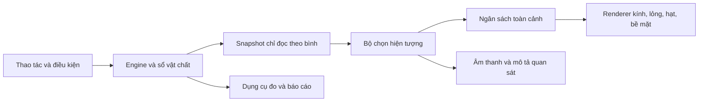

# Nghiên cứu nâng cấp hình ảnh, hiệu ứng và thao tác Lab 3D

Ngày rà soát: **28/10/2026**, múi giờ Việt Nam. Phạm vi: ứng dụng `lab-3d` của ChemDex. Đây là kết quả khảo sát mã, chạy kiểm thử và kiểm tra trình duyệt; các thay đổi sản phẩm dưới đây là **đề xuất chưa triển khai**.

## 1. Quyết định đề xuất

Ưu tiên làm rõ những gì người học đang quan sát: kính trong, màu dung dịch đúng, hiệu ứng xuất phát tại điểm tiếp xúc, lượng cặn nhìn được, dụng cụ dễ thao tác. Phần nền đã có nhiều cơ chế vật lý và kiểm thử; nên nâng cấp trên nền này.

Thứ tự triển khai:

1. Sửa phép đo render, nhánh kính Ultra, giới hạn hạt toàn cảnh và bố cục điện thoại.
2. Chuẩn hóa kính, ánh sáng, màu dung dịch và góc nhìn dụng cụ.
3. Làm rõ vùng hòa trộn tại điểm rót; phân biệt các hình thái kết tủa, bọt khí và sương.
4. Hoàn thiện thao tác cầm/rót/đo, âm thanh theo sự kiện và khả năng giảm chuyển động.
5. Chỉ thêm nhiễu nhiệt, phản chiếu hoặc hiệu ứng màn hình khi phép đo cho thấy còn ngân sách GPU.

Ba tình huống thí điểm: **rót dung dịch màu vào nước**, **AgNO₃ + NaCl tạo kết tủa**, **chuẩn độ có phenolphthalein**. Chúng kiểm tra được kính, pha lỏng, tiếp xúc, phân bố màu, cặn và thao tác mà không cần xây thêm một hệ cảnh khác.

## 2. Cơ sở khảo sát và phần đã có

Phiên bản thực cài tại lần kiểm tra: Three.js **0.185.1**, R3F **9.8.1**, Drei **10.7.7**, React **19.2.7**, React Three Postprocessing **3.1.3**, Postprocessing **6.39.5**, Vite **6.4.3**. Đây là phiên bản trong `node_modules`, có thể khác khoảng phiên bản khai báo ở `package.json`.

| Hệ hiện có | Điểm vào mã | Ý nghĩa đối với nâng cấp |
|---|---|---|
| Cảnh, ánh sáng, bàn, môi trường phản xạ, điều khiển | `src/components/three/LabScene.tsx` | Giữ cảnh hiện tại và cải thiện từng lớp |
| Năm mức đồ họa, nhận diện renderer phần mềm, thích ứng FPS | `src/vfx/quality.ts` | Mở rộng cơ chế này, tránh thêm một bộ tự chỉnh FPS cạnh tranh |
| Kính dùng chung, hình học lòng bình | `src/vfx/materials/glass.ts`, `src/science/vesselContours.ts` | Có nơi sửa tập trung cho nhiều loại bình |
| Mặt thoáng, dao động, meniscus, vùng màu khi rót | `src/vfx/materials/liquid.tsx` | Đã có nền hòa trộn; cần nâng chất lượng vùng chuyển tiếp |
| Dòng rót đạn đạo, giọt, vận chuyển vật chất | `src/pour/render/PhysicalStreamRenderer.tsx`, `src/pour/controller/PourController.ts` | Hiệu ứng phải tiếp tục dùng cùng quỹ đạo với nơi lượng chất thật sự đi vào |
| Bọt, sương, cặn, lắng, đối lưu | `src/simulation/core/SimulationEngine.ts`, `src/simulation/render/PhysicalSimulationRenderer.tsx` | Phần lớn là tinh chỉnh biểu diễn và ngân sách |
| Giọt ngưng tụ, màng ướt, tràn và vũng chất lỏng | `src/components/three/WallCondensateDroplets.tsx`, `VesselWallOverflow.tsx`, `WorkbenchSpills.tsx` | Giữ lượng vật chất hữu hạn và lịch sử bề mặt |
| Na nổi/chuyển động, khí, nhiệt và trạng thái kim loại | `src/science/sodiumWater.ts`, `src/components/three/SodiumWaterPellet.tsx` | Giữ cơ chế chuyên biệt; không thay bằng hoạt ảnh nổ định sẵn |
| Thư viện chương trình, controller và VFX atom | `src/vfx/programs/`, `src/vfx/reactions/`, `src/vfx/catalog/` | Cần phân biệt mô tả hiệu ứng với đường vẽ thực tế |
| Dụng cụ cầm, chuột, cảm ứng và âm thanh tổng hợp | `src/handling/`, `src/input/`, `src/utils/audio.ts`, `src/pour/audio/` | Nâng khả năng hiểu và cảm nhận thao tác |

Các nghiên cứu sẵn có về [hạt và kết bông](precipitation-population-mechanism-audit.vi.md), [chuyển động chất lỏng](shared-liquid-motion.vi.md), [Na và môi trường](sodium-water-and-lab-realism.vi.md), [thể tích cặn](sediment-preview-volume.vi.md) vẫn là nền tham khảo. Đề xuất này tập trung vào chất lượng nhìn thấy và tích hợp, không coi các cơ chế đã có là tính năng cần xây lại.

## 3. Phát hiện có bằng chứng

### F01 — Ultra dùng nhánh kính đơn giản

Trong `src/vfx/materials/glass.ts`, `getGlassMaterials()` chỉ cho `high` và `medium` vào nhánh `MeshPhysicalMaterial`; `ultra` đi tiếp xuống nhánh `MeshStandardMaterial` dành cho mức thấp. Kiểm tra trên trình duyệt xác nhận High có opacity 0,08, mặt trước; Ultra có opacity 0,16, hai mặt. Cốc rỗng Ultra vì thế có cảm giác trắng đục hơn. Ảnh [High](visual-upgrade-2026-10-28/desktop-high.png) và [Ultra](visual-upgrade-2026-10-28/desktop-ultra.png) ghi lại cùng cảnh.

**Hành động:** định nghĩa chiến lược kính cho đủ năm mức; kiểm tra tất cả mức bằng cùng mẫu rỗng, nước, dung dịch màu và cặn. Ultra phải đạt chất lượng ít nhất tương đương High ở độ trong và khả năng thấy bên trong.

### F02 — Bộ đếm draw call không đếm toàn khung hình

`FrameTelemetry.tsx` lấy `gl.info.render.calls` và `triangles` trong callback trước render. Khi bật hậu xử lý, lần kiểm tra liên tục đọc được **1 draw call / 2 tam giác**, tương ứng một lượt vẽ toàn màn hình; ở Low tắt hậu xử lý số đọc lớn hơn nhiều. Đây là bằng chứng bộ đếm hiện tại không đại diện toàn cảnh.

Three.js ghi rõ `renderer.info` mặc định reset mỗi lần gọi render; nhiều lượt trong một frame cần quản lý reset riêng ([tài liệu renderer](https://threejs.org/docs/pages/WebGLRenderer.html)).

**Hành động:** cộng số liệu qua các lượt shadow, transmission, cảnh chính và composer. Có thể lấy tổng frame trước ở đầu frame kế tiếp rồi reset một lần, với `info.autoReset = false`. Cần đặt điểm đọc/reset trước toàn bộ lượt vẽ và giữ đúng quyền điều khiển render của composer. Không thêm `useFrame` ưu tiên dương ở nhánh Low nếu không thực hiện render thay thế. Hiển thị rõ frame time tổng; thời gian GPU phải được đo riêng nếu extension hỗ trợ.

### F03 — Có cấu hình giới hạn hạt nhưng chưa có giới hạn toàn cảnh

`maxLiveParticles` hiện chỉ được khai báo trong `quality.ts`; tìm toàn bộ `src` chưa thấy đường sử dụng để cấp ngân sách. Trong khi đó, mỗi manager có ngân sách riêng: mức Potato có tối đa 120 hạt kết tủa mỗi hệ, 20 bọt và 15 hạt sương; cấu hình tổng Potato ghi 100. Một bình có thể chứa nhiều hệ kết tủa, nhiều bình tiếp tục nhân chi phí.

**Hành động:** bộ cấp ngân sách glyph theo toàn cảnh, có số liệu requested/granted/live. Giảm số glyph không được làm giảm số mol, khối lượng cặn, khí hoặc năng lượng. Phân bổ trước cho bình đang thao tác, sau đó cho các bình còn nhìn thấy; giữ dấu hiệu hiện tượng tối thiểu cho mọi bình có sự kiện.

### F04 — Điện thoại bị hai bảng thông tin che cảnh

Ở viewport **390 × 844 CSS px**, trạng thái mặc định có cả `leftSidebarOpen` và `rightSidebarOpen` bằng true. Ảnh [mobile mặc định](visual-upgrade-2026-10-28/mobile-default.png) cho thấy hai bảng chồng lên nhau, gần như không còn vùng thao tác. Khi đóng bảng, [góc nhìn hiện tại](visual-upgrade-2026-10-28/mobile-low-clear.png) cắt hai bên bình và thanh dụng cụ vẫn vượt vùng đọc dễ dàng. Không có tràn ngang tài liệu không có nghĩa là các điều khiển đều nhìn thấy.

**Hành động:** mở đầu bằng bàn thí nghiệm; chỉ một drawer/bottom sheet được mở mỗi lần; tự đóng sheet khi bắt đầu thao tác 3D; camera fit theo vùng nhìn còn lại. Rút gọn thanh dụng cụ thành công cụ đang dùng và nút mở danh sách; đưa số đo ra vùng riêng.

### F05 — Chất lượng thấp vẫn còn vật liệu transmission đắt

Chai kệ có dùng `glassTransmission` để đổi chất lượng, nhưng một số nhánh trong `Vessels.tsx` vẫn đặt transmission trực tiếp: đũa khuấy, các bộ phận dụng cụ, nước làm mát và thiết bị khác. Do đó, tắt cờ ở Low/Potato chưa bảo đảm bỏ được mọi lượt transmission.

**Hành động:** một hàm chọn vật liệu theo tier và loại bề mặt cho toàn bộ dụng cụ. Xác nhận bằng material inspection và số render pass. Three.js cũng yêu cầu cân nhắc chi phí mỗi pixel của vật liệu physical, và khi dùng transmission thì opacity nên bằng 1 ([MeshPhysicalMaterial](https://threejs.org/docs/pages/MeshPhysicalMaterial.html)); cần rà từng trường hợp đang kết hợp transmission với alpha.

### F06 — Một số atom mới có mô tả/lifecycle, chưa có đường hiển thị tương ứng

Các atom được đọc trực tiếp gồm `colorFrontAdvective`, `beerLambertBlend` và `heatHazeShimmer`. `mount()` hiện chỉ tạo object chứa `custom`, `update()` rỗng, không có `writeBack()` hoặc pool/render target. Tìm kiếm các tên này chưa thấy bridge tiêu thụ handle để tạo hiệu ứng trong cảnh. Điều này không có nghĩa lab không có hòa trộn hay thay màu: shader liquid và controller riêng đã thực hiện một phần khác.

**Hành động:** lập bảng atom → điều kiện → dữ liệu nguồn → renderer → ảnh thực → kiểm thử. Studio chỉ nên gắn trạng thái “đã hỗ trợ” khi đường này có bằng chứng. Ưu tiên nối renderer cho hiện tượng đã chọn thay vì thêm nhiều tên atom mới.

`src/engine/studioAtom.ts` đã có ánh xạ ngữ cảnh được duyệt và trả hành động “xem điều kiện” cho atom chưa có đường chạy phù hợp. Cần giữ cơ chế này, bổ sung bảng coverage và bằng chứng hiển thị thay vì coi mọi preset trong catalog là tính năng đã hoàn chỉnh.

### F07 — Heat haze, reflector và bụi nắng chưa hoàn tất tích hợp

Trong `src`, `tableReflector` và cờ `heatHaze` mới nằm ở cấu hình; atom heat haze có tình trạng như F06. `SunbeamDust` được import nhưng chưa mount trong `LabScene`; texture sunbeam/noise được tạo nhưng không được dùng trong JSX của cảnh. Riêng `transmissionResolutionScale` **đã được nối** vào `SceneEnvironmentSetup`, không phải cấu hình bỏ quên.

**Hành động:** bỏ tài nguyên tạo sẵn không dùng, hoặc chỉ tạo khi hiệu ứng đã được bật và có renderer. Đưa heat haze cục bộ vào giai đoạn sau; mặt bàn hiện có thể cải thiện qua roughness/ánh sáng trước khi thêm planar reflector.

### F08 — Dữ liệu nhanh đang gây cập nhật React rộng

`VfxDirector` subscribe toàn bộ `vessels` và `activeKinetics`; `SolidContentsRenderer` cùng một số component subscribe nguyên vessel. Trong `useFrame`, director cũng có thể ghi patch màu vào store. Đây là điểm cần profile vì thay đổi liên tục có thể làm nhiều component render lại. Chưa có React Profiler để định lượng tỷ lệ chi phí nên chưa kết luận đây là nút thắt chính.

**Hành động:** React quản lý cấu trúc đối tượng; chuyển động/uniform đọc snapshot bằng ref hoặc `getState()`. UI số đo cập nhật theo nhịp đủ đọc. R3F khuyến nghị tránh state phản ứng cho dữ liệu thay đổi nhanh và dùng mutation trong vòng frame ([performance pitfalls](https://r3f.docs.pmnd.rs/advanced/pitfalls)).

### F09 — Cảnh đứng yên vẫn chạy liên tục

`RenderActivity` đã ngừng render khi ẩn tab hoặc canvas ra ngoài vùng nhìn. Khi cảnh đang nhìn thấy, frameloop luôn là `always`, kể cả khi không có thao tác hay quá trình quan sát được.

**Hành động:** trước hết tách tiêu chí “không có hoạt động” khỏi “đang nhìn thấy”. Chỉ dùng `demand` khi không còn động học, truyền nhiệt cần tick, giọt rơi, khí đuôi, lắng, dao động mặt thoáng, flame hoặc camera đang chuyển động. R3F yêu cầu invalidate với thay đổi imperative ([scaling performance](https://r3f.docs.pmnd.rs/advanced/scaling-performance)); không đổi cờ frameloop đơn thuần vì simulation hiện gắn với frame.

### F10 — Camera shake có đường chạy đáng kiểm tra

Trong `CameraControls.tsx`, callback `useFrame` thoát ngay nếu `isTransitioning` false; nhánh decay và áp camera shake nằm phía sau. Sự kiện explosion chỉ tăng trauma. Đây là nghi vấn từ mã: khi camera đã ổn định, trauma có thể không được xử lý đến khi đổi góc nhìn. Chưa thực hiện kịch bản explosion để xác nhận bằng hình.

**Hành động:** tách camera transition và shake; áp offset tương đối trên pose nền thay vì cộng dồn vào camera. Giảm chuyển động phải tác động cả pan/focus, rung và flash trang trí, với tuỳ chọn riêng cho người học. [MDN mô tả cơ chế phát hiện reduced motion](https://developer.mozilla.org/en-US/docs/Web/CSS/Reference/At-rules/@media/prefers-reduced-motion).

## 4. Kiểm chứng hiện trạng

### 4.1 Kiểm thử và typecheck

- `npm run lint`: đạt, không có lỗi TypeScript.
- Chạy 13 tệp kiểm thử có liên quan: **188/188 đạt**. Phạm vi: chất lượng thích ứng, chuyển động chất lỏng, gas visual/flux, silver halides, Na–nước, kết tủa, vật chất khi rót, hơi nước, bọt foam, đồng hồ mô phỏng, bảo toàn và performance logic.
- Log: [typecheck](visual-upgrade-2026-10-28/typecheck.log), [kiểm thử](visual-upgrade-2026-10-28/baseline-tests.log).
- Benchmark headless trong nhóm kiểm thử chỉ đo logic/physics. Nó **không bao gồm WebGL** và không chứng minh FPS sản phẩm. Kết quả được lưu riêng tại `visual-upgrade-2026-10-28/headless-performance.json`.
- Không chạy production build ở lượt nghiên cứu này; các con số trình duyệt dưới đây thuộc bản Vite development.

### 4.2 Phương pháp kiểm tra trình duyệt

Chrome headless thực sự dùng GPU **Intel UHD Graphics qua ANGLE Direct3D11**, không phải SwiftShader. Desktop 1440 × 1000, DPR thiết bị 1; vùng canvas với hai sidebar là 832 × 907 CSS px. Mobile là mô phỏng viewport 390 × 844, DPR thiết bị 2 trên cùng GPU máy tính.

Lượt đầu có typecheck/kiểm thử chạy đồng thời và chịu tác động tự tải lại của HMR khi công cụ ghi JSON; giữ ở `browser-audit-first-pass.json` để truy vết, **không dùng làm mốc hiệu năng chính**. Một lượt chờ `networkidle` bị timeout, một lượt khác bị HMR phá execution context; giữ riêng trong hai tệp `browser-audit-aborted*.json`. Lượt hoàn chỉnh cuối chạy sau kiểm thử, tắt HMR, chỉ ghi JSON sau khi đóng browser. Mỗi kịch bản đợi thêm 1,8 giây rồi lấy mẫu trong khoảng 8 giây; shader và môi trường chưa chắc đã hết mọi tác động khởi động. Ảnh chụp nằm ngoài khoảng đo. Dữ liệu là các cửa sổ FrameTelemetry khoảng 1 giây, không phải GPU timestamp hoặc phép đo độ trễ input.

| Kịch bản | Tier đầu → cuối | Trung vị FPS các cửa sổ | Khoảng FPS cửa sổ | Trung vị frame time cửa sổ | P95 lớn nhất trong các cửa sổ |
|---|---|---:|---:|---:|---:|
| Desktop tự động, cảnh khởi đầu | Medium → Medium | 58 | 36–61 | 17,35 ms | 52,4 ms |
| Desktop High, cảnh khởi đầu | High → High | 36 | 34–37 | 27,5 ms | 43,5 ms |
| Desktop Ultra, cảnh khởi đầu | Ultra → Ultra | 13,5 | 13–14 | 74,1 ms | 228,9 ms |
| Desktop sau khởi chạy ba phản ứng | High → High | 26 | 23–30 | 38,5 ms | 90,6 ms |
| Viewport mobile, mặc định bị drawer che | High → Potato, Auto đang thích ứng | 75 | 13–144 | 13,4 ms | 114,2 ms |
| Viewport mobile, đóng hai drawer | Low → Low | 144 | 136–144 | 6,9 ms | 9,6 ms |

Đây là **trung vị của các số đo theo cửa sổ**, không phải FPS/P95 được tổng hợp từ toàn bộ frame thô. Mobile Auto thay tier trong lúc đo nên không có một mức tải ổn định để so trực tiếp. Sự khác nhau giữa hai dòng mobile đồng thời gồm tier, trạng thái drawer và warm-up; không quy toàn bộ chênh lệch cho việc đóng bảng.

Dữ liệu gốc: [browser-audit.json](visual-upgrade-2026-10-28/browser-audit.json); số liệu rút gọn: [browser-summary.json](visual-upgrade-2026-10-28/browser-summary.json). Cả sáu kịch bản hoàn tất, không có exception JavaScript được Playwright ghi nhận. Console có hai thông báo tải tài nguyên trả 404; không được tính là lỗi shader hoặc bằng chứng engine sai.

Kết luận trong phạm vi phép đo: High/Ultra hiện có chi phí render đáng kể ngay ở cảnh khởi đầu, nên sửa phân tầng và đo từng pass trước khi thêm hậu xử lý. Chưa có GPU timer hoặc A/B tắt từng pass nên chưa thể quy toàn bộ chi phí Ultra cho AO, bóng, vật liệu hoặc một nguyên nhân duy nhất.

Không so FPS headless với tần số màn hình vật lý. Không dùng số draw call hiện tại để so mức High/Ultra vì F02. Kịch bản ba phản ứng khởi chạy CaCO₃/HCl, Zn/CuSO₄ và BaCl₂/Na₂SO₄; khoảng đo bao gồm cả phản ứng kết thúc và giai đoạn hiệu ứng tiếp tục lắng/tắt, không phải tải cực đại giữ nguyên 8 giây.

## 5. Hướng hình ảnh và đặc tả hiệu ứng

### V01 — Kính và ánh sáng

Giữ bàn tối để tách dung dịch khỏi nền, tường sáng trung tính và highlight mảnh ở mép kính. Mục tiêu là thấy được pha lỏng, pha rắn, vạch chia và độ trong. Kính rỗng không được trông như đang có chất trắng; nước không mặc định xanh. Bloom chỉ áp cho vùng thực sự phát sáng.

Làm hai đường vật liệu: Fresnel/alpha rẻ cho Low/Potato và kính có khúc xạ được kiểm soát cho mức cao nếu thử nghiệm cho thấy nhìn bên trong tốt hơn. Với nhiều lớp transparent/transmissive lồng nhau, phải kiểm tra trực tiếp; không thay toàn bộ bằng MeshTransmissionMaterial trong một lượt. Drei nêu rõ vật liệu này thêm lượt vẽ và có trade-off khi dùng shared buffer ([MeshTransmissionMaterial](https://drei.docs.pmnd.rs/shaders/mesh-transmission-material)). Đưa `roughness`, `ior`, độ dày và cường độ environment về một nơi cấu hình.

**Nghiệm thu:** bốn loại bình × rỗng/nước/dung dịch màu/cặn × High/Ultra/Low; xoay camera cả mặt trước và nghiêng; không mất cặn sau kính, không viền trắng cháy và không thay màu định tính khi đổi tier.

### V02 — Màu và độ trong dung dịch

Tách ba thuộc tính: màu hấp thụ của chất tan, độ đục do huyền phù và ánh sáng phản xạ trên mặt. Hiện shader đã có màu/turbidity, nhưng “Beer–Lambert” trong tên atom chưa chứng minh đã có mô hình quang học đó. Nếu chưa có hệ số hấp thụ được kiểm chứng, sử dụng bảng màu minh họa có ghi rõ phạm vi thay vì gắn nhãn đo quang phổ.

Màu cần phụ thuộc trạng thái hóa học hiện tại; chỉ thị cần hiện diện với lượng dương. Có thể bổ sung đáp ứng theo bề dày đường nhìn cho các chất có dữ liệu, sau khi đã kiểm tra chuỗi linear/sRGB và tone mapping. Khi so tier thấp dùng ACES và tier cao dùng AgX, phải kiểm tra màu chỉ thị thay vì coi hai cấu hình là tương đương.

**Nghiệm thu:** nước vẫn không màu; giảm nồng độ không làm màu đậm hơn; thêm nước và tiêu thụ chất tạo màu có kết quả nhất quán; cặn trắng làm đục riêng mà không biến dung dịch mẹ thành chất phát sáng.

### V03 — Vùng hòa trộn tại điểm chạm

Nâng cấp `uMixingPoint/Radius/Color/Strength` hiện có từ vùng gần hình cầu thành plume có hướng theo vận tốc tia rót và vùng tuần hoàn trong bình. Dùng quỹ đạo `PourController`, mặt thoáng, thành bình và trạng thái khuấy để định vị. Shader chỉ biểu diễn phân bố cục bộ; trạng thái lượng chất vẫn do engine quản lý.

Chọn mô hình trường màu đơn giản hoặc một số vùng plume giải tích trước; chưa cần CFD 3D. Mô hình minh họa có thể cho thấy màu đi theo dòng và dần đồng nhất, nhưng không được được giới thiệu là nghiệm khuếch tán/đối lưu định lượng. Nếu cần trường nồng độ thật, bổ sung một mô hình vận chuyển bảo toàn độc lập với renderer và hiệu chuẩn sau.

**Nghiệm thu:** đổi màu bắt đầu sau khi chất lỏng chạm đích, plume bám đúng điểm rót khi di chuyển bình, giới hạn trong lòng bình, sau dừng rót tiếp tục khuếch tán định tính; khuấy làm vùng màu đồng nhất nhanh hơn. Thay tier không đổi mol hay tốc độ phản ứng.

### V04 — Dòng rót, giọt và sóng

Dòng rót đạn đạo và giọt đã có. Phần cần tinh chỉnh là cổ tia ở mép rót, chuyển từ dòng sang giọt, đoạn cuối khi ngừng rót, và sóng tại đúng bề mặt tiếp xúc. Dùng bán kính dòng theo lưu lượng đang được engine xác nhận. Cập nhật hình học có sẵn; không tạo cylinder mới mỗi frame.

Giữ một nguồn quỹ đạo cho hình và phép phân loại dòng đi vào lòng bình/thành bình/mặt bàn. Giọt vẽ thêm chỉ có tính đại diện: không cộng thêm vật chất lần thứ hai. Tia rót không được hướng thẳng về tâm bình nếu phép tính thực đã cho thấy rót trượt.

**Nghiệm thu:** rót trúng, trượt mép, đổi đích giữa dòng, nguồn gần cạn, hai bình chuyển động; tổng nguồn + đích + lớp bám + đang bay + spill + waste giữ đúng sổ vật chất.

### V05 — Bọt khí

Tăng khả năng nhận biết vị trí phát khí: đá/kim loại đang phản ứng là nguồn cục bộ; nguồn sôi dựa trên trường nhiệt đang hỗ trợ. Phối kích thước, tốc độ nổi và highlight để bọt nhỏ vẫn thấy qua kính. Bọt vỡ tạo sóng nhẹ và âm thanh có giới hạn tốc độ sự kiện.

Không gán màu trắng đục cho mọi khí. H₂/CO₂ có thể thấy qua bọt trong chất lỏng nhưng không tự có một cột khói màu ở không khí; `gasVisualState` và bảng khí hiện có cần tiếp tục quyết định loại nào nhìn thấy.

**Nghiệm thu:** hết nguồn khí thì không sinh thêm; bọt đang có vẫn nổi và thoát; pause dừng toàn bộ; chuyển tier không đổi lượng khí thoát và không tạo lại một đợt phát khí.

### V06 — Sôi, sương và ngưng tụ

Các mô hình nước, năng lượng và giọt tường đã khá sâu. Tập trung sửa độ mềm của particle khi giao với kính/mặt thoáng, biến thiên mật độ và ánh sáng của sương, thay vì tăng số lượng sprite. Depth fade có thể dùng depth texture chung ở mức cao; phải thử với kính transparent và giữ fallback không cần depth texture.

Nhiệt độ sôi phụ thuộc môi trường; dữ liệu Antoine của NIST ghi rõ đơn vị và miền nhiệt độ ([NIST Water](https://webbook.nist.gov/cgi/cbook.cgi?ID=C7732185&Mask=4&Type=ANTOINE)). Đây là nguồn nhiệt động, không cung cấp hệ số opacity của particle. Sương nhìn thấy và hơi H₂O ở pha khí cần tiếp tục được phân biệt trong mô hình.

**Nghiệm thu:** không mặc định sôi ở mọi bình 100 °C bất kể áp suất; ngắt nhiệt không xóa tức thì lượng sương/giọt còn lại; vết ngưng tụ giảm theo lượng nước thật. Kiểm tra cả bình có cổ và bình nghiêng.

### V07 — Kết tủa và lớp lắng

Ưu tiên phân biệt bằng hình: AgCl dạng bông/curd trắng; Cu(OH)₂ gel xanh; BaSO₄ hạt mịn; PbI₂ có hình phiến khi điều kiện kết tinh phù hợp. Hạt lơ lửng, dung dịch mẹ và cặn đáy phải là ba lớp dễ đọc. Giữ kích thước vật lý tách khỏi kích thước phóng đại glyph.

Mô hình quần thể/kết tụ là một hạng mục engine riêng đã phân tích ở [nghiên cứu kết bông](precipitation-population-mechanism-audit.vi.md). Có thể cải thiện shader/mesh hình thái trước, nhưng không gọi đó là đã mô phỏng động học kết bông. Không ép mọi phản ứng tạo bông ở cùng giây của timeline.

Đối chiếu trực tiếp: Harvard mô tả AgCl trắng xuất hiện khi trộn dung dịch phù hợp ([AgCl](https://sciencedemonstrations.fas.harvard.edu/presentations/precipitation-silver-chloride)); Colorado mô tả Cu²⁺/NH₃ có kết tủa hydroxide rồi phức xanh đậm khi ligand đủ dư ([metal–ammonia](https://www.colorado.edu/lab/lecture-demo-manual/e740-equilibrium-complex-ions-metal-ammonia-complexes)). Đây là cơ sở cho trình tự quan sát, không phải dữ liệu hiệu chuẩn tốc độ lắng.

**Nghiệm thu:** lượng rắn giảm khi tan thì hình cũng giảm; cặn còn sau phản ứng vẫn tồn tại; đảo/khuấy phân bố lại theo khả năng engine; lượng rất nhỏ không bị vẽ thành lớp dày tối thiểu tùy ý; decant không chuyển hết cặn khi chỉ rót dung dịch phía trên.

### V08 — Lửa và nhiễu nhiệt

Ngọn lửa bám tim đèn/nguồn cháy; có lõi và lớp ngoài, biến thiên mềm theo công suất và nhiên liệu. Một nguồn sáng cục bộ nhỏ đủ tạo cảm nhận; giữ bloom dưới mức mất hình bình. Nhiễu nhiệt là distortion cục bộ bên trên nguồn nóng, giảm nhanh theo chiều cao, không làm rung toàn màn hình.

Nếu triển khai heat haze, dùng một pass/field dùng chung có mask, tránh mỗi ngọn lửa render lại toàn cảnh. Tắt ở mức thấp và khi người dùng giảm hiệu ứng. Na–nước vẫn dùng các điều kiện của engine; vệt hồng do phenolphthalein, không phải màu vốn có của NaOH ([UW alkali metals](https://chem.washington.edu/lecture-demos/activity-series-alkali-metals-water)).

**Nghiệm thu:** hết nhiên liệu/hết điều kiện cháy thì giảm và tắt đúng; không gắn nổ với cuối timeline; mức thấp vẫn thấy tín hiệu nguồn nóng bằng hình/ngữ nghĩa; đổi tier không làm thay đổi nhiệt cấp vào mẫu.

### V09 — Thành bình ướt, foam và vũng tràn

Giữ nguồn dữ liệu hữu hạn hiện tại. Tăng chất lượng highlight của màng ướt, góc tiếp xúc của vũng và độ chuyển tiếp mép; giảm z-fighting giữa màng và kính. Foam có lớp bóng nhỏ, mặt trên không phẳng cứng, nhưng chiều cao vẫn từ lượng foam thật.

**Nghiệm thu:** lau/dọn chỉ làm biến mất phần vật chất đã thu gom; giọt không xuyên ra mặt ngoài bình; foam không xuất hiện ở bình trống; vũng chất lỏng không tự phát sáng hoặc lưu lại mãi khi mô hình đã cho bay hơi/dọn sạch.

### V10 — Dụng cụ và cầm nắm

Tăng chất lượng có chọn lọc ở mép cốc, miệng rót, vạch chia, đầu pipette, cảm biến pH và đầu nhiệt kế. Các nhãn phải đọc được ở khoảng camera làm việc; tránh dùng chữ 3D quá nhỏ cho mọi chai. Dùng nhãn giao diện khi chọn hoặc focus, có occlusion hợp lý.

HandRig hiện là hình giản lược; ưu tiên sửa vị trí grip, trục xoay và cảm giác khối lượng trước khi thay bằng bàn tay chi tiết. Grip và mặt bàn phải dùng chung mốc trong `handling`/`science`; contact shadow không được che một khe hở hình học sai.

**Nghiệm thu:** đầu dò chỉ trả số đo hợp lệ khi nhúng đúng; dụng cụ cầm không trượt khỏi tay khi đổi yaw/tilt; đáy chạm bàn theo hình học; vạch chia không nhấp nháy khi zoom.

### V11 — Camera và thao tác

Một chạm để chọn, kéo đối tượng đã chọn để di chuyển, kéo nền để orbit. Cho phép nút “Rót” mở thanh chỉnh nghiêng dễ thấy; vẫn giữ thao tác nhiều ngón cho người quen. Có trạng thái rõ: đang chọn, đang cầm, đang nghiêng, đang rót, đang khóa camera. Cung cấp nút đưa góc nhìn về bình đang chọn.

Khi chuẩn hóa input, tận dụng Pointer Events và xử lý pointer capture/cancel để thao tác không mắc kẹt khi ngón tay ra khỏi canvas; đặc tả W3C bao quát chuột, bút và touch ([Pointer Events](https://www.w3.org/TR/pointerevents3/)). Mục tiêu thiết kế nút thao tác chính là 44 CSS px; cần phân biệt với mức tối thiểu WCAG 2.2 AA 24 CSS px có các ngoại lệ ([W3C target size](https://www.w3.org/WAI/WCAG22/Understanding/target-size-minimum.html)).

**Nghiệm thu:** tay/ngón không phải che đúng miệng bình mới rót được; mở sheet không xoay camera; nhả ngoài canvas không giữ trạng thái đang cầm; zoom không vô tình làm tăng góc rót; có đường thao tác bằng nút/bàn phím thay cho gesture khó.

### V12 — Âm thanh và phản hồi học tập

Lab đã có Web Audio cho rót, giọt, bọt và sự kiện khác. Bổ sung master gain và giới hạn số voice đồng thời; kiểm tra tiếng bọt chỉ gắn vào sự kiện hợp lệ, không phát mỗi frame. Thay vì chỉ tăng âm lượng, thay timbre/rate theo lưu lượng, lượng bọt và chất liệu va chạm.

Lần chạm đầu bật audio context theo chính sách trình duyệt; có mute dễ tìm. Mỗi phản hồi âm thanh quan trọng có dấu hiệu hình hoặc chữ tương ứng. Nhãn quan sát nên nói “xuất hiện kết tủa trắng”, “khí đang thoát”, “chưa có chỉ thị”, dựa trên engine. Tách nhãn gợi ý/định tính khỏi số đo chính thức của dụng cụ.

**Nghiệm thu:** mute hoạt động cho cả âm rót liên tục; pause/ẩn trang dừng voice đang phát khi cần; không có tiếng bọt từ bình đã hết khí; chạy ba phản ứng không tăng âm tổng mất kiểm soát.

## 6. Kiến trúc tích hợp



Đây là hướng tinh chỉnh các module hiện có, không đề xuất thay engine. Snapshot gồm lượng chất/pha, mặt thoáng, thông lượng khí, lượng rắn lơ lửng/cặn, nguồn nhiệt, foam và trạng thái tiếp xúc. Mọi tọa độ cần có quy ước rõ local/world và đổi mét ↔ đơn vị cảnh tại biên. Dùng `sceneUnits`, `vesselDimensions`, `vesselGeometry` làm nguồn chung; rà các số đo bình còn hard-code trong director.

Các renderer cập nhật transform/uniform theo frame, không tự tiêu thụ hóa chất. Những quyết định vật lý đang phụ thuộc manager được giữ ở engine và kiểm thử riêng. Bộ ngân sách chỉ điều chỉnh độ phân giải và lượng glyph biểu diễn; mỗi glyph có trọng số nếu cần đại diện nhiều vật chất.

Bảng coverage atom nên có cột: `atom`, `conditionSupported`, `stateSource`, `renderer`, `tierFallback`, `evidenceScenario`, `limitations`. Những atom chỉ có metadata phải được thể hiện đúng trạng thái trong Studio.

## 7. Backlog có thể triển khai

Ước lượng dưới đây tính theo ngày kỹ sư, gồm code và kiểm tra cục bộ, giả định một người đã quen repo. Đây là khoảng ước lượng, chưa phải lịch cam kết.

| ID | Ưu tiên | Công việc và nơi thay đổi | Phụ thuộc | Cổng hoàn thành |
|---|---|---|---|---|
| U01 | P0 | Sửa `FrameTelemetry`, tổng pass và báo cáo phép đo | Không | High không còn chỉ báo một fullscreen quad cho cả lab; tách logic/GPU |
| U02 | P0 | Sửa tier kính trong `materials/glass.ts`; kiểm tra các vật liệu `Vessels.tsx` | Không | High/Ultra cùng rõ pha bên trong; Low bỏ transmission theo thiết kế |
| U03 | P0 | Drawer di động và toolbar: `App.tsx`, `VesselInspector`, `MeasurementHUD` | Không | Một sheet mỗi lần; 390 px có vùng thao tác rõ |
| U04 | P0 | Cấp ngân sách toàn cảnh trên nền `quality.ts`, particle systems | U01 | Số live glyph không vượt cấu hình; bảo toàn không đổi |
| U05 | P1 | Coverage atom, bridge renderer và trạng thái Studio | U01 | Mỗi hiệu ứng báo hỗ trợ có cảnh chứng minh |
| U06 | P1 | Ánh sáng trung tính, kính, vạch chia và mẫu màu | U02 | Qua ma trận quang học; không cháy trắng/mất cặn |
| U07 | P1 | Camera fit theo viewport và sheet; tách transition/shake | U03 | Không cắt dụng cụ đang chọn; reduced motion đúng |
| U08 | P1 | Plume hòa trộn trên shader liquid và điểm chạm từ pour | U02, U04 | Màu bắt đầu đúng lúc/đúng chỗ; không thay ledger |
| U09 | P1 | Hình thái kết tủa, phân biệt suspension và bed | U04, U06 | Ba hình thái nhìn khác nhau; lượng cặn nhất quán |
| U10 | P1 | Bọt/sương mềm, giảm overdraw và nguồn phát khí | U04, U06 | Đuôi tắt đúng; không hiện khí vô hình như khói |
| U11 | P1 | Grip/input và trạng thái rót rõ ràng | U03, U07 | Mouse/touch/pointercancel qua kịch bản thực |
| U12 | P1 | Master gain/voice budget, âm thanh theo sự kiện | U05 | Mute/pause hoạt động xuyên các subsystem |
| U13 | P2 | Heat haze cục bộ; thử phản chiếu bàn nếu còn ngân sách | U01, U04, U06 | Có A/B chất lượng–frame time, fallback rõ |
| U14 | P2 | Ngủ khi hoàn toàn idle và đánh thức đúng simulation | U01, U05 | Không dừng lắng/nhiệt/khí chỉ vì không có input |
| U15 | P2 | Động học kết tụ quần thể, sau khi có dữ liệu phù hợp | U09 và nghiên cứu chuyên biệt | Bảo toàn, mô hình/tham số có nguồn; không thay bằng thời gian glyph |

Các đợt đề xuất: **P0 trong 3–5 ngày kỹ sư**; bộ mẫu kính/ánh sáng/camera và coverage **3–5 ngày**; plume, cặn, khí và thao tác **6–10 ngày**; âm thanh và nghiệm thu trên thiết bị thật **3–5 ngày**. Tổng cho bản nâng cấp chính khoảng **15–25 ngày kỹ sư**, chưa gồm U13–U15 hoặc việc thu thập/hiệu chuẩn dữ liệu khoa học mới. Có thể cắt phạm vi sau ba tình huống thí điểm nếu cần bản nhỏ hơn.

## 8. Ngân sách và tiêu chí nghiệm thu

Những giá trị sau là **mục tiêu đề xuất**, không phải kết quả đã đạt:

| Nhóm | Tải kiểm tra | Mục tiêu ban đầu |
|---|---|---|
| Desktop GPU tích hợp | 3 bình, một thao tác rót hoặc một phản ứng; High được điều chỉnh phù hợp | Gần 60 FPS, frame time trung vị ≤ 16,7 ms; P95 ≤ 25 ms trên máy tham chiếu |
| Desktop tải nhiều | 3 phản ứng thật sự cùng đang chạy, có hạt và tương tác | ≥ 30 FPS; P95 ≤ 40 ms trên máy tham chiếu |
| Điện thoại tầm trung thật | 1 phản ứng và thao tác touch; Low/Medium | ≥ 30 FPS; P95 ≤ 40 ms, không che vùng thao tác |
| Tất cả mức | Cùng đầu vào, seed, thời gian mô phỏng | Kho chất, khí thoát, cặn, pH/nhiệt và kết quả dụng cụ nhất quán trong sai số mô hình |
| 20 chu kỳ tạo/xóa/thay mẫu | Cùng loại đối tượng sau warm-up | Không tăng tuyến tính số geometry/texture/manager; kiểm tra dispose và GC thay vì đòi heap bằng tuyệt đối |

P95 cần đo trên khoảng có đủ frame, sau warm-up; không ghép P95 của nhiều cửa sổ bằng cách lấy trung bình. Benchmark sau triển khai cần production build, ít nhất ba lượt 30 giây và ghi GPU/browser/viewport/DPR/tier. Tách pha khởi động/shader compile khỏi pha ổn định nhưng báo cả hai. Nếu được, ghi CPU simulation, CPU render preparation, GPU và input latency riêng.

Ngân sách hạt ban đầu có thể giữ các trần đang khai báo 100/500/1000/1800/3000 cho Potato→Ultra để thử nghiệm. Chúng là số glyph toàn cảnh cần chứng minh, không phải số hạt vật lý. Tối ưu draw call qua instancing và chia sẻ geometry/material trước khi tăng trần. MDN khuyến nghị batch draw và điều chỉnh độ phân giải back buffer theo ngân sách GPU ([WebGL best practices](https://developer.mozilla.org/en-US/docs/Web/API/WebGL_API/WebGL_best_practices)).

### Ma trận tình huống bắt buộc

| Tình huống | Quan sát cần có | Kiểm tra dữ liệu/điều khiển |
|---|---|---|
| Cốc rỗng → thêm nước | Kính rỗng rõ; mặt thoáng xuất hiện sau tiếp xúc | Không thêm nước trước lúc dose chạm |
| Rót dung dịch màu | Dòng, điểm chạm, plume rồi đồng nhất | Mol nguồn/đích/đang bay/spill nhất quán |
| Chuẩn độ có/không có chỉ thị | Chỉ đổi màu chỉ thị khi có chỉ thị và pH phù hợp | Không suy màu từ tên chương trình đơn thuần |
| AgNO₃ + NaCl | Mây trắng, hạt/bông và lớp lắng theo trạng thái | Cặn hữu hạn, không sinh thêm khi timeline lặp |
| Cu²⁺ + NH₃ từng phần/dư | Kết tủa và phức đúng điều kiện hỗ trợ | Thiếu ligand không tự chuyển toàn bộ sang phức |
| Đun nước, ngắt nhiệt | Nguồn bọt, sương, ngưng tụ và đuôi | Ngân sách nhiệt/nước giữ nguyên khi đổi tier |
| Na trên nước có/không chỉ thị | Viên nổi, khí, màu chỉ thị phụ thuộc mẫu | Không tự ép lửa/nổ; khí trơ theo engine |
| Rót trượt, tràn, lau | Hiệu ứng theo quỹ đạo và vật chất thực | Vật chất đến spill/waste, không biến mất |
| Pause/resume, ẩn tab | Đúng chính sách dừng và tiếp tục | Không burst bù thời gian hoặc âm treo |
| Đổi tier khi đang có cặn/khí | Hình giảm chi tiết nhưng hiện tượng còn | Không tạo lại phản ứng, mất cặn hoặc đổi nhiệt |
| Touch 390 × 844 và ngang 844 × 390 | Một sheet, nút chính dễ chạm, camera fit | Nhả ngoài canvas, pointercancel, đổi hướng màn hình |
| Reduced motion và mute | Không rung/flash trang trí quá mức; đọc được quan sát | Trạng thái phản ứng và phép đo vẫn hoạt động |

Không cần mở rộng toàn bộ suite cho mọi thay đổi trang trí. Giữ kiểm thử bảo toàn hiện có; thêm kiểm tra ở những điểm thay đổi quyền sở hữu dữ liệu, cấp ngân sách và thao tác. Ảnh so sánh cần cùng seed, camera, mức mẫu và trạng thái; shader vẫn có nhiễu thời gian thì so theo vùng/tolerance và xem bằng mắt.

## 9. Cách tái hiện khảo sát

Từ thư mục `lab-3d`, khởi động một terminal:

```powershell
$env:DISABLE_HMR='true'
node node_modules/vite/bin/vite.js --host 127.0.0.1 --port 6773 --strictPort
```

Trong terminal khác, khi không có tiến trình build/typecheck/test đang chạy:

```powershell
node scripts/researchLabVisuals.mjs
```

Script dùng Playwright đã có và Chrome cài trên máy, tạo browser context riêng, chuẩn bị mẫu bằng các hàm Studio cục bộ. Nó ghi ảnh và JSON vào `docs/research/visual-upgrade-2026-10-28/`. Không thay mã mô phỏng để tạo hình đẹp hơn. Có thể đặt `LAB_RESEARCH_ORIGIN` hoặc `LAB_RESEARCH_SAMPLE_MS` nếu cần; khi tăng thời gian đo phải nhớ đây vẫn là một kịch bản phản ứng có diễn tiến.

Lệnh chạy lại 13 tệp kiểm thử được ghi trong [README bằng chứng](visual-upgrade-2026-10-28/README.md). Thư mục bằng chứng có sáu ảnh cùng cảnh/drawer, kết quả trình duyệt và log. Những gì chưa kiểm chứng: Safari/iOS, Android thật, WebGL context loss, GPU timer, React Profiler, production performance, toàn bộ atom trong catalog và trải nghiệm âm thanh bằng tai người dùng.
