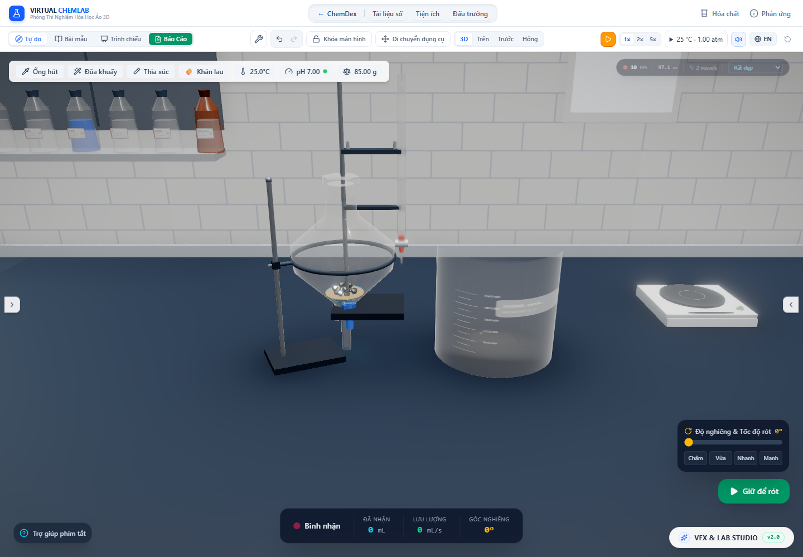

# Hai pha chất lỏng có vật rắn trong phễu phân lớp

Ngày kiểm tra: 30/10/2026. Đợt [phần rắn ngập thật](stock-immersion.vi.md) chưa hỗ trợ phễu phân lớp: hai lớp vẽ theo thể tích lỏng thuần, vật rắn chưa có mesh trong khoang. Đợt này thêm vật rắn và giải cả mặt phân cách lẫn mặt thoáng theo cùng phần ngập, đồng thời giữ thông tin pha trong mẫu xả/tràn.

## Phương trình và dữ liệu dùng chung

Gọi G(c) là thể tích hình học của khoang dưới mặt phẳng hướng trọng lực, D(c) là phần vật rắn ngập bên trong khoang, L₁ là thể tích pha dưới và L₂ là thể tích pha trên. Hai mặt cắt thỏa:

`G(c₁) − D(c₁) = L₁`

`G(c₂) − D(c₂) = L₁ + L₂`

Vì vậy, thể tích pha trên là `G(c₂) − G(c₁) − D(c₂) + D(c₁)`. Chỉ cộng phần chiếm chỗ ở mặt thoáng trên, nhưng để mặt phân cách theo thể tích lỏng thuần, sẽ làm thừa thể tích lớp trên.

`solveStockLiquidSurface` nhận thêm lượng lỏng tích lũy cần giải. Tham số này không thay `volume_ml`, `contents` hoặc bộ đếm pha của bình, nên không làm sai mật độ khi giải một lớp nhỏ. Renderer dùng cùng nghiệm c₁ cho mặt trên của lớp dưới và mặt dưới của lớp trên. Cache vẫn xét hướng ba chiều, lượng vật liệu và lượng lỏng.

`liquidLayers.ts` tách dữ liệu pha thành hàm thuần, dùng chung giữa renderer, bộ kiểm tra chìm và đường xả. `volume_ml` luôn là tổng lỏng; `immiscibleOrganicVolume_ml` là phần trong tổng, không cộng lần nữa. Mật độ từng pha lấy khối lượng lỏng thuộc pha đó chia thể tích pha, gồm chất tan và loại vật rắn/khí. Không giả định mọi pha hữu cơ đều nhẹ hơn nước.

Nhánh vật rắn tĩnh chỉ được dùng nếu nó đặc hơn **từng pha**; mật độ trung bình của hai pha không đủ để chứng nhận vật chìm tới đáy. Quan hệ giữa mật độ và chìm/nổi có cơ sở ở [Archimedes và lực nổi, OpenStax](https://openstax.org/books/university-physics-volume-1/pages/14-4-archimedes-principle-and-buoyancy). Điều kiện kiểm tra này là giới hạn của mô hình tĩnh, chưa giải vật nổi tại mặt phân cách hoặc lực mao dẫn.

Phễu phân lớp đã có `SolidContentsRenderer` trong cùng hệ tọa độ thân và cùng mặt đáy khoang −0,45. Chỉ các bố trí bao được hỗ trợ mới dùng phần ngập lưới, như đợt trước; việc thêm renderer không chứng nhận bột, kết tủa hoặc bố trí `unresolved-fit` đã đúng.

## Mẫu xả và phần tràn

`stepFunnelFlow` vẫn chọn pha dưới theo kho/mật độ hiện hành và chỉ chuyển lượng có trong pha. Mẫu hữu cơ giờ mang `organicVolume_ml` và màu pha qua `dispenseAliquot`. Bình nhận cập nhật pha qua cùng giao dịch; phần chưa nhận giữ thể tích hữu cơ còn lại trong chính aliquot tràn. Trước sửa, bộ đếm bình nhận được cập nhật riêng nhưng aliquot tràn thiếu thông tin này.

Kiểm tra bình nhận chỉ chứa được 0,001 mL, xả 0,005 mL pha hữu cơ dưới: nhận 0,001 mL, aliquot tràn giữ 0,004 mL hữu cơ, nguồn hết pha đó và khối lượng/mol vẫn bảo toàn. Không nhân đôi bộ đếm bằng một lần cộng riêng sau `dispenseAliquot`.

Dải minh họa dòng xả không còn hiện khi bình bị đậy kín; màu lấy từ pha dưới hiện hành. Đây vẫn là hình minh họa: tốc độ xả phễu phân lớp còn cố định 2,5 mL/s, chưa tính áp suất nhiều lớp, lỗ van, trở lực, cửa ra khô khi nghiêng hoặc dòng bay hữu hạn tới vị trí nhận. Đợt này kiểm chứng kho chất và hình học hai pha, không chứng nhận thủy lực hoặc quỹ đạo dòng xả đáy.

## Số đo trong Chrome

[Dữ liệu app/GPU](layered-stock-2026-10-30/browser-audit.json): phễu 150 mL, 3 mL nước, 0,005 mL hữu cơ và 7,14 g Zn = 1 mL vật liệu. Hai fixture có mật độ hữu cơ đầu vào 0,879 và 1,49 g/mL để kiểm tra hai thứ tự phân lớp; không coi các giá trị fixture là phép đo thực nghiệm mẫu trong app.

Vật rắn được đo từ geometry và ma trận Float32 thật. Audit dựng nắp ở miệng rồi cắt lưới độc lập để đo D; không gọi hàm D production. G lấy từ contour và mặt phẳng vật lý. Lưới nước trên GPU được đo riêng bằng uniform đọc ngay sau draw của **từng lớp**, vì các material có thể dùng chung WebGLProgram.

| Khi đứng | Lượng lỏng thực | Thể tích hình học của lớp | Vật rắn chiếm trong lớp |
|---|---:|---:|---:|
| Nước dưới, hữu cơ nhẹ trên: lớp dưới | 3 mL | 3,595143363 mL | 0,595143377 mL |
| Nước dưới, hữu cơ nhẹ trên: lớp trên | 0,005 mL | 0,006143957 mL | 0,001143956 mL |
| Hữu cơ nặng dưới, nước trên: lớp dưới | 0,005 mL | 0,005025175 mL | 0,000025175 mL |
| Hữu cơ nặng dưới, nước trên: lớp trên | 3 mL | 3,596262144 mL | 0,596262158 mL |

Hai thứ tự × ba góc 0 / 0,8 / 1,2 rad × bốn mức chất lượng tạo 24 snapshot, mỗi snapshot hai lớp. Sai số lớn nhất `G − D − L` khoảng **1,44×10⁻⁸ mL**, dưới ngưỡng audit 10⁻⁶ mL. Mặt trên lớp dưới và mặt dưới lớp trên khớp nhau trong ngưỡng 10⁻¹⁰ đơn vị mô hình.

Thể tích lỏng đo trên lưới GPU, sau trừ phần vật rắn giao nhau, lệch tối đa **0,198%** ở fixture hữu cơ nhẹ và **0,193%** ở fixture hữu cơ nặng. Sai số này gồm đa giác hóa bình và uniform Float32; khác sai số phương trình mô hình ở trên. Ngưỡng kiểm tra lưới là `max(2×10⁻⁶ mL, 0,5% lượng pha)`, không dùng nó để nới ngưỡng bảo toàn kho.

Qua bốn mức chất lượng, ledger không đổi, 22 mảnh Zn vẫn giữ cùng thể tích và `instanceMatrix.version = 1`. Khi giảm Zn xuống 2,856 g = 0,4 mL, vẫn 22 mảnh theo khối lượng ban đầu, ma trận cập nhật sang version 2, cả hai thể tích pha tiếp tục đúng.

Sau đó đưa tư thế kiểm tra về đứng và gọi cùng hàm giao dịch xả mà store sử dụng, ghi kết quả vào fixture để kiểm tra renderer. Pha dưới hết trước, còn một lớp; lần tiếp theo hết lỏng, không còn mesh nước, Zn vẫn đủ 0,4 mL ở nguồn. Khối lượng, thể tích lỏng và mol từng chất bảo toàn. Đây là kiểm tra giao dịch có kiểm soát, chưa phải bằng chứng dòng rơi tới đúng bình trong không gian. Audit cũng xác nhận dải minh họa bị ẩn khi đậy kín và dùng màu pha đang ở dưới.



Ảnh kiểm tra ngoại hình. Lớp 0,005 mL được giữ đúng lượng nhỏ, không tăng độ dày để dễ thấy. HUD đang chọn bình nhận và app tạm dừng; số góc/FPS trên đó không dùng làm phép đo nguồn hay benchmark. Các góc nghiêng audit chỉ cô lập hình học; chuyển động của cả giá đỡ theo thân vẫn là giới hạn renderer cũ.

## Kiểm tra và chi phí

6 test mới: hai thứ tự pha đối chiếu lưới/nắp độc lập ở bốn hướng trọng lực; điều kiện mật độ từng pha; hai thứ tự xả hữu hạn giữ stock/khối lượng/mol; và aliquot hữu cơ tràn giữ bộ đếm pha. Fixture vật có thể nổi tại mặt phân cách chỉ kiểm tra từ chối nhánh tĩnh, không mô phỏng phản ứng hóa học của nó.

- [Correctness suite](layered-stock-2026-10-30/test-results.json): **188 file, 2.334/2.334 test qua**; loại `tests/performance.smoke.test.ts` để giữ artifact benchmark lịch sử.
- [TypeScript](layered-stock-2026-10-30/lint.log) và [build](layered-stock-2026-10-30/build.log) qua; Vite 29,08 giây, còn cảnh báo chunk lớn hơn 500 kB.
- [Hồi quy lớp nước mỏng](layered-stock-2026-10-30/thin-regression/browser-audit.json): 8 nguồn/tư thế, 4 liều rót và lớp hữu cơ mỏng không có stock; không lỗi audit/console.
- [Hồi quy stock/đầu áp](layered-stock-2026-10-30/stock-regression/browser-audit.json): 4 bình, 16 tư thế, Cu giữ lại và CuS vận chuyển; không lỗi audit/console.

[Benchmark CPU](layered-stock-2026-10-30/cpu.json), Node v26.7.0: hai nghiệm tích lũy cho mỗi hướng, 30 lượt làm nóng và 120 mẫu thay đổi hướng/gọi lại cùng đầu vào. Không gồm React, controller, upload, draw hoặc mô phỏng hóa học.

| Fixture | Gọi đầu tiên hai nghiệm | Đổi hướng median / p95 | Gọi lại median / p95 |
|---|---:|---:|---:|
| Hữu cơ nhẹ | 10,396 ms | 0,449 / 0,817 ms | 0,0072 / 0,0164 ms |
| Hữu cơ nặng | 0,656 ms | 0,296 / 0,474 ms | 0,0058 / 0,0136 ms |

Fixture thứ hai dùng chung cache geometry đã nóng từ fixture đầu; không so hai lần gọi đầu như benchmark lạnh độc lập. Số đo CPU này không chứng minh FPS hoặc hiệu năng trên máy khác.

```powershell
node --import tsx scripts/benchmarkLayeredStock.ts
# Vite chạy cổng 6773:
node scripts/auditLayeredStock.mjs
```

Mục tiêu còn tiếp tục: thủy lực và vận chuyển dòng xả đáy hữu hạn; vật rắn chuyển động/đổi cách xếp; vật nổi tại mặt phân cách; bột/kết tủa; sức căng bề mặt, phân bố chất tan giữa pha và phản ứng tại biên pha. Các mục này không được coi là đã hoàn thành bằng số đo hai mặt cắt.
