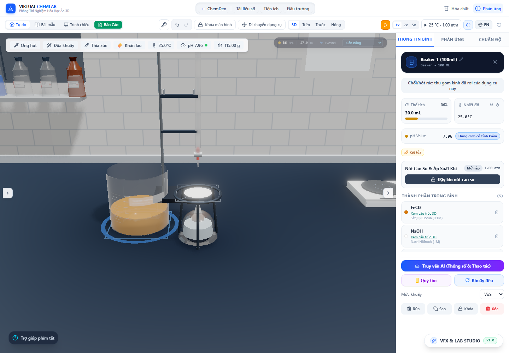

# Tối ưu mô phỏng và đo khung hình — 29/10/2026

Đã giảm tính toán lặp trong `PrecipitationSystem` và sửa bộ đếm draw call/triangle của HUD. Không thay đổi bước vật lý 120 Hz, công thức kéo/lắng, số lần lấy mẫu vận tốc, thứ tự PRNG hoặc các hệ số kết bông.

## Thay đổi

- Chỉ tra lại hồ sơ khi bộ ba **chất, dạng hình thành, màu khai báo** thay đổi. Điều kiện cho phép kết bông được cập nhật cùng danh tính hóa học; bí danh màu `BLUE` vẫn không được cấp mô hình kết bông của Cu(OH)₂.
- Ghi nhớ vận tốc lắng theo đúng bán kính vật lý, mật độ hạt, mật độ chất lỏng và độ nhớt. Không làm tròn đầu vào. Kết quả tính thuần số có thể dùng lại qua các bước; hòa tan hoặc thay đổi chất lỏng làm mất hiệu lực ngay.
- Tạo tham số dòng chảy một lần mỗi bước, lưu tuổi hạt mới theo vị trí liên tiếp, dồn các hạt còn hoạt động ngay trong mảng. Bỏ Map với khóa chuỗi cho vận tốc lắng và mảng sao chép toàn bộ hạt ở mỗi bước.
- HUD đặt `gl.info.autoReset = false`, xóa bộ đếm đầu khung hình và đọc sau render bằng `addAfterEffect`. Dọn callback và khôi phục cấu hình khi unmount. Số draw call bao gồm cảnh, các lượt phụ và hậu xử lý; không còn chỉ hiện quad cuối cùng. Đây là thống kê khối lượng dựng hình, không phải GPU timer.

Cách đếm nhiều lượt render phù hợp [tài liệu WebGLRenderer.info của Three.js](https://threejs.org/docs/pages/WebGLRenderer.html#info). Thời điểm callback được đối chiếu với [tài liệu React Three Fiber](https://r3f.docs.pmnd.rs/api/additional-exports) và mã thư viện đang cài trong dự án.

## Đo CPU trước/sau

[Dữ liệu đo xen kẽ](performance-2026-10-29/paired.json): Node v26.7.0, Windows, 9 lượt mỗi phiên bản sau warmup. Hai phiên bản chạy xen kẽ trong cùng tiến trình, đổi thứ tự theo lượt. Đo riêng thời gian gọi `update`, không tính tạo ảnh hay tuần tự hóa checkpoint. Một lượt mô phỏng 15 giây ở đầu vào 60 Hz, nội bộ 120 Hz. Các mốc gồm đổi nhiệt độ/độ nhớt, khuấy, rút huyền phù, hòa tan, thêm kết tủa và giảm hạn mức hạt.

| Kịch bản | Trước, median ms | Sau, median ms | Giảm CPU |
| --- | ---: | ---: | ---: |
| Cu(OH)₂, hạn mức 900 | 38,12 | 9,98 | 73,8% |
| AgCl, hạn mức 550 | 30,98 | 11,63 | 62,5% |
| BaSO₄, hạn mức 900 | 46,85 | 24,64 | 47,4% |
| PbI₂ dạng tấm, hạn mức 260 | 52,08 | 28,00 | 46,2% |
| Chất chưa có hồ sơ, hạn mức 120 | 64,91 | 23,30 | 64,1% |
| Cu(OH)₂ giữ lơ lửng lâu, hạn mức 900 | 1.445,10 | 862,39 | 40,3% |
| BaSO₄ giữ lơ lửng lâu, hạn mức 900 | 1.263,05 | 876,15 | 30,6% |

Năm kịch bản đầu dùng biên hình học nhỏ; nhiều hạt đã lắng nên mức cải thiện chủ yếu phản ánh việc bỏ tra cứu thừa. Hai kịch bản cuối dùng miền cao/rộng nhân tạo để giữ hạt hoạt động, chỉ dành cho tải CPU, không đại diện kích thước cốc hay một mẫu hóa học đo thực nghiệm. Hạn mức là sức chứa tối đa, không phải số hạt luôn có mặt. Sau khung 700, hạn mức giảm còn một phần ba; cuối hai kịch bản tải còn 300 hạt.

Các lượt dài có biến động thời gian đáng kể; JSON giữ toàn bộ mẫu, không bỏ ngoại lệ. Kết quả này áp dụng cho phần kết tủa trong môi trường đo, **không suy ra FPS toàn cảnh tăng 31–74%**, không phải bảo đảm cho thiết bị khác.

## Giữ kết quả mô phỏng

Ở mỗi kịch bản có 31 checkpoint, tổng cộng 217 checkpoint mỗi lượt. SHA-256 của toàn bộ hạt (tọa độ, vận tốc, tuổi, bán kính, khối lượng…), lượng chất đại diện, lớp lắng, độ đục, đồng hồ và quần thể kết bông **trùng khớp chính xác** với bản trước tối ưu. Các lần lặp cũng trùng nhau. Mỗi khung còn kiểm tra lượng chất đại diện lệch đầu vào không quá 10⁻¹⁰ g.

[Baseline](performance-2026-10-29/baseline.json), [lần đo sau độc lập](performance-2026-10-29/optimized.json) và [lần đo xen kẽ](performance-2026-10-29/paired.json) được giữ lại. Bản lớp đối chứng tạm thời được sao chép trước khi sửa và xóa sau phép đo. Script vẫn hỗ trợ đối chứng trong các lần tối ưu tiếp theo bằng cách lưu phiên bản trước thành `src/simulation/effects/PrecipitationSystem.benchmark-reference.ts` rồi đặt `PRECIPITATION_REFERENCE=1` khi chạy.

Test mới kiểm tra mất hiệu lực cache khi đổi dạng tinh thể, màu chất chưa biết, bí danh hóa học, độ nhớt, mật độ, hòa tan và reset. Test HUD kiểm tra tổng cảnh + quad cuối, không cộng dồn qua khung, loại khoảng thời gian ẩn và dọn subscription.

Kết quả toàn bộ lab: **170 file / 2.101 test qua, 0 lỗi, 0 bỏ qua**; [JSON kết quả](performance-2026-10-29/test-results.json). Production build qua trong 32,03 giây; [log build](performance-2026-10-29/build.log) còn cảnh báo chunk lớn có sẵn. Bản TypeScript cũng được kiểm tra bằng `npm run lint`.

## Kiểm tra trình duyệt

[Browser audit](performance-2026-10-29/browser-audit.json), Chrome headless, Intel UHD/ANGLE D3D11, viewport 1440 × 1000, DPR 1. Dùng phản ứng thật FeCl₃ + NaOH trên giao diện lab, sau đó tạm dừng để đối chiếu trạng thái:

- Qua medium → low → high → low, cùng manager, lượng chất, đồng hồ và lịch sử kết bông được giữ nguyên khi tạm dừng. Sau tiếp tục, đồng hồ chạy lại.
- Bộ đếm ổn định ở medium khoảng 331 draw call / 39.053 triangle và low khoảng 311 / 32.316; số liệu không tăng dồn theo thời gian. Lượt đầu sau chuyển mức có thể vẫn thuộc cửa sổ thống kê cũ.
- Không ghi nhận lỗi JavaScript hoặc console. Không có request API cần chặn trong lần này.
- FPS quan sát trong cảnh đang tạm dừng: medium 35–36, high 22–23, low sau ổn định 56–59. Đây là kiểm tra renderer sau sửa, không phải phép đo FPS trước/sau tối ưu CPU và không đại diện cảnh nhiều phản ứng đang chạy.



## Tái chạy

Từ thư mục `lab-3d`:

```powershell
node --import tsx scripts/benchmarkPrecipitation.ts current 9
npx vitest run --maxWorkers=2 --exclude tests/performance.smoke.test.ts
npm run lint
npm run build
```

Script benchmark tự đối chiếu checkpoint với baseline đã lưu và dừng nếu khác. Không dùng ngưỡng thời gian cứng trong test vì tải máy/JIT có thể biến động. Bài `performance.smoke` cũ không nằm trong đợt chạy này vì nó ghi đè artifact kiểm toán riêng.

Để chạy browser audit, mở Vite ở cổng 6773 rồi chạy `node scripts/auditPerformance.mjs`. Nếu dùng `DISABLE_HMR=true`, khởi động lại Vite sau khi sửa nguồn.

## Phần còn có thể tối ưu

Mức high vẫn bị giới hạn bởi dựng kính/hậu xử lý trên Intel UHD. Số FPS toàn ứng dụng cần đo thêm với cùng cảnh đang chạy và cùng trạng thái phản ứng. Hạn mức bọt/sương của manager hiện được chọn lúc tạo, chưa thu nhỏ đầy đủ khi đổi chất lượng; xử lý tiếp cần giữ các receipt khí/hơi và lịch sử đã nhận, không xóa mô phỏng để đạt số FPS đẹp hơn.
