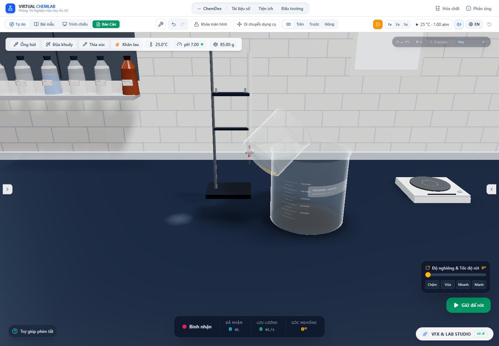

# Mặt cặn hữu hạn khi nghiêng bình

Ngày kiểm tra: 30/10/2026. Đợt này sửa lớp cặn luôn nằm ngang theo đáy mô hình, dù thân bình đang nghiêng. Thay đổi bao gồm hình học theo thể tích thật của cặn, chuyển động mặt cặn hạt rời có giới hạn ma sát và chỗ hạt lơ lửng chạm lớp cặn. Không tự biến cặn thành huyền phù chỉ vì người dùng nghiêng bình.

## Cơ sở và giới hạn ngay từ mô hình

[Courrech du Pont và cộng sự, *Granular Avalanches in Fluids*](https://arxiv.org/pdf/cond-mat/0209050) phân biệt các chế độ trượt theo tác động của chất lỏng và kích thước hạt; kết quả với hạt cầu cho thấy độ nhớt có thể kéo dài mạnh thời gian dịch chuyển. Bài báo đưa ra thang thời gian nhớt tỉ lệ D/U và hệ số thực nghiệm gần 4 trong nhóm thí nghiệm đó. Đây là cơ sở tham chiếu, không phải số đo của kết tủa hóa học trong ChemDex.

[Tài liệu USACE](https://www.hec.usace.army.mil/confluence/rasdocs/rasum/6.6/hydraulic-design-hd-calculators/stable-channel-design-functions/stable-channel-design/selecting-an-angle-of-repose-in-cohesionless-sediment) nêu góc nghỉ của vật liệu rời thay đổi theo kích thước và độ góc cạnh. [Nghiên cứu hai pha về cặn ngập nước](https://www.cambridge.org/core/services/aop-cambridge-core/content/view/13907859E8C612C895688CE55656EAD2/S0022112021006662a.pdf/twofluid_model_for_immersed_granular_avalanches_with_dilatancy_effects.pdf) còn cho thấy vai trò của thay đổi độ đặc. Vì vậy mã không áp dụng một công thức cát rời cho mọi gel, bông hoặc bột mịn.

Mô hình mới là **tham chiếu mặt cặn hạt rời ở chế độ quá tắt dần**, không phải DEM hay solver hai pha được hiệu chuẩn. Nó dùng:

- Góc nghỉ danh định 30°. Đây là lựa chọn mô hình, chưa phải hệ số ma sát đo của PbI₂, kim loại hay một sản phẩm cụ thể.
- Thang thời gian `τ = 4D/U`, với D là đường kính cực đại của lòng bình theo mét, U là vận tốc lắng cầu tương đương từ profile hiện có. Khi có nhiều thành phần hạt rời, dùng trung bình điều hòa theo khối lượng cho U. Phép chọn trung bình và việc mở rộng thang thời gian này chưa có hiệu chuẩn cho hỗn hợp kết tủa.
- Nếu góc giữa pháp tuyến mặt cặn và hướng lên thế giới vượt góc nghỉ, phần góc dư giảm theo `exp(−dt/τ)`. Mặt cặn quay dần về phía hướng lên; không xoay tức thời. Trong nón ma sát, mặt giữ nguyên trong bình. Do đó khi trả bình về đứng, cặn không bị ép phẳng ngay.

Chỉ profile `crystalline` hoặc `granular` đã được nhận diện mới đi qua nhánh tham chiếu này. Gel, bông, bột mịn và fallback chung trả `cohesion-unavailable`; trạng thái khô/đóng băng hoặc carrier không dùng được trả `carrier-unavailable`. Khi mất tiếp xúc nén với đáy, trả `contact-lost`. Nếu cặn chạm vùng cửa ra, đánh dấu `outlet-unresolved`. Các trạng thái này giữ vật chất hiện có; **chưa mô phỏng cặn rời qua miệng hoặc rơi tự do khỏi bình úp**.

## Một mặt chung cho thể tích, mesh và va chạm

Thể tích cặn đóng gói là tổng `m/(ρ × φ)` của từng thành phần đã lắng. ρ là mật độ vật liệu; φ là độ đặc giả định đã có của profile. Nước trong lỗ rỗng không được tạo thêm hoặc cộng thành chất rắn mới. Trường `thickness` cũ được giữ làm chiều cao tương đương khi đứng thẳng; mặt nghiêng dùng `surfacePlane` riêng.

Với pháp tuyến mặt cặn n, mã giải c sao cho phần lòng bình thỏa `n·p ≤ c` có đúng thể tích cặn. Trong thử nghiệm ban đầu, tái dùng hàm mặt chất lỏng cũ với lưới tích phân y cố định làm sai đáng kể các nêm rất mỏng: ví dụ cặn mục tiêu 0,1 mL trong ống đong ở góc 0,3 rad có thể tạo mesh khoảng 0,11817 mL. Đây là sai lệch tìm thấy khi nghiên cứu cách dựng **mặt cặn nghiêng mới**, không phải một số đo rằng mọi lớp cặn cũ đều sai 18%.

`polygonBedVolume` giải theo đúng lòng bình đa giác 48 cạnh dùng cho mesh cặn. Mỗi đoạn contour được chia tại các độ cao mà mặt phẳng cắt qua một đỉnh đa giác. Trong mỗi khoảng, đỉnh đa giác bị cắt biến thiên tuyến tính theo y, diện tích tiết diện là bậc hai; tích phân Simpson ba điểm vì thế là chính xác tới sai số số học. Cách này không bỏ sót một nêm mỏng nằm giữa các lát y thưa.

Mesh được cắt từ lòng bình kín, rồi đóng nắp theo các vòng cạnh giao tuyến. Các điểm biên thẳng hàng bị Earcut bỏ qua được chèn lại để nắp chia sẻ từng cạnh với thành; các đỉnh được weld. Kiểm thử xác nhận mỗi cạnh có đúng hai mặt kề, hướng/thể tích có dấu đúng, mọi đỉnh nằm dưới mặt cắt và thể tích khớp mục tiêu trong 0,1% ở các trường hợp đã chạy. Đây là độ chính xác đối với lòng bình đa giác của mô hình, không phải chứng nhận hình dạng dụng cụ thực.

Lớp PrecipitationSystem nhận chính mặt cặn đó để xác định hạt đã chạm cặn, thay cho một ngưỡng y cố định. Khối lượng của hạt chạm mặt chuyển vào kho cặn hiện có. Hạt được khuấy bốc lại sinh ở phía trên mặt này; nhánh khuấy vẫn dùng luật entrainment minh họa đã có. Chuyển động mặt cặn tự nó không cấp khối lượng cho kho lơ lửng và không đổi điều kiện lấy mẫu huyền phù của pipet/dòng rót.

Orientation của mặt được giữ trong manager của mẫu. Cache tránh giải lại mặt khi pháp tuyến, profile và lượng cặn không đổi. Quá trình va chạm và cập nhật tổng thể tích là các bước tách theo snapshot; chưa phải tích phân hai chiều liên tục giữa mọi hạt, lực cặn và dòng chất lỏng trong cùng một bước.

## Bằng chứng trong app

[Audit Chrome](sediment-surface-2026-10-30/browser-audit.json) dùng mẫu có sẵn **0,5 g PbI₂ dạng CRYSTAL_PLATE trong 30 mL nước**, để quần thể hiện hành lắng hữu hạn rồi dùng PourController nghiêng bình. Đây là mẫu quang học/cơ học có kiểm soát, không phải một thí nghiệm chứng minh tốc độ tái kết tinh hoặc góc nghỉ của PbI₂.

Đồng hồ app được tạm dừng, còn bước manager được cấp thời gian có kiểm soát để cô lập chuyển động cặn: 20 s để lắng mẫu, sau đó 30 s ở tư thế nghiêng khoảng 55,64°. Ma trận và vertex/index buffer của mesh thật được đọc trực tiếp.

| Bình | Góc mặt cặn so với phương ngang trước → sau | Thời gian tham chiếu τ | Thể tích mesh sau, mL |
|---|---:|---:|---:|
| Cốc 100 mL | 55,64° → 30,018° | 4,136 s | 0,270562644 |
| Bình tam giác 250 mL | 55,64° → 30,622° | 8,065 s | 0,270562610 |
| Ống nghiệm 50 mL | 55,64° → 30,000006° | 1,959 s | 0,270562858 |
| Ống đong 100 mL | 55,64° → 30,000281° | 2,627 s | 0,270562858 |

Thể tích mục tiêu của bốn mẫu là khoảng **0,270562771 mL**, từ 0,5 g, mật độ/độ đặc profile. Sai số mesh lớn nhất trong kịch bản này khoảng 1,61×10⁻⁷ mL. Kho cặn vẫn là 0,5 g trong sai số số học khoảng 10⁻¹⁵ g; lượng được phép lấy như huyền phù không tự tăng. Kho chất canonical trước/sau 30 s cơ học giống hệt nhau. Trọng tâm thật của mesh hạ xuống theo trọng lực trong cả bốn bình. Đổi chất lượng lúc tạm dừng giữ nguyên snapshot cặn. Audit không ghi nhận lỗi JavaScript hoặc console WebGL.



Ảnh là trạng thái tạm dừng; HUD góc rót có thể còn thông báo đã throttle trước các bước điều khiển thủ công. Số góc làm bằng chứng nằm trong JSON/ma trận. Không dùng ảnh để kết luận FPS hoặc thời gian phản ứng thực.

`sediment_surface.test.ts` kiểm tra nón ma sát, tính không đổi khi chia bước thời gian, đáp ứng chậm hơn khi tăng độ nhớt, giới hạn gel/khô/mất tiếp xúc, va chạm với mặt cặn thay cho y đáy và trọng tâm hạ xuống khi mặt thư giãn. Hình học được kiểm tra ở **14 loại bình × 4 hướng nghiêng × 3 thể tích** (0,1/2/20 mL), gồm pháp tuyến có thành phần z. Suite tổng và các kiểm tra lấy mẫu huyền phù/hỗn hợp kết tủa xác nhận các kho chất không bị cấp thêm bởi mặt cặn.

[Benchmark CPU](sediment-surface-2026-10-30/cpu-benchmark.json) đo riêng giải mặt và dựng mesh với 5 lượt làm nóng, 40 mẫu mỗi contour, Node 26.7. Median giải mặt + dựng hình lần lượt khoảng 1,21 + 0,89 ms cho cốc, 0,91 + 0,52 ms cho bình tam giác, 3,83 + 2,56 ms cho ống nghiệm, 1,33 + 2,75 ms cho ống đong. p95 tổng cao nhất khoảng 11,61 ms. Đây là phép đo CPU của kịch bản riêng, không phải FPS, không phải so sánh trước/sau tương đương và chưa chứng minh ngân sách nhiều bình đang chuyển động đồng thời. Phần dựng hình động còn chi phí cần tối ưu tiếp.

Kết quả kiểm tra cuối và log: [test-results.json](sediment-surface-2026-10-30/test-results.json), [lint.log](sediment-surface-2026-10-30/lint.log), [build.log](sediment-surface-2026-10-30/build.log). [Hồi quy tư thế hạt/khí](sediment-surface-2026-10-30/tilted-regression/browser-audit.json) chạy với mã mới; artifact các đợt trước được giữ nguyên.

Kiểm tra cuối: **182 file / 2.228 test đều qua**, TypeScript qua, build production qua trong **40,80 s**. Audit cặn và hồi quy tư thế hạt/khí đều qua, không có lỗi JavaScript/console WebGL. Cảnh báo chunk lớn và localStorage thử nghiệm của Node vẫn còn.

## Chưa hoàn tất trong mục tiêu thực tế

1. Góc 30°, hệ số thời gian 4, kích thước cầu tương đương và độ đặc không phải tập tham số đã hiệu chuẩn cho từng sản phẩm. Chưa có dilatancy, áp suất nước lỗ rỗng, thay đổi tính kết dính, phân lớp hỗn hợp hay lực cản sát thành của cặn.
2. Cặn khô, gel/bông/bột mịn, mất tiếp xúc và dòng hạt qua cửa ra vẫn là các giới hạn tường minh, chưa có solver tương ứng. Không lấy trạng thái “giữ nguyên” của chúng làm chứng cứ đã mô phỏng đúng vật lý.
3. Dòng mang/slosh, rung giật bình và tương tác ngược của cặn lên dòng chưa được giải đồng thời. Việc hạt và mesh dùng chung mặt sửa ràng buộc hình học; chưa chứng minh toàn bộ quán tính hoặc cơ chế bám/trượt đúng thực nghiệm.
4. Nhánh `solveLevel` cũ của chất lỏng cần xử lý riêng độ chính xác ở nêm mỏng. Đợt tiếp theo [đã thay bộ giải và đo mesh dung dịch](thin-liquid.vi.md); xem phạm vi, sai số và giới hạn riêng ở báo cáo đó, không suy rộng phép đo cặn thành chứng nhận mọi thể tích chất lỏng.
5. Vỡ giọt, bám ướt, liên kết phụ kiện, hiệu chuẩn phản ứng và các giới hạn đã ghi trong [màng tràn](circular-overflow.vi.md), [mẫu vận chuyển](aliquot-contact-chemistry.vi.md), [thước SI](world-scale.vi.md) và [đám khí](gas-cloud-lifecycle.vi.md) vẫn còn. Mục tiêu tổng thể tiếp tục hoạt động.

## Tái chạy

```powershell
npx vitest run --maxWorkers=2 --exclude tests/performance.smoke.test.ts
npm run lint
npm run build
node --import tsx scripts/benchmarkSedimentSurface.ts
# Vite riêng, khởi động lại sau mỗi sửa nguồn nếu tắt watcher:
$env:DISABLE_HMR='true'
node node_modules/vite/bin/vite.js --host 127.0.0.1 --port 6773 --strictPort
# Ở tiến trình khác:
node scripts/auditSedimentSurface.mjs
```

Đổi thư mục audit bằng `SEDIMENT_AUDIT_OUTPUT`. Suite tổng bỏ `performance.smoke.test.ts` để không ghi đè dữ liệu hiệu năng lịch sử.
