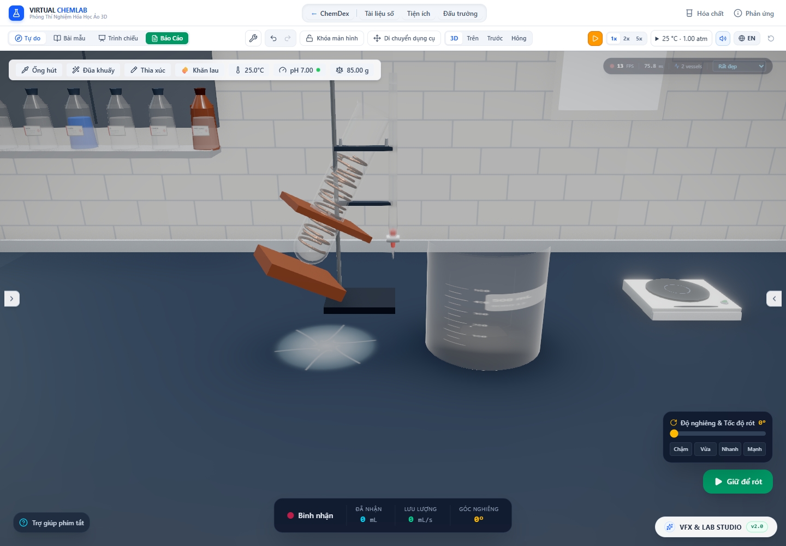

# Giữ đủ thể tích vật rắn khi bố trí trong bình

Cập nhật sau đợt này: [phần vật rắn ngập thật](stock-immersion.vi.md) đã nối hình học vào nước/đầu áp cho bố trí được hỗ trợ. Các số đo và mục chưa khớp bên dưới giữ làm bằng chứng lịch sử; nhánh bột/vật nổi/bố trí chưa giải vẫn có giới hạn riêng.

Ngày kiểm tra: 30/10/2026. Đợt này sửa lỗi hình học vật rắn bị thu nhỏ để vừa lòng bình. Với 2 mL đồng trong ống nghiệm, lưới cũ chỉ còn khoảng 0,8864 mL; 4 mL trong ống đong chỉ còn 3,2663 mL. Kho khối lượng vẫn giữ nguyên nên hình ảnh và lượng vật chất mâu thuẫn nhau.

## Thay đổi

`stockSolidLayout.ts` bố trí các mảnh bằng bao trụ bảo thủ, thử ba hướng cơ sở và các lưới vuông/tam giác. `solidColumnIntervals.ts` tính các khoảng cao độ mà toàn bộ bao trụ nằm trong biên lòng bình tuyến tính từng đoạn. Các bao không giao nhau khi đĩa ngang tách nhau hoặc khoảng cao độ tách nhau. Vì toàn bộ mảnh nằm trong bao, cách này kiểm tra cả bề mặt liên tục thay vì chỉ một số đỉnh.

Tổng thể tích luôn bằng thể tích lưới đơn vị đo được nhân tổng định thức các ma trận instance. Không giảm scale để nhét vừa. Với dạng gồm nhiều mảnh, thuật toán có thể tăng số mảnh đại diện cho cùng liều; đây không phải sự kiện bẻ vụn trong mô phỏng. Đinh luôn là một vật nguyên. Bình mở có thể cho vật nhô qua miệng; khi không tìm được cách bố trí, trạng thái là `unresolved-fit` và vẫn giữ đủ vật chất. Trạng thái này **không** chứng nhận vật nằm trong bình, cũng chưa chặn thao tác đóng nắp hoặc thêm vật liệu.

Kế hoạch ban đầu được giữ theo `initialMass_g`/`initialMoles`. Khi tan, số mảnh và tọa độ ngang giữ nguyên; kích thước và cao độ đỡ giảm theo khối lượng còn lại. Kế hoạch được cache theo geometry và dữ liệu đầu vào; thay đổi buffer/version làm mất cache. Renderer không upload lại instance matrix khi lượng chất, bố trí và lớp bám không đổi. Đã bỏ dịch ngang giả theo sin của góc nghiêng trong nhánh này.

Theo [tài liệu InstancedMesh](https://threejs.org/docs/pages/InstancedMesh.html), mỗi instance có ma trận riêng; [BufferAttribute](https://threejs.org/docs/pages/BufferAttribute.html) lưu dữ liệu thuộc tính và version cập nhật. Audit đo dữ liệu ma trận Float32 thực đã gửi cho renderer, không chỉ kế hoạch double precision trên CPU.

Đây là bố trí tĩnh gắn với thân bình (`body-fixed-envelope-reference`). Chưa có cân bằng lực, ma sát, lăn/trượt, va chạm động, đường nạp qua cổ hoặc dòng chất rắn ra cửa. Bao trụ có thể để nhiều khoảng trống; chưa chứng minh cách xếp là tối ưu. Các nhóm chất khác nhau vẫn được bố trí độc lập nên chưa bảo đảm chúng không giao nhau. Bột, đá, Na và K dùng các nhánh riêng chưa thay đổi; lớp bám cũng chưa có nghiệm tiếp xúc đầy đủ.

## Kết quả đo trong Chrome

[Dữ liệu và bảo toàn](solid-volume-layout-2026-10-30/browser-audit.json) lấy từ app và controller thật. Nguồn nghiêng 0,5 rad, dùng cùng fixture nước/đồng của đợt [đầu áp có vật rắn](displaced-source-flow.vi.md). Thể tích lấy từ lưới và ma trận đã upload, quy về mL bằng thước SI của từng thân bình.

| Nguồn | Đồng đã thêm | Lưới cũ | Lưới mới | Phần lưới ngập dưới mặt nước hiện hành | Số mảnh |
|---|---:|---:|---:|---:|---:|
| Cốc 100 mL | 4 mL | 4,000000065 mL | 4,000000076 mL | 3,273919 mL | 37 |
| Tam giác 250 mL | 10 mL | 10,000000420 mL | 9,999999691 mL | 5,154600 mL | 37 |
| Ống nghiệm 50 mL | 2 mL | 0,886405194 mL | 2,000000038 mL | 2,000000038 mL | 13 |
| Ống đong 100 mL | 4 mL | 3,266256651 mL | 3,999999882 mL | 3,999999882 mL | 12 |

Không có cặp bao trụ giao nhau trong từng nhóm đồng của bốn ca. Sai lệch thành/đáy lớn nhất là 2,1071×10⁻⁸ đơn vị mô hình do ma trận Float32, dưới ngưỡng audit 10⁻⁶. Phép đo bán kính chặn cao độ truy vấn tại đáy, đồng thời đo lỗi cao độ riêng: nếu không, đỉnh lệch xuống đáy một lượng làm tròn rất nhỏ sẽ bị so nhầm với bán kính bằng 0 ngoài miền contour.

Bình tam giác có trạng thái `protruding-reference`: cột mảnh nhô qua cổ. Đây là giới hạn cách xếp bảo thủ hiện tại, không phải bằng chứng rằng lượng đồng ấy không thể nằm gọn theo một cách xếp thực khác. Ba bình còn lại là `packed-reference`.

Cả bốn mức low/medium/high/ultra giữ nguyên ledger, thể tích lưới và kế hoạch. `instanceMatrix.version` giữ ở 1 qua các bước đổi chất lượng khi tạm dừng, xác nhận không upload lại ma trận trong kịch bản này. Đây không phải phép đo FPS.



Ảnh dùng để kiểm tra ngoại hình sau sửa. HUD đang chọn bình nhận và app được giữ tạm dừng; góc/FPS trong HUD không dùng làm bằng chứng số đo nguồn.

## Chỗ chưa khớp với nước và đầu áp

Mực nước và đầu áp vẫn dùng `upright-compact-reference` từ đợt trước, chưa cắt thể tích các mảnh mới theo mặt thoáng thật. Bảng trên cho thấy khác biệt rõ: 4 mL đồng trong cốc chỉ có khoảng 3,274 mL nằm dưới mặt nước hiện hành, còn 10 mL trong bình tam giác chỉ khoảng 5,155 mL. Vì vậy, dù đã giữ đúng thể tích vật liệu, **chưa thể coi mực nước và lưu lượng của những ca ngập một phần là đúng theo hình học mới**.

Audit rót vẫn kiểm tra nhận đúng liều, bảo toàn khối lượng/mol và đầu áp khớp clipping plane theo mô hình tham chiếu hiện hành. Ca huyền phù 1 g CuS trong 80 mL, rót 0,5 mL, chuyển 0,00625 g CuS và giữ tổng kho. Những kết quả này không hiệu chuẩn quan hệ lưu lượng ngoài thực nghiệm. Việc cần làm tiếp là dùng cùng hình học vật rắn cho phần chiếm chỗ khi đứng/nghiêng, rồi giải lại mặt nước và lượng lỏng giữ được tại mép.

## Chi phí CPU

Chạy `node --import tsx scripts/benchmarkStockLayout.ts`; [dữ liệu thô](solid-volume-layout-2026-10-30/cpu.json), Node v26.7.0. Mỗi dạng đo một lần tìm kế hoạch ban đầu, sau đó 30 lượt làm nóng và 120 mẫu cache hit/giảm thể tích. Không tính tạo geometry, React, upload, draw hoặc lớp bám.

| Nguồn | Tam giác của đồng | Tìm ban đầu, ms | Cache median / p95, ms | Cập nhật khi tan median / p95, ms |
|---|---:|---:|---:|---:|
| Cốc | 38.924 | 4,971 | 0,0014 / 0,0024 | 0,0164 / 0,0309 |
| Tam giác | 38.924 | 12,959 | 0,0013 / 0,0023 | 0,0139 / 0,0263 |
| Ống nghiệm | 13.676 | 0,511 | 0,0013 / 0,0022 | 0,0076 / 0,0141 |
| Ống đong | 12.624 | 0,098 | 0,0012 / 0,0017 | 0,0042 / 0,0067 |

Đây là phép đo CPU cục bộ, không phải bảo đảm hiệu năng trên mọi máy. Số mảnh tăng kéo theo số tam giác tăng; tiết kiệm tìm bố trí/upload không chứng minh GPU rẻ hơn hoặc FPS tăng.

## Kiểm tra và tái chạy

19 test mới gồm bốn fixture đồng kiểm tra thể tích/đỉnh/bao không giao nhau và giữ danh tính khi còn 40% khối lượng; 13 dạng × 5 bình kiểm tra tổng thể tích; đinh nhô miệng mở/bình đóng và placement không vừa vẫn giữ scale. Ma trận 65 trường hợp kiểm tra bảo toàn thể tích, không chứng nhận mọi trường hợp có tiếp xúc hoặc cân bằng cơ học hợp lệ.

- [Toàn bộ correctness suite](solid-volume-layout-2026-10-30/test-results.json): 186 file, 2.321/2.321 test qua. Loại `tests/performance.smoke.test.ts` để không ghi đè artifact benchmark lịch sử; chi phí bố trí được đo riêng ở trên.
- [TypeScript](solid-volume-layout-2026-10-30/lint.log): `npm run lint` qua.
- [Build](solid-volume-layout-2026-10-30/build.log): qua, Vite 19,14 giây; còn cảnh báo chunk lớn hơn 500 kB.
- [Hồi quy hạt/bọt/hơi khi nghiêng](solid-volume-layout-2026-10-30/tilted-regression/browser-audit.json): bốn loại bình, không lỗi audit hoặc console.

Với Vite chạy cổng 6773, PowerShell tái chạy audit mà không ghi đè bằng chứng đợt trước:

```powershell
$env:DISPLACEMENT_AUDIT_OUTPUT='docs/research/solid-volume-layout-2026-10-30'
$env:SOLID_LAYOUT_AUDIT='true'
node scripts/auditDisplacementFlow.mjs
```

Ngưỡng thể tích tương đối audit 10⁻⁶; kiểm tra thành/đáy 10⁻⁶ đơn vị mô hình và không cho cặp bao giao nhau trong bốn fixture đồng. Chỉ bật biến môi trường này cho kiểm tra bố trí mới; audit đầu áp mặc định vẫn có thể chạy độc lập.
