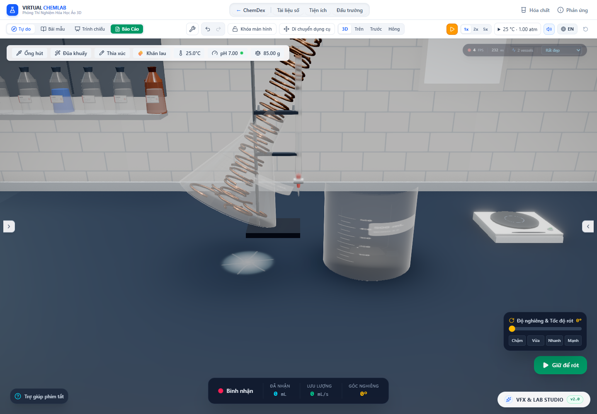

# Phần vật rắn ngập thật dùng chung cho mặt nước và đầu áp

Cập nhật tiếp: [hai pha có vật rắn trong phễu phân lớp](layered-stock.vi.md) đã mở nhánh lưới cho phễu và giải hai mặt cắt tích lũy. Các mô tả phễu phân lớp chưa hỗ trợ bên dưới giữ làm bằng chứng phạm vi của đợt này; thủy lực dòng xả đáy và vật nổi tại biên pha vẫn chưa được giải.

Ngày kiểm tra: 30/10/2026. Sau đợt [giữ đủ thể tích vật rắn](solid-volume-layout.vi.md), hình đồng cuộn và phép tính nước vẫn khác cơ sở: renderer có các mảnh thật, còn bộ giải chiếm chỗ dùng một cầu đặc tương đương. Đợt này nối hình học mảnh vào mực nước, mặt nước của hạt/bọt, dung tích nhận mẫu và đường rót cho các bố trí được hỗ trợ.

## Mô hình

`stockImmersion.ts` dựng cùng geometry, mật độ, khối lượng ban đầu/còn lại và kế hoạch bao trụ mà renderer dùng. Chỉ các nhóm vật rắn đặc có bao được chứng nhận nằm trong lòng bình/nhô qua miệng và không giao nhau mới dùng nhánh `stock-mesh-envelope-reference`. Các nhóm khác nhau cũng được kiểm tra giao nhau trước khi cộng thể tích. Không dùng số lượng hạt hoặc mức chất lượng hình ảnh để suy ra lượng chiếm chỗ.

Gọi n là hướng lên trong hệ tọa độ thân, c là cao độ mặt thoáng theo hướng đó, G(n,c) là thể tích phần lòng bình dưới mặt nước và D(n,c) là thể tích vật rắn nằm đồng thời dưới mặt nước và trong khoang chứa. Bộ giải tìm:

`G(n,c) − D(n,c) = L`, với L là kho dung dịch thực.

Lòng bình tròn xoay cho phép tích phân G theo đường contour. D dùng toàn bộ ba thành phần của n vì bố trí vật rắn không đối xứng tròn. Vật nhô khỏi miệng bị cắt thêm bởi `y <= topY`; phần đồng ngoài khoang không đẩy nước trong bình. Đây là thể tích đa diện của lưới hiện hành, chưa chứng nhận hình dạng hạt hoặc cách xếp đó là thực nghiệm.

`clippedSolidVolume.ts` lưu tam giác một lần, cắt từng mặt theo một/hai nửa không gian rồi cộng tứ diện có dấu. Gốc tích phân nằm trên mặt cắt; với hai mặt cắt phải nằm trên giao tuyến của chúng, để cả hai nắp đóng góp thể tích bằng 0. Trường hợp gần song song dùng các nhánh toàn phần/một mặt cắt hoặc giao tuyến nằm trong bao ngang, tránh gốc rất xa. Mặt nước hướng xuống dùng phần bù trong thể tích vật nằm trong khoang. Scratch polygon được tái sử dụng, không cấp phát trong vòng lặp tam giác.

[Mirtich, Computing Polyhedral Mass Properties](https://people.eecs.berkeley.edu/~jfc/mirtich/massProps.html) trình bày cơ sở tính các đại lượng thể tích từ biên đa diện. Phần cắt hai mặt phẳng và xử lý miệng bình ở đây được kiểm tra riêng bằng nghiệm hình hộp và một cách dựng nắp độc lập; không coi bài báo là kiểm chứng trực tiếp mã triển khai.

Khoảng nghiệm của c được chặn bởi nghiệm nước thuần L và L + tổng thể tích vật trong khoang. Secant xen kẽ chia đôi giữ khoảng chặn; nếu chưa hội tụ, 32 lượt cuối luôn chia đôi. Cache giữ các nghiệm có cùng vật liệu, khối lượng, lượng nước và hướng n. Không đổi tốc độ hóa học hoặc bước thời gian để che chi phí phép giải.

## Các đường đã nối

`occupiedLiquidVolume` và `solidDisplacementAtSurface` dùng phần ngập lưới khi bình đứng, nên tiếp xúc/dung tích nhận mẫu cũng dùng cùng hình học. `RealisticLiquid` giải lại theo hướng thật của thân và nhiễu slosh của renderer; cache xét cả thành phần ngang của n, không chỉ độ nghiêng. `SimulationEngine` dùng cùng bộ giải cho mặt thoáng trọng lực khi giải hạt, bọt và hơi. So sánh mặt nước trong audit là khi tạm dừng, đã loại dao động.

`calculateVesselWeirFlow` tính D ngay tại mặt phẳng qua mép theo góc rót, rồi tách lượng **lỏng** giữ được là `G_lip − D_lip`. Head lấy từ cùng nghiệm mặt nước đó. Assist tìm góc theo lượng lỏng giữ được; phần vật rắn khô hoặc ở ngoài cổ bình không biến thành liều rót. Giao dịch vận chuyển vẫn giữ nguyên kho khối lượng/mol hữu hạn.

Renderer cũng bỏ ngưỡng mol nhỏ cố định ở bước chọn vật rắn: vật có khối lượng dương đi tiếp vào nhánh vẽ theo thể tích, thay vì bị ẩn trong khi vẫn được tính chiếm chỗ.

## Kết quả trong Chrome

[Audit app thật](stock-immersion-2026-10-30/browser-audit.json) dùng đúng fixture nước/đồng ở các đợt trước. Phép đo độc lập lấy ma trận Float32 đã upload, dựng nắp ở miệng bằng `clipClosedMesh`, rồi cắt theo clipping plane của nước. Phép đo này không gọi bộ tính D của production.

| Nguồn, góc 0,5 rad | Nước trong kho | Đồng ngập trong khoang | Thể tích hình học dưới mặt nước | Head qua mép | Q mô hình |
|---|---:|---:|---:|---:|---:|
| Cốc 100 mL, 4 mL Cu | 71,433716 mL | 3,242710 mL | 74,676425 mL | 0,055384 cm | 0,173776 mL/s |
| Tam giác 250 mL, 10 mL Cu | 239,769490 mL | 4,608936 mL | 244,378426 mL | −0,054898 cm | 0 |
| Ống nghiệm 50 mL, 2 mL Cu | 45,969417 mL | 2,000000 mL | 47,969417 mL | 0,204536 cm | 1,006481 mL/s |
| Ống đong 100 mL, 4 mL Cu | 90,715967 mL | 4,000000 mL | 94,715967 mL | 0,225122 cm | 1,558681 mL/s |

Ở bình tam giác, phép tính cầu đặc cũ cho Q khoảng 13,825 mL/s. Với hình học hiện hành, mặt nước thấp hơn mép nên Q = 0. Tổng đồng nằm trong khoang chỉ khoảng 4,987407 mL; phần ngập tại mặt phẳng qua mép ở góc này là 4,628518 mL. Không được cộng toàn bộ 10 mL đồng vào lượng chiếm chỗ. Khi dùng assist, controller tăng góc và vẫn chuyển đúng liều 0,5 mL.

Tại các góc 0; 0,5; 1,2 và 2,2 rad, cả bốn nguồn đều thỏa `G_rendered − D_rendered = L` trong ngưỡng 10⁻⁶ mL. Ở 12 tư thế bổ sung, sai số lớn nhất khoảng 2,19×10⁻⁷ mL; chênh offset mặt nước giữa manager và renderer dưới 10⁻¹⁵ đơn vị mô hình. Sai số Float32 của ma trận được giữ trong phép đo, không thay bằng ma trận kế hoạch double precision.

Bốn mức low/medium/high/ultra giữ nguyên kho chất, tổng thể tích đồng và kế hoạch instance khi tạm dừng. Các liều rót 0,2 / 0,5 / 0,1 / 0,2 mL đều tới bình nhận, đồng vẫn ở nguồn, tổng khối lượng/mol bảo toàn. Ca CuS 1 g / 80 mL vẫn dùng mô hình tham chiếu huyền phù và chuyển đúng 0,00625 g trong liều 0,5 mL.



Ảnh cũng cho thấy giới hạn còn lại của cách xếp: cột đồng nhô cao khỏi cổ. Các số góc/FPS trong HUD đang chọn bình nhận và app tạm dừng, không dùng làm số đo nguồn hoặc benchmark.

## Kiểm tra số học và hồi quy

7 test mới gồm nghiệm hình hộp bị cắt bởi hai mặt phẳng; đối chiếu phép cắt tam giác độc lập với lưới indexed/non-indexed; bốn fixture đồng kiểm tra phần bù, nắp miệng, nhiều góc và thể tích từ 0,0002 mL; hướng n có thành phần z và gần đứng; lượng lỏng giữ tại mép so với lưới đóng nắp độc lập; và các nhánh chưa hỗ trợ. Nhóm 4 fixture chạy 80 tổ hợp hướng/lượng nước cho phương trình mặt thoáng.

Các test dung tích nhận mẫu cần đúng 10 mL vật chìm hoàn toàn đã đổi fixture từ đồng cuộn sang 71,4 g kẽm hạt, thật sự nằm gọn trong bình. Test nguồn chìm hoàn toàn dùng 0,896 g Cu = 0,1 mL. Giữ nguyên các kiểm tra 1 mL nhận / 9 mL tràn và bảo toàn. Trường hợp đồng ngập một phần có phép đo riêng, bao gồm bình tam giác chưa đủ head nên không chảy.

[Toàn bộ correctness suite](stock-immersion-2026-10-30/test-results.json): 187 file, 2.328 test. [TypeScript](stock-immersion-2026-10-30/lint.log), [build](stock-immersion-2026-10-30/build.log) và [hồi quy hạt khi nghiêng](stock-immersion-2026-10-30/tilted-regression/browser-audit.json) được lưu cùng đợt. Loại `tests/performance.smoke.test.ts` khỏi correctness suite để giữ artifact benchmark lịch sử; chi phí mới được đo riêng dưới đây. Build còn cảnh báo chunk lớn hơn 500 kB.

## Chi phí CPU và tái chạy

[Benchmark](stock-immersion-2026-10-30/cpu.json), Node v26.7.0: một lần dựng model nguội; 30 lượt làm nóng, 120 góc liên tục và 120 lần gọi lại ngay cùng đầu vào. Đây chỉ là CPU của model/giải mặt nước, không gồm React, controller, upload/draw hoặc lớp bám. Không dùng làm bằng chứng FPS.

| Nguồn | Dựng model nguội | Đổi góc median / p95 | Gọi lại cùng đầu vào median / p95 |
|---|---:|---:|---:|
| Cốc | 23,747 ms | 5,380 / 6,660 ms | 0,0242 / 0,0356 ms |
| Tam giác | 18,867 ms | 1,728 / 3,792 ms | 0,0078 / 0,0296 ms |
| Ống nghiệm | 0,371 ms | 0,593 / 2,225 ms | 0,0040 / 0,0147 ms |
| Ống đong | 0,102 ms | 0,621 / 3,265 ms | 0,0055 / 0,0314 ms |

Phép giải cốc đang đổi góc vẫn có chi phí đáng kể nếu nhiều bình hoạt động. File `cpu-before-root.json` là số đo phát triển trước khi đổi lịch secant/chia đôi, với tải nền khác; không dùng để tuyên bố mức tăng tốc có kiểm soát.

```powershell
node --import tsx scripts/benchmarkStockImmersion.ts
# Với Vite ở cổng 6773:
$env:DISPLACEMENT_AUDIT_OUTPUT='docs/research/stock-immersion-2026-10-30'
$env:SOLID_LAYOUT_AUDIT='true'
node scripts/auditDisplacementFlow.mjs
```

## Phạm vi còn thiếu

Bố trí vẫn gắn cứng với thân bình. Chưa giải lực, ma sát, vật lăn/trượt, đổi cách xếp khi nghiêng, hoặc mảnh rời qua cửa. Sai tư thế tĩnh của cột đồng trong bình tam giác chưa được sửa bởi việc tính đúng phần ngập của chính cột ấy.

Bột, kết tủa/lớp bám, đá/Na/K, vật nhẹ hơn dung dịch, mật độ chưa biết, các nhóm bao giao nhau hoặc `unresolved-fit` vẫn theo mô hình tham chiếu cũ. Phễu lọc có mặt đỡ riêng và phễu phân lớp chưa có renderer vật rắn chung nên được loại khỏi nhánh mới. Chưa giải không khí mắc kẹt, mao dẫn/tiếp xúc ướt, biến đổi mật độ/thể tích dung dịch thực hoặc hiệu chuẩn Cd/lưu lượng thực nghiệm. Các mục này tiếp tục thuộc mục tiêu nâng cấp lab, không được coi là đã hoàn thành nhờ test hình học qua.

Slosh hiển thị còn là nhiễu hướng riêng; manager và quan hệ xả dùng mặt trọng lực theo tư thế thân, chưa giải dòng xả do sóng dao động hoặc chuyển động khối chất lỏng. Vì vậy bằng chứng mặt nước khớp khi tạm dừng không chứng nhận mọi thời điểm của dao động.
