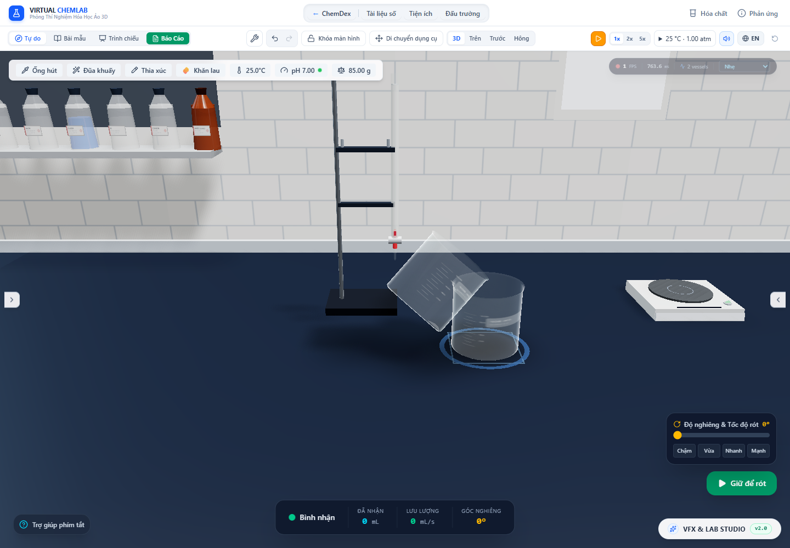

# Nêm dung dịch mỏng: mặt nước, đầu áp và mesh

Kiểm tra ngày 30/10/2026. Đợt này sửa trường hợp bình gần cạn hoặc đang nghiêng: lát tích phân theo y bỏ sót phần nước sát thành, nội suy góc báo sai điểm bắt đầu rót và ngưỡng hiển thị làm ẩn lượng nhỏ. Các kết quả dưới đây kiểm chứng hình học và bảo toàn trong mô hình hiện tại; chưa hiệu chuẩn dòng vi lượng với thí nghiệm.

Cập nhật tiếp theo: [lưới theo cung ướt và clipping gần điểm đỡ](wet-arc-mesh.vi.md) đã giảm chi phí lưới dày và sai số lớp phẳng Float32. Các số đo/giới hạn bên dưới được giữ như kết quả lịch sử của đợt trước; xem báo cáo tiếp theo để biết trạng thái hiện tại.

## Thay đổi

`roundPlaneVolume.ts` chia từng đoạn thẳng của contour tại giao điểm mặt nước–thành. Phần đầy dùng tích phân khối nón cụt; phần ướt một phần dùng diện tích phân đoạn tròn và Gauss–Legendre 16 điểm sau phép đổi biến sin². Công thức diện tích dùng chuỗi cho mảnh tròn nhỏ để tránh triệt tiêu số học. Không còn ngưỡng bán kính 0,0001 theo đơn vị mô hình. Cơ sở quy tắc Gauss xem [NIST DLMF §3.5(v)](https://dlmf.nist.gov/3.5#v); chia miền và phép đổi biến là lựa chọn triển khai, được đối chiếu độc lập bên dưới.

`solveLevel` dùng Newton có chặn bằng chia đôi, tích phân trực tiếp diện tích mặt cắt dV/dc, và giải phần nhỏ hơn giữa nước/không khí. Bỏ bước sai phân hữu hạn và sàn diện tích giả. `retainedVolume` tính trực tiếp mặt phẳng qua mép ở góc thật; bảng 64 góc chỉ còn chọn góc ban đầu cho trợ giúp rót.

Renderer giữ dung dịch khi thể tích dương, thay vì ẩn dưới 0,05 mL hoặc 0,2% dung tích. Mesh dùng 64–8.192 cạnh theo sai số dây cung so với độ sâu; cache tối đa ba mức mỗi lớp nước, giải phóng mức cũ. Thân nước có mặt khép tại cửa bình để phần nước qua cửa trong bước dòng chảy có biên hình học đầy đủ. Đây là mặt của nước, không phải nắp kính. Sóng/meniscus trang trí bị giới hạn tối đa 5% độ sâu khả dụng và 2,5% chiều cao mô hình; chúng vẫn là biến dạng quang học chưa giải theo áp suất mao dẫn.

Bộ điều khiển chấp nhận lưu lượng dương dưới 0,05 mL/s và không tự dừng chỉ vì nguồn còn dưới 0,05 mL. Nhánh trộn dự phòng cũng không bỏ qua một bước chuyển dương dưới 0,0001 mL. Mỗi bước vẫn bị chặn bởi kho nguồn, lượng dư có thể thoát và lượng người dùng yêu cầu.

## Bằng chứng số học

[Trước](thin-liquid-2026-10-30/before.json) và [sau](thin-liquid-2026-10-30/after.json) dùng cùng script `node --import tsx scripts/auditThinLiquid.ts <nhãn>`. Hình trụ được kiểm tra bằng tích phân theo x, tách giao với đáy/đỉnh và Simpson 4.096 bước mỗi khoảng, độc lập với tích phân theo y trong production. Ma trận gồm bốn góc 0,3/0,8/π/2/2,2 rad và năm phần thể tích từ 10⁻⁸ tới 0,5. Sai số tương đối lớn nhất giảm từ **0,99741766** xuống **6,67×10⁻¹²** trong bộ đo này.

Test còn kiểm tra đứng/thẳng ngược, gần đầy, đổi thước chiều dài 10⁻⁶–10³ và dời gốc, diện tích mặt cắt tại 90°, điểm bắt đầu chảy giữa các góc cache. Với cả 16 profile trong registry, thể tích nằm giữa hai khối đa giác nội/ngoại tiếp độc lập ở bốn góc và bốn phần thể tích. Mesh thích nghi được kiểm tra thêm ở 10⁻⁶ dung tích, ba góc và phương ngang có thành phần z, với sai số dưới 0,2% trong ma trận đó. Các phép này không chứng minh một chặn sai số tổng quát cho mọi thể tích tiến tới zero.

## Mesh thật và rót trong Chrome

Chạy `node scripts/auditThinLiquid.mjs`. [JSON](thin-liquid-2026-10-30/browser-audit.json) ghi cốc 100 mL, bình tam giác 250 mL, ống nghiệm 50 mL và ống đong 100 mL, mỗi bình ở **0,02 và 0,0002 mL**. Audit đọc clipping plane thật, ma trận thật, vertex/index buffer và uniform đã biên dịch trong WebGL. Thể tích được tính từ các tam giác đã cắt, dùng tổng tứ diện có gốc trên mặt cắt. Các tư thế nằm ngang được giữ tạm dừng trước bước xả để kiểm tra hình học; không phải trạng thái cân bằng giữ nước ở 90°.

Đo riêng mặt cắt tham chiếu và mesh đã phát hiện rằng sai số 0,641% của cả vòng 32 cạnh không áp dụng cho nêm nước: sai số tương đối tăng mạnh khi phần nước chỉ nằm sát thành. [Snapshot trước tăng độ phân giải](thin-liquid-2026-10-30/browser-before-adaptive-mesh.json) được giữ lại, sau khi đã sửa bộ giải mức nước. Ở góc khoảng 45,87°, lượng 0,0002 mL cho kết quả:

| Bình | Thể tích đa giác 32 cạnh / kho | Thể tích mesh mới / kho |
|---|---:|---:|
| Cốc | 49,52% | 99,9350% |
| Tam giác | 36,14% | 99,9691% |
| Ống nghiệm | 54,39% | 99,9474% |
| Ống đong | 65,07% | 99,9626% |

Cột trước là tích phân đa giác lý tưởng cùng contour/mặt cắt; cột sau đo tam giác Float32 được upload thật. Trong 16 trạng thái nghiêng/nằm ngang của audit, sai số mesh lớn nhất dưới **0,1%**; sai số tham chiếu ở tư thế nghiêng/nằm ngang dưới **2×10⁻¹¹ tương đối**. Trạng thái đứng cũng được ghi riêng: ở 0,0002 mL, sai số mesh lớn nhất còn **3,413%**, do độ cao lớp phẳng rất nhỏ so với tọa độ Float32 của đáy. Đây là giới hạn chưa sửa trong đợt này. Không dùng cờ visible để kết luận lượng vi mô sẽ nhìn rõ trên màn hình: nhiều phần có thể nhỏ hơn pixel.

Bốn phiên rót thật đưa hết 0,02 mL từ nguồn qua pipeline bay/đến nơi; bình nhận nhận đủ trong sai số số học, không có tràn ở các kịch bản trợ giúp này. Tổng thể tích, khối lượng và mol H₂O trước/sau được đối chiếu ở mọi kho. Audit không ghi nhận lỗi JavaScript hoặc WebGL.

Ảnh là trạng thái tạm dừng; HUD chưa đồng bộ các bước điều khiển thủ công không dùng làm bằng chứng góc hoặc FPS. Số đo trong JSON lấy từ ma trận và mesh.

## Chi phí và giới hạn

[Benchmark bộ giải](thin-liquid-2026-10-30/after.json) đo CPU cho `solveLevel` + `retainedVolume`, 50 lượt làm nóng và 200 mẫu mỗi bình, xen kẽ 10⁻⁶ và 0,4 dung tích. Median khoảng 0,011–0,053 ms trong lượt đo này; ống nghiệm chậm hơn bộ giải cũ, phù hợp việc giải nhiều đoạn contour với sai số nhỏ hơn. Không suy ra FPS từ số này. [Benchmark mesh](thin-liquid-2026-10-30/mesh-cpu.json) đo riêng dựng hình, không bao gồm upload/draw GPU; mức dày được cache nhưng lần tạo đầu có chi phí lớn hơn rõ rệt. Ca nặng nhất, ống nghiệm nằm ngang với 0,0002 mL, cần 131.088 vertex / 245.760 tam giác / khoảng 7,14 MB buffer ở 8.192 cạnh: median dựng **16,81 ms**, p95 **31,21 ms**. Kết quả này chưa đạt mục tiêu nhẹ cho nhiều bình; cần tối ưu lưới theo vùng ướt thay vì rải đều mọi góc.

Độ phân giải bị chặn ở 8.192 cạnh. Khi thể tích nhỏ hơn các ca đã kiểm tra, đặc biệt gần 90°, sai số tương đối vẫn có thể tăng; chưa có bảo đảm mọi nêm tùy nhỏ. Chưa đo ngân sách GPU khi nhiều bình cùng thay độ phân giải, chưa giải bài toán chất lỏng tự do đầy đủ hoặc mô hình thành kính của nhà sản xuất.

[USBR Water Measurement Manual](https://www.usbr.gov/tsc/techreferences/mands/wmm/chap07_03.html) phân biệt điều kiện hình học, co dòng và thông khí khi dùng quan hệ đập tràn. Việc sửa đầu áp và onset không biến hệ số 0,62 hay phép trộn weir/orifice hiện tại thành mô hình đã hiệu chuẩn cho mép bình hóa học. Dòng mao dẫn/nhớt ở đầu áp nhỏ, góc tiếp xúc, màng ướt còn lại và giọt tách chưa được giải từ sức căng bề mặt. Không ép nguồn về zero khi quan hệ lưu lượng của mô hình tiến về zero.

Thể tích mặt thoáng có vật rắn chiếm chỗ và thể tích chất lỏng dùng để rót còn cần đối chiếu chung cho hình dạng hỗn hợp. Các giới hạn cặn dính, dòng hạt qua cửa, hóa học khí trong không khí và hiệu chuẩn động học phản ứng vẫn theo báo cáo các đợt trước. Mục tiêu thực tế toàn lab còn đang tiếp tục.

Log kiểm tra: [suite](thin-liquid-2026-10-30/test-results.json), [TypeScript](thin-liquid-2026-10-30/lint.log), [build](thin-liquid-2026-10-30/build.log). Hồi quy [hạt/khí khi nghiêng](thin-liquid-2026-10-30/tilted-regression/browser-audit.json) và [thước SI/dòng tràn](thin-liquid-2026-10-30/world-scale-regression/browser-audit.json) lưu riêng để không ghi đè artifact cũ.

Kết quả cuối: **183 file / 2.274 test qua**, TypeScript qua, production build qua trong **13,25 s**. Audit 8 ca nước mỏng, 4 phiên rót, hồi quy 4 ca hạt/khí và hồi quy thước SI + 4 pha tràn đều qua, không có lỗi JavaScript/console WebGL. Cảnh báo chunk lớn và localStorage thử nghiệm của Node vẫn còn. Test tổng được chạy sau thay đổi bộ giải, controller và chọn độ phân giải; kiểm tra browser/build/TypeScript cuối bao gồm cả mặt khép cửa của mesh.
