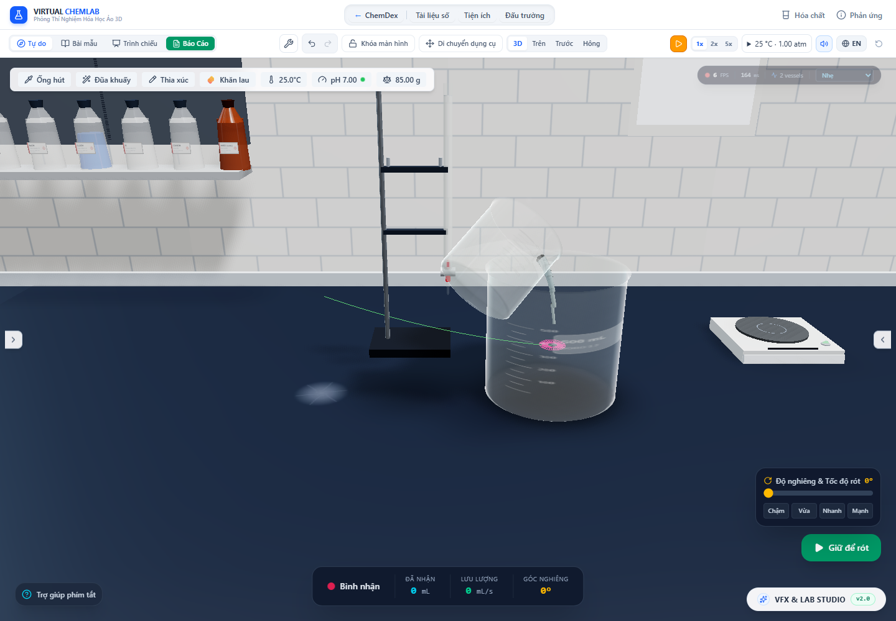

# Hạt, bọt và khí khi bình đang nghiêng/rót

Ngày kiểm tra: 29/10/2026. Tiếp nối [đợt thống nhất thước SI](world-scale.vi.md), đợt này sửa hệ tọa độ của hiệu ứng khi bình rời vị trí nghỉ. Các thay đổi không tăng tốc đồng hồ hóa học và không thêm lượng chất vào kho.

## Lỗi tìm được trong nguồn

Thân bình nhận `sourcePos` và góc nghiêng từ PourController mỗi khung hình. Nhóm PhysicalSimulationRenderer trong VfxDirector chỉ nhận vị trí đã lưu của bình. Vì vậy bình có thể đang rót trên cao nhưng kết tủa/bọt vẫn vẽ ở vị trí cũ. Bên trong mô phỏng, lực nổi, vận tốc lắng, độ sâu áp suất và ngưỡng vỡ bọt đều dựa vào trục y nội bộ cùng một mặt nước ngang trong bình. Khi bổ sung phép xoay cho renderer, những đại lượng đó cũng phải được đổi hướng.

Hơi và khí màu có lỗi liên quan: tọa độ của hạt đã phát vẫn tương đối với nguồn. Di chuyển nguồn có thể kéo cả đám khí đã thoát theo bình. Ngoài ra quaternion camera dùng trực tiếp dưới cha đã xoay sẽ làm billboard bọt lệch hướng nhìn.

## Cách sửa

`VesselBodyScale` đăng ký đúng Object3D của thân thủy tinh. `VesselEffectsFrame` lấy ma trận thế giới của thân và chuyển về hệ tọa độ cha của nhóm hiệu ứng. Nhóm hiệu ứng không đăng ký thêm một thân thứ hai. Cleanup kiểm tra danh tính đối tượng để việc tháo một component cũ không xóa frame của component mới.

Theo [quy tắc thứ tự useFrame của React Three Fiber](https://r3f.docs.pmnd.rs/api/hooks), các callback được xếp theo priority. Đợt này đặt thứ tự:

| Bước | Priority |
|---|---:|
| Hóa học và PourController | −3 |
| Cập nhật tư thế dụng cụ | −2,75 |
| Đồng bộ ma trận hiệu ứng | −2,5 |
| Tích phân hạt/bọt | −2 |
| Upload hạt kết tủa | −1 |
| Cập nhật vật liệu/mặt chất lỏng | 0 |

Các priority mới vẫn âm, giữ cơ chế render tự động. Có thể xem mô tả chính thức của [ma trận local/world và việc cập nhật Object3D](https://threejs.org/docs/pages/Object3D.html). Phép đổi hướng dùng phần quay của ma trận, khác với phép đổi vị trí có dịch chuyển; [Vector3](https://threejs.org/docs/pages/Vector3.html) là nguồn đối chiếu API.

Mỗi bước vật lý chụp ma trận thân riêng. Các khoảng thời gian đang chờ tích phân giữ snapshot đó; callback nguồn không đọc lại tư thế sống ở một thời điểm tương lai.

Gọi `n` là hướng lên của thế giới sau khi đổi về tọa độ nội bộ, mặt nước tham chiếu thỏa `n·p = c`. Giá trị c lấy từ cùng phép tích phân thể tích contour đang dùng cho mặt chất lỏng nghiêng. Vì contour đối xứng tròn, góc nghiêng bất kỳ có cả thành phần z được quy về góc của pháp tuyến so với trục y để giải thể tích. Cache giữ lại kết quả nếu profile, lượng chất lỏng và hướng không đổi.

- Vận tốc lắng tương đối với dòng mang là `−v_lắng × n`. Định luật lắng và thời gian đáp ứng lực cản SI giữ nguyên; cả ba thành phần được tích phân bằng cùng công thức đáp ứng hữu hạn.
- Vận tốc nổi của bọt hướng theo n. Độ sâu thủy tĩnh là `max(c − n·p, 0) × mét/mỗi đơn vị nội bộ`. Độ sâu này được dùng khi tạo bọt, tính áp suất/cơ học bán kính, ngưng tụ hơi và nhập bọt.
- Bọt chạm mặt nước theo khoảng cách đến mặt phẳng, không theo y nội bộ. Tâm bọt đang vỡ nằm trên mặt phẳng. Vị trí phát ejecta đổi qua đúng snapshot thân. Nhiễu quỹ đạo minh họa được đặt theo hai hướng tiếp tuyến với mặt phẳng.
- Kiểm tra chứa hạt kết hợp đáy/miệng, bán kính contour quanh kích thước glyph và mặt phẳng nghiêng. Các phép chiếu có số vòng lặp hữu hạn; glyph có thể thu nhỏ để vừa chỗ hẹp, nhưng không sửa khối lượng đại diện hoặc bán kính vật lý dùng cho lực cản/áp suất. Đây là ràng buộc hình học, chưa phải solver lực tiếp xúc.

Khi bình đứng thẳng, mô phỏng tiếp tục dùng nhánh cũ. Hạt kết tủa lúc tạm dừng vẫn upload lần đầu hoặc khi snapshot/mesh/profile đổi; snapshot đã upload được giữ lại để tránh lặp công việc không cần thiết. Đổi chất lượng hoặc kéo bình không làm chạy thêm đồng hồ hạt.

Hơi và khí màu nhận vị trí nguồn qua snapshot ma trận ngay lúc phát, sau đó sống trong **tọa độ thế giới**. Renderer triệt biến đổi của cha cho riêng mesh khí. Hạt đã thoát không bị xoay/dịch cùng nguồn trong các khung tiếp theo. Gió và hướng nổi/chìm của đám khí tiếp tục dùng trục thế giới. Billboard bọt trong bình dùng quaternion camera đã đổi ngược qua phép quay thân; billboard khí ngoài bình dùng frame thế giới.

## Bằng chứng và cách diễn giải

[Audit trình duyệt](tilted-particles-2026-10-29/browser-audit.json) chạy app thật với PourController, bốn loại bình chính và góc nghiêng khoảng **0,9514–0,9711 rad (~54,5–55,6°)**. Kịch bản kiểm tra tọa độ dùng một quần thể CuS hữu hạn có sẵn; bọt và hơi quang học được seed có kiểm soát để kiểm tra renderer. Những seed đó **không chứng minh bình CuS ở 25 °C tự sinh khí hay đang sôi**. Đồng hồ điều khiển rót và bước hạt được chạy tách khi tạm dừng để cô lập lỗi ma trận.

Các điều kiện kiểm tra trực tiếp từ mesh/instance buffer:

- Ma trận thế giới của nhóm vật lý khớp thân thủy tinh trong 10⁻⁹.
- Tâm hạt được vẽ khớp vị trí nội bộ đổi qua ma trận thân trong 2×10⁻⁵ đơn vị cảnh; tâm nằm dưới clipping plane thật của chất lỏng với cùng ngưỡng số học. Đây là phép đo tâm, không tích phân mọi đỉnh glyph hay biến dạng sóng GPU.
- Lượng kết tủa đại diện khớp kho CuS của bình trong 10⁻⁹ g. Tổng khối lượng, mol nước và CuS của nguồn/đích/packet/vũng được kiểm tra khi di chuyển.
- Normal billboard bọt có tích vô hướng với hướng camera lớn hơn 0,999999.
- Tâm hạt hơi được vẽ khớp tọa độ thế giới của mô phỏng trong 2×10⁻⁵ đơn vị cảnh. Khi nguồn đổi vị trí hơn một đơn vị trong lúc tạm dừng, toàn bộ snapshot hạt giữ nguyên. Thay chất lượng đồ họa cũng giữ lịch sử quần thể.

Trong lần chạy cuối, sai số ma trận lớn nhất khoảng 2,22×10⁻¹⁶; sai số tâm kết tủa lớn nhất khoảng 3,36×10⁻⁸ đơn vị cảnh; sai số tâm hơi lớn nhất khoảng 1,31×10⁻⁷. Kho đại diện CuS là 0,09999999999999998 g so với 0,1 g trong bình. Đây là sai số chuyển đổi/render số học, không phải sai số thực nghiệm của mô hình chất lỏng.

Nhánh khí màu được kiểm tra riêng bằng **chuẩn bị và kích hoạt thật chương trình `cu_hno3_conc`**, rồi cho đồng hồ app chạy để tạo NO₂ từ ledger. Trước khi tạm dừng, mẫu đã ghi nhận khoảng 0,018780865 g NO₂ thoát ra, với flux thời điểm đó khoảng 0,002352941 mol/s. Bốn glyph khí đã xuất hiện trong renderer; ma trận mesh ở thế giới là identity. Sau khi di chuyển bình trong lúc tạm dừng, cả bốn tâm giữ nguyên và kho chất không đổi. Kịch bản này xác nhận liên kết nguồn khí–renderer và việc không kéo đám khí theo nguồn; không hiệu chuẩn tốc độ thoát khí hay số phân tử trên mỗi glyph. Audit không có lỗi JavaScript hoặc console WebGL.

[Lượt hồi quy hình học và tràn](tilted-particles-2026-10-29/world-and-overflow/browser-audit.json) cũng qua với mã mới: bốn dung tích đầy/nửa bình, bốn giai đoạn tràn và tải lại trang vẫn bảo toàn 150 g tổng kho cùng 20 mL bên ngoài. Fixture nghiên cứu vật liệu cũng được chuyển sang VesselEffectsFrame/profile thật để không tiếp tục dùng kích thước hạt cố định cũ; [kiểm tra fixture](tilted-particles-2026-10-29/fixture-audit.json) đo sai số ma trận bằng 0, không có lỗi JavaScript.



HUD rót trong ảnh có thể vẫn hiển thị thông báo đã throttle từ trước bước điều khiển thủ công; số góc dùng làm bằng chứng nằm trong session và ma trận của JSON. Ảnh tạm dừng và tải GPU trong môi trường headless không phải phép đo FPS. Kịch bản ma trận không thay thế kiểm tra toàn bộ thao tác bằng chuột/cảm ứng.

`tilted_particle_frame.test.ts` kiểm tra bốn contour ở bốn góc nghiêng và ba mức đầy, gồm pháp tuyến có thành phần z, tư thế vượt 90°, lượng thể tích và chứa glyph. Các test khác xác nhận tính hiệp biến khi xoay toàn bộ bài toán lực nổi, vị trí vỡ bọt theo frame đã chụp, hướng lắng và khối lượng đại diện, đám hơi/khí không theo nguồn đã di chuyển và lifecycle của body registry.

Kiểm tra cuối: **180 file / 2.196 test đều qua**, TypeScript qua, build production qua trong **27,42 s**. Xem [test-results.json](tilted-particles-2026-10-29/test-results.json), [lint.log](tilted-particles-2026-10-29/lint.log), [build.log](tilted-particles-2026-10-29/build.log). Bộ test tổng loại `performance.smoke.test.ts` để giữ nguyên artifact hiệu năng lịch sử. Cảnh báo chunk lớn và localStorage thử nghiệm của Node vẫn còn.

## Phần chưa được xác nhận là thực tế đầy đủ

1. Trường vận tốc dòng mang vẫn là closure đối lưu/khuấy được chỉ định. Chưa giải Navier–Stokes cho mặt nước nghiêng, dòng rót, gia tốc/dao động thành bình hoặc tương tác ngược giữa hạt và chất lỏng. Hạt đi theo bình về mặt frame không chứng minh đúng quán tính khi nâng/giật bình.
2. **Cập nhật sau báo cáo này:** [đợt mặt cặn hữu hạn](sediment-surface.vi.md) đã thêm thư giãn mặt cặn hạt rời theo một nón ma sát tham chiếu, mesh theo thể tích và va chạm cùng mặt cặn. Hệ số chưa hiệu chuẩn, gel/bột mịn, mất tiếp xúc và cặn qua cửa ra còn chưa giải. Chưa có solver tiếp xúc/poromechanics hoặc hiệu chỉnh lực cản sát thành hoàn chỉnh.
3. Mặt phẳng của mô phỏng hạt là mặt cân bằng theo trọng lực. Sóng/slosh và meniscus biến dạng trong shader chưa là điều kiện biên động của mô phỏng hạt. Quang học bọt/hơi vẫn có glyph phóng đại và tham số minh họa.
4. Màng tràn, vỡ giọt, tiếp xúc phụ kiện và hiệu chuẩn tốc độ phản ứng giữ các giới hạn của [báo cáo màng tràn](circular-overflow.vi.md), [hóa học trong mẫu vận chuyển](aliquot-contact-chemistry.vi.md) và [thước SI](world-scale.vi.md). Bản sửa tọa độ không thay thế các mô hình đó.
5. Audit render trực tiếp bao phủ bốn bình chính trong Canvas lab. Các thân khác dùng cùng cơ chế nhưng chưa có kiểm tra trình duyệt cho mọi tổ hợp dụng cụ/hoạt ảnh. Các hiệu ứng phụ như foam/frost/sparks cần audit tư thế riêng.
6. **Cập nhật sau báo cáo này:** [đợt sửa vòng đời đám khí](gas-cloud-lifecycle.vi.md) đã tách khí màu sang kho ngoài React, kiểm tra giữ đuôi khí sau phản ứng/thay/xóa mẫu, đổi chất lượng và mount lại renderer. Receipt khí không phát lặp từ flux cũ. Kho nồng độ không gian, quang học thực nghiệm và khôi phục khí sau reload vẫn chưa hoàn tất. Artifact của đợt tilted-particles ở đây là số đo lịch sử trước thay đổi batch khí.

## Tái chạy

```powershell
npx vitest run --maxWorkers=2 --exclude tests/performance.smoke.test.ts
npm run lint
npm run build
# Vite cổng 6773 phải được khởi động lại sau khi sửa nguồn nếu tắt watcher:
$env:DISABLE_HMR='true'
node node_modules/vite/bin/vite.js --host 127.0.0.1 --port 6773 --strictPort
# Ở tiến trình khác:
node scripts/auditTiltedParticles.mjs
```

Đổi đường dẫn artifact bằng `TILTED_PARTICLE_AUDIT_OUTPUT`. Không dùng audit này để kết luận FPS hay tốc độ phản ứng đã hiệu chuẩn thực nghiệm. Mục tiêu tổng thể vẫn đang tiếp tục.
