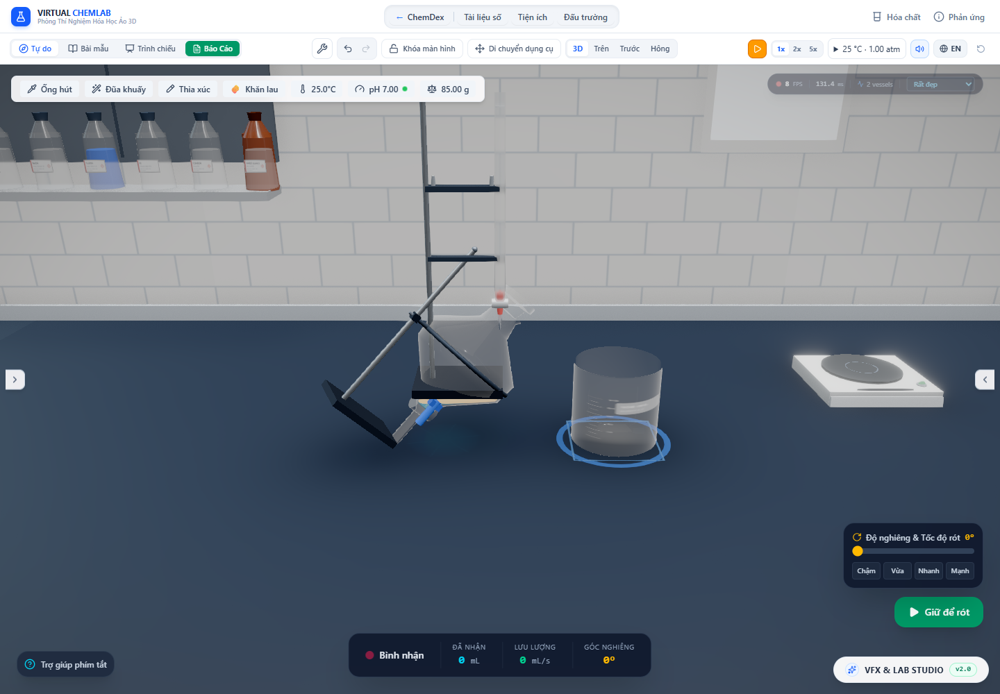

# Lưới nước theo cung ướt và clipping gần điểm đỡ

Ngày kiểm tra: 30/10/2026. Tiếp nối [nêm dung dịch mỏng](thin-liquid.vi.md), đợt này xử lý hai giới hạn đã đo được: lưới chia dày cả vòng làm dựng hình tốn CPU/buffer, và tọa độ Float32 của đáy làm lệch một lớp nước trải phẳng rất mỏng. Hình học, kho chất và mô hình lưu lượng vẫn dùng cùng thể tích vật lý; tối ưu này không thay động học hóa học hay hệ số xả.

## Cách dựng hình

Mỗi vòng có nền 64 cạnh. Chỉ cung có thể tiếp xúc với nước được chia mịn thêm. Với một đoạn contour thẳng r(y), ngưỡng góc ướt là `(ny*y-c)/(h*r(y))`; đạo hàm có dấu không đổi trong đoạn có bán kính dương, nên cung rộng nhất lấy ở các đầu đoạn. Đỉnh nón bán kính zero dùng giới hạn khi tiến tới đỉnh; không coi điểm trục của mặt đáy có chiều cao zero là một đoạn nón. Cung được làm tròn rộng lên theo ô góc nền, tránh bỏ sót vùng ướt khi dùng cache.

`liquidMeshLayout` tạo các góc không đều; `createLiquidVolumeGeometry` giữ kết nối tam giác và pháp tuyến theo meridian của LatheGeometry, cập nhật vị trí/pháp tuyến/UV cho các góc mới. [Tài liệu LatheGeometry](https://threejs.org/docs/pages/LatheGeometry.html) mô tả mặt xoay quanh y và tham số số đoạn. Triển khai mới thay trực tiếp buffer thay vì chỉ sửa `parameters`, vì thay đổi đối tượng tham số không tự dựng lại hình học.

Gốc buffer chuyển tới điểm contour có hình chiếu thấp nhất theo trọng lực, hoặc mặt đáy/miệng khi đứng thẳng. Chỉ số điểm này đổi tại các ngưỡng góc rời rạc, cho phép tái sử dụng mesh trong khi bình nghiêng liên tục. Thân nước xoay quanh trục bình để cung được chia mịn luôn hướng về phía nước thấp. Tịnh tiến/xoay mesh con bù lại gốc buffer, không đổi tọa độ bình hay vị trí vật lý của nước.

Shader clipping kiểm tra mặt phẳng trong tọa độ cục bộ gần điểm đỡ. Cách này tránh lấy hiệu hai độ cao lớn để tìm một lớp mỏng. Material vẫn giữ các mặt phẳng thế giới cho va chạm, hạt và các audit khác. [BufferAttribute của Three.js](https://threejs.org/docs/pages/BufferAttribute.html) là dữ liệu vị trí/pháp tuyến/UV/index được chuyển tới GPU; đợt này kiểm tra trực tiếp những mảng đó và các uniform đã upload.

Ngân sách góc mịn tối đa 65.536 chia đều nếu trải ra cả vòng, nhưng số cạnh thực tế của mesh là hợp giữa nền 64 và phần cung mịn. Cache giữ nền và tối đa hai layout bổ sung mỗi lớp nước; layout bị bỏ được dispose. Với nón hoặc hình có toàn bộ góc ướt, vẫn có thể cần lưới dày trên vùng rộng. Chưa có chặn FPS tổng quát cho mọi hình và số bình.

## CPU và dung lượng buffer

Chạy `node --import tsx scripts/benchmarkWetArcMesh.ts`. [Dữ liệu](wet-arc-mesh-2026-10-30/mesh-cpu.json) so sánh trong cùng tiến trình: cách cũ dựng LatheGeometry chia đều cả vòng và cách mới dựng cung ướt. Hai nhánh dùng cùng profile, thể tích, độ nghiêng và ngân sách góc mịn; thứ tự đo đổi luân phiên từng cặp. Có 15 lượt làm nóng và 60 mẫu mỗi nhánh, không tính giải mặt phẳng/layout, upload hay draw GPU.

Với **0,0002 mL và góc π/2**:

| Bình | Median dựng cũ | Median dựng mới | p95 dựng mới |
|---|---:|---:|---:|
| Cốc | 3,375 ms | 0,138 ms | 0,234 ms |
| Tam giác | 1,083 ms | 0,069 ms | 0,132 ms |
| Ống nghiệm | 14,509 ms | 0,402 ms | 1,453 ms |
| Ống đong | 3,662 ms | 0,118 ms | 0,256 ms |

Ống nghiệm giảm từ **131.088 xuống 5.104 vertex**, **245.760 xuống 9.540 tam giác**, **7.143.936 xuống 220.568 byte buffer**. CPU dựng median giảm khoảng 36 lần trong ca này; số tam giác giảm khoảng 96,1%. Đây là chi phí dựng mới một mesh, không phải thời gian mỗi frame và không phải FPS của lab. Cache hit không phải dựng lại; thay góc qua ngưỡng layout vẫn có thể phát sinh dựng/upload và cấp phát.

## Độ chính xác và runtime

`liquid_wet_arc_mesh.test.ts` đo thể tích bằng tổng tứ diện của các tam giác đã cắt, độc lập với bộ tích phân mặt cắt tròn. Ma trận **16 profile × 5 phần thể tích × 5 góc** gồm phần thể tích 10⁻⁸, 10⁻⁶, 0,01, 0,4, gần đầy; góc đứng, 0,8, π/2, 2,2 và π. Mỗi trường hợp kiểm tra cả mặt phẳng double và mặt phẳng đã lượng tử Float32, với sai số dưới 0,2% trong ma trận. Có kiểm tra riêng hai mặt cắt của lớp trên và nón cắt xiên gần tiếp tuyến, đối chiếu công thức thể tích nón độc lập. Sai số số học của bộ giải nón được kiểm tra theo tỉ lệ chiều dài, không theo số chữ số thập phân cố định.

Chạy Chrome với:

```powershell
$env:THIN_LIQUID_AUDIT_OUTPUT='docs/research/wet-arc-mesh-2026-10-30'
node scripts/auditThinLiquid.mjs
```

[Audit runtime](wet-arc-mesh-2026-10-30/browser-audit.json) đo 0,02 / 0,0002 mL ở bốn bình, mỗi lượng ở tư thế đứng, nghiêng khoảng 45,87° và nằm ngang. Thể tích từ buffer và mặt phẳng thực đều giữ giới hạn dưới 0,2% trong các ca này. Lớp phẳng cực mỏng trước đó có sai số mesh tối đa **3,413%**, nay khoảng **0,16057%**; phần còn lại gần bằng sai số đa giác nền 64 cạnh. Các ca nghiêng/nằm ngang vẫn dưới 0,1% trong phép đo.

Trường `gpuVolume_ml` là thể tích tính từ buffer Float32 với uniform đọc từ WebGL ngay sau draw của chính mesh đó. Đây không phải phép tích phân pixel hay chứng nhận mọi sai số nội suy/rasterization GPU. Hook đọc theo từng draw là cần thiết: nhiều material dùng chung một WebGLProgram và GL chỉ giữ giá trị uniform của draw gần nhất. Audit còn xác nhận nhánh clipping cục bộ có trong shader đã biên dịch và uniform đang hoạt động.

Bốn phiên rót 0,02 mL vẫn nhận đủ vào bình đích, đối chiếu tổng thể tích, khối lượng và mol nước ở mọi kho. Phễu chiết có 3 mL nước + 0,005 mL benzen được dùng làm mẫu hai pha chuẩn bị sẵn, không phải phản ứng tạo pha. Lớp trên dương dưới 0,01 mL được render thay vì bị ẩn. Sau clipping đọc theo từng draw, hai lớp lần lượt khoảng **2,999056 mL** và **0,004999255 mL**. Low/medium/high/ultra cho cùng kết quả và kho chất không đổi khi tạm dừng. Đây là kiểm tra hình học ở tư thế giữ cố định, chưa kiểm chứng cách cầm/giá kẹp của phễu trong thao tác thật.



Ảnh chỉ dùng kiểm tra bố cục/hiển thị. HUD góc/FPS ở trạng thái tạm dừng và điều khiển thủ công không dùng làm bằng chứng tốc độ. Lượng nhỏ hơn pixel có thể khó nhìn dù có mesh và kho chất đúng.

## Kiểm tra và phạm vi còn lại

[Hồi quy thước SI, dung tích đầy/nửa bình và bốn pha tràn](wet-arc-mesh-2026-10-30/world-scale-regression/browser-audit.json), [hồi quy hạt/bọt/hơi/khí khi nghiêng](wet-arc-mesh-2026-10-30/tilted-regression/browser-audit.json) tiếp tục qua. Đo mép bình dùng ma trận thân cha vì mesh nước nay có gốc và góc riêng; không dùng biến đổi mesh con để dịch chuyển điểm mép vật lý.

Log cuối: [test](wet-arc-mesh-2026-10-30/test-results.json), [TypeScript](wet-arc-mesh-2026-10-30/lint.log), [build](wet-arc-mesh-2026-10-30/build.log). Artifact đợt trước giữ nguyên.

Kết quả cuối: **184 file / 2.293 test qua**, TypeScript qua, production build qua trong **15,88 s**. Audit 8 mẫu nước mỏng × 3 tư thế, 4 phiên rót và hai pha qua 4 mức chất lượng đều qua; các hồi quy thước SI/tràn và hạt/khí qua, không có lỗi JavaScript/console WebGL. Cảnh báo chunk lớn và localStorage thử nghiệm của Node vẫn còn. Bổ sung cuối về giới hạn đỉnh nón được kiểm tra bằng công thức nón cắt xiên và suite tổng; các mẫu runtime ở trên dùng cùng cung/gốc với trước bổ sung đó vì không có đỉnh bán kính zero trên đoạn contour có chiều cao dương.

Tối ưu này chưa giải capillary/contact angle, màng ướt còn lại, lưu lượng vi lượng, cặn dính, dòng hạt qua cửa hay tốc độ động học của mọi phản ứng. Mặt thoáng có vật rắn chiếm chỗ vẫn cần đối chiếu chung với đầu áp rót. Chưa đo GPU/frame budget cho nhiều bình đổi layout đồng thời; ngân sách góc và phép lượng tử vẫn hữu hạn nên không cam kết sai số tương đối cho thể tích tùy nhỏ. Mục tiêu nâng cấp toàn lab còn đang tiếp tục.

Cập nhật tiếp theo: [đầu áp của nguồn có vật rắn](displaced-source-flow.vi.md) đã nối phần chiếm chỗ tham chiếu với lượng rót hữu hạn và vận chuyển huyền phù. Báo cáo đó cũng đo riêng sai lệch mesh đồng khi bị co để lọt bình; phần hình học/pose vật rắn thật vẫn cần hoàn thiện.
