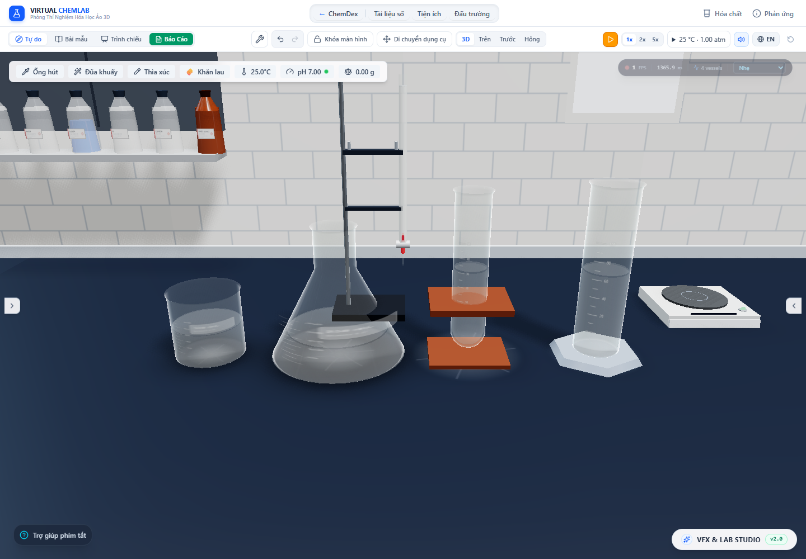

# Dung tích, hình học và chuyển động dùng chung thước SI

Ngày kiểm tra: 29/10/2026. Đợt này sửa sai khác giữa kích thước bình đang vẽ và thước dùng cho dòng bay, màng tràn, vũng. Không thay kho mL hay lượng chất để làm vừa hình ảnh.

## Sai lệch đo được và cách sửa

Thước toàn cảnh giữ nguyên **1 đơn vị = 0,035 m = 3,5 cm**. Theo [NIST về đơn vị thể tích](https://www.nist.gov/pml/owm/si-units-volume), 1 mL = 1 cm³. Vì vậy một đơn vị thể tích cảnh tương ứng 42,875 mL. Quy tắc lũy thừa của tiền tố SI được đối chiếu trong [NIST SP 811, chương 6](https://www.nist.gov/pml/special-publication-811/nist-guide-si-chapter-6-rules-and-style-conventions-printing-and-using).

Trước đây nội thất dùng dung tích để suy ra một thước riêng, nhưng thân bình vẫn vẽ cùng kích thước mẫu. Trong khi đó dòng bay và màng tràn dùng thước toàn cảnh. Tích phân contour bên trong cho thấy:

| Bình | Dung tích trong kho | Thể tích hình học cũ theo thước cảnh | Hệ số chiều dài mới | Thể tích mặt tròn lý tưởng mới |
|---|---:|---:|---:|---:|
| Cốc | 100 mL | 243,338240 mL | 0,743470 | 100 mL |
| Bình tam giác | 250 mL | 163,720414 mL | 1,151540 | 250 mL |
| Ống nghiệm | 50 mL | 10,197888 mL | 1,698843 | 50 mL |
| Ống đong | 100 mL | 36,279468 mL | 1,402102 | 100 mL |

Với thể tích contour mẫu V₀ và dung tích C, thân được biến đổi đồng đều theo `s = cbrt(C / (V₀ × 3,5³))`. Dịch chuyển theo y bằng `y_đáy × (1 − s)` giữ nguyên vị trí đáy hình học đã lưu. Sau đó mới áp dụng nghiêng, xoay và vị trí bình. Không ghi lại vị trí hoặc sửa lượng chất của dữ liệu cũ.

Có hai hệ tọa độ với chuyển đổi tường minh:

- **Nội bộ mô hình:** contour gốc, cắt mặt chất lỏng, hạt, giọt ngưng tụ; một đơn vị dài bằng `s × 0,035 m`. Các mesh tương ứng nằm dưới `VesselBodyScale`.
- **Tương đối với vị trí bình trong cảnh:** profile đã nhân s và dịch đáy; một đơn vị dài bằng 0,035 m. Dùng cho miệng bình, rót, va chạm, màng tràn ngoài và các tọa độ bay. `vesselLocalToWorld` và phép nghịch đảo bao gồm cả nghiêng/xoay.

`getVesselProfile` vẫn trả profile nội bộ; `getWorldVesselProfile` trả profile trong cảnh. Trộn hai profile này sẽ tái tạo lỗi cũ, nên các test kiểm tra đồng thời dung tích, mức chất lỏng và vị trí miệng.

## Phạm vi triển khai

14 thân bình nhận phép biến đổi: cốc, bình tam giác, ống nghiệm, ống đong, kính đồng hồ, chén cô, chén nung, đĩa Petri, bình định mức, phễu chiết, phễu lọc, cối, sinh hàn và bình tia. Các phụ kiện nằm trong cùng thân được biến đổi cùng nhau.

Miệng nguồn/đích, chiều cao chất lỏng, đầu áp, quỹ đạo, điểm chạm, chiều dài đường bám ngoài và bán kính hạ xuống bàn dùng profile theo dung tích thực của bình. Điểm chạm trong cảnh được chuyển ngược về tọa độ nội bộ trước khi gieo hạt. Hoạt ảnh cấp hóa chất và vị trí đầu pipet cũng lấy mặt/mép đã đổi thước.

Các đại lượng SI của hạt lắng, bọt sôi, chuyển động hạt Brown, chuyển động hơi trong mô hình, diện tích bốc hơi/truyền nhiệt thành và giọt ngưng tụ được đổi qua thước nội bộ tương ứng. Giọt ngưng tụ giữ thể tích vật lý khi được vẽ dưới nhóm thân. Phản xạ caustic được đặt trên mặt bàn trong tọa độ cảnh, kể cả khi bình thay kích thước hoặc nghiêng. Trường đối lưu/khuấy vẫn là closure minh họa có biên kín; chưa được hiệu chuẩn thành trường vận tốc thực nghiệm.

Đồng thời sửa một race trong lịch sử: callback khởi tạo sau 100 ms không được thêm bản chụp RESET nếu người dùng đã có lịch sử thao tác. Lỗi này từng khiến Undo khôi phục lại trạng thái hiện tại thay vì mẫu trước khi hút pipet.

## Bằng chứng

[Audit Chrome](world-scale-2026-10-29/browser-audit.json) đo **buffer đỉnh của mesh đang render và định thức ma trận thế giới**, không chỉ gọi lại hàm tính dung tích. Với bốn bình trong bảng, ở mức đầy và một nửa:

- Tích phân mặt tròn chuẩn hóa qua ma trận thật khớp 100/250/50/100 mL.
- Thể tích lưới 32 cạnh ở mức đầy là khoảng **99,358684 / 248,396710 / 49,679341 / 99,358678 mL**. Sai số đa giác so với mặt tròn khoảng **−0,641315%**; ở nửa bình có cùng tỷ lệ. Audit giữ nguyên số đo thô và hệ số đa giác `N sin(2π/N)/(2π)`; không giấu sai số bằng cách đổi dung tích kho.
- Mặt cắt clipping thật ở mức nửa bình khớp thể tích kho sau khi tách riêng sai số đa giác; sai lệch dư nhỏ hơn 0,02 mL. Phép đo không tích phân phần biến dạng sóng/meniscus trong shader GPU.
- Vị trí miệng từ ma trận mesh khớp vị trí dùng cho profile va chạm. Nghiêng/xoay bất kỳ được kiểm tra riêng bằng ma trận Three.js trong test.



Audit còn chạy lại dòng tràn 20 mL trong app thật: cùng kho chất đi qua thành, bay và vũng; thể tích mesh thành/bay khớp kho tương ứng trong 0,003 mL. Không có vũng trước thời điểm chạm bàn. Khi di chuyển bình, phần đã bay giữ quỹ đạo cũ, phần còn bám đi theo bình, tạo hai vùng hạ xuống. Tải lại trang giữ tổng lượng chất và 20 mL bên ngoài. Không phát hiện lỗi JavaScript hoặc console WebGL trong kịch bản đã chạy. Ảnh có HUD đang tạm dừng; **không dùng số FPS trong ảnh làm phép đo hiệu năng**.

`vessel_world_scale.test.ts` kiểm tra 14 loại × 3 dung tích (25/100/500 mL), mỗi trường hợp tại 10/50/90%; kiểm tra nghịch đảo tọa độ, ma trận thực, miệng phát dòng và quy luật đồng dạng khi dung tích tăng 8 lần. Kiểm tra lắng dùng hạt có seed: vận tốc nhân thước nội bộ phải bằng vận tốc SI của định luật lắng, và giảm một nửa theo tọa độ nội bộ khi chiều dài mỗi đơn vị tăng gấp đôi. Test giọt thành xác nhận quãng trượt theo mét không đổi khi đổi thước nội bộ.

Kiểm tra cuối: **179 file / 2.186 test đều qua**, TypeScript qua, build production qua trong **26,86 s**. Kết quả được lưu trong [test-results.json](world-scale-2026-10-29/test-results.json), [lint.log](world-scale-2026-10-29/lint.log) và [build.log](world-scale-2026-10-29/build.log). Cảnh báo chunk lớn và localStorage thử nghiệm của Node vẫn còn. Audit hình học Chrome bao phủ trực tiếp bốn bình chính; 14 loại được kiểm tra ở tầng hình học/hàm chuyển đổi, chưa phải kiểm tra mọi tổ hợp dụng cụ trên màn hình.

## Giới hạn còn lại

- Đợt này thống nhất thước vật lý, chưa xác nhận hình dạng/độ dày thủy tinh theo dụng cụ của một nhà sản xuất. Dung tích hiện là dung tích contour chứa tối đa trong mô hình; bình định mức thực cần thể tích tại vạch hiệu chuẩn và khoảng trống phía trên vạch.
- Buret, chai hóa chất trên kệ, giá ống nghiệm độc lập và các đạo cụ ngoài nhóm thân chưa có kiểm chứng SI tương đương. Các vị trí người dùng xếp sát trước đây có thể cần chỉnh lại khi bình đổi kích thước. Khe giá, kẹp/đỡ và tiếp xúc cơ học giữa các dụng cụ cần audit riêng.
- Góc tiếp xúc động, tách thành, vỡ giọt, turbulence, màng Reynolds cao và thời gian dose giả định vẫn theo các giới hạn trong [báo cáo màng tràn](circular-overflow.vi.md). Độ chính xác đơn vị không chứng minh độ chính xác của các closure đó.
- Hóa học trong mẫu vận chuyển chỉ hỗ trợ phạm vi đã nêu trong [báo cáo aliquot](aliquot-contact-chemistry.vi.md); phản ứng sinh khí/chuyển pha, mạng phản ứng nhiều bước, hóa học trong vũng và hiệu chuẩn thời gian từng phản ứng còn chưa đầy đủ. Hạt/khí có phần biểu diễn phóng đại để quan sát; chưa có chứng nhận mọi ảnh đúng kích thước vật lý.
- **Cập nhật sau báo cáo này:** [đợt sửa frame của hạt/khí](tilted-particles.vi.md) đồng bộ nhóm vật lý với ma trận thân thật, hướng lắng/nổi, mặt cân bằng nghiêng và khói đã thoát; có audit bốn bình. Quán tính dòng khi di chuyển, trượt cặn, sóng GPU và các hiệu ứng phụ vẫn chưa được giải đầy đủ. Hoạt ảnh rót cũ, sương giá và foam chưa có phép đo độc lập tương đương dòng tràn.

Mục tiêu “mọi thứ thực tế” vẫn đang tiếp tục; kết quả trên chỉ xác nhận các bất biến và kịch bản đã đo.

## Tái chạy

```powershell
npx vitest run --maxWorkers=2 --exclude tests/performance.smoke.test.ts
npm run lint
npm run build
# Trong một tiến trình riêng, tắt watcher; khởi động lại sau mỗi lần sửa nguồn:
$env:DISABLE_HMR='true'
node node_modules/vite/bin/vite.js --host 127.0.0.1 --port 6773 --strictPort
# Trong tiến trình khác:
node scripts/auditWorldScale.mjs
```

`performance.smoke.test.ts` được loại khỏi lượt tổng để tránh ghi đè artifact hiệu năng lịch sử. Audit dùng Chrome cục bộ, chất lượng thấp; không đo FPS hay đối chiếu hiệu năng trước/sau. Có thể đổi thư mục artifact bằng `WORLD_SCALE_AUDIT_OUTPUT`.
