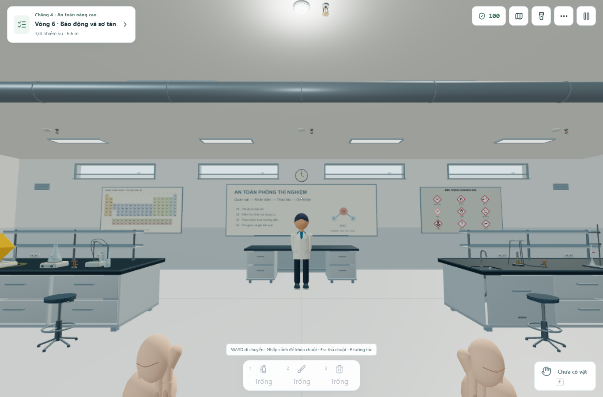

# Asset studies — thư viện phòng thí nghiệm

Đã hoàn tất đợt rà và phát triển theo [kế hoạch chi tiết từng asset](../ASSET_DETAIL_PLAN.vi.md): **134 mẫu/biến thể**, **536 ảnh từ bốn góc**. Một mục là model giáo viên GLB sẵn có được giữ nguyên và kiểm tra lại; các mục còn lại dùng hình học và vật liệu trong source. Số mẫu bao gồm các trạng thái mở/đóng, lửa, bảo hộ và kiểu tóc, không phải 134 loại thiết bị khác nhau.

Cập nhật 28/10: [tối ưu phòng chi tiết](../room-upgrade/README.md) chia sẻ tài nguyên chai/cốc, gom chân ghế và cập nhật ống bình tại chỗ. Đã làm mới bốn góc của sáu model liên quan; góc tủ trong phòng giảm 478 → 352 lượt vẽ ở cùng độ phân giải.

## Kết quả trong phòng chơi



- Thủy tinh có thành trong–ngoài, đáy và miệng; nhãn ôm thân và giữ đúng tỷ lệ chữ. Các bản trên bàn, kệ, tình huống và phim dùng chung model.
- Cân, bếp, buret, pH, ly tâm có từng cụm, chân và điểm nối. Rotor và ống được che khi nắp đóng.
- Bunsen có khe khí thật, vòng xoay, đầu ống rỗng, chân kiềng/lưới; lửa vàng và xanh có hình khác nhau. Đèn cồn có bấc, bình, nắp rỗng và khay; đậy nắp sẽ bỏ hình lửa.
- Tủ hút có khoang rỗng, baffle/khe, mặt thao tác, cửa/rail, bảng hiển thị và nhánh nối lên ống gió. Tủ quay vào lối đi; collider dùng cùng dữ liệu bố trí. Hai bồn rửa và bốn bồn bàn có lòng, xả và lỗ xuyên mặt bàn.
- Bàn có khoang dưới chậu và hộc kéo riêng; hộc trượt đúng một hành trình rồi đóng lại. Ghế có năm chân và vòng ngang. Tủ hóa chất và giá bốn tầng có chai/cốc tiếp xúc đúng kệ, giằng nối vào khung.
- Vòi tắm có mặt phun khoét lỗ và cần kéo nối tay van; rửa mắt có nắp bụi và hai cung nước riêng. Bình bột có đồng hồ; CO₂ có loa rỗng. Chăn, sơ cứu, gạc/cuộn băng và bộ tràn có cấu tạo riêng.
- Năm vật chứa được xếp thành hàng để tiếp cận từng món: kính, rắn nhiễm, lỏng, vật sắc và giấy sạch. Nắp, bàn đạp, phễu, khe/vạch được phân biệt; không dùng một workflow rắn cho can lỏng.
- Cửa đôi có ô kính xuyên cánh, bản lề/thanh đẩy/tay co; cửa sổ cao tách khỏi bảng. Đèn có tấm tán sáng nhìn được từ dưới, ống gió/giá treo, lưới lá, báo khói/đầu phun, đồng hồ có kim và vạch.
- Bảng GHS dùng chín biểu tượng có sẵn; bảng tuần hoàn dùng dữ liệu 118 nguyên tố của ChemDex; nội quy và sơ đồ có nội dung. Sơ đồ thể hiện vị trí bốn bàn, tủ hút, hai cửa Nam và vị trí bảng.
- Thảm kiểm tra giày và gương có chân đỡ được đặt đúng khu chuẩn bị. Bảo hộ và ba lô có cấu tạo riêng. Áo/kính/khẩu trang trên nhân vật đi theo thân/đầu; chân nhân vật đứng yên chạm sàn.
- Góc nhìn cầm vật dùng cùng model bình, hốt/chổi và vật chứa; đo điểm nắm với lòng tay, hai đầu ống và chiều dài vòi. Chốt/niêm hiển thị theo trạng thái thật; bóp cò theo lúc xả. Đã chạy lại thao tác rút chốt, phun, quét và dập đám cháy.

## Bằng chứng

| Bằng chứng | Phạm vi |
| --- | --- |
| [805 kiểm tra](all-assets-browser-checks.json) | Bốn góc cho toàn bộ thư viện |
| [46 kiểm tra](integration-checks.json) | Thiết bị, kệ và 15 tình huống |
| [17 kiểm tra](ppe-integration-checks.json) | Thảm, gương và lấy bảo hộ |
| [24 kiểm tra](fixture-integration-checks.json) | Bàn, ghế, ngăn kéo, tủ hút và đèn đốt |
| [20 kiểm tra](emergency-integration-checks.json) | Vòi khẩn cấp và bình chữa cháy |
| [23 kiểm tra](waste-integration-checks.json) | Năm vật chứa và mẫu trên sàn |
| [24 kiểm tra](architecture-integration-checks.json) | Kiến trúc, bảng và cửa |
| [16 kiểm tra](held-integration-checks.json) | Tiếp xúc tay cầm, chốt, vòi và dập lửa |
| [Khung chơi và chuyển động](../visual-gameplay/model-browser-checks.json) | 15 chuyển động cảnh, tủ/kệ/va chạm, zoom, giảm chuyển động và mobile |
| [Ba mô phỏng chi tiết](../visual-gameplay/detail-browser-checks.json) | Ly tâm, tủ hút và đèn cồn; vị trí khung giữ nguyên qua từng bước |

Các báo cáo trong bảng asset có tổng 975 điểm kiểm tra; báo cáo cảnh/UI được giữ riêng. Đã chạy typecheck, build, core của học viện và 76 workflow / 397 bước thực hành. Build còn cảnh báo chunk lớn và chunk postfx rỗng. Đây là QA trình duyệt desktop và kích thước mobile, không phải phép đo FPS trên điện thoại thật.

Mỗi asset riêng có 1–126 lệnh vẽ trong phòng xem; không có đỉnh lỗi/NaN trong các lượt kiểm tra. Số này không đại diện cho tổng lệnh vẽ cả căn phòng. Model GLB giáo viên gần 286 nghìn tam giác vẫn chỉ dùng ở Ultra; bản nhẹ được dùng ở các mức còn lại.

## Xem từng model

Trong dev server, mở `/?asset-review=beaker` rồi chọn model/góc và xoay. Trang QA chỉ được import ở dev. [Thư viện](../../src/components/3d/assets/assetCatalog.tsx) là danh mục ID và trạng thái; các ảnh có dạng `{id}-front.png`, `{id}-three-quarter.png`, `{id}-back.png`, `{id}-top.png`.

- [Toàn bộ thư viện](asset-contact-sheet.jpg)
- [Gia nhiệt](contact-gia-nhiet.jpg), [thiết bị](contact-thiet-bi.jpg), [thủy tinh](contact-thuy-tinh.jpg)
- [Trạm cố định](contact-tram-co-dinh.jpg), [khẩn cấp](contact-khan-cap.jpg), [chất thải](contact-chat-thai.jpg)
- [Lưu trữ](contact-luu-tru.jpg), [nội thất](contact-noi-that.jpg), [kiến trúc](contact-kien-truc.jpg), [bảng chỉ dẫn](contact-bang-chi-dan.jpg)
- [Bảo hộ](contact-bao-ho.jpg), [vật cầm và nhân vật](contact-vat-cam-va-nhan-vat.jpg)

Ảnh trong phòng: [tủ hút](room-fume-hood.png), [rửa tay](room-handwash.png), [ngăn kéo mở](room-drawer-open.png), [vòi tắm](room-shower-active.png), [rửa mắt](room-eyewash-active.png), [gương](room-mirror-reflection.png), [vật đang cầm](room-held-extinguisher-spraying.png).

## Kiểm tra lại

```text
npm run lint
npm run build
npm test
npm run test:practical
node scripts/test-asset-studies-browser.mjs --report=all-assets-browser-checks.json
node scripts/test-held-assets-browser.mjs
node scripts/test-architecture-assets-browser.mjs
node scripts/test-ppe-assets-browser.mjs
node scripts/test-fixture-assets-browser.mjs
node scripts/test-emergency-assets-browser.mjs
node scripts/test-waste-assets-browser.mjs
node scripts/test-asset-integration-browser.mjs
node scripts/test-visual-models-browser.mjs
node scripts/test-workbench-detail-browser.mjs
```

Browser scripts dùng Vite ở 3000 và Chrome CDP ở 9222, tạo trang riêng và chạy nối tiếp. Muốn kiểm tra lại riêng một model sau thay đổi, dùng `--update --report=all-assets-browser-checks.json <id>`; chỉ gộp với báo cáo nền đã đạt, đồng thời thay ảnh và số đo của ID đó.
