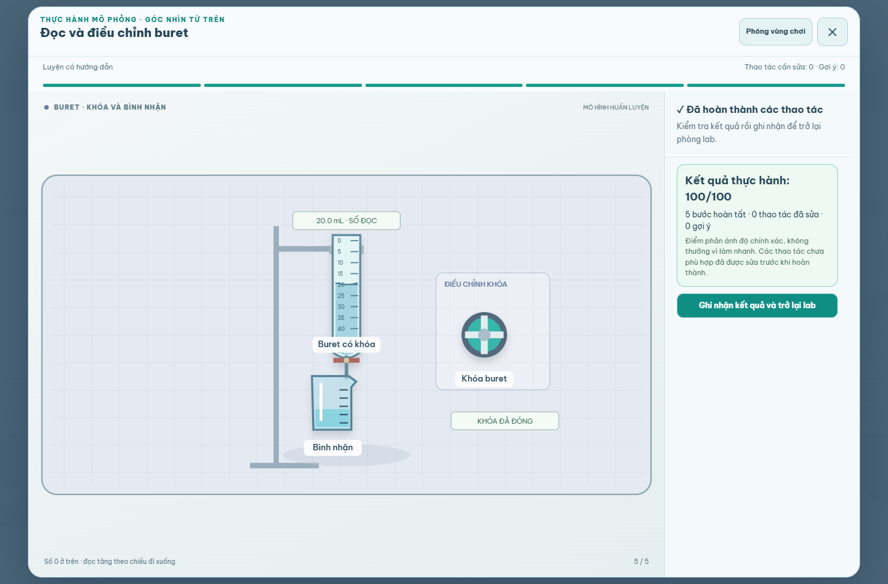

# Hiện trường dụng cụ và phản hồi thao tác

Đợt tiếp theo của phần An toàn phòng thí nghiệm, theo [kế hoạch chi tiết](../INSTRUMENT_VISUAL_PLAN.vi.md). Thay đổi chủ yếu ở bàn thực hành SVG; giữ bộ model 3D, dữ liệu bố trí và tối ưu phòng từ [đợt trước](../room-upgrade/README.md).

## Hiện trường đã nâng cấp

| Phần chơi | Hình và phản hồi riêng |
| --- | --- |
| Cân | Vùng cốc/mẫu, đĩa, tín hiệu ổn định khi giữ và trạng thái trừ bì; số hiển thị theo lượng điều chỉnh mô phỏng |
| Ống đong | Thang 50 mL, mặt khum theo mức, đường đọc ngang mắt; vạch 50 trên điều khiển tương ứng 25 mL |
| Buret | Thang tăng từ trên xuống, giá giữ, bình nhận và điều khiển khóa; giọt chỉ xuất hiện khi khóa đang mở |
| Điện cực pH | Cốc rửa, cốc mẫu, dây nối và giá có lọ bảo quản; tín hiệu ổn định theo lượt giữ, không tự tạo số pH của mẫu |
| Gia nhiệt | Vùng bếp, đầu đo, vùng chờ; tắt nguồn vẫn giữ dấu có thể còn nóng |
| Rửa tay | Nước theo bước làm ướt/tráng, bọt theo chà và tráng, giấy sạch và vật chứa giấy riêng |
| Bình tia | Thân/nắp/ống hút/vòi cong, tia theo lúc giữ bóp, nước được thu trong khay |
| Ghế, ngăn và tủ | Vùng lối đi, đế, ray trượt hoặc cửa tủ; vật đã cất được che khi đóng |
| Chăn, vòi khẩn cấp, bộ tràn | Hai đai kéo độc lập; nước tắm chỉ sau kích hoạt; kiểm kê từng món của hộp bộ tràn |
| Đồng hồ | Kim và số giây theo thời gian giữ của từng bước, cộng 3 + 2 giây của bài hiện tại |
| Thông gió, báo khói | Lá/khe hoặc đế/đầu báo đúng loại; chi tiết kiểm tra bám tiến độ, không di chuyển cả thiết bị |
| Thu gom/phân loại | Hiện trường kính, mẫu nhiễm và giấy; vật chứa rắn nhiễm, hộp vật sắc và can lỏng có hình khác nhau |
| Bảng | GHS, bảng 118 nguyên tố, sơ đồ hai cửa Nam và hướng dẫn; bảng đứng yên khi rà đọc |
| Pha loãng | Cốc nguồn nhỏ riêng khỏi nước/khay, dòng phần nhỏ chỉ trong lúc nghiêng, khuấy thật giữa hai chu trình |
| Biểu tượng cảnh báo | Vùng đối chiếu, mẫu huấn luyện và nhãn đã gắn; giữ đủ 11 biểu tượng có sẵn của bài, tiêu đề bao quát cả biểu tượng sinh học |

Không thêm rung toàn màn hình. Các hiệu ứng nằm tại bộ phận đang thao tác hoặc thay đổi trực tiếp theo cử chỉ; cài đặt giảm chuyển động của game và hệ điều hành dừng animation CSS.

## Khung và tính liên tục

- Mọi workflow được kiểm kê có visual ID thuộc hồ sơ đã đăng ký, thay vì suy luận từ một model bất kỳ rồi dùng nền mặc định.
- Khi chuyển sang đóng khóa/ngăn, giữ mức mở trước đó. Mỗi lần rót phần nhỏ bắt đầu lại từ cốc nguồn đứng thẳng.
- Vỏ hộp chăn, bảng, thông gió và đầu báo giữ vị trí trong lúc dò đường. Chỉ đai hoặc chi tiết kiểm tra đổi trạng thái.
- Khi chuyển giữa rót và khuấy, vùng SVG giữ kích thước. Chú thích khuấy được đặt trong vùng phủ thay vì chiếm thêm chiều cao.
- Lỗi kéo sai, gợi ý và kết quả không làm thay đổi bounds của dialog/hiện trường/SVG.

## Bằng chứng và cách kiểm tra

[Báo cáo browser](browser-checks.json) lưu từng fixture và điều kiện. Bộ mới chạy toàn bộ 29 bài/biến thể qua gesture thật, rồi thêm lượt cảm ứng ngang/dọc; không dùng nút tự hoàn thành. Các bài dữ liệu cũ được kiểm tra hồi quy bằng bộ advanced, visual, mobile, practical và model detail hiện có.

Ảnh tiêu biểu:



- [Điện cực và lọ bảo quản](ph-ph-complete.png).
- [Bình tia đang được giữ bóp](wash-bottle-active.png).
- [Thông gió](ventilation-ventilation-complete.png), [đầu báo khói](smokeAlarm-smokeAlarm-complete.png).
- [Hai chu trình pha loãng](extra-acid-dilution-complete.png), [nhãn cảnh báo](extra-hazard-labels-complete.png).
- [Cảm ứng ngang](mobile-volume-844.png), [cảm ứng dọc](mobile-volume-390.png).

### Cơ sở rà hình

[University of Wisconsin — đọc buret](https://www2.chem.wisc.edu/deptfiles/genchem/lab/labdocs/modules/buret/bretread.htm) phân biệt chiều thang buret với ống đong và cách đọc mặt khum. [Vernier — hướng dẫn điện cực pH](https://www.vernier.com/manuals/ph-bta/) dùng để phân biệt hình/trạng thái rửa, đo và bảo quản. Các số điều khiển trong bài là số mô phỏng đã có, không phải thông số vận hành ngoài đời.

### Chạy lại

Khởi động một Vite server sạch ở cổng 3000 và Chrome CDP cổng 9222 trước bộ browser. Chạy tuần tự để tránh tab nền và save dùng chung. Với Vite đã hot reload nhiều thay đổi dữ liệu, các import fixture trực tiếp có thể trỏ sang bản store khác bản app; khởi động lại server trước khi kiểm chứng cuối.

```powershell
npm run lint
npm run build
npm test
npm run test:practical
node scripts/test-instrument-visuals-browser.mjs
node scripts/test-advanced-practice-browser.mjs
node scripts/test-visual-models-browser.mjs
node scripts/test-workbench-detail-browser.mjs
node scripts/test-mobile-ux-browser.mjs
node scripts/test-practical-browser.mjs
```

## Kết quả nghiệm thu

Đã hoàn tất triển khai, rà ảnh và kiểm chứng. Các báo cáo đang lưu **351 mục kiểm tra browser**, không có exception runtime:

| Bằng chứng | Số mục | Phạm vi |
| --- | ---: | --- |
| [Bài dụng cụ mới](browser-checks.json) | 104 | 29 bài/biến thể hoàn chỉnh, đọc đúng đáy mặt khum, trạng thái dòng chảy, nút đặt lại/zoom, hai cách giảm chuyển động, cảm ứng ngang/dọc |
| [Nâng cao](../practical-review/advanced-browser-checks.json) | 70 | 19 bài, sai vị trí, lưu/tiếp tục, tự thực hành, điểm và thao tác mobile |
| [Hình ảnh, khung và model](../visual-gameplay/model-browser-checks.json) | 69 | 15 chuyển động riêng, tủ/kệ/va chạm, khung và zoom |
| [Chi tiết thiết bị](../visual-gameplay/detail-browser-checks.json) | 8 | Nắp ly tâm, cửa/luồng hút và đậy đèn cồn |
| [Mobile UX](../practical-review/mobile-ux-checks.json) | 64 | Bề mặt khuấy, pop-up, cuộn/nút đóng, khôi phục cử chỉ trên các viewport nhỏ |
| [Luồng chơi thật](../practical-review/browser-checks.json) | 36 | Thực hành, lưu/tiếp tục, hai chu trình pha loãng, chất thải, input guard và pointer lock |

TypeScript, production build và các bộ lõi đều đạt. Danh mục lõi nay gồm **78 workflow / 421 bước**, thêm hai bài trước đây nằm riêng trong component. Toàn bộ workflow trong danh mục đều có visual ID thuộc hồ sơ đã đăng ký. Mô tả an toàn và số bước cũ được giữ; bài biểu tượng chỉ đổi tiêu đề cho đúng phạm vi các hình đã có.

Đã giữ **61 ảnh** từ bộ mới: trước/sau cho 29 fixture, bình tia đang bóp và hai ảnh cảm ứng. [Tổng kiểm chứng và dấu nguồn](verification-summary.json) ghi các báo cáo và SHA-256 của những file liên quan. Hai bài đo thể tích được kiểm tra bổ sung sau khi chỉnh đáy đường cong khớp vạch; báo cáo chính ghi `refreshedFixtures` để phân biệt lần cập nhật này.

Giới hạn: đây là kiểm tra Chrome headless trên máy phát triển, không phải thử trên điện thoại vật lý. Chưa đo FPS thiết bị thật trong đợt này. Build vẫn có cảnh báo chunk lớn hơn 500 kB và chunk postfx trống; không có lỗi build.
