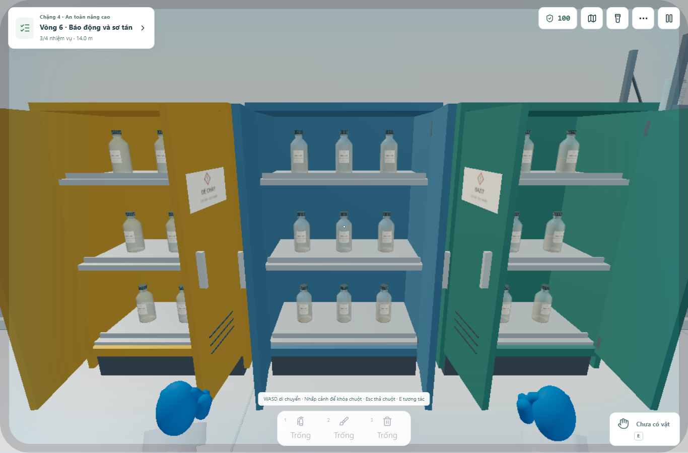

# Nâng cấp độ mượt của phòng — 28/10/2026

Đợt nâng cấp theo [kế hoạch chi tiết](../SMOOTH_ROOM_PLAN.vi.md) giảm chi phí vẽ các vật lặp, giữ hình dáng và bố trí của bộ model đã hoàn thiện. Khung thực hành và chuyển động riêng từng tình huống tiếp tục được kiểm tra bằng bộ browser hiện có.

## Thay đổi đã thực hiện

- **Ghế năm chân:** năm nan chân dùng một hình học với năm biến đổi; năm đệm chân tương tự. Vẫn có đủ piston, vòng, gối đỡ, đệm và cần chỉnh. Lượt vẽ một ghế giảm **19 → 11**.
- **27 chai trong ba tủ:** mỗi tủ dùng hai nguồn model tương ứng hai màu dung dịch; bản sao giữ tên, hình học, vị trí và nhãn. Phần đục được gom bằng InstancedMesh; thành kính và dung dịch vẫn là từng mesh riêng để Three sắp thứ tự trong suốt. Một tủ trong studio giảm **126 → 83** lượt vẽ.
- **16 cốc trên giá:** dùng chung ba geometry và hai texture nhãn/vạch chia. Giữ đủ 16 cốc và phần kính riêng; giá vẫn có 114 lượt vẽ trong studio. Đây là giảm tài nguyên lặp, không giảm hình học kính.
- **Ống bình chữa cháy:** giữ một geometry và các buffer position/normal/index/UV. Chỉ cập nhật đỉnh/pháp tuyến khi hai đầu thay đổi; khi đứng yên với reduced motion, bỏ qua lần upload thừa. Vẫn dùng 16 đoạn dọc, 6 cạnh vòng và đúng hai đầu nối.
- **Độ phân giải:** Canvas và bộ thích nghi dùng chung bảng DPR. Khắc phục trường hợp cùng mức Low nhưng khởi tạo ở DPR 1 hoặc 0,85 tùy thứ tự cập nhật. Các mức Potato/Low/Medium/High được đổi qua lại trong browser để kiểm tra.
- **Công cụ rà model:** bộ đếm tam giác tính đủ số instance, bỏ các mesh đục chỉ còn dùng làm bản sao tên/bounds. Probe DEV có thêm thông tin tài nguyên và bộ đếm frame render thật.

## Kết quả đo cùng điều kiện

Chrome headless trên máy phát triển; viewport 1366 × 900, device scale 1, chất lượng Low, **DPR 0,85 ở cả hai bản**, reduced motion bật, không CPU throttle. Mỗi góc lấy mẫu 5 giây sau khi camera ổn định. Hai bản dùng cùng pose, trạng thái cửa và bài đang chơi. Baseline được chạy lại bằng ba đường xử lý cũ cho ghế, kệ và ống, rồi khôi phục source nâng cấp.

| Góc đo | Lượt vẽ trước | Sau | Giảm |
| --- | ---: | ---: | ---: |
| Giữa phòng | 975 | 895 | 8,2% |
| Ba tủ đóng | 478 | 352 | 26,4% |
| Ba tủ mở | 478 | 352 | 26,4% |
| Giá thủy tinh | 329 | 291 | 11,6% |
| Khu ghế/bàn | 425 | 393 | 7,5% |
| Cầm bình chữa cháy | 989 | 909 | 8,1% |

Sau khi đi hết sáu góc để nạp cùng vùng tài nguyên, renderer báo **2.261 → 1.878 geometry**, **182 → 131 texture**. Đây là số lượng tài nguyên, không phải dung lượng VRAM. Tên, vị trí và bounds của **87 model** được theo dõi trùng nhau trong cả sáu góc, sai số dưới 0,01 mm.

Bộ lập lịch Low giới hạn cảnh ở khoảng **40 khung hình 3D/giây**; cả hai bản đạt mức này. Vì vậy kết quả chứng minh giảm lượt vẽ và tài nguyên lặp, chưa chứng minh tăng FPS trên điện thoại. Nhịp requestAnimationFrame của trình duyệt được ghi riêng; không dùng nhịp màn hình làm FPS của game.

- [Dữ liệu trước](before.json), [dữ liệu sau](after.json).
- [Ảnh trước khi mở tủ](before-cabinets-open.png), [ảnh sau](after-cabinets-open.png).
- [Ảnh toàn phòng sau nâng cấp](after-room.png), [giá cốc](after-glass-rack.png), [cầm bình](after-held-hose.png).



## Kiểm chứng

| Bộ kiểm tra chạy lại | Kết quả |
| --- | --- |
| [Room upgrade](browser-checks.json) | 43 kiểm tra: tài nguyên chia sẻ, mở tủ bằng bài thực hành, DPR, ống, đổi dụng cụ, tháo/lắp nguồn model và đối chiếu sáu góc |
| Sáu model thay đổi, bốn góc/model | 37 kiểm tra; cập nhật 24 ảnh và snapshot trong [báo cáo thư viện](../asset-studies/all-assets-browser-checks.json) |
| [Tích hợp thiết bị và 15 tình huống](../asset-studies/integration-checks.json) | 46 kiểm tra |
| [Bàn, ghế, ngăn kéo, tủ hút, lửa](../asset-studies/fixture-integration-checks.json) | 24 kiểm tra |
| [Vật cầm và chữa cháy thật](../asset-studies/held-integration-checks.json) | 16 kiểm tra |
| [Khung thực hành, tủ/kệ, chuyển động, mobile](../visual-gameplay/model-browser-checks.json) | 69 kiểm tra |
| [Hình học ống](hose-geometry-checks.json) | 1.428 tọa độ đối chiếu TubeGeometry, 1.785 tọa độ hữu hạn, 595 pháp tuyến, 10 điểm nối và 1.000 lần dùng lại buffer |
| TypeScript, production build, academy core, practical core | Đạt; practical xác minh 76 workflow, 397 bước và 15 tình huống |

Tổng cộng **235 kiểm tra browser được chạy lại trong đợt này**, không có exception runtime. Bốn chu kỳ tháo/lắp nguồn chai trở về 0 geometry và cùng mức texture nền của renderer thông thường. Một texture nội bộ tồn tại sau khi đã render vật liệu physical ở cả model gốc lẫn bản chia sẻ; nó không tăng qua các chu kỳ.

Production build còn cảnh báo chunk lớn hơn 500 kB và chunk postfx trống đã có trước đợt này. Chưa có phép đo trên điện thoại vật lý hoặc khẳng định tốc độ Ultra; model giáo viên GLB và phần kính vẫn cần ngân sách riêng khi nghiên cứu tiếp.

## Chạy lại

Với Vite cổng 3000 và Chrome CDP cổng 9222 đang chạy, chạy từng bộ browser tuần tự:

```powershell
node scripts/profile-room-upgrade.mjs after
node scripts/test-mutable-hose.mjs
node scripts/test-room-upgrade-browser.mjs
node scripts/test-held-assets-browser.mjs
node scripts/test-visual-models-browser.mjs
```

`profile-room-upgrade.mjs after` đo source hiện tại; `before.json` lưu baseline của đợt nâng cấp này. Không chạy nhiều bộ browser cùng lúc vì tab nền bị giảm nhịp và dùng chung save.
