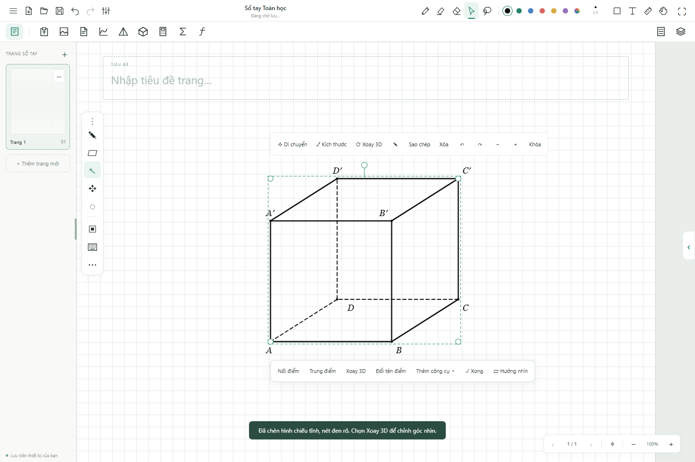

# Inkulator 1.7 · 07/11/2026

## Phạm vi

Khung điều chỉnh sát hình chiếu 3D; thanh công cụ gần hình; bỏ Bước giảng và cơ chế che phép dựng theo currentStep. Tệp cũ vẫn mở được và hiện toàn bộ hình.

Chín phép dựng mới: giao đường–mặt (5 điểm), giao hai mặt (6), chiếu lên mặt (4), khoảng cách điểm–mặt (4), góc đường–mặt (5), góc hai mặt (6), vuông góc chung (4), điểm chia cạnh (2 + tỉ lệ) và tiếp tuyến (tâm + điểm trên tròn + điểm ngoài/trên tròn). Giao tuyến hiện đỏ; các mặt tham chiếu được tô nhẹ. Góc không gian là góc nhỏ giữa đường/mặt hoặc hai mặt, nằm trong 0–90°.

Giao tuyến được biểu diễn bằng một đoạn đủ dài quanh khối, không phải cắt chính xác theo đa giác mặt. Vuông góc chung chỉ áp dụng cho hai đường chéo nhau; báo lỗi với hai đường song song hoặc cắt nhau. Điểm chia cạnh nằm trong cạnh, tỉ lệ 0 < AM/AB < 1. Tiếp tuyến áp dụng cho đường tròn 2D; điểm nằm trong đường tròn bị từ chối.

## Nguồn tham khảo

- [Mathvera, hướng dẫn chính chủ](https://mathvera.com/vi/huong-dan/), mục hình phẳng và hình không gian: chọn điểm theo thứ tự, dựng giao tuyến/hình chiếu/góc/khoảng cách, đổi tên trực tiếp. Tham khảo ý tưởng thao tác; không sao chép mã hoặc tài nguyên.
- [GeoGebra, tài liệu dạy hình không gian của SL Hui](https://www.geogebra.org/resource/n3unZ5Vg/p9TqufE9Fekx1eG1/material-n3unZ5Vg.pdf): chóp đáy tứ giác, trung điểm, thiết diện, gọi tên đỉnh.
- [Cổng Chính phủ, đề minh họa Toán từ 2025](https://xaydungchinhsach.chinhphu.vn/de-thi-minh-hoa-mon-toan-tot-nghiep-thpt-tu-nam-2025-119231229180528163.htm): tham khảo cách trình bày bài toán phổ thông.

Giữ quy ước hình biểu diễn: cạnh đáy chính nằm ngang, chiều sâu xiên, cạnh đứng thẳng khi dùng mẫu bài tập; ký hiệu S.ABC, S.ABCD, ABC.A′B′C′ và ABCD.A′B′C′D′ đi cùng mẫu. Quan hệ/độ dài tính từ tọa độ 3D, không đo trên hình biểu diễn.

## Kiểm tra

- `npm test`: 22 toán/dữ liệu + 26 dựng hình + 12 nét khuất.
- `npm run test:geometry-pen`: Chrome/Edge bằng sự kiện pen qua CDP; WebKit bằng thao tác con trỏ; kiểm tra góc đối diện giữ nguyên khi resize, khung thực nhỏ hơn vùng chứa, 8 phép dựng liên tiếp có đỉnh chung, đổi tên, góc nhìn, tiếp tuyến từ điểm phụ, lưu/mở và bố cục 834 × 1112. Tổng cộng 15 nhóm kiểm tra trên ba engine.
- `npm run test:pen`: 34 kiểm tra Chrome/Edge.
- `npm run test:notebook`: 22 kiểm tra Chrome/Edge.

WebKit dùng binary build 2370 có sẵn qua INKULATOR_WEBKIT_EXECUTABLE; không phải kiểm tra Apple Pencil trên iPad thật. Hình minh chứng được tạo trong test-results. Kiểm tra desktop dùng hồ sơ riêng để giữ nguyên dữ liệu đang sử dụng.

- `npm run test:studio`: 32 kiểm tra Chrome/Edge, gồm PDF và xuất tài liệu.
- `node tests/desktop-tests.cjs <đường dẫn EXE>`: 5 kiểm tra trên bản đóng gói và lặp lại trên chính EXE sau khi cài.
- `node tests/package-smoke.cjs`: bản ZIP mở ngoại tuyến Chrome/Edge; lưu thủ công khi storage bị chặn.

Đã nâng bản cài tại `%LOCALAPPDATA%\Programs\Inkulator` lên version 1.7.0. Bộ cài `dist/desktop/Inkulator-Setup-1.7.0-x64.exe` có SHA-256 `B0878968D69278969E7E109CF23E8689CA7E5114C2201BBAF601F348CBBBFA63`. Nội dung JS/CSS trong app.asar đã đối chiếu với mã nguồn cuối cùng.

