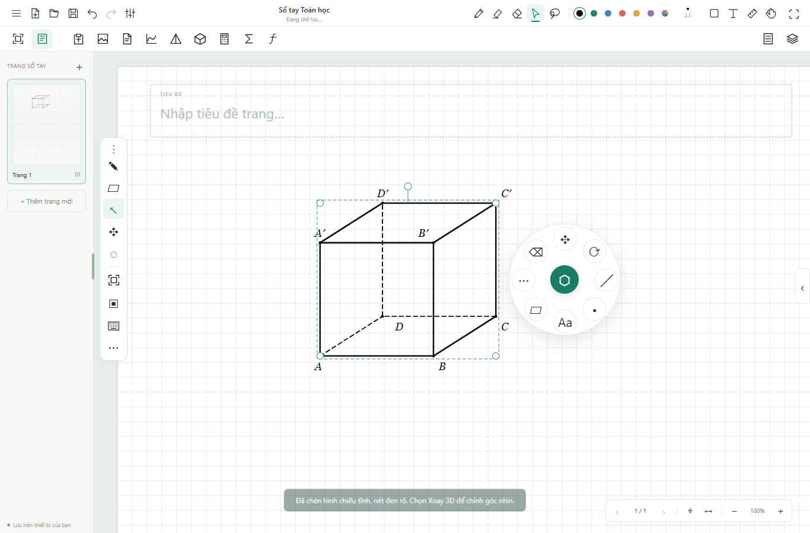

# Inkulator 1.8 · 07/11/2026

## Thay đổi

Chụp vùng ngay trên trang viết bằng hình chữ nhật kéo bằng bút, chuột hoặc ngón tay. Bản chụp gồm giấy, nét viết, hình học, ảnh và công thức trong vùng đang xem, không có khung chọn hay bảng điều khiển. Bản Windows lưu từng PNG trong `captures` thuộc hồ sơ ứng dụng và đưa vào clipboard hệ thống; bản web lưu ảnh gần nhất trong IndexedDB. Khay ảnh có nút dán lại và tải PNG. Khi clipboard không dùng được, nút Dán trong ứng dụng vẫn lấy ảnh vừa chụp. Dán tạo đối tượng ảnh chỉnh sửa được và có Undo/Redo.

Trang mặc định vừa cả trang, cân giữa vùng viết; hỗ trợ vừa chiều rộng và giữ mức zoom khi người dùng tự chỉnh. Chuyển sổ/trang, thêm trang và nhập PDF đều áp dụng chế độ vừa trang. Căn lại khi đổi kích thước vùng viết không tự thêm trang.

Hai thanh điều khiển hình học dài được thay bằng một nút tròn 52 px, mở thành vòng 188 px cạnh hình. Công cụ được nhóm Dựng hình, Đo, Ký hiệu và Chỉnh hình. Thêm truy cập nhanh phóng vừa hình, nhân bản, ẩn tên điểm/nét khuất, màu và xóa nét dựng cuối. Trung điểm, chia cạnh và đo hỗ trợ chạm trực tiếp một cạnh; dựng song song/vuông góc hỗ trợ chọn cạnh trước rồi chọn điểm.

## Kiểm tra

- `npm test`: 22 nhóm toán/dữ liệu, 26 nhóm phép dựng, 12 nhóm nét khuất.
- `npm run test:capture-layout`: Chrome, Edge, WebKit; căn trang khi mở/đổi bảng/đổi kích thước, kéo vùng ngược bằng bút ở DPR 2, kiểm tra pixel PNG, không chụp UI, clipboard bị chặn, Undo/Redo, hủy chụp, lưu qua reload, thao tác vòng tròn, nhân bản, ẩn tên và màn hình 834 × 1112.
- `npm run test:geometry-pen`: Chrome, Edge, WebKit; khung sát hình, kéo góc, dựng hình không gian với đỉnh chung, đặt tên, hướng nhìn, tiếp tuyến từ điểm phụ, lưu/mở và giới hạn màn hình.
- `npm run test:pen`: 34 kiểm tra Chrome/Edge, gồm clipboard, bàn phím bút, kéo/đổi kích thước và chuyển xoay/di chuyển.
- `npm run test:notebook`: 22 kiểm tra Chrome/Edge.
- `npm run test:studio`: 32 kiểm tra Chrome/Edge.
- `npm run test:browser`: 34 kiểm tra Chrome/Edge.
- `npm run test:pdf`: 24 kiểm tra Chrome/Edge, gồm 34 trang PDF, zoom 400%, ảnh quét lớn và lưu/mở.
- `npm run test:performance`: Chrome/WebKit, giả lập bố cục iPad; chống chạm lòng bàn tay, 400 Undo/Redo, autosave chờ nhấc bút và giới hạn mật độ canvas. Với 1.200 nét/76.800 điểm, Chrome bị giới hạn CPU 4× có trung vị dựng hình 10,7 ms, P95 19,3 ms; WebKit trung vị 3 ms, P95 145 ms. Đây là phép đo trong môi trường kiểm thử, không phải cam kết độ trễ phần cứng.
- `node tests/desktop-tests.cjs <EXE>`: renderer cô lập, nhấp đúp không bật chỉnh sửa khi viết, chụp PNG vào ổ đĩa/clipboard Windows, dán ảnh, Casio ngoại tuyến, lưu qua lần khởi động lại và chặn mạng ngoài. Dùng hồ sơ kiểm thử riêng.

WebKit dùng binary có sẵn qua `INKULATOR_WEBKIT_EXECUTABLE`; đây là kiểm tra tương thích engine và bố cục iPad, chưa phải đo Apple Pencil trên iPad thật.

Bản đóng gói và EXE sau khi cài đều đạt 6 nhóm kiểm tra desktop ở trên. Bản ZIP đạt smoke test ngoại tuyến trên Chrome/Edge và lưu thủ công khi storage bị chặn. Đã đối chiếu 37 tệp runtime trong `app.asar` với mã nguồn; `app.asar` sau cài khớp bản đã kiểm tra.

Đã nâng ứng dụng tại `%LOCALAPPDATA%\Programs\Inkulator` lên 1.8.0. Bộ cài `dist/desktop/Inkulator-Setup-1.8.0-x64.exe` có SHA-256 `F8BD58371008409489A66CB8AE905EEBBFDA6F2AC3039642347185AEA3CBBEED`.

