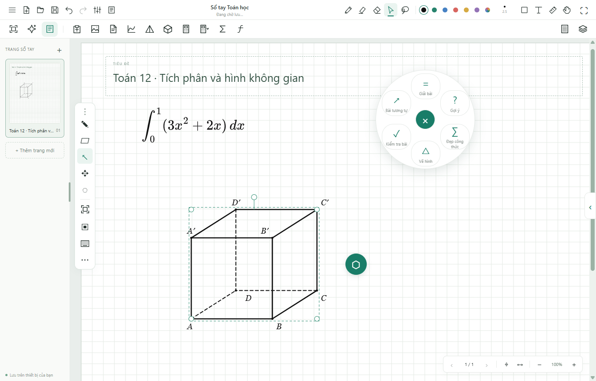

# Inkulator 1.9.1 · 07/11/2026

## Tài liệu và máy tính

Bản Windows lưu mỗi sổ tay thành tệp tự chứa trong Documents / Inkulator / Tai lieu; giữ 10 phiên bản khôi phục, ghi tệp tạm và đồng bộ trước khi đóng cửa sổ. Ctrl+S lưu ngay; Ctrl+Shift+S chọn đường dẫn mới. Tài liệu chứa PDF gốc và ảnh; bộ nhớ trình duyệt là bản đệm. Xóa thư viện trình duyệt không xóa các tệp tài liệu. Tệp mở từ ngoài phải qua bộ kiểm tra cấu trúc trước khi được gắn đường dẫn tự lưu.

Bản 1.9.1 xử lý hồ sơ Windows chuyển hướng báo EXDEV khi đổi tên hai tệp cùng thư mục: dùng bản sao có flush khi rename không được hỗ trợ. Danh mục có bản dự phòng; nếu cả hai bản hỏng, ứng dụng dựng lại danh sách từ các tệp trong thư mục tài liệu. Đường ghi bình thường vẫn dùng rename. Đã bổ sung chạy kiểm tra với hồ sơ tạm trên ổ C, ngoài hồ sơ D của workspace.

Bộ chọn máy tính có bản web 580 và hai chương trình Windows tại các thư mục đã cung cấp. Nút Mở máy mở hoặc đưa cửa sổ gốc ra trước; Chèn ảnh máy lấy PNG cửa sổ máy tính để đưa vào trang. Có chọn lại vị trí EXE. Hai bộ giả lập không nằm trong bộ cài Inkulator; cần giữ EXE/DLL đi cùng tại vị trí đã chọn. Đã mở và chụp được cả 580 lẫn 880 qua cầu nối của ứng dụng trên máy này.

Vòng công cụ hình học tính khoảng trống quanh hình, chừa thêm 62 px cho tên đỉnh/tay nắm và tránh thanh bút. Nút trung tâm kéo được. Khi hình gần lấp màn hình, người dùng có thể tự dời nút tới vị trí thuận tay.

## Trợ lý Gemini

Model cố định `gemini-3.5-flash-lite`. Chọn vùng trên trang rồi chọn Giải bài, Gợi ý, Đẹp công thức, Vẽ hình, Kiểm tra bài hoặc Bài tương tự. Prompt hướng tới giáo viên Toán lớp 12. Ảnh vùng chọn gửi tới Google; không gửi cả thư viện. Yêu cầu thủ công chỉ gửi sau khi chọn tác vụ. Nhận diện viết tay tự động mặc định tắt; bật trong Cài đặt thì nhóm nét sau 2,6 giây dừng bút được gửi để nhận diện.

LaTeX có bản xem trước và ô sửa. Thay nét cần bấm nút riêng; Undo khôi phục nét gốc. Nét đã bị đổi/xóa trong thời gian nhận diện sẽ không bị thay bằng kết quả cũ. Không cam kết nhận diện đúng 100%. Kết quả toán và mẫu hình cần giáo viên kiểm tra; hình là mô hình chỉnh sửa được, không phải ảnh sinh bằng AI. Lời giải dài tự chia trang, Undo một lần hoàn tác toàn bộ lần chèn.

Khóa Windows được mã hóa bằng API bất đồng bộ `safeStorage`; chỉ main process đọc khóa và gọi Google, renderer vẫn chặn mọi yêu cầu mạng trực tiếp. Bản web/iPad dùng khóa trong bộ nhớ phiên và gọi API trực tiếp; tải lại trang xóa khóa. Khóa không xuất trong tài liệu, mã nguồn hoặc bộ cài. Ngoại tuyến không gửi; có hủy và thông báo hạn mức/thời gian chờ. Không tự đổi model, không tự thử lại gây thêm lượt gọi.

Tham khảo [model Gemini chính chủ](https://ai.google.dev/gemini-api/docs/models/gemini-3.5-flash-lite), [structured output](https://ai.google.dev/gemini-api/docs/structured-output) và [Electron safeStorage](https://www.electronjs.org/docs/latest/api/safe-storage).

## Kiểm tra

- `npm test`: 60 nhóm toán/dữ liệu/phép dựng/nét khuất.
- `npm run test:teaching`: giao thức Gemini, tệp thật trên ổ đĩa, 10 bản khôi phục, Save As, mở lại tệp sửa từ ngoài, phục hồi khi mất cache, cache đầy, PDF nhúng, khóa mã hóa, offline, menu AI, kết quả LaTeX, hình 3D có thể sửa, phân trang, Undo và đồng bộ khi đóng.
- `npm run test:teaching-browser`: Chrome/Edge/WebKit, khung iPad 834 × 1112; viết tay mặc định tắt, gom nét sau khi dừng bút, xem trước/thay/Undo, khoanh vùng thực, sáu tác vụ, sửa LaTeX, hủy, ngoại tuyến và khóa biến mất khi reload. Dùng phản hồi Gemini giả lập để kiểm tra có thể lặp lại.
- Hai yêu cầu thật tới Gemini bằng ảnh bài thử: giải `x² − 5x + 6 = 0`; nhận diện đề khối lập phương rồi chèn mô hình khối hợp lệ. Không dùng tài liệu riêng của người dùng để gọi API thử.
- `INKULATOR_NATIVE_TEST=1 node tests/teaching-desktop-tests.cjs`: thêm kiểm tra mở/đưa ra trước/chụp hai máy Windows thật.
- `npm run test:geometry-pen`: Chrome/Edge/WebKit, thao tác hình học bằng bút và giới hạn màn hình.
- `npm run test:capture-layout`: Chrome/Edge, chụp–dán, căn trang, nhóm công cụ.
- `npm run test:performance`: Chrome/WebKit, 1.200 nét/76.800 điểm, chống chạm lòng bàn tay và 400 Undo/Redo; bố cục iPad. Đây không phải đo Apple Pencil trên phần cứng iPad thật.
- `node tests/desktop-tests.cjs`: renderer cô lập, nhấp đúp khi viết, chụp/lưu/dán, Casio web, khởi động lại và chặn mạng ngoài trong renderer.

Đã đối chiếu 50 tệp runtime/tài liệu trong `app.asar` với mã nguồn. Bản 1.9.1 đóng gói đạt bộ kiểm tra lưu tài liệu và chụp ảnh với hồ sơ tạm trên ổ C, gồm khôi phục danh mục hỏng từ `.bak`. Trên hồ sơ Windows đang dùng, đã xác nhận mọi sổ đang mở có tệp trên ổ đĩa, nhận diện tự động vẫn tắt và khóa Gemini đã mã hóa.

Máy này đặt Documents tại `D:\`; tài liệu hiện nằm trong `D:\Inkulator\Tai lieu`. Đã cài và mở bản 1.9.1 tại `%LOCALAPPDATA%\Programs\Inkulator`. Bộ cài `dist/desktop/Inkulator-Setup-1.9.1-x64.exe` có SHA-256 `D05B5F6B3C7265E851F44DC9DFC8CAE1837D7C5B219ACB40D19404CF12A7A8FE`.

