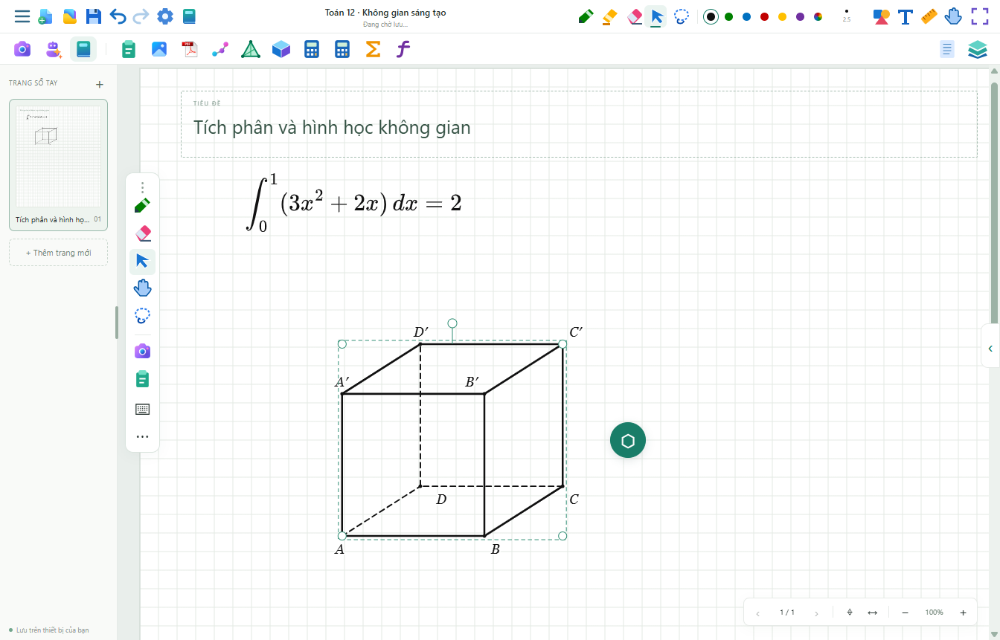
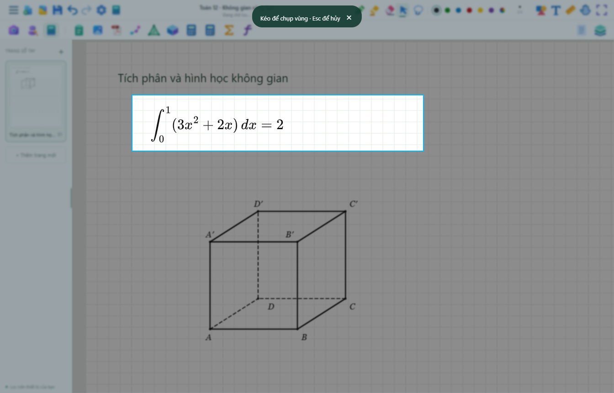

# Inkulator 2.0.1 · 07/11/2026

## Lưu tài liệu

Thay bản JSON chứa base64 bằng gói thư mục: Images/PDF là byte gốc; Pages là cấu trúc nét/hình nén; book.ink và book.recovery.ink là manifest nén có SHA-256, luân phiên hai bản. Đường lưu không cần đổi tên tệp nên không còn phụ thuộc rename trong hồ sơ Windows chuyển hướng. Tài nguyên có tên băm và chỉ ghi khi chưa có; lịch sử dùng chung ảnh/PDF, giữ 10 lần sửa nội dung. PNG trang trong Previews không bị nhân bản trong mỗi lần autosave/lịch sử. Sổ vẫn chỉnh sửa được; không làm phẳng toàn bộ thành ảnh.

Thư mục theo nhóm/tên sổ, đổi vị trí trong Cài đặt. Khi chuyển nơi lưu, bản cũ được giữ. Lưu thành tạo bản gói tại thư mục được chọn; snapshot là ZIP `.ink` để chuyển máy. Nhập ZIP kiểm tra số lượng/kích thước và chặn đường dẫn ra ngoài gói. JSON cũ vẫn mở được; sau khi lưu sẽ có gói mới, bản cũ giữ lại.

Bản Windows chỉ giữ tùy chọn thiết bị nhỏ trong localStorage; tài liệu lấy từ thư viện ổ đĩa. Khi chuyển đổi, so thời gian sửa để giữ bản mới hơn, nén sao lưu bộ đệm cũ vào LegacyCache rồi mới bỏ bản JSON khỏi trình duyệt. Hết quota trình duyệt không chặn lưu tệp. Hai manifest hỏng có thể đọc phiên bản History hợp lệ gần nhất.

## Máy tính, giao diện và chụp

Bộ cài chứa các EXE/DLL gốc từ hai thư mục người dùng cung cấp; BUNDLED.json ghi tên/kích thước/SHA-256. Cài sẵn trong resources/emulators/580 và 880, có lối tắt Start Menu và bộ chọn trong app. Bản chạy dùng thư mục cài của chính nó, không dựa vào D:/Apps. Đây là phân phối nhị phân gốc, không có mã nguồn Casio để nhúng/biên dịch. Giấy phép/kích hoạt của giả lập gốc vẫn do chương trình đó xử lý.

Chụp phủ mờ/tối toàn cửa sổ và hiện rõ vùng đang kéo. PDF được raster riêng cho bản chụp; không thay kích thước hoặc xóa canvas cache của vùng đang viết. Con trỏ Chọn kéo khung chữ nhật; lasso vẫn là công cụ riêng. Icon màu có ghi nguồn/giấy phép, palette mực dùng các màu đậm tiêu chuẩn.

## Gemini và OCR

Gemini có khóa mặc định trong tài nguyên cài đặt, không yêu cầu nhập mới; vẫn hỗ trợ khóa riêng và dùng DPAPI cho khóa đang dùng. Khóa đi cùng chương trình có thể trích xuất, không phải bí mật tuyệt đối. Renderer tiếp tục chặn mạng bên ngoài; yêu cầu Gemini đi qua main process có giới hạn thời gian, hủy, trạng thái lỗi và kiểm tra JSON/kiểu hình trước khi chèn.

OCR là [CoMER/ink-on](https://github.com/kimseungdae/ink-on), pin nguồn và model ở UPSTREAM.json; Apache-2.0. ONNX Runtime Web 1.24.2, MIT. Encoder/decoder INT8 khoảng 7,2 MB, 113 token ký hiệu; chạy CPU trong Worker. Runtime/model nén được nhúng vào script cục bộ, giải nén bằng fflate trong Worker để hoạt động trên file:// và WebKit; không CDN, không Python, không gọi Gemini. Adapter ONNX dùng WASM-JS nhúng thay vì tải module từ mạng. Nguồn upstream và giấy phép được giữ trong vendor/ink-on.

OCR mặc định tắt, có xem trước và sửa LaTeX trước khi thay nét. Kết quả mang tính thống kê, còn nhầm ký hiệu/cỡ chữ/biểu thức nhiều dòng; không tuyên bố có cơ sở dữ liệu nhận diện tuyệt đối hoặc tự huấn luyện toàn bộ toán học. Tích phân, phân số, số mũ, căn, giới hạn và các ký hiệu nằm trong từ vựng model; khả năng đọc cụ thể vẫn phụ thuộc nét viết.

Icon nguồn [Microsoft Fluent](https://github.com/microsoft/fluentui-system-icons) và [vscode-icons PDF](https://github.com/vscode-icons/vscode-icons), MIT, cùng SVG riêng. Giấy phép ở assets/color-icons.

## Kiểm tra

- `npm test`: 60 nhóm toán/dữ liệu/phép dựng/nét khuất.
- `node tests/library-v2-tests.cjs`: C-profile; file ảnh/PDF gốc chính xác, PNG xem trước, gói nét nén, dedup, rename/nhóm, thay nơi lưu, ZIP export/import, giữ ID và đóng/mở lại. Giả lập fs.rename luôn ném EXDEV trong main process; thêm kiểm tra bộ đệm cũ/mới, quota trình duyệt và khôi phục History khi hai manifest hỏng.
- `node tests/capture-pdf-v2-tests.cjs`: Chrome/Edge DPR 2; kiểm tra pixel PDF trong PNG, PDF còn hiện sau khi chụp, overlay toàn cửa sổ, vùng sáng, chọn chữ nhật và icon/màu mới.
- `node tests/offline-ocr-browser-tests.cjs`: Chrome/Edge/WebKit; model thật đọc nét thử dạng X + 1, xem trước tự động; kiểm tra không có HTTP/API khi tắt mạng. Thời gian đo trong môi trường kiểm thử khoảng vài trăm ms, không phải cam kết độ trễ mọi iPad.
- `node tests/desktop-v2-tests.cjs <EXE>`: mặc định API sẵn sàng, renderer sandbox, OCR thực trong ứng dụng và hai máy tính từ bản đóng gói.
- Gemini thật đã đọc và giải ảnh khoanh từ PDF thử `x² − 5x + 6 = 0`, không dùng tài liệu riêng của người dùng để gọi API thử.
- `npm run test:performance`: Chrome/WebKit, 1.200 nét/76.800 điểm, 400 Undo/Redo, autosave chờ nhấc bút; chưa đo Apple Pencil trên iPad vật lý.

## Dựng lại

`node scripts/prepare-calculators.cjs` sao chép hai bộ gốc đã cung cấp vào .local/emulators. Tài nguyên khóa mặc định là .local/runtime-key (base64), bị loại khỏi Git. `node scripts/build-runtime.cjs` dựng ZIP codec và worker/model OCR độc lập. `npm run desktop:build` kiểm tra hash bộ máy tính/tài nguyên rồi đóng gói NSIS. Bộ cài có cả hai bộ máy tính và OCR; repo nguồn giữ manifest và script chuẩn bị các tài nguyên máy tính cục bộ.

## Bản cài đã kiểm tra

Đã dựng, cài và mở bản 2.0.1 trên máy hiện tại. Thư viện đang dùng ở D:\Inkulator giữ đủ 58 trang / 220 đối tượng khi chuyển đổi và đọc lại từ gói mới. Kiểm thử thư viện và desktop v2 cũng chạy trên EXE đóng gói; OCR thật, hai giả lập gốc, sandbox và khóa mặc định đều qua. Tệp cài cùng phiên bản đã kiểm tra có SHA-256 `61d1bcc996d8ac3bf8f104678d5d6beebc53a58ff2acd8924ddc23489c5f91f6`.
