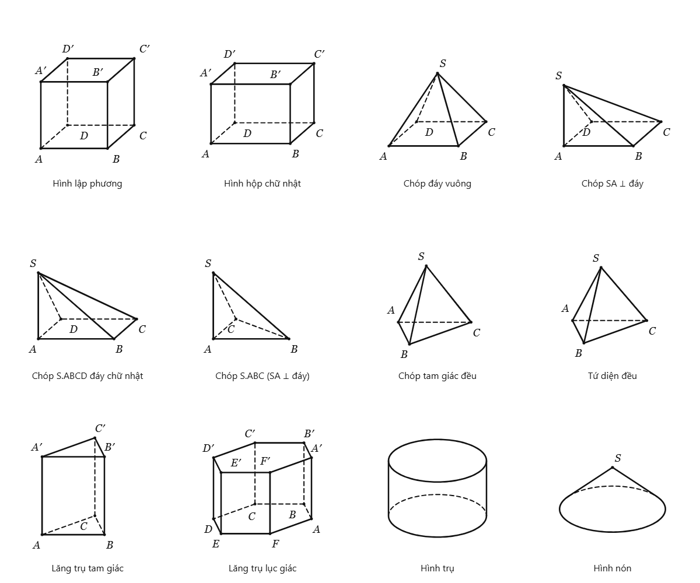

# Inkulator 2.1.0 · 09/11/2026

## Dùng nhanh

- **Máy tính & công thức:** một icon máy tính duy nhất trên thanh công cụ. Casio fx-580VN X và 880BTG Windows đứng đầu bộ chọn. Bản Casio web, máy tính khoa học, soạn công thức và công cụ toán ở ngay bên dưới; không cần mở nhiều icon giống nhau. Máy Windows chỉ khởi chạy khi chọn Mở máy, tái sử dụng cửa sổ đang chạy.
- **Chụp câu hỏi** trên thanh trên: kéo vùng đề trong tài liệu đang hiển thị → mở một trang giảng bài giấy trắng có sẵn ảnh đề. Viết, vẽ, chèn hình hoặc lời giải như trang thường. Nút **×** quay về vùng đề gốc; nút **↗ Câu hỏi** ở gần vùng đó mở lại toàn bộ phần đã giảng. Trang câu hỏi và các trang tiếp theo được lưu cùng sổ, hỗ trợ Undo, snapshot và mở lại sau khi đóng ứng dụng. Các trang tiếp theo thuộc cùng câu hỏi và không chen vào luồng tài liệu gốc. Khi xóa trang gốc, phần giảng được giữ lại thành các trang thường.
- **Chụp vùng trên thanh bút** tiếp tục lưu PNG vào khay/clipboard để dán nhiều lần. Khay chỉ còn ảnh thu nhỏ và nút tải, đã bỏ chữ “Dán ảnh chụp”. Chụp nội dung trong vùng viết của Inkulator, gồm PDF nhập vào, ảnh, nét và hình; không chụp cửa sổ ứng dụng khác.
- **Trang mới mặc định giấy trắng**, kể cả trang tự nối khi viết. Giữ kiểu giấy đã chọn trên các trang cũ. Thêm trang chèn ngay sau trang đang đứng; chuột phải trên trang hoặc thumbnail có thêm/xóa trang. Xóa trang khác giữ đúng trang đang đọc; xóa có Undo.
- **Menu tài liệu:** chia bốn nhóm Tài liệu / Xuất–In / Chèn / Thao tác, có ô tìm nhanh; tên thao tác mở/lưu dùng đúng định dạng hiện tại.

## Đồ thị và hình học

- Đồ thị mặc định không lưới và không khung ngoài; trục đen đậm có mũi tên, tên x/y và gốc O. Có thể chủ động bật lưới/nền trắng, chỉnh độ đậm trục, giới hạn x/y và đơn vị bằng nhau trên hai trục.
- Có mẫu parabol, bậc ba, phân thức, lượng giác, mũ, logarit, đường tròn và elip. Thêm đồ thị đạo hàm, tính/tô diện tích giữa hai hàm; tiếp tục có nghiệm, cực trị, giao điểm, tiếp tuyến, tích phân và bảng giá trị. Các phép khảo sát số là kết quả gần đúng; hàm gián đoạn cần kiểm tra miền xác định.
- **Thước:** di chuyển bằng nút ✥, nhập góc xoay, đổi chiều dài; chọn thước thẳng, ê ke 45°, ê ke 30°/60° hoặc thước đo góc. Lăn chuột xoay 1°, Shift+lăn xoay 15°. Nét bút bắt theo cạnh trên nếu bắt đầu sát cạnh; nút ╱ kẻ cạnh thành nét thật có Undo. Thước là dụng cụ hướng dẫn/đo trên màn hình, không phải đối tượng in ra.
- Chóp mặc định có chiều cao cân đối hơn; đáy vẫn là hình bình hành trong hình chiếu xiên, cạnh khuất nét đứt. Thuộc tính hình có **Góc xoay** và **Vị trí tên đỉnh**; chỉnh xoay đáy, độ nghiêng, xoay nhanh ±15°, trả về góc bài tập, chọn từng nhãn và chuyển sang tám hướng hoặc tự tránh cạnh. Vòng công cụ → Chỉnh hình cũng có các thao tác này. Nhãn và góc nhìn lưu trong sổ.

## AI

- Cho chọn **Gemini 3.8 Flash**, **Gemini 3.6 Flash**, **Gemini 3.5 Flash Lite** và **Gemini 3.1 Flash Lite** trong Cài đặt hoặc ngay bảng giải toán. Mặc định **gemini-3.5-flash-lite**; lựa chọn được lưu trên thiết bị, dùng đúng endpoint cho cả kiểm tra kết nối và giải bài. Không tự đổi sang model khác khi API từ chối quyền/hạn mức.
- Hướng dẫn giải bổ sung đọc lại giả thiết, điều kiện, suy luận từng bước, xét trường hợp/nghiệm ngoại lai và thế ngược đáp số.
- AI được tự chọn tham số mô hình và dựng thêm cạnh, trung điểm, điểm chia cạnh, đường song song/vuông góc, giao điểm, chân chiếu, trọng tâm, thiết diện, góc vuông và số đo bằng dữ liệu hình học. Điểm phụ phụ thuộc đúng tọa độ, tự cập nhật khi sửa khối. Kiểm tra phép dựng, thứ tự tham chiếu và điểm suy biến trước khi cho chèn; không thực thi mã do AI tạo. Ảnh đầu vào là dữ liệu, không phải chỉ thị cho hệ thống.
- Kiểm thử bốn model dùng phản hồi API giả lập để xác minh giao thức/endpoint và lưu dữ liệu. Kiểm tra thêm API thật của **Gemini 3.5 Flash Lite** từ bản đóng gói: đề chóp đáy vuông cạnh 4, SA = 6 vuông góc đáy, M là trung điểm BC; model chọn đúng khối `s-abcd-rec` với a = b = 4, h = 6, dựng M từ B/C rồi nối S–M, không có cảnh báo hình học. Đây là kiểm tra một đề mẫu, không phải đánh giá độ chính xác mọi lời giải của từng model. Quyền dùng model/hạn mức phụ thuộc khóa Google. Kết quả AI vẫn cần được giáo viên kiểm tra.

## RAM và Windows giả lập

- Snapshot Undo dùng chung dữ liệu ảnh/preview, không nhúng lặp ảnh vào từng bước chỉnh sửa. Tính cả byte ảnh cũ khi thay ảnh để cắt lịch sử theo bộ nhớ. Kiểm thử 40 lần sửa ảnh 2 MB: **74.382 byte** JSON lịch sử; byte ảnh không thay đổi qua Undo/Redo, thay ảnh, hủy kéo và xuất sổ. Đây là số liệu lịch sử tuần tự hóa, không phải mức RAM toàn bộ ứng dụng.
- Giới hạn lịch sử thông thường khoảng 24 MB, tiết kiệm khoảng 8 MB, giữ tối thiểu bước gần nhất. Ảnh của trạng thái hiện tại được dùng chung và không tính lặp.
- Bộ đệm đồ thị tối đa khoảng 6 triệu pixel (tiết kiệm 2 triệu); bộ đệm ảnh giải mã giữ ưu tiên ảnh đang thấy, loại ảnh ngoài vùng nhìn theo ngân sách 48/16 MB và 24 mục; PDF raster giảm còn 8/4 triệu pixel, tile 24/12 MiB. Bỏ tham chiếu canvas PDF khỏi đối tượng tài liệu. Canvas chụp được giải phóng sau khi dùng.
- OCR chỉ nạp khi cần; worker và model nén được trả lại sau 90 giây không dùng, lần nhận diện tiếp theo nạp lại từ bộ cài. OCR vẫn tắt mặc định.
- Máy ảo Windows nên chọn **Cài đặt → Hiệu năng hiển thị → Máy yếu / Windows giả lập**. Nếu trình điều khiển GPU của máy ảo lỗi, mở `Inkulator.exe --software-rendering` hoặc đặt `INKULATOR_SOFTWARE_RENDERING=1` trước khi chạy. Đã kiểm tra khởi động, IPC và lưu/khởi động lại trong chế độ dựng bằng phần mềm; chưa có phép đo trên mọi trình giả lập Windows.
- Benchmark 1.200 nét / 76.800 điểm, CPU bị giảm tốc 4 lần: Chrome median 10,3 ms / P95 22,4 ms; Edge median 13,0 ms / P95 17,8 ms trên môi trường kiểm thử. Kết quả phụ thuộc máy và tài liệu.

## Kiểm tra

- `npm test`: 22 bài toán/trạng thái + 26 phép dựng + 13 kiểm tra cạnh khuất, gồm đối chiếu ray–triangle độc lập trên nhiều góc.
- `npm run test:workspace-v21`: lịch sử ảnh; Chrome/Edge kiểm tra giao diện mới, menu chuột phải, đồ thị, thước, AI hình học, nhãn/góc, trang câu hỏi và trang tiếp theo, lưu/mở lại; Electron kiểm tra bốn model qua IPC, khởi động lại thật và chế độ software rendering.
- Các bộ kiểm tra bút, dựng hình bằng bút, capture PNG/PDF, bố cục capture, Casio, studio PDF, OCR ngoại tuyến và desktop đã chạy trên Windows. Benchmark chạy Chrome/Edge qua `INKULATOR_TEST_ENGINES=chrome,msedge`; WebKit chưa cài trong môi trường này.
- Bộ cài Windows x64 đã tạo; chạy lại các bài kiểm tra IPC/model, trang câu hỏi, lưu/khởi động lại, OCR thật và hai Casio từ `win-unpacked/Inkulator.exe`. Đối chiếu byte của 16 tệp mã/giao diện cốt lõi trong `app.asar` với workspace và kiểm tra phiên bản đóng gói 2.1.0.

## Nguồn tham khảo

- [GeoGebra — Use of IT in 3D Objects/Space](https://www.geogebra.org/resource/n3unZ5Vg/p9TqufE9Fekx1eG1/material-n3unZ5Vg.pdf): biểu diễn chóp, trung điểm, thiết diện và cạnh khuất.
- [Pogorelov — Geometry, phần phép chiếu song song](https://www.dm.unibo.it/~ferri/hm/Geometry-Pogorelov.pdf): dùng hình chiếu song song và nét đứt cho cạnh không nhìn thấy. Áp dụng bằng mô hình tọa độ có thể chỉnh sửa, không dùng ảnh AI làm hình toán học.
- [Google — Gemini 3.8 Flash](https://ai.google.dev/gemini-api/docs/models/gemini-3.8-flash), [danh sách model Gemini](https://ai.google.dev/gemini-api/docs/models), [Gemini 3.5 Flash Lite](https://ai.google.dev/gemini-api/docs/models/gemini-3.5-flash-lite).
