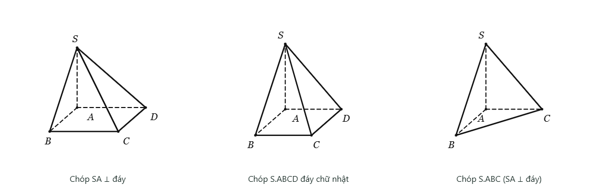
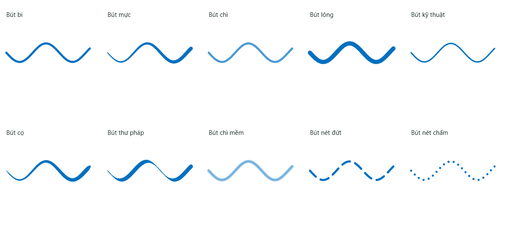

# Inkulator 2.2.0 · 09/11/2026

## Hình chóp đứng thẳng

Chóp SA vuông góc đáy mặc định đặt A ở phía trái bên trong đáy, S ngay trên A. SA thẳng đứng, cạnh đáy ngang; không xoay nghiêng cả hình. Áp dụng cho chóp đáy vuông, đáy chữ nhật và S.ABC. **Góc bài tập / Góc nhìn gốc** dùng hướng mới; hình đã được người dùng chỉnh góc vẫn giữ dữ liệu của nó.

## Capture: ảnh thường là mặc định

- Bấm icon camera → khoanh vùng → ảnh vào khay để dán ở nơi người dùng chọn. Không tạo trang và không tự dán.
- Mũi tên nhỏ cạnh camera → **Chụp và tạo trang câu hỏi** chỉ áp dụng cho lần chụp đó. Trong màn khoanh vùng cũng có thể đổi **Ảnh để dán / Tạo trang câu hỏi**. Lần bấm camera thông thường tiếp theo luôn là chụp ảnh.
- Trang câu hỏi có ảnh đề, viết/vẽ như trang thường và có nút × quay về tài liệu.
- Nút **↗ Câu…** được đặt một lần trong vùng trống phía trên vùng đã khoanh. Lưu tọa độ theo trang gốc; không tự tìm chỗ khác khi vẽ lại, không bám theo mép màn hình khi cuộn. Kéo để đổi chỗ; vị trí mới giữ sau khi lưu/khởi động lại. Chuột phải vào nút để sửa tên câu/ý.

## Nhận diện câu và ý

Ưu tiên đọc lớp chữ trong đúng vùng PDF hoặc đối tượng văn bản đã chọn. Với ảnh/scan, bản Windows dùng **Windows OCR** cục bộ để đọc nhãn, ví dụ **Câu 12 · ý a, b**. Cơ chế này tách khỏi CoMER dùng nhận diện công thức.

Nếu chưa đọc được nhãn và Gemini đã cấu hình, có mạng, ứng dụng có thể gửi riêng vùng đã chụp tới model đang chọn để đọc nhãn. Nếu vẫn chưa có kết quả, trang vẫn mở bình thường với tên tạm; có thể sửa bằng chuột phải. Tên do người dùng sửa không bị kết quả OCR đến muộn ghi đè. OCR có thể nhầm khi chữ mờ, bị cắt hoặc thiếu ngôn ngữ nhận diện của Windows.

## Xuất PDF xen trang ảo

Có icon **Xuất PDF** trên thanh trên; menu → Xuất/In cũng giữ chức năng này. Xuất A4/A3 theo trình tự:

**Trang gốc 1 → câu hỏi từ trên xuống trên trang 1, kèm các trang giải tiếp theo của từng câu → trang gốc 2 → các câu hỏi trên trang 2 → …**

Tính cả trang ảo đang đóng, mỗi trang đúng một lần. Kéo nút câu hỏi không làm đổi thứ tự xuất, vì thứ tự dựa trên vị trí vùng đề gốc. PDF gốc tiếp tục được giữ nội dung vector/chữ; phần chú thích, ảnh chụp, nét bút và các trang giảng đều được xuất. In sổ tay dùng cùng thứ tự.

## Bút và Smart Shape

- Có **10 bút** trong Thiết lập bút: bi, mực áp lực, chì, lông, kỹ thuật nét mảnh, cọ thuôn nét, thư pháp, chì mềm, nét đứt, nét chấm. Các kiểu dùng cách dựng nét khác nhau; nhớ lựa chọn và cấu hình từng bút sau khi mở lại.
- Con trỏ vùng viết dùng mũi tên mặc định của hệ điều hành. Công cụ kéo trang vẫn dùng con trỏ kéo tự nhiên.
- Bật/tắt **Smart Shape** ngay trong Thiết lập bút hoặc Cài đặt. Nhận nét thẳng nhanh kể cả chỉ có hai điểm, tròn, elip nghiêng, chữ nhật nghiêng, tam giác và tứ giác. Giữ màu/độ dày gốc và Undo/Redo.
- Bỏ điều kiện cũ phải có ít nhất 10 điểm; lấy mẫu theo chiều dài nét, kiểm tra độ khép kín, độ cong, các cạnh và góc. Chữ viết dạng răng cưa, hình tự cắt, nét quá nhỏ hoặc vẽ chồng nhiều vòng được giữ là nét bút. Giữ **Alt** khi nhấc bút để bỏ nhận dạng cho nét đó. Nhận dạng là hình học gần đúng, không bảo đảm mọi nét tay đều được hiểu đúng.

## Kiểm tra

- `npm test`: toán/trạng thái, phép dựng, cạnh khuất và nhiều góc nhìn.
- `npm run test:workspace-v22`: nhận hình và loại nét không phù hợp; Chrome/Edge kiểm tra capture thường/chọn tạo trang, OCR nhãn, neo nút/kéo/lưu/mở lại, 10 kiểu bút khác nét, bút đang chọn sau reload, con trỏ gốc, Smart Shape + Undo và hình SA thẳng đứng.
- Tạo PDF thật 6 trang với các màu riêng, đọc và render từng trang để xác minh thứ tự xen câu hỏi/trang giải. Đọc nhãn từ lớp chữ PDF có một câu khác nằm ngoài vùng chọn để kiểm tra chỉ dùng đúng vùng.
- Electron dùng Windows OCR thật đọc **Câu 12. a) Tìm x.** khi chặn toàn bộ yêu cầu mạng; kiểm tra tên, metadata OCR, vị trí nút và thứ tự xuất còn nguyên sau khi đóng/mở ứng dụng. IPC từ chối đầu vào không phải PNG.
- Chạy lại các bộ bút/clipboard, capture, dựng hình bằng bút, studio PDF, giao thức Gemini và lịch sử ảnh.
- Đã tạo bộ cài Windows x64 2.2.0; kiểm tra lại Windows OCR thật và lưu/khởi động lại từ `win-unpacked/Inkulator.exe`. Các tệp tính năng chính trong `app.asar` khớp byte với mã nguồn; script OCR được đóng gói tại đúng đường dẫn `app.asar.unpacked`.

Windows OCR dùng API [OcrEngine.RecognizeAsync của Microsoft](https://learn.microsoft.com/en-us/uwp/api/windows.media.ocr.ocrengine.recognizeasync?view=winrt-26100), được chạy theo tiến trình riêng khi cần và kết thúc sau khi đọc.
