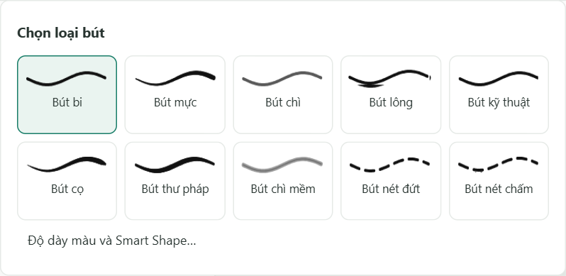
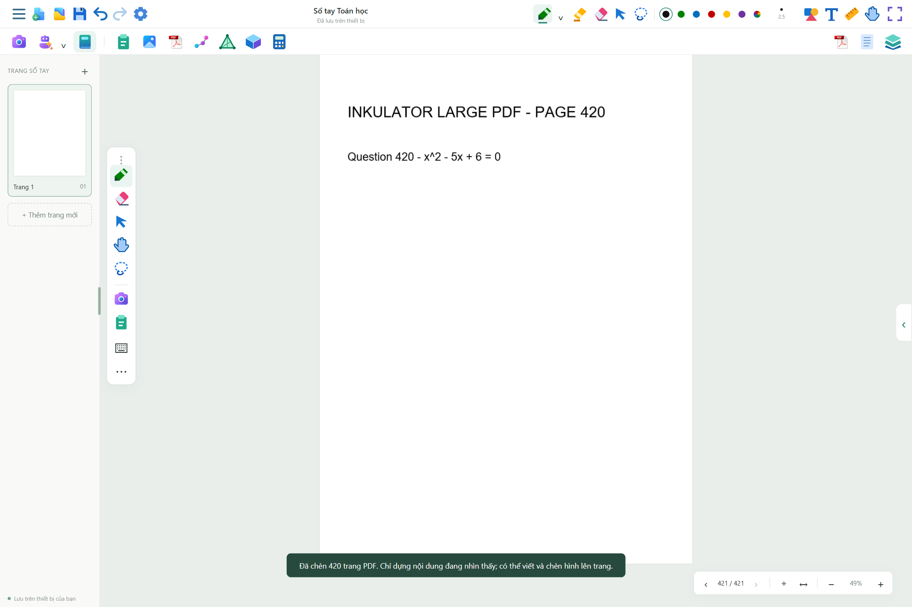

# Inkulator 2.3.0 · 09/11/2026

## Chọn loại bút

Mũi tên cạnh icon bút mở bảng gồm 10 nút có tên và nét mẫu. Bấm lại icon khi đang dùng bút cũng mở bảng này. Nút **Độ dày màu và Smart Shape…** dẫn đến phần chỉnh chi tiết. Chọn loại bút áp dụng ngay; bản Windows lưu và khôi phục đầy đủ các preset và loại đang dùng, thay cho danh sách cũ chỉ nhận bốn loại.

## PDF nhiều trang

- Nâng giới hạn sổ lên **2.000 trang**, áp dụng đồng bộ khi thêm trang, tạo trang câu hỏi, AI và lưu/mở gói Windows.
- Mỗi PDF tối đa **160 MB**; kiểm tra trước khi đọc toàn bộ tệp. Giới hạn tổng nội dung lưu vẫn là 240 MB; nhiều tài nguyên có thể đạt giới hạn này trước khi đạt số trang tối đa.
- Đọc kích thước và thông tin PDF theo nhóm 12 trang, trả quyền điều khiển cho giao diện giữa các nhóm. Chỉ dựng ảnh PDF theo vùng nhìn, không raster hóa tất cả trang khi nhập.
- Giữ các thẻ trang và ảnh thu nhỏ khi chỉ thay đổi nét hoặc trang đang chọn, giảm việc tạo lại hàng trăm phần tử.
- Dùng chung chuỗi dữ liệu PDF/ảnh bất biến khi tạo nội dung lưu, giảm sao chép chuỗi base64. Hủy tác vụ PDF khi loại tài liệu khỏi cache hoặc nhập không hoàn thành; dọn tài nguyên nhập dở.
- Bỏ thông báo nhập PDF “không giới hạn dung lượng” và hiển thị giới hạn thực khi cần.

## Hướng dẫn có hình

[Tải tài liệu Word về các phiên bản 2.1, 2.2 và 2.3](Inkulator_Changelog_Huong_dan_2.1_2.2_2.3.docx). Có changelog riêng từng bản và hướng dẫn chọn bút, Smart Shape, PDF dài, capture, OCR nhãn câu, trang giảng, xuất PDF xen trang, hình học, đồ thị, máy tính và Gemini.

## Kiểm tra

- `npm test`: 22 kiểm tra toán/trạng thái, 26 phép dựng, 13 nhóm kiểm tra cạnh khuất.
- `node tests/workspace-v22-tests.cjs`: Chrome/Edge kiểm tra capture, OCR, vị trí nút câu hỏi, bút, Smart Shape, SA thẳng đứng và thứ tự PDF thực có trang ảo.
- `node tests/library-v2-tests.cjs`: gói tài liệu, tài nguyên gốc, snapshot, khôi phục và mở lại bản Windows.
- `npm run test:workspace-v23`: bấm bộ chọn bút bằng chuột trên Chrome/Edge, nhập PDF vector mẫu **420 trang**, đến trang cuối, xác nhận chỉ một số ít trang được raster hóa, các thẻ trang không bị thay lại khi cập nhật, lưu và mở lại đủ trang.
- `node tests/workspace-v23-tests.cjs dist/desktop/win-unpacked/Inkulator.exe`: kiểm tra lại trên ứng dụng đã đóng gói; lựa chọn bút nét chấm và đủ 420 trang PDF còn nguyên sau đóng/mở thật.

Số trang đã kiểm tra là của PDF vector mẫu, không phải bảo đảm tốc độ hoặc RAM cố định với mọi PDF scan và cấu hình máy ảo.
